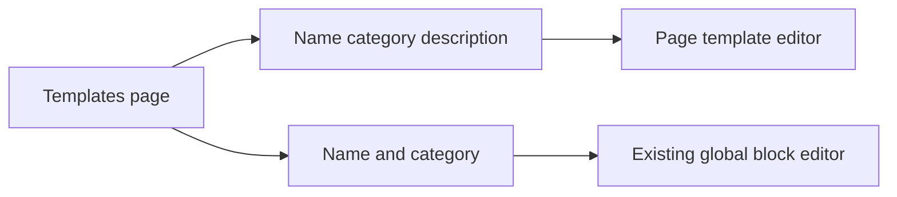

---

name: Add templates and globals
overview: The templates page can list and delete page templates and global blocks, but it has no way to create them. Add a New template and New global block flow on that page, then open an editor so the new item can be designed.
todos:
- id: template-create-edit
  content: Add New template dialog, updateTemplate action, and a page-template Puck editor with an Edit layout link for custom templates
  status: completed
- id: global-create
  content: Add New global block dialog, allow empty content on create, and open the existing global block editor
  status: completed
  isProject: false

---

# Add page templates and global blocks

`/dashboard/templates` only lists items. Page templates are created by **Save as template** inside a page builder, and global blocks by **Save as global block** on a selected section. There is no create control on [templates-and-globals.tsx](src/app/(admin)/dashboard/(shell)/templates/_components/templates-and-globals.tsx), and page templates have no editor after they are saved.

Follow the post-templates pattern: a short details dialog, then the visual editor.

## New page template

- On the Page templates tab, add **New template** when the user has `pages.create` (same gate as `saveTemplate`).
- Dialog fields: name, category (default `Custom`), description. Submit calls the existing `saveTemplate` action with `editorType: 'builder'` and `emptyBuilderData()` from [data.ts](src/builder/data.ts), then routes to the new editor.
- Add a fullscreen editor at `/dashboard/templates/[id]`, modeled on [global-block-editor.tsx](src/app/(admin)/dashboard/(fullscreen)/templates/globals/[id]/global-block-editor.tsx). Use the full page `builderConfig` (including GlobalRef). Save writes content through a new `updateTemplate` action. Back link returns to `/dashboard/templates`.
- On each custom template card, add **Edit layout**. Starter templates (`isSystem`) stay locked, matching the existing delete rule in [templates.service.ts](src/app/(admin)/dashboard/(shell)/templates/_modules/templates.service.ts).
- `updateTemplate` requires `pages.create`, rejects missing and starter templates, and revalidates the templates list.

## New global block

- On the Global blocks tab (including the empty state), add **New global block**. Anyone who can open the page already has `pages.edit`.
- Dialog fields: name and category (default `General`). Create a row with empty content `{ content: [], zones: {} }`, then open the existing editor at `/dashboard/templates/globals/[id]`.
- `saveGlobalBlock` currently throws unless there is at least one section. Allow an empty body only when creating (no `id`). The editor already refuses to save until a section is added, so published blocks stay non-empty.

## Files

- [templates-and-globals.tsx](src/app/(admin)/dashboard/(shell)/templates/_components/templates-and-globals.tsx) — buttons, dialogs, edit link
- [templates.actions.ts](src/app/(admin)/dashboard/(shell)/templates/_modules/templates.actions.ts) and [templates.service.ts](src/app/(admin)/dashboard/(shell)/templates/_modules/templates.service.ts) — `updateTemplate`; relax create-only empty global content
- [pages.ts](src/config/pages.ts) — `TEMPLATE: (id) => '/dashboard/templates/${id}'`
- New route under `src/app/(admin)/dashboard/(fullscreen)/templates/[id]/` (static `globals` segment is unaffected)
