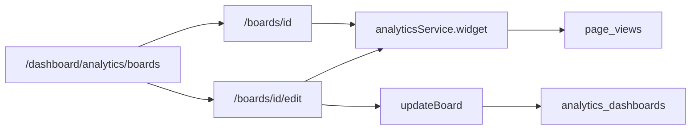

---

name: Analytics dashboard builder
overview: "Add named, shared analytics dashboards: a drag-and-drop grid of stat, chart, and table widgets, where each widget is a small query over existing page views. The fixed /dashboard/analytics trend page stays."
todos:
- id: schema
  content: Add analytics_dashboards and a zod layout schema (widget types, query, span, max 12)
  status: completed
- id: widget-query
  content: Add analyticsService.widget for stat, day series, and page/path/referrer breakdowns over the current and previous windows
  status: completed
- id: board-crud
  content: "Add board service and accessProcedure actions: create, update, delete, previewWidget"
  status: completed
- id: list-and-view
  content: Add the boards list and the server-rendered view grid, with the 7d/30d override for inherited widgets
  status: completed
- id: builder
  content: Add the dnd-kit palette, sortable 12-column canvas, inspector, live preview, save, and the traffic-overview preset
  status: completed
- id: entry
  content: Register routes and add a Dashboards link on the existing analytics trend page
  status: completed
  isProject: false

---

# Drag-and-drop analytics builder

First-party traffic already lives in `page_views` and is read by [`analyticsService.trends`](src/server/services/analytics.service.ts). [`/dashboard/analytics`](src/app/(admin)/dashboard/(shell)/analytics/page.tsx) stays the fixed trend report. This adds **named dashboards** anyone who can open the dashboard can list, open, edit, and delete.

The page builder ([`@measured/puck`](src/builder/config.tsx)) stays the tool for public page content. Dashboards use [`@dnd-kit`](src/app/(admin)/dashboard/(shell)/menus/_components/menus-manager.tsx), which already reorders admin lists, because each widget is a database query rendered only inside the dashboard shell.



## Layout document

New table `analytics_dashboards` in [`src/db/schemas/analytics.schema.ts`](src/db/schemas/analytics.schema.ts), exported from [`src/db/schema.ts`](src/db/schema.ts). Generate the migration with `pnpm db:generate`.

- `id`, `created_at`, `updated_at` from [`baseColumns`](src/db/helpers/base.columns.ts)
- `name` varchar(120)
- `created_by` text, nullable, references `users.id` on delete set null
- `layout` jsonb

`layout` is validated with zod before every write and every read (invalid widgets are dropped on read):

- `range`: `7 | 30` (board default)
- `widgets`: at most 12 items
- each widget: `id`, `type` (`stat | chart | table`), `span` (`4 | 6 | 12`), optional `title` (max 80), and `query`

`query`:

- `metric`: `views | uniqueVisitors | viewsPerVisitor`
- `dimension`: `none | day | page | path | referrer`
- `compare`: boolean
- `range`: `inherit | 7 | 30`
- `pageId`: string or null
- `limit`: `5 | 10 | 20` (categorical charts and tables)

Legal combinations, rejected by `superRefine`:

- **Stat** uses `dimension: none`. All three metrics are allowed. `viewsPerVisitor` is the ratio of views to unique visitors, computed in JS from the two counts, same as the trend page.
- **Chart** uses `day`, `page`, `path`, or `referrer`. Metrics are `views` and `uniqueVisitors`.
- **Table** uses `page`, `path`, or `referrer`. Metrics are `views` and `uniqueVisitors`.
- `compare` on a chart is a second series. On a stat or table it is the previous window and the percent change. `viewsPerVisitor` is stat-only.

A missing title is derived: "Views", "Views by day", "Unique visitors by page".

## Query

Add `analyticsService.widget(query, boardRange)` beside `trends`. Same UTC windows as `trends`: current is `created_at >= since`, previous is `created_at >= previousSince and created_at < since`. One scan with `count(*) filter (where ...)` or `count(distinct visitor_id) filter (where ...)`. Optional `pageId` is `eq(page_views.page_id, pageId)`.

Return one of:

- **stat**: `{ value, previous }` (`previous` is null when `compare` is off)
- **series**: `{ points: { label, value, previous }[] }` — one point per day, missing days filled with 0, previous day aligned by `rangeDays` the way `trends` already does
- **rows**: `{ rows: { key, label, detail, value, previous }[] }` ordered by the current metric, limited by `query.limit`. Page rows join `pages` for the title (`detail` is the path). Path rows use `path`. Referrer rows group `referrer_host` where it is not null.

`summary` and `trends` stay as they are. No new columns on `page_views`. The beacon and `POST /api/analytics/view` stay as they are.

## Screens

Register routes in [`src/config/pages.ts`](src/config/pages.ts):

- `ANALYTICS_BOARDS` = `/dashboard/analytics/boards`
- `ANALYTICS_BOARD(id)` = `/dashboard/analytics/boards/[id]`
- `ANALYTICS_BOARD_EDIT(id)` = `/dashboard/analytics/boards/[id]/edit`

Sidebar item in [`src/menus/index.tsx`](src/menus/index.tsx) stays **Analytics** → the trend page. The trend page header gets a **Dashboards** link. No new permission: [`accessProcedure`](src/server/procedures/permission.procedure.ts), same as opening the dashboard.

**List** — [`analytics/boards/page.tsx`](src/app/(admin)/dashboard/(shell)/analytics/boards/page.tsx), server component, [`PageHeader`](src/components/organisms/page-header.tsx). Each row shows name, widget count, and updated time, with Open, Edit, and Delete. Empty state is a dashed card and **New dashboard**. New dashboard asks for a name (existing dialog), inserts an empty layout (`range: 30`, `widgets: []`) via `createBoard`, and redirects to the editor.

**View** — `boards/[id]/page.tsx`, server component. Loads the board, resolves each widget (`inherit` uses `?range=7|30` when present, otherwise `layout.range`), runs `analyticsService.widget` in `Promise.all`, and renders a 12-column grid. Header has the 7d / 30d toggle (same pill as the trend page; it does not write), **Edit**, and **Delete**. An unknown id 404s. An empty board shows a dashed state and a link to the editor.

**Edit** — `boards/[id]/edit/page.tsx` loads the board and published pages (`id`, `title`) and renders the client builder. **Save** calls `updateBoard` with the name and layout. A dirty check against the last saved JSON enables the button. Delete confirms in a dialog, then returns to the list.

CRUD lives in `analytics-boards.service.ts` and `analytics/boards/_modules/boards.actions.ts` (`createBoard`, `updateBoard`, `deleteBoard`, `previewWidget`). Hard delete. `revalidatePath` for the list, the view, and the editor.

## Builder

Client component under `analytics/boards/_components/`. Stays in the dashboard shell.

```
┌─────────────────────────────────────────────────────────┐
│ Name          7d / 30d          Save          View      │
├──────────────┬──────────────────────────┬───────────────┤
│ Palette      │ 12-column canvas         │ Inspector     │
│ Stat         │                          │ metric        │
│ Chart        │                          │ dimension     │
│ Table        │                          │ compare       │
│              │                          │ range         │
│ Traffic      │                          │ page          │
│ overview     │                          │ width, remove │
└──────────────┴──────────────────────────┴───────────────┘
```

One `DndContext` (`PointerSensor` with a small distance constraint, `KeyboardSensor`, same sensors as the menu editor). Palette items are draggable sources (`palette:stat`, `palette:chart`, `palette:table`). The canvas is a `SortableContext` with `rectSortingStrategy`. Dropping a palette item inserts a widget with defaults at the hovered index, or at the end if the canvas is empty. Reordering uses `arrayMove`. A `DragOverlay` ghost follows the pointer. Clicking a palette item also appends, so the builder works without a pointer. The canvas refuses a 13th widget.

Width is the column span, set in the inspector and on the card: one third (`span` 4), half (6), or full (12). Below `md`, every card is full width.

Selecting a card opens the inspector. Dimension options follow the widget type, so an illegal query cannot be built. Page is a select of published pages plus **All pages**. Range is **Board default**, **7 days**, or **30 days**. The board default is the header 7d / 30d control and is stored on `layout.range`.

The canvas shows live data. Inspector changes call `previewWidget` (debounced). The stat card reuses [`TrendCard`](src/app/(admin)/dashboard/(shell)/analytics/_components/trend-card.tsx), extended so a null previous hides the change and the "prev" line. A day chart reuses [`DualBars`](src/app/(admin)/dashboard/(shell)/analytics/_components/dual-bars.tsx); when `compare` is off it draws one bar. A page, path, or referrer chart is a single SVG bar list in the same style, with a second bar when `compare` is on. Tables use the same bordered rows as the trend page breakdown (label, value, previous, change). No chart library.

**Traffic overview**, shown on an empty canvas, inserts the fixed report as widgets: three stats (views, unique visitors, views per visitor, span 4, compare on), a views-by-day chart (span 12, compare on), and a views-by-page table (limit 10, span 12). All inherit the board range.

## Verification

Create a dashboard, drag a stat, a day chart, and a pages table onto the canvas, reorder them, set widths, and save. Reload the editor and confirm the layout is still there. Open the view, switch 7 and 30 days, and confirm inherited widgets follow the toggle while a widget set to 7 days does not. Confirm a stat shows a percent or **New**, a day chart has two bars per day when compare is on, and a table lists pages with both windows. Open the same board in another session and confirm the shared layout. Delete it and confirm it leaves the list. On `/dashboard/analytics`, confirm the trend report is unchanged and **Dashboards** opens the list.
