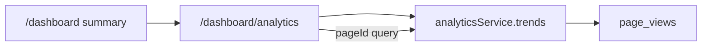

# Analytics trend page

First-party views already land in `page_views` ([`src/db/schemas/pages.schema.ts`](src/db/schemas/pages.schema.ts)) via the public beacon. [`analyticsService.summary`](src/server/services/analytics.service.ts) only totals the selected window, and [`/dashboard`](src/app/(admin)/dashboard/(shell)/page.tsx) draws that window as bars, top pages, and top referrers. There is no previous-period comparison.

The new page is `/dashboard/analytics`, inside the existing dashboard shell (same signed-in layout). The beacon, the `POST /api/analytics/view` route, and the page builder stay as they are. No new table or columns: a trend is the current window versus the immediately previous window of the same length.

## What the page shows

Range stays `?range=7|30`, default 30, same toggle style as the home page. An optional `?pageId=` scopes every number and the chart to one page. A missing or unknown id is ignored and the page shows all traffic.

**Headline cards**, each with a change versus the previous window:

- Views
- Unique visitors
- Views per visitor

Change is an integer percent, `(current - previous) / previous`. When the previous window is 0 and the current window is not, the card says **New** instead of a percent. Zero versus zero shows no change.

**Daily chart** (plain SVG, no chart library). One slot per day in the range. Each slot has two bars: this period, and the same day-offset in the previous period (day 1 of this window beside day 1 of the last window). Tooltip text includes the date and both counts. The series is views; unique visitors stay on the cards.

**Page trends.** A list of pages with views now, views in the previous window, and the change. Clicking a row sets `pageId` so the cards and chart follow that page. A clear control drops the filter. Titles link to the page editor with [`PAGES.DASHBOARD.PAGES.EDIT`](src/config/pages.ts).

**Referrer trends.** Hostname, views now, views before, and the change. Hostnames only, same as today.

Empty state matches the home page: dashed border, and the note that a published public page must be visited before anything is recorded. That state shows when both windows are empty.

## Queries

Add `analyticsService.trends(rangeDays, pageId?)` next to `summary`. One read of `page_views` for both windows, using Postgres `count(*) filter (where ...)` so the current and previous totals share a scan.

Bounds, UTC, same as `summary`: `since` is the start of the current window; `previousSince` is `rangeDays` earlier. Current is `created_at >= since`. Previous is `created_at >= previousSince` and `created_at < since`.

- Totals: `count()` and `countDistinct(visitorId)` for each window.
- Daily: group by `date_trunc('day', created_at)` across both windows, then align previous days forward by `rangeDays` in the page component (fill missing days with 0, same loop as `DailyBars` today).
- Pages: group by `pageId`, path, and title, with filtered counts for each window, ordered by current views, limit 10. Skipped when `pageId` is set; the header uses that page’s title instead.
- Referrers: group by `referrerHost` where it is not null, same two counts, limit 10.

`summary` stays for the home page. `contentOverview` is unchanged.

## Home page and navigation

On [`src/app/(admin)/dashboard/(shell)/page.tsx`](src/app/(admin)/dashboard/(shell)/page.tsx), keep the two traffic numbers (views and unique visitors, fixed at 30 days) and replace the range toggle, daily bars, top pages, and top referrers with a link to the analytics page. Content counts, recent pages, and audit activity stay on the home page.

Register the route in [`src/config/pages.ts`](src/config/pages.ts) as `PAGES.DASHBOARD.ANALYTICS` (`/dashboard/analytics`). Add an **Analytics** item in [`src/menus/index.tsx`](src/menus/index.tsx) (Lucide `BarChart3`), placed after Pages. No extra permission: anyone who can open the dashboard can open it, same as Pages.

The page is a server component at `src/app/(admin)/dashboard/(shell)/analytics/page.tsx`. Stat cards and the chart live in `_components` beside that page, using the same `rounded-lg border border-steel-200` cards as the home page. The inline `DailyBars` in the home page goes away with the chart.

## Verification

Open `/dashboard/analytics`, switch 7 and 30 days, and confirm each card shows a percent or **New** against the previous window, and that the chart has two bars per day. Open a page row and confirm the header, cards, and chart follow that page, then clear the filter. On `/dashboard`, confirm the 30-day views and visitors are still there, the chart is gone, and the analytics link lands on the new page.
