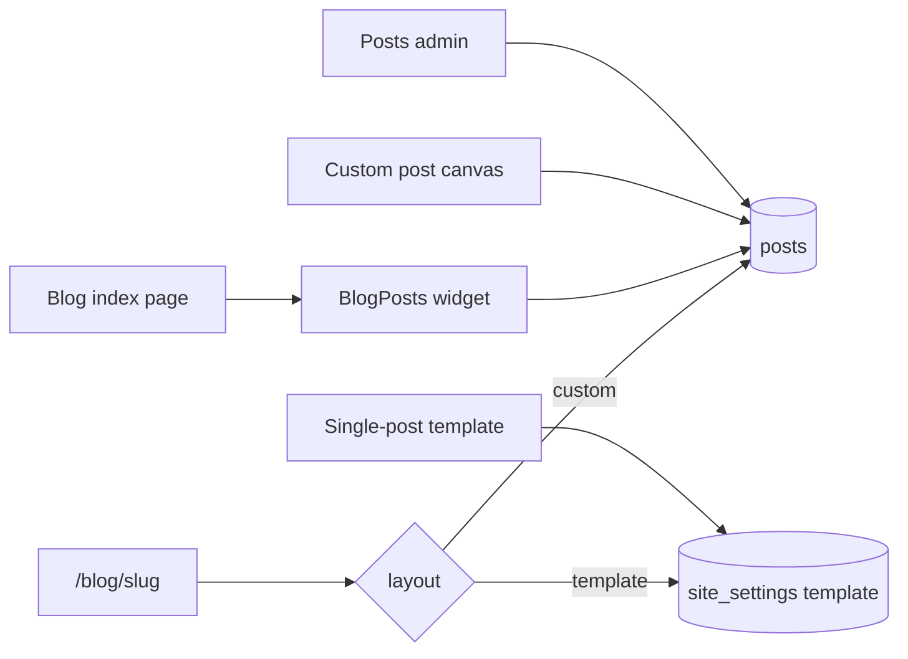

# Blog posts, listing widget, and single-post builder

Posts are a new content type. They are not pages. The listing page stays in the existing page builder. Each post uses one shared single-post template, and can switch to its own canvas when the layout needs to differ.

The article body is always rich text. Cards, SEO, and the template’s content block read that body in both layout modes.

Reuse the existing page permissions (`pages.create`, `pages.edit`, `pages.publish`, `pages.delete`). Authors can draft their own posts the same way they draft pages.

## 1. Posts data model

Add tables in [src/db/schemas/pages.schema.ts](src/db/schemas/pages.schema.ts) and a `post_layout` enum (`template` | `custom`) in [src/db/schemas/shared.schema.ts](src/db/schemas/shared.schema.ts). Generate a Drizzle migration.

- `posts`: title, slug, excerpt, featured image URL, status, visibility, language, `translationGroupId`, `publishedAt`, `scheduledAt`, `layout` (default `template`), `createdBy`, soft delete. Unique `(slug, language)` where not deleted. Same status and visibility enums as pages.
- `post_contents`: `postId`, `kind` (`draft` | `published`), `body` (rich text), `canvas` (Puck data, null while layout is `template`). Unique `(postId, kind)`.
- `post_revisions`: snapshot of title, layout, body, and canvas.
- `post_seo`: same fields as `seo_meta`, keyed by `postId`.
- `post_categories` and `post_tags`: join the existing `categories` and `tags` tables.

On [site_settings](src/db/schemas/pages.schema.ts), add `singlePostTemplate` and `singlePostTemplateDraft` (jsonb). Draft autosaves; publish copies draft onto the live template, which every `layout = template` post uses.

Service in `src/app/(admin)/dashboard/(shell)/posts/_modules/`, following [pages.service.ts](src/app/(admin)/dashboard/(shell)/pages/_modules/pages.service.ts): create, update, get, paginate, soft delete, duplicate, draft vs published body, publish, schedule, revisions, and “one blog index per language” is separate (below). Extend [src/app/api/cron/publish/route.ts](src/app/api/cron/publish/route.ts) so due posts publish with due pages.

## 2. Posts admin

New sidebar item in [src/menus/index.tsx](src/menus/index.tsx) and routes in [src/config/pages.ts](src/config/pages.ts):

- `/dashboard/posts` list, same table pattern as [pages-table.tsx](src/app/(admin)/dashboard/(shell)/pages/_components/pages-table.tsx) (status, layout, language).
- `/dashboard/posts/create` and `/dashboard/posts/[id]/edit`: title, slug, excerpt, featured image via the existing media picker, categories, tags, status, visibility, language, schedule, SEO panel, and the existing Tiptap editor for the body.
- Layout control: **Shared template** or **Custom layout**. Choosing custom copies the current published template into that post’s canvas. Reverting clears the canvas and returns the post to the template.
- `/dashboard/posts/[id]/builder` only for custom layout.
- `/dashboard/posts/template` edits the shared template.

## 3. Blog listing page and filterable widget

The listing page is a normal builder page. Wire the unused `isBlogIndex` column the same way `isHome` works in [pages.service.ts](src/app/(admin)/dashboard/(shell)/pages/_modules/pages.service.ts): a checkbox in [sidebar-editor.tsx](src/app/(admin)/dashboard/(shell)/pages/_components/sidebar-editor.tsx), and only one blog index per language.

Add a `BlogPosts` block to [src/builder/config.tsx](src/builder/config.tsx) under a Blog category. Inspector settings:

- Layout: grid or list. Columns for the grid. Page size.
- Toggles: search, category, tag, sort. Card fields: image, excerpt, author, date.
- Optional locked category and locked tag. When one is locked, hide that public filter and always apply it.

Public filters are a GET form on the current page: `q`, `category`, `tag`, `sort` (`newest` | `oldest` | `title`), `page`. [src/app/(site)/[[...slug]]/page.tsx](src/app/(site)/[[...slug]]/page.tsx) passes those search params into `resolveAllData` metadata. The block’s `resolveData` loads one page of published public posts (title, slug, excerpt, image, date, author, categories, tags). In the editor, filters do not navigate; the block shows real posts using only the locked category, tag, and page size.

Card links go to the post URL, not the listing page’s slug.

Seed a starter blog page template (slug suggestion `blog`, `isBlogIndex`, one `BlogPosts` block) in the existing templates gallery so the listing page can be created in one step.

## 4. Single-post builder

`postBuilderConfig` spreads the page blocks and adds blocks that read the current post from Puck metadata:

- `PostTitle`, `PostFeaturedImage`, `PostMeta` (date, author, categories, tags), `PostContent` (the rich-text body), `RelatedPosts` (same category, exclude self, limit).

These blocks are not offered on ordinary pages. In the template builder they render a sample post. On the public site they render the real post.

Give [builder-editor.tsx](src/app/(admin)/dashboard/(fullscreen)/pages/[id]/builder/_components/builder-editor.tsx) a config plus save, publish, and review callbacks, defaulting to the current page actions. The post canvas and the template builder reuse that shell instead of copying it. Template mode hides page revisions; the post canvas uses `post_revisions`.

Default template, used when the setting is empty: featured image, title, meta, content, related posts.

## 5. Public post routes

The catch-all only resolves one slug, or a language plus a slug, so posts need their own routes:

- [src/app/(site)/blog/[slug]/page.tsx](src/app/(site)/blog/[slug]/page.tsx) for `/blog/my-post`
- [src/app/(site)/[language]/blog/[slug]/page.tsx](src/app/(site)/[language]/blog/[slug]/page.tsx) for `/es/blog/my-post`

`/blog` itself stays on the catch-all, so the blog index page keeps slug `blog`.

Render path:

- `layout = custom` and a canvas exists: render that canvas with `postBuilderConfig`.
- Otherwise: render the published single-post template.
- Metadata and JSON-LD use `BlogPosting` from post SEO, excerpt, and featured image.
- Draft preview extends [src/app/api/preview/route.ts](src/app/api/preview/route.ts) and the preview session with a nullable `postId` on `preview_tokens` (`pageId` becomes nullable; one of the two is required).

Also add published posts to [src/app/sitemap.ts](src/app/sitemap.ts) and read routes `GET /api/v1/posts` and `GET /api/v1/posts/[slug]`, matching the pages API.

## Out of scope

Comments, RSS, a separate posts permission matrix, and AI generation for post canvases.