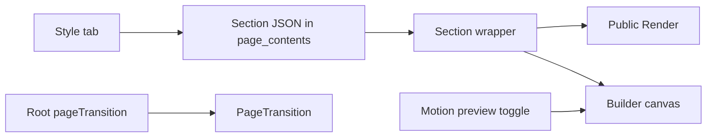

# Canvas editor, style controls, and motion

## What this repo already is

next-cms is a self-hosted Next.js 16 CMS: Postgres, Google OAuth, Tiptap for articles, and `@measured/puck` 0.20 for landing pages. The earlier port (publishing, preview, revisions, media, SEO, menus, templates, globals, roles, read API, Gemini) is in the tree.

Every block is wrapped by [`Section`](src/builder/blocks/section.tsx). Shared sidebar fields live in `sectionField` / `withSection` in [`src/builder/config.tsx`](src/builder/config.tsx). Public pages render that same config through Puck `<Render>` in [`src/app/(site)/[[...slug]]/page.tsx`](src/app/(site)/[[...slug]]/page.tsx). Content is Puck JSON in `page_contents`, so new presentation props do not need a migration.

Motion today is only button opacity, the pricing pill, the FAQ chevron, and the nav dropdown. There is no `motion` / GSAP / Lottie dependency, and no animation field.

## Market requirements

Compared with Webflow, Framer, and Elementor (visual motion) and Payload, Storyblok, and Builder.io (CMS workflow), this app is already at parity for the CMS core: drag-and-drop blocks, drafts, revisions, preview, SEO, media, menus, templates, globals, roles, a read API, and AI generation.

What is still missing, in the order it matters for this product:

- **Interactive motion.** Webflow and Framer treat scroll, hover, and page transitions as default. This app has none. This is the feature to build now.
- **Form inbox.** Contact blocks only POST to an external URL. Submissions are not stored.
- **Real responsive editing.** Breakpoints only hide a section. They do not change layout, type, or spacing per device.
- **Design tokens beyond color.** Theme is primary, accent, font, radius, and light/dark. No type scale, spacing, or shadow tokens.
- **Localization depth.** Translations are cloned drafts. There is no side-by-side editor.
- **Webhooks, in-app analytics, A/B tests, comments, custom CSS, and a real blog index.** Settings can paste a GA4 id, and `isBlogIndex` exists on the schema, but none of these are products yet.

This plan replaces the fixed Puck columns with the canvas editor in the reference screenshot, and it puts motion and style behind that floating card. The rest stays backlog.

## Canvas editor

[`builder-editor.tsx`](src/app/(admin)/dashboard/(fullscreen)/pages/[id]/builder/_components/builder-editor.tsx) renders `<Puck>` with no children, so Puck draws its own header, left drawer, and right field column. Puck 0.20 skips that layout when `<Puck>` has children. The pieces are `Puck.Preview`, `Puck.Components`, `Puck.Outline`, and `Puck.Fields`. `usePuck().selectedItem` is the selected block.

New shell, still inside the existing fullscreen builder route:

- **Top bar.** Keep the current save, publish, preview, revisions, and motion-preview actions from [`builder-chrome.tsx`](src/app/(admin)/dashboard/(fullscreen)/pages/[id]/builder/_components/builder-chrome.tsx). Composing children removes Puck’s default header, so those actions move into this bar.
- **Left rail.** Tabs for Blocks (`Puck.Components`, using the categories already in [`config.tsx`](src/builder/config.tsx)) and Layers (`Puck.Outline`). A local search filters the block list.
- **Canvas.** `Puck.Preview` fills the rest. The iframe stays on (`iframe={{ enabled: true }}`). Puck’s own overlay keeps the selection box.
- **Floating card.** Shown only while a block is selected. It sits in the parent page, not inside the iframe, so the iframe cannot clip it. Position comes from the iframe’s rectangle plus the selected node’s rectangle in that same-origin document, then clamped to the viewport. Reposition on scroll and resize. Close returns focus to the canvas. Nothing selected means no card; new blocks still come from the left rail.

The card is the only field editor. There is no second right-hand column.

Card contents, top to bottom:

- **Describe a change.** One text input. Submit runs the existing per-block rewrite in [`ai-dialogs.tsx`](src/app/(admin)/dashboard/(fullscreen)/pages/[id]/builder/_components/ai-dialogs.tsx) and still shows the result before it is applied. Hidden when AI is off, and hidden for Global ref.
- **Content.** The block’s own fields (title, copy, items, media, buttons). Editing happens here. Clicking the canvas selects the block; it does not turn the heading into a contenteditable surface.
- **Style / Layout tabs.** Style holds colors, type, border, shadow, display, and the Animation group. Layout holds padding, alignment, the device row, anchor, and hide-on-device. Tabs are local UI. Puck has no tab field.

Typography and display stay allowlisted, matching the rest of the style work: size `sm | md | lg | xl`, weight `regular | medium | bold`, align `left | center | right`, content align `start | center | end`. No freeform font CSS.

```mermaid
flowchart LR
  rail[Blocks and Layers] --> canvas[Puck.Preview]
  canvas --> selection[selectedItem]
  selection --> card[Floating card]
  card --> content[Content fields]
  card --> style[Style and Layout]
  card --> rewrite[Existing rewrite action]
  style --> json[Section JSON]
  json --> section[Section wrapper]
```

## Inspector controls

The reference is [KantaPaul/gear-trader-super-admin](https://github.com/KantaPaul/gear-trader-super-admin/tree/geartrader-qa/rest/src/components/builder) on `geartrader-qa`, folder `rest/src/components/builder/control`. Those files are custom Puck fields, not Puck’s built-in select and radio. next-cms today only has three custom fields in [`src/builder/fields/client-fields.tsx`](src/builder/fields/client-fields.tsx) (media, rich text, global block). Section settings are plain selects.

Adapt that inspector into `src/builder/controls/`. Do not copy the gear-trader blocks (`fairfees`, flex, grid, heading) and do not copy their storage. Their controls `JSON.stringify` values and sometimes emit Tailwind class names. This app stores plain objects on the existing Puck JSON and renders only allowlisted values.

Controls to add, matching their layout:

- **Device row.** Monitor, tablet, and phone icons beside the label. Clicking one calls Puck `dispatch({ type: 'setUi' })` so the canvas viewport changes. Widths stay this app’s existing viewports: desktop 1280, tablet 768, mobile 375. Device keys are always `desktop | tablet | mobile`.
- **Choose.** A full-width segmented button row. Icon or short label, tooltip, selected state filled. Used for entrance, trigger, hover, easing, shadow, and page transition.
- **Slider.** Label, range, and an editable number. Used for duration, delay, padding, and border width. Units stay `px` for spacing. No em/rem/% switch.
- **Dimensions and border.** Four sides (top, right, bottom, left), each a slider, switched by the device row. Border also has a style choose (none, solid, dashed) and a color.
- **Color.** Label plus a color input. Light and dark values where the gear-trader background control has both.
- **Background.** Three tabs: color, gradient, image. Gradient has two colors, angle, and two locations. Image uses the existing media picker, plus size, position, and repeat selects.
- **Shadow.** Choose among none, small, medium, and large. No freeform `box-shadow` string.

`sectionField` in [`src/builder/config.tsx`](src/builder/config.tsx) stops using `select()` for padding and background. Those become custom fields. Anchor and hide-on-device stay. Existing pages keep their current padding and background enum; `Section` still understands `sm | md | lg` and `muted | primary | dark` when the new object is absent.

[`Section`](src/builder/blocks/section.tsx) turns the new objects into CSS variables and a small set of classes. User text never becomes a class name or a style string.

## Motion model

Presets only. Editors pick named effects. They never type CSS, durations in milliseconds, or keyframes. Unknown values are ignored, so stored JSON cannot inject styles.

Add an `animation` object on the existing section settings (old pages keep today’s look because the default is `none`). In the floating card this object sits on the Style tab, built from Choose and Slider:

- **Entrance** (Choose): none, fade, fade-up, fade-down, slide-left, slide-right, zoom, blur
- **Trigger** (Choose): on load, on scroll into view, on hover, on click
- **Duration** (Slider): 0.2s to 1.2s, default 0.6s
- **Delay** (Slider): 0s to 0.8s, default 0
- **Easing** (Choose): ease-out or spring
- **Once** (Choose): first time only, or every time it re-enters
- **Stagger** (Choose): none, or children (cards, stats, plans, quotes, FAQ rows, columns)
- **Hover** (Choose): none, lift, scale, glow (runs in addition to the entrance)
- **Play on** (device row): desktop, tablet, and mobile toggles. A device that is off shows the final state and does not animate. This uses the same viewport switch as the spacing controls.

Page-level, on Puck root props: **page transition** none, fade, or slide-up. That applies when a published builder page loads. Rich-text pages stay static.



## Behavior

- **Public site.** Scroll uses an in-view trigger with a small visibility threshold. Load runs on mount. Hover and click play the entrance on that interaction. Hover lift, scale, and glow stay active after the entrance finishes. Click-to-reveal keeps the copy in the DOM at opacity 0 so it stays readable by assistive tech, and it is focusable.
- **Reduced motion.** If the visitor asks for reduced motion, skip transforms and fades and show the final state. Do not animate.
- **Builder.** The canvas shows the finished layout so dragging stays stable. A **Motion preview** toggle in the builder header, passed through the existing Puck `metadata` prop in [`builder-editor.tsx`](src/app/(admin)/dashboard/(fullscreen)/pages/[id]/builder/_components/builder-editor.tsx), turns the real triggers on inside the iframe. [`renderBlock`](src/builder/config.tsx) already reads `puck.isEditing`; it will also read `puck.metadata.motionPreview`.
- **Stagger.** `Section` exposes a small context. List markup in [`marketing.tsx`](src/builder/blocks/marketing.tsx) and [`content.tsx`](src/builder/blocks/content.tsx) wraps each card or column in a `MotionItem`. With stagger off, that wrapper renders nothing extra.
- **AI.** Leave [`GENERATABLE_BLOCKS`](src/builder/schema.ts) unchanged. Generated pages omit `animation` and fall through to `none`.
- **Library.** Add `motion`. Map each preset to variants in one module, for example `src/builder/motion.tsx`, and keep `Section` as the only wrapper. No per-block animation code.

Page enter is a client wrapper around the public page body, reading `root.props.pageTransition`. Exit animations need a transition that survives the App Router swap; that is a follow-up, not part of this pass.

## Files

- [`builder-editor.tsx`](src/app/(admin)/dashboard/(fullscreen)/pages/[id]/builder/_components/builder-editor.tsx) — pass a custom shell as `<Puck>` children
- New builder shell and selection card next to [`builder-chrome.tsx`](src/app/(admin)/dashboard/(fullscreen)/pages/[id]/builder/_components/builder-chrome.tsx) — header, Blocks/Layers, floating card
- [`ai-dialogs.tsx`](src/app/(admin)/dashboard/(fullscreen)/pages/[id]/builder/_components/ai-dialogs.tsx) — “Describe a change” calls the existing rewrite
- New `src/builder/controls/` — device row, choose, slider, dimensions, color, background, border, shadow. Custom Puck field renderers, same layout as the gear-trader `control/` folder
- [`src/builder/blocks/section.tsx`](src/builder/blocks/section.tsx) — apply allowlisted spacing, type, background, border, and shadow; extend animation settings; export `MotionItem`
- New `src/builder/motion.tsx` — preset maps, reduced-motion guard, client-only
- [`src/builder/config.tsx`](src/builder/config.tsx) — content fields stay per block; style and layout groups use the custom controls; root `pageTransition` as Choose; pass `motionPreview`
- [`src/builder/blocks/marketing.tsx`](src/builder/blocks/marketing.tsx) and [`src/builder/blocks/content.tsx`](src/builder/blocks/content.tsx) — wrap repeated children
- [`src/builder/site.css`](src/builder/site.css) — reduced-motion backup scoped to motion nodes, not the whole admin UI
- [`src/app/(site)/[[...slug]]/page.tsx`](src/app/(site)/[[...slug]]/page.tsx) — enter transition from root props
- `package.json` — `motion` dependency

Out of this pass: gear-trader’s product blocks, their class-name option catalogs, freeform CSS, and click-to-type on the canvas.

## Verify

Open the builder and confirm the left rail switches between Blocks and Layers, the canvas fills the rest, and Puck’s old right column is gone. Select a hero and confirm the card opens beside it, stays outside the iframe, and follows the block on scroll. Edit the title from the card, switch Style and Layout, and confirm the device row changes the canvas between 1280, 768, and 375. Submit “Describe a change” and confirm the existing rewrite preview still appears before apply. Set fade-up on scroll and a staggered features grid, turn Motion preview on, and confirm the canvas plays it. On the public page, confirm scroll, hover, click, and the page fade. Confirm a default block does not move, and that reduced motion shows content immediately.
