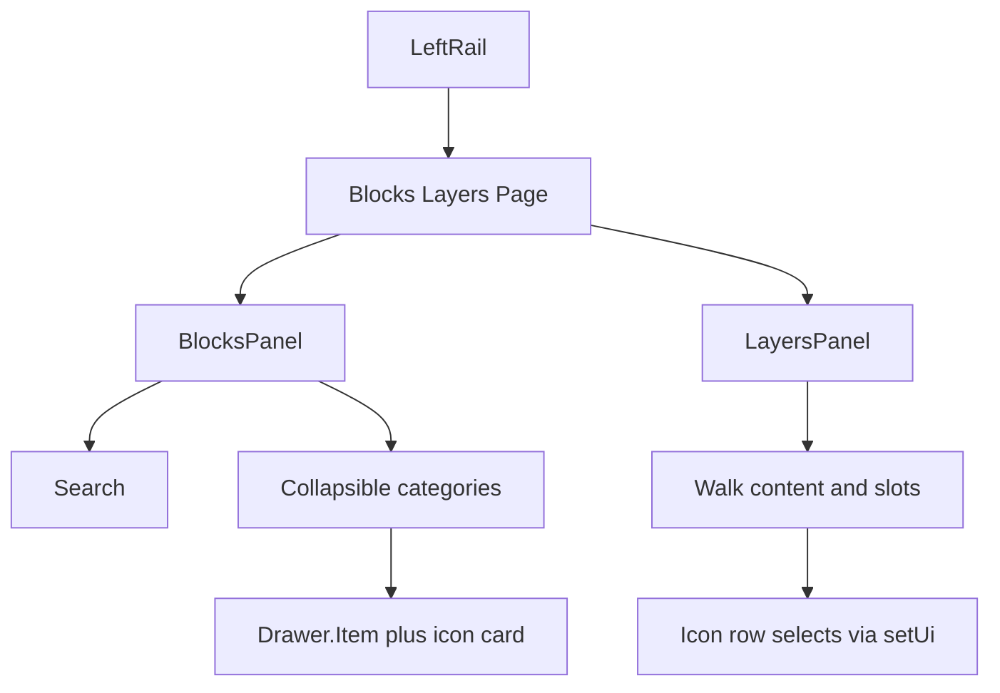

---

name: Builder rail redesign
overview: "Restyle the page builder’s Blocks and Layers panels so they match the existing steel chrome: icon cards for blocks, and a custom layer tree instead of Puck’s default outline. Drag-to-insert and click-to-select stay as they are."
todos:
- id: rail-chrome
  content: Restyle LeftRail tabs, width, and search in builder-shell.tsx
  status: completed
- id: block-cards
  content: Render Drawer.Item rows as tinted icon cards with collapsible categories
  status: completed
- id: layers-tree
  content: Replace Puck.Outline with a custom tree that selects, nests slots, and scrolls the canvas
  status: completed
- id: verify
  content: Typecheck and verify blocks drag plus layers selection in the browser
  status: pending
  isProject: false

---

# Builder blocks and layers redesign

The page builder left rail lives in [`builder-shell.tsx`](src/app/(admin)/dashboard/(fullscreen)/pages/[id]/builder/_components/builder-shell.tsx). Blocks render Puck `Drawer.Item` (grey row plus a drag glyph). Layers render `Puck.Outline`, whose rows are all the same grid icon and use Puck’s azure theme. The global-block editor keeps Puck’s own sidebar.

## Look

Stay on the builder’s white and steel palette. Widen the rail from `w-64` to `w-72`.

- Tabs become a pill track: muted background, active tab is a white chip with a light shadow.
- Search is a rounded field with a focus ring, reused on Blocks and Layers.
- Each block is one row: a 32px tinted icon well, the label, and a grip that shows on hover. Drag still comes from `Drawer.Item`; the custom render only replaces the inner markup (`children` on `Drawer.Item` is the visual, the drag ref stays on the wrapper).
- Category headings are collapsible, with a count. Search keeps only matching groups open.
- Icon tint follows the category already defined in [`config.tsx`](src/builder/config.tsx): violet for heroes, sky for marketing, amber for content, steel for layout, emerald for global blocks.

## Blocks

In `BlocksPanel`, pass a render function to each `Drawer.Item` instead of relying on Puck’s default label. Map block type to a Lucide icon next to the panel (Hero, CTA, Features, Stats, Pricing, Testimonials, FAQ, RichText, Image, ContactForm, Columns, GlobalRef). Unknown types fall back to `LayoutGrid`.

## Layers

Replace `<Puck.Outline />` with a small tree in a new [`layers-panel.tsx`](src/app/(admin)/dashboard/(fullscreen)/pages/[id]/builder/_components/layers-panel.tsx). `Puck.Outline` cannot swap the per-row icon; its override only wraps the whole list.

- Walk `appState.data.content`. For each item, read slot fields from `config.components[type].fields` (`type === 'slot'`) and render those arrays as nested groups. Columns is the only slot block today.
- Row: chevron when it has children, the same block icon, the component label, and a short subtitle from `title`, `headline`, or `eyebrow` when one exists.
- Click calls `getSelectorForId` and `dispatch({ type: 'setUi', ui: { itemSelector } })`. Clicking the selected row clears the selector. Then scroll the matching `[data-puck-component]` inside the preview iframe into view.
- Selected row uses a steel chip. Ancestors of the selection stay expanded. Empty content shows a short empty state. A search box filters by label and subtitle.
- Hover-sync from the layer row onto the canvas stays with Puck’s outline. The custom tree selects and scrolls; it does not drive Puck’s internal hover store.

The Page tab keeps its current fields. It only picks up the shared tab chrome.

## Check

Typecheck the builder files, then open the page builder and confirm: search and category collapse, drag a block onto the canvas, select and nest layers under Columns, and that the floating inspector still opens for the selected block.
