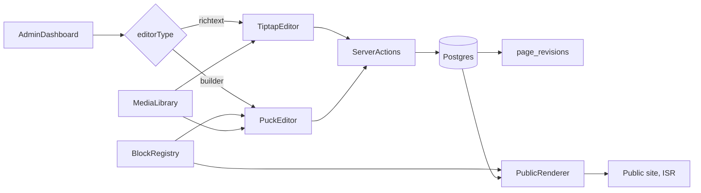

---

name: CMS Page Builder Roadmap
overview: "An analysis of the current next-cms codebase and the self-hosted visual CMS market (Payload, Builder.io, Storyblok, Sanity, TinaCMS, Puck, WordPress/Elementor), followed by a phased roadmap. Each phase includes a ready-to-use implementation prompt. The editor will be a hybrid: Tiptap for blog posts and Puck for landing pages."
todos:
- id: p0
  content: "Phase 0: Fix pages service/content persistence, getById bug, indexes, edit route, list table"
  status: pending
- id: p1
  content: "Phase 1: editorType enum, Puck block registry, builder route, hybrid switch"
  status: pending
- id: p2
  content: "Phase 2: Public [[...slug]] renderer, ISR/revalidate, draft preview tokens, scheduling"
  status: pending
- id: p3
  content: "Phase 3: Revisions table, draft vs published, autosave, restore UI"
  status: pending
- id: p4
  content: "Phase 4: Media library with storage adapter and MediaPicker for Puck/Tiptap/SEO"
  status: pending
- id: p5
  content: "Phase 5: SEO tab, categories/tags CRUD, menus, site settings, sitemap/robots"
  status: pending
- id: p6
  content: "Phase 6: Global blocks, templates gallery, design tokens, responsive controls"
  status: pending
- id: p7
  content: "Phase 7: Roles/permissions enforcement, review workflow, audit log"
  status: pending
- id: p8
  content: "Phase 8: i18n translations and versioned public REST API with API keys"
  status: pending
- id: p9
  content: "Phase 9: AI page generation and content assistant"
  status: pending
- id: p10
  content: "Phase 10: Tests, Lighthouse CI, Docker distribution, plugin API"
  status: pending
  isProject: false

---

# CMS Page Builder: Analysis and Phased Plan with Prompts

## 1. Current code analysis

**Stack:** Next.js 16 (App Router), React 19, Drizzle ORM with Postgres, `arctic` for Google OAuth with a custom session, zod v4, react-hook-form, TanStack Query and Table, jotai and zustand, shadcn/Radix, Tiptap v3, and `@measured/puck` 0.20 (installed but not used anywhere yet).

**What already exists**
- Admin shell: dashboard layout, sidebar ([src/menus/index.tsx](src/menus/index.tsx)) with only a "Pages" entry, and a login page.
- A solid internal toolkit: `FormFactory`/`FieldFactory`, a data table with filters and personalization, the `protectedProcedure` server action builder, and query helpers (`with-filters`, `with-pagination`).
- Schema in [src/db/schemas/pages.schema.ts](src/db/schemas/pages.schema.ts) with these tables: `pages` (status, visibility, `isHome`, `language`, `isBuilderEnable`), `page_contents` (jsonb), `preview_tokens`, `seo_meta`, `categories` (nested), `tags`, and the join tables between pages and categories/tags.
- The page editor UI ([src/app/(admin)/dashboard/pages/form.tsx](src/app/(admin)/dashboard/pages/form.tsx)) has a title field that auto-generates the slug, a Tiptap content field, and a sidebar with status, visibility, and slug.

**Bugs and gaps found**
- `pagesServices.create` inserts `content` straight into `pages`, which has no `content` column. Nothing is written to `page_contents`, so saving fails or silently drops the content.
- `pagesServices.getById` queries `db.query.categories` when it should query `pages`.
- The editor form's `defaultValues` are commented out, so editing an existing page does not hydrate the form.
- `pages.slug` has no unique index (per language), and the category/tag join tables have no composite primary key and no cascade on delete.
- There is no public renderer: the `[...slug]` route, published-vs-draft resolution, and ISR/revalidation are all missing.
- Missing modules: media library, revisions, SEO UI, preview tokens UI, roles/permissions enforcement (the tables exist but are not used), navigation menus, global settings, and an API.

## 2. Competitor market (self-hosted and developer-focused segment)

- **Payload CMS 3**: runs natively inside Next.js, config-as-code collections, blocks field, live preview, versions and drafts, localization, access control. It is the closest competitor. Its weakness is that the visual drag-and-drop editing is basic.
- **Builder.io**: best-in-class visual drag-and-drop over the user's own React components, AI generation (Visual Copilot, Figma to code), A/B testing. Weaknesses: proprietary SaaS and expensive.
- **Storyblok**: a visual editor with a live preview iframe, nested "bloks", workflows, and i18n. SaaS only.
- **Sanity**: Presentation tool with click-to-edit overlays, real-time collaboration, GROQ. Hosted content lake.
- **TinaCMS**: Git-backed, inline visual editing for Next.js.
- **Puck**: open-source MIT drag-and-drop editor (just the editor; no CMS, auth, media, or publishing). Puck AI is emerging.
- **WordPress (Gutenberg/Elementor)**: the incumbent, with a huge plugin ecosystem. Its weak points are PHP, performance, and security.
- **AI site builders (Framer AI, Webflow AI, Wix Studio, v0, Lovable)**: these set the user expectation for "prompt to page".

**Table-stakes features (must have to compete):** drag-and-drop blocks, live preview, drafts and publishing, revisions, media library, SEO, i18n, roles, reusable components, a templates library, responsive controls, scheduled publishing, and a content API.

**Ways to stand out (where we can win):**
1. A self-hosted Next.js-native CMS that has a real drag-and-drop builder. Puck plus a full CMS layer is the gap between Payload (no strong visual editing) and Builder.io (SaaS only).
2. One content model that serves both blog posts (Tiptap) and landing pages (Puck).
3. AI page generation from a prompt, producing Puck JSON from our own block registry.
4. One-command Docker deployment, MIT license, no per-seat pricing.

## 3. Target architecture

Each page stores `editorType` (`richtext` or `builder`). `page_contents.content` holds either Tiptap JSON or Puck `Data`. A single block registry is shared by the Puck editor (`config`) and the public `<Render>`.

## 4. Phased plan with prompts

### Phase 0: Fix the foundation

Prompt:
> In next-cms, fix the pages module. (1) `pagesServices.create/update` in `src/app/(admin)/dashboard/pages/_modules/pages.service.ts` must split `content` out of the inputs and upsert it into `page_contents` inside the same transaction. (2) `getById` must query `pages` with its `page_contents`, `seo_meta`, categories, and tags (add Drizzle `relations` for these). (3) Add a unique index on `(slug, language)` for `pages`, composite primary keys and cascade deletes on `page_categories` and `page_tags`, and generate a migration. (4) Hydrate `defaultValues` in `form.tsx` from `initialValues` and add an edit route at `pages/[id]/edit`. (5) Implement the pages list with the existing `DataTable` and `getPaginated` using `with-filters` and `with-pagination`, plus soft delete. Follow the existing `protectedProcedure` and `FormFactory` patterns.

### Phase 1: Hybrid editor switch and Puck integration

Prompt:
> Add an `editorType` enum (`richtext` | `builder`) to `pages`, replacing `isBuilderEnable`, with a migration. Create `src/builder/` containing: `registry.ts` (Puck `Config` with categories), `blocks/*` (Hero, Heading, RichText using the existing Tiptap viewer, Image, Button, Columns/Grid with DropZone, Section/Container, Spacer, Card, FAQ accordion, CTA, Testimonial, Pricing, Embed/Video, Form), and `root.tsx` (page-level props such as theme and max width). Each block uses Tailwind and shadcn and has typed fields with defaults. Build a full-screen route `dashboard/pages/[id]/builder` that renders `<Puck config data onPublish>` and saves through a server action to `page_contents`. In `form.tsx`, show Tiptap when `editorType=richtext`, and when it is `builder`, show an "Open Builder" button. Load Puck client-only with `dynamic(..., { ssr:false })`.

### Phase 2: Public renderer, publishing, and preview

Prompt:
> Create a public route group `src/app/(site)/[[...slug]]/page.tsx` that resolves a page by slug and language (the `isHome` page for `/`), only when `status=published` and `visibility=public`. For builder pages, render with Puck `<Render config={registry} data>`. For rich text pages, use the Tiptap viewer. Add `generateMetadata` from `seo_meta`, `generateStaticParams` for published pages, and `revalidatePath`/`revalidateTag` on publish. Implement draft preview using Next `draftMode()` and the `preview_tokens` table (create, expire, and revoke tokens from the editor sidebar). Add `publishedAt` and `scheduledAt` columns and a cron-safe route handler that publishes scheduled pages.

### Phase 3: Revisions, drafts, and autosave

Prompt:
> Add a `page_revisions` table (pageId, content jsonb, title, authorId, createdAt, label). Keep the draft content separate from the published content: `page_contents` gets a `kind` column of `draft` | `published`. Autosave the draft (debounced, 3s) from both the Puck and Tiptap editors. "Publish" copies the draft to published and writes a revision. Build a revisions drawer that lists revisions, previews them read-only, and restores them. Show an "unsaved changes" guard.

### Phase 4: Media library

Prompt:
> Build a media module with a `media` table (id, key, url, mime, size, width, height, alt, folder, createdBy) and a pluggable storage adapter (local disk for dev, S3-compatible for prod, configured through env in `src/env.mjs`). Upload with `react-dropzone`, generate image dimensions and blurhash, and serve through `next/image`. Add an admin grid page with search, folders, and alt-text editing. Create a reusable `MediaPicker` dialog and wire it into a custom Puck field type (`media`), the Tiptap image extension, and the `seo_meta.ogImage` field.

### Phase 5: SEO, taxonomy, and site structure

Prompt:
> Add an SEO tab to the page sidebar bound to `seo_meta` (title, description, canonical, OG, Twitter) with a Google/OG preview card and character counters. Build CRUD pages for categories (tree) and tags, and enable the commented-out multiselects in `sidebar-editor.tsx`. Add a `menus` and `menu_items` model (nested, drag-sortable with dnd-kit) and a `site_settings` singleton (site name, logo, favicon, default SEO, header/footer menu ids). Generate `sitemap.ts` and `robots.ts` from published pages.

### Phase 6: Reusable components, templates, and design tokens

Prompt:
> Add "Global Blocks" (symbols): a `global_blocks` table storing Puck subtrees. Add a Puck block `GlobalBlockRef` that renders the referenced subtree, so editing the source updates every usage. Add "Save section as template" and a templates gallery for new pages (seed 10 starter templates: landing, about, pricing, contact, blog index). Add a theme/design-tokens editor in `site_settings` (colors, fonts, radius, spacing) that outputs CSS variables consumed by all blocks. Add per-block responsive controls (hide on mobile/tablet, padding per breakpoint) using Puck viewports.

### Phase 7: Roles, permissions, and workflow

Prompt:
> Enforce the existing `roles` and `permissions` tables: seed Admin, Editor, Author, and Viewer roles with permission keys (`pages.create`, `pages.publish`, `media.upload`, `settings.manage`, and so on). Add a `requirePermission(key)` middleware to the procedure builder in `src/server/procedures/`, and hide UI actions with a `<Can>` component. Add a review workflow where an Author can only submit for review and an Editor publishes. Add a user management page. Add an audit log table recording create/update/publish/delete actions.

### Phase 8: i18n and content API

Prompt:
> Add multi-language pages: a `translationGroupId` column links translations of the same page. Add a language switcher in the editor ("create translation" clones the content), locale-prefixed public routes, and `hreflang` metadata. Expose a read-only, versioned REST API under `src/app/api/v1/` (pages, page by slug, menus, settings, media) with API keys (`api_keys` table, hashed) and rate limiting, so the CMS can also be used headless. Generate an OpenAPI spec.

### Phase 9: AI features (differentiator)

Prompt:
> Add an AI assistant to the Puck editor: (1) "Generate page from prompt" sends the block registry schema (field definitions as JSON Schema) plus the user prompt to an LLM through a server action, then validates the returned Puck `Data` with zod against the registry and inserts it. (2) A per-block "rewrite/translate/shorten" text action. (3) Auto-generate SEO title, description, and image alt text. Keep the provider pluggable (OpenAI/Anthropic/local) through env. Stream responses and show a diff before applying.

### Phase 10: Polish, performance, and distribution

Prompt:
> Add Playwright end-to-end tests for create, build, publish, and view, and Vitest tests for services and the block registry. Add Lighthouse CI on the public renderer (target 95+). Harden the Dockerfile and docker-compose (app + Postgres + MinIO), add a one-command `make setup`, add seed data, and write the README setup docs. Add a plugin/extension API so developers can register custom Puck blocks from `src/builder/custom/` without touching core.

## 5. Suggested order and milestones

- MVP (Phases 0 to 2): a working hybrid editor with public published pages. This is the first demo-able release.
- Competitive parity (Phases 3 to 6): revisions, media, SEO, and templates. This brings the product to Payload/Storyblok parity for the visual-editing use case.
- Differentiation (Phases 7 to 9): workflow, headless API, and AI generation.
- Launch (Phase 10).
