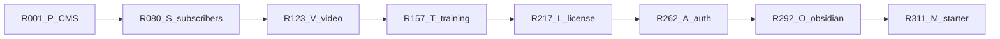
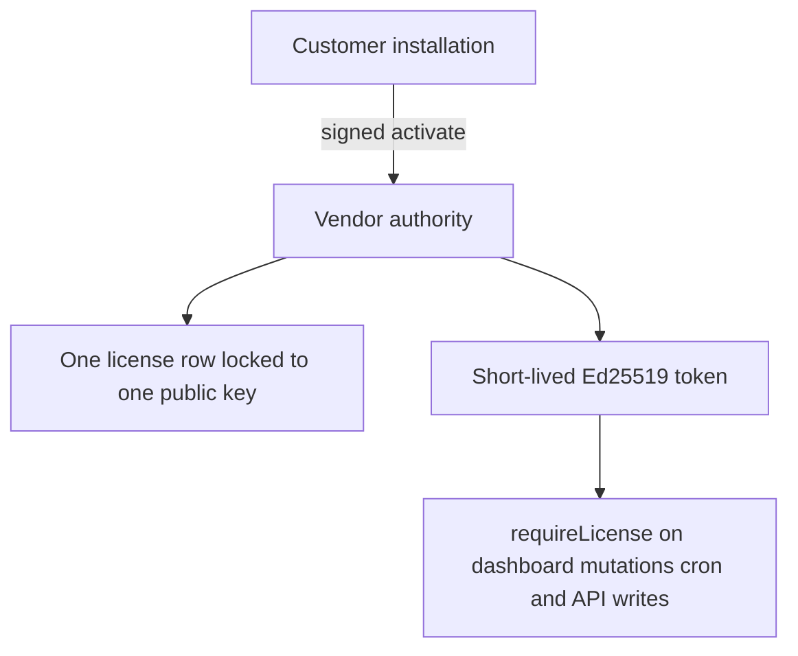
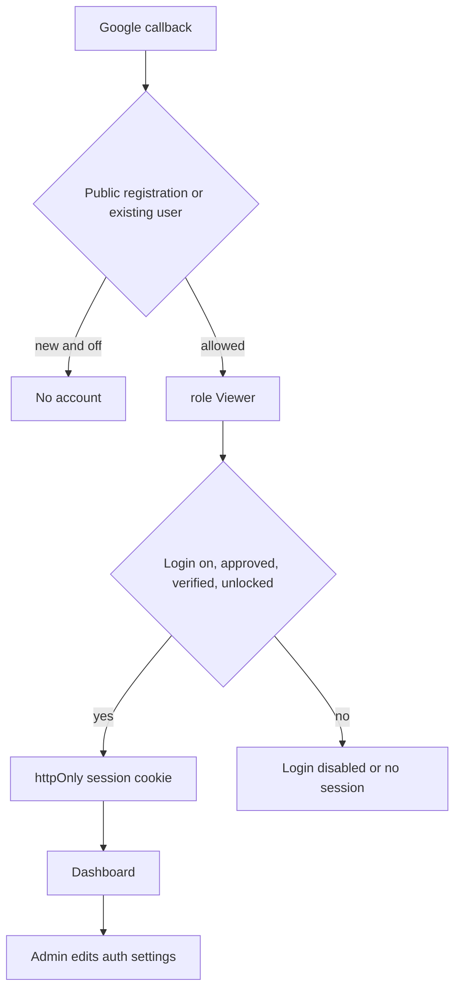
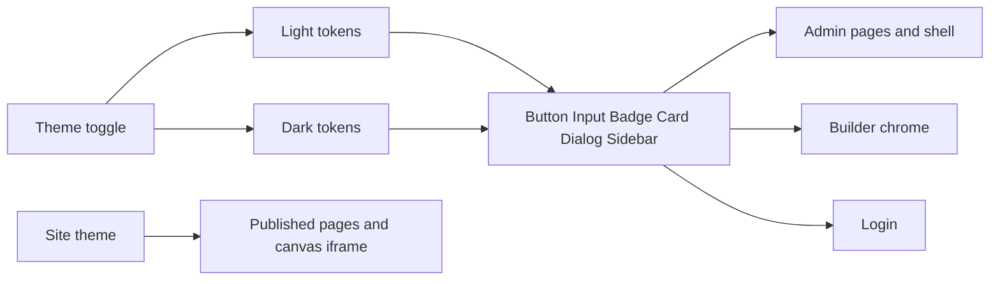
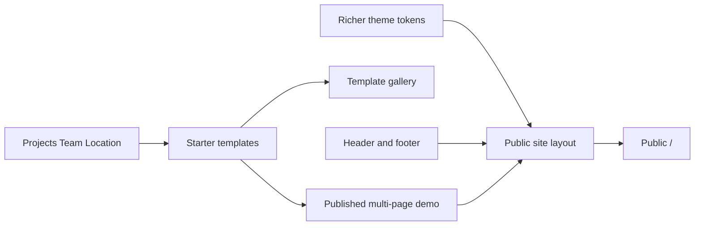

# Combined refs R001–R462

Say **implement R042** (or the original id, such as **P2-14**, **L3-01**, **A2-01**, **O1-01**, or **M2-01**). That ref is the whole task. Do not continue to the next ref unless you ask.

Specs for the first four blocks stay in the source plans. Licensing, auth, the Studio light and Obsidian dark restyle, and the modern starter site are specified in this file.

- CMS gap: [numbered_cms_refs_7ecd08c6.plan.md](.cursor/plans/numbered_cms_refs_7ecd08c6.plan.md) and [full_cms_gap_plan_8a7c0c53.plan.md](.cursor/plans/full_cms_gap_plan_8a7c0c53.plan.md)
- Subscribers: [content_subscriptions_af1362e2.plan.md](.cursor/plans/content_subscriptions_af1362e2.plan.md)
- Video library: [video_library_widget_0c5e2239.plan.md](.cursor/plans/video_library_widget_0c5e2239.plan.md)
- Training: [training_certificates_b50ce1b0.plan.md](.cursor/plans/training_certificates_b50ce1b0.plan.md)
- Licensing: **R217–R261** below
- Auth visibility and Viewer default: **R262–R291** below
- Studio Crafted light and Obsidian Studio dark admin restyle: **R292–R310** below, from [design/light-screen.md](design/light-screen.md), [design/dark-screen.md](design/dark-screen.md), and [obsidian_studio_restyle_148e7524.plan.md](.cursor/plans/obsidian_studio_restyle_148e7524.plan.md)
- Modern starter site: **R311–R327** below, from [modern_starter_site_719459d9.plan.md](.cursor/plans/modern_starter_site_719459d9.plan.md)

Training follows the video library because it reuses `parseVideoUrl`, `buildEmbed`, and `src/components/video/`. Licensing does not depend on video or training. Auth visibility reuses the session cookie and the Admin, Editor, Author, and Viewer roles that already exist. In-app license notices use the notification helper from **R209** when that table exists, and always write the audit log.

The admin restyle and the modern starter site sit after auth in this list. Either one can start before **R001**. The restyle owns admin, builder, and login chrome, and the theme toggle switches Studio Crafted light and Obsidian Studio dark. The starter site owns the public theme, starter templates, and the one published demo. They do not edit each other’s surfaces.

## Shared work (do not build twice)

- **R025 (P2-14)** adds `users.password_hash` and the scrypt helper, and keeps Google in [src/auth.ts](src/auth.ts). **R081 (S1-02)** only confirms that column. **R088 (S3-01)** uses the same helper. **R091 (S3-04)** is the public `/account/login` page for the Subscriber role, on that same hash and the session cookie in [src/lib/auth/session.ts](src/lib/auth/session.ts). Password login from **R025** records failures through **R276**.
- **R264** makes [assignDefaultRole](src/server/services/access.service.ts) always assign Viewer. It replaces the current first-user-becomes-Admin branch. **R267** is the server CLI that creates the first Admin. **R027** may set a role only because an Admin is sending the invite. **R089** still assigns Subscriber and does not call `assignDefaultRole`. **R271** also applies to that signup: public registration off means no new subscriber row.
- **R070–R072 (P6-08, P6-09)** own the Stripe client and `POST` webhook for one-product Checkout. **R096 (S4-01)** reuses that client. **R099–R102 (S4-04 through S4-07)** add subscription events on the same route. Product checkout and the subscriber plan stay two products.
- **R123 (V1-01)** journals [src/db/migrations/20261022070000_page_views.sql](src/db/migrations/20261022070000_page_views.sql) without editing that SQL. **R157 (T1-01)** confirms the journal entry and stops.
- **R126–R127 (V2-01, V2-02)** own `parseVideoUrl` and `buildEmbed`. **R164 (T2-01)** calls them. **R186–R188 (T5-01 through T5-03)** wrap [src/components/video/](src/components/video/) from **R143–R145**. Training progress stays in `training_video_progress`, not `video_progress`.
- **R130 (V2-05)** adds the `test` script in [package.json](package.json). **R171 (T2-08)** and **R227 (L2-06)** only add tests. **R227** adds the script when **R130** has not.
- **R095 (S3-07)** sends role Subscriber to `/account`. **R173 (T3-02)** sends role Learner to `/dashboard/my-training`. **R239 (L5-02)** adds the license fail-closed check in the same dashboard layout and keeps both redirects. **R279** runs the session check in that layout before those redirects.
- License key hashing follows [src/server/services/api-keys.service.ts](src/server/services/api-keys.service.ts): sha256 via Node `crypto`, prefix stored, plaintext returned once. Signing uses Node `crypto` Ed25519. Do not add a second crypto package.
- **R048 (P5-01)** is a single Video block. **R150 (V6-02)** is the `VideoLibrary` widget. Both stay.
- **R051 (P5-04)** and **R317 (M2-02)** are one Team block: photo, name, and role, wrapped in `Section`, registered once in the builder config and registry. Whichever ref runs first builds it. The other confirms those fields.
- **R053 (P5-06)** is the Map block. **R318 (M2-03)** is the Location block: address, hours, and a map link. Both stay.
- **R292** maps Studio Crafted light and Obsidian Studio dark tokens in [src/app/globals.css](src/app/globals.css). **R311–R315** extend public `ThemeTokens` in the page schema, [src/builder/theme.ts](src/builder/theme.ts), and [src/builder/site.css](src/builder/site.css). **R294** sets Inter for product-chrome body text, Hanken Grotesk for light headlines, and Inter for dark headlines. **R315** seeds Plus Jakarta Sans on the public theme only while tokens still equal `DEFAULT_THEME_TOKENS`. A published page that sets its own font keeps that font.
- **R295** leaves the root provider without `forcedTheme`. **R296** keeps the header toggle, which switches the two token blocks on admin, builder chrome, and login. **R311** keeps public color mode as light, dark, or system. The seeded demo is light.
- Product-chrome refs leave published pages, the Puck iframe, color swatches, chart series, and the revision content preview on the page theme. The drawer around that preview uses the active admin theme. Starter-site refs leave admin chrome on the Studio light and Obsidian dark themes once **R292–R310** have run, and leave it untouched when they have not.

New tables from **R012 (P2-01)** onward include `site_id` defaulting to `default` until **R034 (P3-03)** backfills it.

## Gates

- Do not start **R040 (P4-01)** until **R034 (P3-03)**.
- Do not start **R073 (P7-01)** until **R001** and **R002**.
- Do not start **R086 (S2)** until **R080–R085**. **R105 (S5)** needs **R086–R087** and **R090–R091**. **R096 (S4)** needs **R088–R095** and the Stripe route from **R072**.
- Do not start **R136 (V4)** until **R125, R126, R131, R132**.
- Do not start **R164 (T2-01)** until **R126**. Do not start **R186 (T5)** until **R143–R145**. Do not start **R178 (T4)** until **R163, R164, R172**.
- Do not start **R228 (L3-01)** until **R221–R226**. Do not start **R234** until **R228–R232**. Do not start **R239** until **R238**. Do not start **R245** until **R243** and **R244**. **R217** can start before **R001**; licensing does not wait on the CMS gap.
- Do not start **R265** until **R264**. Do not start **R270** until **R268**. Do not start **R282** until **R262** and **R268**. **R262** can start before **R001**. **R025** calls **R276** when that ref exists and does not add a second lockout table.
- Do not start **R298** until **R292**. Do not start **R300** until **R293**. Do not start **R305** until **R295**. Do not start **R310** until **R304–R309**. **R292** can start before **R001**. Light and dark stay inside **R292–R310**. Do not add a new ref number for the second theme.
- Do not start **R314** or **R315** until **R311** and **R312**. Do not start **R313** until **R311**. Do not start **R320** or **R321** until **R316**. Do not start **R322** until **R317**. Do not start **R324** until **R318**. Do not start **R325** until **R315** and **R319–R324**. Do not start **R326** until **R325**. Do not start **R327** until **R326**. **R311** can start before **R001**. **R317** and **R051** are the same block.

## R001–R079 — CMS gap (P1–P7)

### P1 — Finish what is started

- **R001** (P1-01) Register `Slider`, `Tabs`, and `Accordion` as keys of `builderConfig.components` in [src/builder/config.tsx](src/builder/config.tsx).
- **R002** (P1-02) Confirm those three blocks render on the public site.
- **R003** (P1-03) Show the contact-form options editor only for select and radio.
- **R004** (P1-04) Nullable `page_id` plus `post_id` on `page_views`. Record post views in the analytics service and beacon route.
- **R005** (P1-05) Mount the view beacon on post routes in [src/app/(site)/[[...slug]]/page.tsx](src/app/(site)/[[...slug]]/page.tsx). Depends on R004.
- **R006** (P1-06) Include posts on the analytics boards.
- **R007** (P1-07) Public language switcher using `translationGroupId` and hreflang.
- **R008** (P1-08) Wire `UrlField` on Hero, CTA, Pricing, and Image.
- **R009** (P1-09) Wire `IconPickerField` on Features.
- **R010** (P1-10) Turn off `typescript.ignoreBuildErrors` in [next.config.ts](next.config.ts) and fix the type errors.
- **R011** (P1-11) Replace [README.md](README.md) with Postgres, Google OAuth, storage, Gemini, and cron setup.

### P2 — Day-one table stakes

- **R012** (P2-01) `form_submissions` table. `site_id` defaults to `default`.
- **R013** (P2-02) First-party contact-form submit route.
- **R014** (P2-03) Admin form inbox: list, read, archive.
- **R015** (P2-04) CSV export of form submissions.
- **R016** (P2-05) Honeypot and optional Turnstile on form submit.
- **R017** (P2-06) Email the site owner via SMTP or Resend from env.
- **R018** (P2-07) `redirects` table with `site_id`.
- **R019** (P2-08) Middleware resolves redirects before the catch-all page.
- **R020** (P2-09) Redirect CSV import.
- **R021** (P2-10) Publishing a slug change offers to create a redirect.
- **R022** (P2-11) Postgres full-text on published pages and posts.
- **R023** (P2-12) Public `/search` page.
- **R024** (P2-13) `GET /api/v1/search`.
- **R025** (P2-14) Email and password login for staff. Add nullable `users.password_hash` and one scrypt helper. Keep Google. Record failures through R276 when that helper exists.
- **R026** (P2-15) Magic-link login.
- **R027** (P2-16) Invite flow for new users. An Admin may choose the role on the invite. A missing role uses Viewer from R264. This path does not make the first Google user Admin.
- **R028** (P2-17) Optional TOTP for Admins.
- **R029** (P2-18) Review queue for `status=review`: approve and request changes.
- **R030** (P2-19) Email the author on review actions.
- **R031** (P2-20) OpenAPI spec from zod schemas in [src/server/api/v1.ts](src/server/api/v1.ts).

### P3 — Multi-site

- **R032** (P3-01) `sites` table: name, primary host, extra domains, locale list.
- **R033** (P3-02) `site_memberships`: user, site, role.
- **R034** (P3-03) Add `site_id` to content tables and backfill `default`.
- **R035** (P3-04) Resolve the public site from the request host.
- **R036** (P3-05) Admin site switcher. Permissions against the active site.
- **R037** (P3-06) Per-site locale list. English unprefixed.
- **R038** (P3-07) Translated menus.
- **R039** (P3-08) Translated site name, description, and default SEO.

### P4 — Headless

Do not start until R034.

- **R040** (P4-01) `collections` and `collection_fields` tables.
- **R041** (P4-02) Validate collection entry JSON against the field list.
- **R042** (P4-03) Generated admin list and edit screens for collections.
- **R043** (P4-04) `CollectionItem` block and `/{collection}/{slug}` route.
- **R044** (P4-05) Scoped API keys: `content:read`, `content:write`, `media:write`.
- **R045** (P4-06) Draft-first write endpoints for pages, posts, entries, and media.
- **R046** (P4-07) Postgres rate limit shared across instances.
- **R047** (P4-08) Signed webhooks and a delivery log.

### P5 — Builder

- **R048** (P5-01) Video block (single embed, not the library widget).
- **R049** (P5-02) Embed block.
- **R050** (P5-03) Logo cloud block.
- **R051** (P5-04) Team block: photo, name, and role, wrapped in `Section`. Same block as R317. Register it once.
- **R052** (P5-05) Timeline block.
- **R053** (P5-06) Map block. Location (address, hours, and a map link) is R318.
- **R054** (P5-07) Spacer block.
- **R055** (P5-08) Button block.
- **R056** (P5-09) Code block.
- **R057** (P5-10) Newsletter block wired to the form inbox. Needs R012.
- **R058** (P5-11) Image-morph block from [image_morphing_block_544e3097.plan.md](.cursor/plans/image_morphing_block_544e3097.plan.md).
- **R059** (P5-12) Load Puck components from `src/builder/custom/`.
- **R060** (P5-13) Document the local plugin registration type.
- **R061** (P5-14) Soft lock and presence on pages and posts.
- **R062** (P5-15) One A/B variant per page with cookie split and beacon.
- **R063** (P5-16) Analytics group by variant and manual pick winner.

### P6 — Comments and one-product Stripe

- **R064** (P6-01) Threaded post comments: pending, approved, spam.
- **R065** (P6-02) Public comment form for guests or signed-in users.
- **R066** (P6-03) Comment moderation queue.
- **R067** (P6-04) Comments post block.
- **R068** (P6-05) Email the post author when a comment is approved.
- **R069** (P6-06) `products` and `orders` tables.
- **R070** (P6-07) Product grid block and Buy button.
- **R071** (P6-08) Stripe Checkout for one product. Add the shared Stripe client here.
- **R072** (P6-09) Stripe webhook marks the order paid. Orders inbox. This route later gains subscription events in R099.

### P7 — Ship

- **R073** (P7-01) Per-site baked export of published content, menus, theme, and media. Depends on R001 and R002.
- **R074** (P7-02) Export report: forms and checkout need external URLs.
- **R075** (P7-03) Playwright: sign in, edit, publish, view, submit a form, follow a redirect.
- **R076** (P7-04) Vitest for routes, redirects, collection validation, and the block registry.
- **R077** (P7-05) docker-compose for app, Postgres, and optional MinIO.
- **R078** (P7-06) Lighthouse CI on the home page and a blog post.
- **R079** (P7-07) GitHub Actions for lint, typecheck, unit tests, and Playwright.

## R080–R122 — Subscriber-only posts and pages (S1–S6)

One subscription unlocks every post or page with `subscribers_only`. Staff stay entitled. Role Subscriber is not. Spec: content subscriptions plan.

### S1 — Schema

- **R080** (S1-01) `pages.subscribers_only` and `posts.subscribers_only`, default false, plus a migration.
- **R081** (S1-02) Confirm `users.password_hash` from R025. Do not add a second column.
- **R082** (S1-03) `subscriptions` table: user, Stripe customer, Stripe subscription, status, period end.
- **R083** (S1-04) `subscription_enabled` and `subscription_label` on `site_settings`.
- **R084** (S1-05) Subscriber role with no dashboard permissions. Signup assigns it directly.
- **R085** (S1-06) Optional `STRIPE_SECRET_KEY`, `STRIPE_WEBHOOK_SECRET`, `STRIPE_PRICE_ID`. App boots when empty. Reuse names already added for R071 if present.

### S2 — Entitlement

- **R086** (S2-01) `hasAccess(userId)` is true only for `active` or `trialing`.
- **R087** (S2-02) Admin, Editor, Author, and Viewer are entitled. Subscriber is not.

### S3 — Visitor account

- **R088** (S3-01) Use the scrypt helper from R025. Do not add a second hasher.
- **R089** (S3-02) Signup creates the user and sets role Subscriber. It does not call `assignDefaultRole`. When R271 is present, public registration off rejects this signup.
- **R090** (S3-03) Public `/subscribe` page: name, email, password.
- **R091** (S3-04) `/account/login` writes the existing session cookie.
- **R092** (S3-05) `/account` shows email and subscription status.
- **R093** (S3-06) Subscriber logout.
- **R094** (S3-07) Dashboard layout sends role Subscriber to `/account`.
- **R095** (S3-08) Header link to Subscribe or Account.

### S4 — Stripe subscription

- **R096** (S4-01) Use the Stripe client from R071.
- **R097** (S4-02) Checkout session in `subscription` mode, `metadata.userId`, price from `STRIPE_PRICE_ID`.
- **R098** (S4-03) `/subscribe` starts that session after the account exists.
- **R099** (S4-04) Verify the Stripe signature on the webhook from R072.
- **R100** (S4-05) Handle `checkout.session.completed` for subscriptions.
- **R101** (S4-06) Handle subscription updated and deleted.
- **R102** (S4-07) `past_due`, `canceled`, `incomplete`, and `unpaid` stay locked.
- **R103** (S4-08) Stripe Customer Portal route.
- **R104** (S4-09) Clear message when Stripe env vars are missing.

### S5 — Public gate

- **R105** (S5-01) Expose `subscribersOnly` on public post and page loads.
- **R106** (S5-02) Strip locked post body and canvas before render.
- **R107** (S5-03) Strip locked page content before render.
- **R108** (S5-04) Paywall with title, excerpt, and subscribe or login links.
- **R109** (S5-05) Draft preview still shows the full body.
- **R110** (S5-06) Omit locked post body and layout from `/api/v1`.
- **R111** (S5-07) Omit locked page content from `/api/v1`.
- **R112** (S5-08) Set `isAccessibleForFree` false on locked JSON-LD.

### S6 — Editor

- **R113** (S6-01) Post form field and validation for subscribers only.
- **R114** (S6-02) Subscribers-only switch on the post sidebar.
- **R115** (S6-03) Persist the post flag on save.
- **R116** (S6-04) Copy the post flag when duplicating.
- **R117** (S6-05) Page form field and validation for subscribers only.
- **R118** (S6-06) Subscribers-only switch on the page sidebar.
- **R119** (S6-07) Persist the page flag on save.
- **R120** (S6-08) Copy the page flag when duplicating.
- **R121** (S6-09) Settings switch and price label.
- **R122** (S6-10) Subscribers list for `settings.manage`.

## R123–R156 — Video library (V1–V7)

URL records only: YouTube, Vimeo, and direct HTTPS `.mp4` / `.webm`. No uploads. Spec: video library plan.

### V1 — Schema

- **R123** (V1-01) Journal the existing `page_views` SQL so later migrations do not recreate it.
- **R124** (V1-02) `video_playlists`, `videos`, `video_progress`, and `site_settings.video_settings`.
- **R125** (V1-03) Generate the Drizzle migration. It adds video tables and `video_settings` only.

### V2 — Parsers

- **R126** (V2-01) `parseVideoUrl` for YouTube, Vimeo, and direct MP4/WebM.
- **R127** (V2-02) `buildEmbed` allowlisted iframe src from a parsed id.
- **R128** (V2-03) `videoSettingsSchema` and defaults.
- **R129** (V2-04) `clampProgress` completion rule.
- **R130** (V2-05) `node:test` for parsers, embed hosts, settings, and progress clamp, plus a `test` script.
- **R131** (V2-06) Official oEmbed client for YouTube and Vimeo only.

### V3 — Permissions and settings

- **R132** (V3-01) `videos.create`, `videos.edit`, `videos.publish`, `videos.delete`.
- **R133** (V3-02) Audit target `video`.
- **R134** (V3-03) Persist `videoSettings` in the site settings service and action.
- **R135** (V3-04) Video library section on the settings form.

### V4 — Admin

- **R136** (V4-01) Dashboard video routes and sidebar item.
- **R137** (V4-02) Playlist service and actions.
- **R138** (V4-03) Playlist panel on the videos page.
- **R139** (V4-04) Video create and update with parser, provider flags, and oEmbed fill.
- **R140** (V4-05) Publish, unpublish, soft-delete, and reorder.
- **R141** (V4-06) Video list table.
- **R142** (V4-07) Create and edit form with invalid-URL message.

### V5 — Player

- **R143** (V5-01) Native player controls for direct MP4 and WebM.
- **R144** (V5-02) YouTube and Vimeo iframe player with unavailable fallback.
- **R145** (V5-03) Native-only seek restriction.
- **R146** (V5-04) Video list with search, playlist filter, and load more.
- **R147** (V5-05) Sidebar and stacked library layouts.
- **R148** (V5-06) Admin preview dialog.

### V6 — Public block

- **R149** (V6-01) Published-video query for the block, including catalog mode and viewer access.
- **R150** (V6-02) Register the `VideoLibrary` Puck block.
- **R151** (V6-03) `saveVideoProgress` no-ops for anonymous visitors and clamps on the server.
- **R152** (V6-04) Resume start position for native, YouTube, and Vimeo.
- **R153** (V6-05) Wire progress into the widget when the setting is on.

### V7 — Checks

- **R154** (V7-01) Permission matrix test for the four video keys.
- **R155** (V7-02) Lint and `tsc` on the touched files.
- **R156** (V7-03) Browser check of the admin form and the public widget.

## R157–R216 — Training certificates (T1–T8)

Courses, playback, quizzes, PDF certificates, both dashboards, in-app notifications. Spec: training plan. Playback numbers are client estimates.

### T1 — Schema

- **R157** (T1-01) Confirm R123 journaled `page_views`. Do not journal it again.
- **R158** (T1-02) `training_courses`, `training_course_items`, and `training_enrollments`.
- **R159** (T1-03) `training_video_progress` and `course_progress`. Depends on R158.
- **R160** (T1-04) `training_questions` and `training_attempts`. Depends on R158.
- **R161** (T1-05) `certificates`, one issued row per user and course. Depends on R158.
- **R162** (T1-06) `notifications` and `site_settings.training_settings`.
- **R163** (T1-07) Drizzle migration for the training tables only. Depends on R157–R162.

### T2 — Rules

- **R164** (T2-01) Parse a course item as media, YouTube, Vimeo, or direct MP4/WebM by calling R126.
- **R165** (T2-02) Merge watched ranges without counting seeks across a gap.
- **R166** (T2-03) Accept a playback event with stale, duplicate, and wall-clock guards. Depends on R165.
- **R167** (T2-04) Course completion rules from progress, quiz, and approval.
- **R168** (T2-05) Score a quiz on the server and enforce attempt limits.
- **R169** (T2-06) Certificate number, verify token, and eligibility.
- **R170** (T2-07) Notification dedupe keys.
- **R171** (T2-08) `node:test` for R164–R170. The `test` script already exists from R130.

### T3 — Permissions and settings

- **R172** (T3-01) `training.manage`, `training.learn`, and the Learner role.
- **R173** (T3-02) Send a Learner away from non-training dashboard routes. Keep the Subscriber redirect from R094.
- **R174** (T3-03) `trainingSettingsSchema` and defaults.
- **R175** (T3-04) Persist training settings in the site settings service and action.
- **R176** (T3-05) Training section on the settings form.
- **R177** (T3-06) Audit targets for course, enrollment, and certificate.

### T4 — Course admin

- **R178** (T4-01) Training routes and sidebar items.
- **R179** (T4-02) Course create, update, and publish service.
- **R180** (T4-03) Course list.
- **R181** (T4-04) Course editor for title, description, cover, dates, and enrollment.
- **R182** (T4-05) Ordered course items from the media picker or a video URL.
- **R183** (T4-06) Per-course completion requirement fields.
- **R184** (T4-07) Assign and unassign individual users.
- **R185** (T4-08) Quiz question editor.

### T5 — Player

- **R186** (T5-01) HTML5 playback adapter using the native player from R143.
- **R187** (T5-02) YouTube IFrame API adapter using R144.
- **R188** (T5-03) Vimeo Player.js adapter using R144.
- **R189** (T5-04) Heartbeat on play, pause, ended, and page leave.
- **R190** (T5-05) `saveTrainingProgress` server action. Writes `training_video_progress` only.
- **R191** (T5-06) Resume from last position when the setting is on.
- **R192** (T5-07) Course player page for an enrolled learner.

### T6 — Completion and certificates

- **R193** (T6-01) Recalculate `course_progress` in a transaction.
- **R194** (T6-02) Manual completion approval.
- **R195** (T6-03) Quiz submit action.
- **R196** (T6-04) Certificate PDF layout with `pdf-lib` and a QR code.
- **R197** (T6-05) Store the PDF through `storage()`.
- **R198** (T6-06) Auto-issue one certificate when eligibility passes.
- **R199** (T6-07) Revoke a certificate.
- **R200** (T6-08) Reissue a certificate.
- **R201** (T6-09) Public verification page.
- **R202** (T6-10) Learner certificate download.

### T7 — Dashboards

- **R203** (T7-01) Admin overview counts from SQL aggregates.
- **R204** (T7-02) User progress table.
- **R205** (T7-03) Course progress table.
- **R206** (T7-04) CSV export of training progress.
- **R207** (T7-05) Learner training home.
- **R208** (T7-06) Learner course page with resume, quiz, and certificate status.

### T8 — Notifications and checks

- **R209** (T8-01) Idempotent notification insert.
- **R210** (T8-02) Notify on assign, complete, issue, and revoke.
- **R211** (T8-03) Cron reminders for due dates and expiring certificates.
- **R212** (T8-04) Unread notification list in the dashboard shell.
- **R213** (T8-05) Audit log on course, assignment, approval, issue, revoke, and reissue.
- **R214** (T8-06) `docs/training.md` with provider limits.
- **R215** (T8-07) Lint, `tsc`, and the test script.
- **R216** (T8-08) Browser check of admin, learner, download, and verify.

## R217–R261 — Single license, single item, single installation (L1–L8)

One license authorizes product `next-cms` on one installation. Say **implement R228** to do only that piece.

This repo is a self-hosted Next.js 16 App Router app on Postgres and Drizzle. Staff auth, roles, audit, and API-key hashing already exist. The process and the database run on whoever deploys the source. There is no compiled client and no vendor-controlled runtime inside a customer deploy.

Run two roles of this same codebase:

- **Authority** (`LICENSE_ROLE=authority`): the vendor deployment. It stores license hashes, binds installations, and signs tokens. `LICENSE_SIGNING_PRIVATE_KEY` stays in that server’s env. It is never a `NEXT_PUBLIC_` variable, never written to the repo, and never sent to a browser.
- **Installation** (`LICENSE_ROLE=installation`): a customer deployment. It keeps `LICENSE_INSTALLATION_PRIVATE_KEY` in server env, registers the matching public key, and calls `LICENSE_AUTHORITY_URL`. It verifies tokens with `LICENSE_SIGNING_PUBLIC_KEY`.

The licensed item is the product id `next-cms`, a constant in code. A license row cannot be pointed at another product. This is separate from the shop products in **R069** and the subscriber flag in **R080**.

What the authority database can enforce: one active binding, an atomic claim under concurrent requests, hashed keys, revocation of new tokens, rate limits, and an audit trail.

What an installation check can enforce: reject a bad signature, a wrong product, a wrong installation, and a token past its expiry, for as long as this code is the code that is running.

Known limits, written so they are not treated as bugs:

- A deploy that can edit this source can remove the guard. The private signing key still cannot be derived from the public key, so a removed guard is a local bypass, and forged tokens still fail on any install that keeps the verifier.
- A disconnected installation keeps working until the current token expires. Revocation applies on the next online validate or heartbeat. There is no push channel.
- IP address, hostname, MAC address, and user agent are not installation identity.
- `max_installations` is a database check constraint of `1`. The settings screen has no control that raises it, and no control that turns enforcement off.

Policy lives in `site_settings.license_settings` on the authority: heartbeat interval, offline grace capped in code, default expiry, reassignment cooldown and limit, activation rate limit, and which events notify. `LICENSE_ENFORCEMENT=off` works only when `NODE_ENV` is `development` or `test`. Production ignores it.

### L1 — Schema

Depends on nothing else in this checklist. Reuse `baseColumns` and the user FK. Add [src/db/schemas/licenses.schema.ts](src/db/schemas/licenses.schema.ts) and export it from [src/db/schema.ts](src/db/schema.ts).

- **R217** (L1-01) `licenses`: internal id, random `public_id`, `key_hash`, `key_prefix`, `product_id`, nullable `owner_user_id`, status `pending|active|suspended|expired|revoked`, `issued_at`, nullable `activated_at`, nullable `expires_at`, `max_installations` default `1` with a check constraint that it stays `1`, nullable current installation id, `last_validated_at`, `last_validation_result`, `reassignment_count`, timestamps. Unique `public_id` and unique `key_hash`.
- **R218** (L1-02) `license_installations`: random public id, Ed25519 `public_key`, license id, status, `last_seen_at`, timestamps. Partial unique index: one `active` row per `license_id`. Depends on R217.
- **R219** (L1-03) `license_events`: license id, installation public id, type, outcome, reason, actor id, timestamp. `license_nonces`: hash of the nonce, expiry. No license key, private key, or bearer token column. Depends on R217.
- **R220** (L1-04) `site_settings.license_settings` jsonb in [src/db/schemas/pages.schema.ts](src/db/schemas/pages.schema.ts), same pattern as `themeTokens`. Fields are the policy list above. No enforcement switch and no max-installations field.
- **R221** (L1-05) `npm run db:generate`. The new SQL adds the license tables and `license_settings` only. Depends on R217–R220.

### L2 — Keys and tokens

No UI. No new npm package. Use Node `crypto`, as [src/server/services/api-keys.service.ts](src/server/services/api-keys.service.ts) already does for hashes.

- **R222** (L2-01) `generateLicenseKey` and `hashLicenseKey` in [src/lib/license/keys.ts](src/lib/license/keys.ts). Prefix `ncms_lic_`. Return the plaintext once. Persist the sha256 hash and the prefix.
- **R223** (L2-02) `signLicenseToken` in [src/lib/license/token.ts](src/lib/license/token.ts). Ed25519. Claims: license public id, product id, installation public id, issued time, expiry, token version, issuer, audience, `kid`. The private key is read from server env on the authority.
- **R224** (L2-03) Installation key pair helper. Generate with `crypto.generateKeyPairSync('ed25519')`. Document that the private key is written to server env or a server-only file outside the repo. The activate request sends the public key. Logs and API responses omit both the license key and the private key.
- **R225** (L2-04) `verifyLicenseToken` checks the signature, issuer, audience, expiry, product id `next-cms`, and installation public id. Reject malformed tokens.
- **R226** (L2-05) Verify with the current public key, then the previous public key. New tokens are signed with the current `kid`. Depends on R225.
- **R227** (L2-06) `node:test` via `tsx` for R222–R226. Cover a forged signature, an expired token, a wrong product, a wrong installation, and a rotated key. Add the `test` script when R130 has not. Use keys generated in the test.

### L3 — Authority rules

Service: [src/server/services/license.service.ts](src/server/services/license.service.ts). Decisions happen in a transaction.

- **R228** (L3-01) `activate`: hash the presented key, lock the license row, reject unknown, wrong product, pending, suspended, expired, and revoked with one generic client error. The same installation public key refreshes the binding and does not insert a second row. A different public key leaves the row unchanged. Depends on R221–R226.
- **R229** (L3-02) `validate` and `heartbeat` for the bound public key. Update `last_validated_at` and `last_validation_result`. Return a new short-lived token when status is `active` and unexpired. Depends on R228.
- **R230** (L3-03) `deactivate` accepts a request signed by the bound installation key. Clears that binding only. Depends on R228.
- **R231** (L3-04) `reassign` is an admin operation. It clears the previous active installation, binds the new public key, increments `reassignment_count`, and writes both public ids, the actor, and the reason. A normal activate call does not take this path. Enforce the cooldown and the reassignment limit from R220. Depends on R228.
- **R232** (L3-05) Persist activation attempts in a small rate-limit table so the limit is shared across processes. Store a hash of the nonce until it expires and reject a repeat. Client errors stay generic. License events store the specific reason for the admin screen. Depends on R219.
- **R233** (L3-06) Extend [src/app/api/cron/publish/route.ts](src/app/api/cron/publish/route.ts) to set `expired` when `expires_at` has passed. Same `CRON_SECRET` bearer check. Depends on R217.

### L4 — HTTP

Routes under `src/app/api/licenses/`. Installation requests include a timestamp and a signature from R224. Reassign is not a public route.

- **R234** (L4-01) `POST /api/licenses/activate` calls R228. Depends on R228 and R232.
- **R235** (L4-02) `POST /api/licenses/validate` and `POST /api/licenses/heartbeat` call R229. Depends on R229 and R232.
- **R236** (L4-03) `POST /api/licenses/deactivate` calls R230. Depends on R230.
- **R237** (L4-04) `GET /api/licenses/status` returns status, expiry, and bound installation public id for a signed installation. It omits the key hash, the prefix, and the owner email. Depends on R229.

### L5 — Server enforcement

- **R238** (L5-01) `requireLicense` in [src/server/services/license.service.ts](src/server/services/license.service.ts). On an installation it verifies the cached token with R225. Past grace, or when the authority has answered revoked or suspended, it fails closed. It caches a successful online result until the token expiry.
- **R239** (L5-02) [src/app/(admin)/dashboard/layout.tsx](src/app/(admin)/dashboard/layout.tsx) calls R238 before the page renders. Keep the Subscriber redirect from R094 and the Learner redirect from R173 when those refs exist.
- **R240** (L5-03) Call R238 from `permissionProcedure` so dashboard mutations are covered in one place. Depends on R238.
- **R241** (L5-04) Call R238 from the publish cron and from mutating `/api/v1` handlers. Published public GET pages stay available. Depends on R238.
- **R242** (L5-05) Read `LICENSE_ENFORCEMENT` in [src/env.mjs](src/env.mjs). When `NODE_ENV` is `production`, R238 runs even if the variable is `off`. `development` and `test` may set `off`. Add the authority and installation secrets to the server env schema. None are client env vars.

### L6 — Administration

Screens under `src/app/(admin)/dashboard/(shell)/licenses/`. The authority deployment shows them. An installation deployment does not issue licenses.

- **R243** (L6-01) Add `licenses.manage` to [src/config/permissions.ts](src/config/permissions.ts), Admin only. Add audit target `license` and the license actions on [src/server/services/audit.service.ts](src/server/services/audit.service.ts). Audit details omit secrets.
- **R244** (L6-02) Routes in [src/config/pages.ts](src/config/pages.ts) and a sidebar item in [src/menus/index.tsx](src/menus/index.tsx), visible with `licenses.manage`.
- **R245** (L6-03) Issue a `pending` license for product `next-cms`. Show the plaintext key once, then drop it. Audit the create. Depends on R222, R243, and R244.
- **R246** (L6-04) Assign `owner_user_id`. Depends on R245.
- **R247** (L6-05) List: public id, prefix, status, owner, expiry, bound installation. Search, filter, sort, pagination. Depends on R245.
- **R248** (L6-06) Detail page: status, current installation public key id, and `license_events`. Depends on R219 and R247.
- **R249** (L6-07) Suspend, revoke, and renew. Each asks for confirmation. Revoke and suspend block the next token. Renew updates `expires_at`. Audit each one. Depends on R248.
- **R250** (L6-08) Reassign and deactivate actions call R231 and R230. Confirmation includes a reason. Show the previous and next installation public ids. Depends on R231 and R248.
- **R251** (L6-09) License section on [settings-form.tsx](src/app/(admin)/dashboard/(shell)/settings/_components/settings-form.tsx), gated by `settings.manage`. Heartbeat, grace (rejected above the code cap), default expiry, reassignment cooldown and limit, rate limit, notification toggles. Depends on R220.

### L7 — Notices and abuse

- **R252** (L7-01) On activation conflict, revocation, and expiry inside the reminder window, write a license event and an audit row. When the notifications helper from R209 exists, insert an in-app row with a dedupe key. Skip the in-app insert when that table is absent. Depends on R219 and R249.
- **R253** (L7-02) Record rate-limit hits, second-installation attempts, and bad signatures as license events. Do not revoke because the caller IP changed or a heartbeat was late. Depends on R232.

### L8 — Tests and docs

Tests use generated keys and `NODE_ENV=test`. They do not read production secrets.

- **R254** (L8-01) Tests for a valid activate, an unknown key, the wrong product, a second installation, and a repeat from the same installation. Depends on R228.
- **R255** (L8-02) Two overlapping activate calls for one license and two public keys: one succeeds, one fails, one active installation row remains. Depends on R228.
- **R256** (L8-03) Expired, revoked, and suspended licenses, a modified token, a wrong installation claim, and verification after key rotation. Depends on R226 and R229.
- **R257** (L8-04) Reassign requires `licenses.manage`. A second overlapping reassign still leaves one active installation. Depends on R231.
- **R258** (L8-05) Grace boundary, rate limit, replayed nonce, `requireLicense` on a protected entry, and an audit row for revoke. Depends on R232, R238, and R249.
- **R259** (L8-06) [docs/licensing.md](docs/licensing.md): authority versus installation, where each key lives, dev and test `LICENSE_ENFORCEMENT=off`, production ignoring that variable, grace versus immediate revocation, and the source-edit limit from this section.
- **R260** (L8-07) `npm run lint`, `tsc --noEmit`, and the license tests. Fix issues these refs introduced.
- **R261** (L8-08) Browser, on an authority: issue a license, confirm the key is shown once, suspend or revoke with confirmation, and reassign. Confirm the settings form has no control that sets max installations above 1 or turns enforcement off. Depends on R250 and R251.

## R262–R291 — Login visibility and default Viewer (A1–A8)

Say **implement R264** to do only that piece. Reuse the current session, roles, and audit log. Do not add a second login system or a second Administrator role.

What already exists:

- Google sign-in at `/login` and [src/app/login/google/callback/route.ts](src/app/login/google/callback/route.ts). [AuthService.create](src/server/services/auth.services.ts) upserts the user and does not set `roleId`.
- [assignDefaultRole](src/server/services/access.service.ts) runs on first access. The first user with no role becomes Admin. Later users become Viewer.
- Roles Admin, Editor, Author, and Viewer live in [src/config/permissions.ts](src/config/permissions.ts). Viewer has no permission rows. Admin is the administrator role. Author stays.
- Sessions are random ids in the `session` table. The `session` cookie is `httpOnly`, `SameSite=lax`, and `secure` in production ([src/lib/auth/session.ts](src/lib/auth/session.ts)). Lifetime is a fixed 30 days. Expired rows are rejected.
- User status is `Active` or `Inactive`. Role changes go through `setUserRole` with `settings.manage` and an audit `role_change`.
- Published pages under the public site are readable without a session. The dashboard layout loads the current user, and the sidebar sends a missing session to `/login`.

Gaps these refs close: the first Google user becomes Admin, login cannot be turned off, registration cannot be turned off, approval and lockout are absent, and session lifetime ignores settings. Hiding the login link must leave the dashboard and mutating APIs refused.

Defaults, chosen so a current install still shows login until an admin changes it:

- Login enabled.
- Public registration enabled, so a new Google email can still create a row.
- Email verification off. Admin approval off.
- Session lifetime 30 days, matching the code today. Code rejects a value outside 1 hour to 90 days.
- Five failed attempts, then a 15 minute lockout.
- New accounts get Viewer. The settings screen shows that as a fixed label. It is not a dropdown.

Bootstrap: after the first Google login the account is Viewer. On the server, `npm run auth:promote -- user@example.com` sets Admin. If login is later turned off, an existing session can turn it back on. A logged-out admin uses `npm run auth:enable-login`, which updates the database and has no HTTP route. Both commands require shell access to the deployment.

### A1 — Settings and columns

- **R262** (A1-01) `site_settings.auth_settings` jsonb in [src/db/schemas/pages.schema.ts](src/db/schemas/pages.schema.ts), same pattern as `themeTokens`. Fields: `loginEnabled`, `publicRegistrationEnabled`, `requireEmailVerification`, `requireAdminApproval`, `sessionLifetimeHours`, `maxFailedAttempts`, `lockoutMinutes`, `loginDisabledMessage`. Zod defaults as listed above. No writable default-role field.
- **R263** (A1-02) On `users`: nullable `approved_at`, `failed_login_count` default `0`, nullable `locked_until`. Backfill `approved_at` from `created_at` for existing rows so current users stay approved. Drizzle migration for this column set and `auth_settings` only. Depends on R262.

### A2 — Viewer by default

- **R264** (A2-01) `assignDefaultRole` always sets Viewer inside a transaction. It takes no role from its caller. Users who already have `roleId` are left unchanged. Delete the first-user-becomes-Admin branch. Update the copy in [users-and-roles.tsx](src/app/(admin)/dashboard/(shell)/users/_components/users-and-roles.tsx) that describes that branch.
- **R265** (A2-02) [AuthService.create](src/server/services/auth.services.ts) and the Google callback call R264 only when `roleId` is null. Ignore `role`, `roleId`, and any other privilege field on the provider payload or request body. Depends on R264.
- **R266** (A2-03) `setUserRole` remains `permissionProcedure(settings.manage)`. Audit `role_change` with the actor, the target user, and the new role name. A request whose actor lacks `settings.manage` throws before the update. Depends on R264.
- **R267** (A2-04) `src/db/scripts/promote-admin.ts` and `npm run auth:promote`. It sets the Viewer or roled user with that email to Admin using `DATABASE_URL`. It does not listen on HTTP. Document the command in the script header. Depends on R264.

### A3 — Login and registration switches

- **R268** (A3-01) `getAuthSettings` in [src/server/services/site-settings.service.ts](src/server/services/site-settings.service.ts). Server-only. Depends on R262.
- **R269** (A3-02) When `loginEnabled` is false, remove login links and the Google button from the public header, the login form, and other entry points that render them. Depends on R268.
- **R270** (A3-03) `/login` renders `loginDisabledMessage` and no form when login is disabled. `GET /login/google` and the callback respond with that same refusal and do not start a session. A session that already exists keeps working. Depends on R268.
- **R271** (A3-04) When `publicRegistrationEnabled` is false, the Google callback rejects an email that has no user row. An existing user can still sign in. **R089** uses this same check. Depends on R268.
- **R272** (A3-05) When `requireAdminApproval` is true, a new user is stored with `approved_at` null and status `Inactive`. `login` does not create a session for that user. Existing backfilled users stay approved. Depends on R263 and R265.
- **R273** (A3-06) When `requireEmailVerification` is true and `emailVerified` is false, do not create a session. Google’s `email_verified` still maps onto `emailVerified`. Depends on R265.
- **R274** (A3-07) `validateSession` returns null for `Inactive`, for `approved_at` null while approval is required, and while `locked_until` is in the future. Stop writing the raw session id into logs. Depends on R263.

### A4 — Session and abuse

- **R275** (A4-01) `createSession` sets `expiresAt` from `sessionLifetimeHours`. Keep the halfway refresh using that same length. Logout keeps deleting the session row and clearing the cookie. Depends on R268.
- **R276** (A4-02) `auth_attempts` rows keyed by a hash of the email or IP, plus `failed_login_count` and `locked_until` on the user. Google start, the callback, and the password login from R025 call one helper. Over the limit, the response is generic. A successful login clears the counter. Depends on R263.
- **R277** (A4-03) A post-login `next` path must start with a single `/` and must not be protocol-relative. The Google callback continues to land on the dashboard path. Depends on R270.
- **R278** (A4-04) Leave the `session` cookie `httpOnly`, `SameSite=lax`, and `secure` in production. On the login routes, reject a request whose `Origin` host is present and does not match the app host. The OAuth `state` cookie stays the CSRF check for Google.

### A5 — Server enforcement

- **R279** (A5-01) [src/app/(admin)/dashboard/layout.tsx](src/app/(admin)/dashboard/layout.tsx) requires a valid session before the Subscriber redirect (R094), the Learner redirect (R173), or the license check (R239). Missing session goes to `/login` when login is enabled, and to the disabled message when it is not. Depends on R270 and R274.
- **R280** (A5-02) Users, settings, and license pages call `assertPermission` on the server. Viewer has none of `settings.manage`, `licenses.manage`, or user-admin actions. Editor does not receive `settings.manage`. A hidden button is not the check. Depends on R266.
- **R281** (A5-03) Published public pages and public GET content stay available with no session. Dashboard, settings, user management, license management, and mutating server actions require a session from R274.

### A6 — Admin screen

- **R282** (A6-01) Authentication & Access section on [settings-form.tsx](src/app/(admin)/dashboard/(shell)/settings/_components/settings-form.tsx), gated by `settings.manage`. Toggles for login, public registration, email verification, and admin approval. Selectors for session lifetime, attempt limit, and lockout duration. Read-only text: default role Viewer. Server zod rejects a body that tries to set another default role, and rejects lifetime or lockout outside the caps. Turning login off asks for confirmation and names the `auth:enable-login` command. Audit `settings_change`. Depends on R262 and R268.
- **R283** (A6-02) On the users screen, an Admin with `settings.manage` can approve a pending user. That sets `approved_at` and status `Active` in one transaction and writes `role_change` or `update` audit details that name the approval. The approved role stays Viewer unless an admin changes it afterward. Depends on R272 and R266.

### A7 — Recovery

- **R284** (A7-01) `src/db/scripts/enable-login.ts` and `npm run auth:enable-login`. It sets `loginEnabled` true through `DATABASE_URL`. No route, cookie, or token on the public site. Depends on R262.
- **R285** (A7-02) [docs/auth.md](docs/auth.md): the defaults, why the first Google user is Viewer, `auth:promote` and `auth:enable-login`, the Subscriber exception for R089, the invite exception for R027, and which routes stay public.

### A8 — Tests

Use `node:test`. Add the `test` script only when R130 and R227 have not. No production session ids or passwords in fixtures.

- **R286** (A8-01) A new user and a Google create receive Viewer. A body that sends Administrator or Admin is stored as Viewer. The first user in an empty role table is Viewer. Depends on R264 and R265.
- **R287** (A8-02) A Viewer session is rejected for the settings action, the user-role action, and a license admin action. An Editor session is rejected for `settings.manage`. An unauthenticated call is rejected. Depends on R280.
- **R288** (A8-03) Login disabled: `/login` has no Google start, and the callback does not create a session. Registration disabled: an unknown email does not insert a user. Pending, inactive, and expired sessions fail R274. Depends on R270, R271, and R274.
- **R289** (A8-04) The attempt after the configured limit locks the account. A Viewer role-change call throws and leaves an audit row. A published public page handler does not require a session. The enable-login script sets `loginEnabled` true. Depends on R276, R266, R281, and R284.
- **R290** (A8-05) `npm run lint`, `tsc --noEmit`, and the auth tests. Fix issues these refs introduced.
- **R291** (A8-06) Browser: open Authentication & Access, turn login off, confirm the confirmation step, open `/login` and see the disabled message and no Google button, then turn login back on from the still-valid session. Confirm the default role control is text reading Viewer. Depends on R269, R270, and R282.

## R292–R310 — Studio light and Obsidian dark admin restyle (O1–O5)

Say **implement R298** to do only that piece. Product chrome (admin, page-builder toolbars, drawers, dialogs, and login) follows [design/light-screen.md](design/light-screen.md) in light mode and [design/dark-screen.md](design/dark-screen.md) in dark mode. The header toggle switches them. Published pages under [src/app/(site)](src/app/(site)) and the site theme in [src/builder/theme.ts](src/builder/theme.ts) / [src/builder/site.css](src/builder/site.css) stay on the public theme from **R311–R315**. The Puck iframe is the page preview.

Component prose in each design file is the source of fills. Do not average the two specs into one radius or one status color. YAML Material tokens are not used for fills when they disagree. The dark YAML primary `#c0c1ff` is not the button fill. Dark primary buttons are `#6366F1` with white text. Light primary buttons are `#4338ca` with white text.

### O1 — Tokens

- **R292** (O1-01) Map both themes in [src/app/globals.css](src/app/globals.css). `:root` and `[data-theme='light']` use the light component section. `--background` `#f8fafc`. `--card` and `--sidebar` `#ffffff`. `--popover` `#ffffff`. `--foreground` `#0f172a`. `--muted-foreground` `#475569`. Disabled text and timestamps `#94a3b8`. `--primary` `#4338ca`. `--primary-foreground` `#ffffff`. Hover `#3730a3`. `--ring` `#4338ca`. `--border` `#e2e8f0`. Stronger outline `#cbd5e1`. `--input` `#ffffff`. `--secondary` stays the white surface button. `#6366f1` is only for hover indicators and secondary badges. `.dark` and `[data-theme='dark']` use the dark component section. `--background` `#0B0F17`. `--card` and `--sidebar` `#111827`. `--popover` and the surface secondary `#1E293B`. `--muted` and `--accent` `#334155`. `--foreground` `#F9FAFB`. `--muted-foreground` `#94A3B8`. `--primary` `#6366F1`. `--primary-foreground` `#FFFFFF`. Hover `#4F46E5`. `--ring` `#6366F1`. `--border` `rgba(255,255,255,0.08)`. `--input` `#0B0F17`. Destructive button `rgba(239,68,68,0.12)` fill, `#FCA5A5` text, `rgba(239,68,68,0.3)` border. Radius is three variables, not one `--radius`. Light controls 8px, cards 16px, sheets 24px. Dark controls 4px, cards 8px, dialogs 12px. Set `--radius-control`, `--radius-card`, and `--radius-overlay` on each theme.
- **R293** (O1-02) Shadows and status colors from R292. Light level 1 `0 1px 2px rgba(15,23,42,0.04)`. Light level 2 `0 4px 12px -2px rgba(15,23,42,0.08), 0 2px 4px -2px rgba(15,23,42,0.04)`. Light level 3 `0 16px 32px -8px rgba(15,23,42,0.12), 0 4px 8px -2px rgba(15,23,42,0.04)` with backdrop `rgba(15,23,42,0.2)`. Dark tray shadow `0 8px 24px -4px rgba(0,0,0,0.6), 0 2px 6px -1px rgba(0,0,0,0.4)`. Dark drag shadow `0 12px 32px -4px rgba(0,0,0,0.8)`. Light published pills are `#e0e7ff` with slate text. Light draft pills are `#f1f5f9`. Dark published pills are `rgba(16,185,129,0.12)` / `#34D399` with a 6px dot. Dark draft pills are `rgba(245,158,11,0.12)` / `#FBBF24`. Both are 22px pills. Emerald is not the dark secondary button. Depends on R292.
- **R294** (O1-03) Body and controls are Inter in both themes. Light headlines use Hanken Grotesk. Dark headlines use Inter. Load both in [src/app/layout.tsx](src/app/layout.tsx) and set `--font-display` per theme. Headlines above 24px step down under 768px. A published page that sets its own font still uses that font. The public theme font from R315 is separate.

### O2 — Theme toggle

- **R295** (O2-01) Let [next-themes](src/components/providers/theme-provider.tsx) keep driving `.dark` and `data-theme`. Do not force dark. Leave the root provider without `forcedTheme`. Remove hardcoded `data-theme="light"` from [builder-editor.tsx](src/app/(admin)/dashboard/(fullscreen)/pages/[id]/builder/_components/builder-editor.tsx) and from the builder dialogs (`ai-dialogs`, save-template, save-global) so chrome follows the toggle. The revision content preview still uses the page theme. Depends on R292.
- **R296** (O2-02) Keep [ThemeToggle](src/components/atoms/theme-toggle.tsx) in [src/components/organisms/header/header.tsx](src/components/organisms/header/header.tsx). It switches the light and dark token blocks from R292. Do not remove it. Depends on R292.
- **R297** (O2-03) The toaster in [src/components/ui/sonner.tsx](src/components/ui/sonner.tsx) follows the active theme. Depends on R295.

### O3 — Shared controls

Colors come from the R292 tokens. Variants do not hardcode one theme’s hex. Radius comes from R292.

- **R298** (O3-01) [src/components/ui/button.tsx](src/components/ui/button.tsx). Primary, surface or secondary, ghost, and destructive follow the active theme. Dark primary keeps the white/20 border, hover `#4F46E5`, and active scale `0.98`. Light primary uses the `#3730a3` border and the indigo micro-shadow. Radius is `--radius-control`. Depends on R292.
- **R299** (O3-02) [src/components/ui/input.tsx](src/components/ui/input.tsx) and the atom form input. Theme background and border. Focus ring is 2px at 15% indigo in light and 20% indigo in dark. Dark placeholder `#475569`. Checkboxes and radios are 16px. The checked fill is `--primary`. Depends on R292.
- **R300** (O3-03) [src/components/ui/badge.tsx](src/components/ui/badge.tsx) and [src/components/atoms/status-badge.tsx](src/components/atoms/status-badge.tsx). Pill status colors from R293. Version badges stay compact with tabular numbers. Dark version badges use `#1E293B`. Depends on R293.
- **R301** (O3-04) [src/components/ui/card.tsx](src/components/ui/card.tsx), dialog, sheet, and popover. Cards use `--radius-card` and a hairline border. Light card hover shifts the border to `#cbd5e1` and adds the level-1 shadow. Dialogs, sheets, and popovers use `--radius-overlay` and the theme overlay shadow. Light modal backdrop is `rgba(15,23,42,0.2)`. Builder block cards in dark use base `#111827`, drag border `#6366F1`, and an indigo drop line. Light block cards stay white with the light border and hover lift. Depends on R292 and R293.
- **R302** (O3-05) [src/components/ui/sidebar.tsx](src/components/ui/sidebar.tsx). Expanded width 240px, collapsed rail 64px. Ease the width change with `cubic-bezier(0.16, 1, 0.3, 1)`. Dark divider `rgba(255,255,255,0.06)` and 4px nav items. Light divider `#e2e8f0` and 8px nav items. Depends on R292.
- **R303** (O3-06) Header and breadcrumbs. Dark sticky bar is `backdrop-blur(12px)` over `rgba(17,24,39,0.85)`. Light sticky bar is white with a `#e2e8f0` hairline and the level-1 shadow. Breadcrumb separators are slashes. Light active crumb is bold slate. Dark inactive crumbs are `#94A3B8`. Dark active crumb is `#F9FAFB` at weight 500. Depends on R292 and R293.

### O4 — Screen sweep

Replace `steel-*`, `dark-*`, and light/dark pairs (`border-steel-200 dark:border-dark-300`, `text-steel-500`, raw indigo links) with semantic classes (`bg-card`, `border-border`, `text-muted-foreground`, `text-primary`).

- **R304** (O4-01) Admin routes under [src/app/(admin)](src/app/(admin)): dashboard, lists, settings, analytics, media, menus, users. Depends on R298–R303.
- **R305** (O4-02) Builder chrome: [builder-shell.tsx](src/app/(admin)/dashboard/(fullscreen)/pages/[id]/builder/_components/builder-shell.tsx), [builder-editor.tsx](src/app/(admin)/dashboard/(fullscreen)/pages/[id]/builder/_components/builder-editor.tsx), selection card, layers, and builder dialogs. Chrome follows the active theme. Depends on R295.
- **R306** (O4-03) Inspector controls in [src/builder/controls](src/builder/controls) and [src/builder/fields](src/builder/fields) that style the editor UI. Depends on R298 and R299.
- **R307** (O4-04) Shared atoms those screens use: tables, text editor chrome, media browser, and react-select styles. Tables use borderless row dividers, 40px default row height, and a hover tint of the canvas color, with no zebra striping. Depends on R298 and R299.
- **R308** (O4-05) Login page and auth layout: canvas background, raised card, theme primary action. Depends on R295 and R298.
- **R309** (O4-06) Category tints in the block drawer: translucent indigo, violet, and emerald chips that stay readable in both themes. Replace `bg-violet-50` pastels.

### O5 — Check

- **R310** (O5-01) In the browser, toggle light and dark on login, dashboard, one list (pages or posts), media, and the page builder (sidebar, canvas chrome, a dialog). The public homepage still uses the site theme. Color swatches, chart series, and the revision content preview stay on the page theme. Depends on R304–R309.

## R311–R327 — Modern starter site (M1–M5)

Say **implement R320** to do only that piece. Every selected site kind is a modern starter. The public theme grows. The few layouts the current blocks cannot make get a block. One multi-page demo is published, with navigation.

Selected site kinds: SaaS product site, agency or studio, portfolio, marketing site with a blog, company site, docs or changelog, local business, and the multi-page set (home, pricing, about, contact, blog).

Selected scope: restyle the existing starters, set a modern public theme, expand theme tokens, add blocks the current set cannot carry, seed published pages, seed header and footer menus, treat the homepage as the flagship, and keep the other kinds as templates.

One published demo is the multi-page marketing site. Agency, portfolio, company, docs, and local business are system templates in the gallery. They do not each publish a second homepage. The home page is the flagship composition. Admin chrome is **R292–R310**.

[src/db/seed/starter-content.ts](src/db/seed/starter-content.ts) has six system templates (SaaS landing, pricing, about, contact, blog index, article). [src/db/seed/index.ts](src/db/seed/index.ts) updates those templates and does not create pages or menus, so [src/app/(site)/[[...slug]]/page.tsx](src/app/(site)/[[...slug]]/page.tsx) stays empty until a home page is published. Theme tokens in [src/db/schemas/pages.schema.ts](src/db/schemas/pages.schema.ts) today are primary, accent, four fonts, radius, and color mode. Blocks today are Hero, CTA, Features, Stats, Pricing, Testimonials, FAQ, RichText, Image, Gallery, ContactForm, BlogPosts, Columns, Slider, Tabs, Accordion, and GlobalRef.

### M1 — Theme

- **R311** (M1-01) Extend `ThemeTokens` with background, foreground, and muted, in addition to primary and accent. Color mode stays light, dark, or system.
- **R312** (M1-02) Keep Inter, Plus Jakarta Sans, JetBrains Mono, and System. Add Instrument Sans and Newsreader.
- **R313** (M1-03) [src/builder/theme.ts](src/builder/theme.ts) and [src/builder/site.css](src/builder/site.css) consume background, foreground, and muted. Blocks keep using the existing `s-*` classes. Depends on R311.
- **R314** (M1-04) Settings form in [src/app/(admin)/dashboard/(shell)/settings/_components/settings-form.tsx](src/app/(admin)/dashboard/(shell)/settings/_components/settings-form.tsx) edits the new fonts and color roles. Depends on R311 and R312.
- **R315** (M1-05) Write seeded defaults only when tokens still equal `DEFAULT_THEME_TOKENS`: Plus Jakarta Sans, large radius, primary `#4F46E5`, accent `#0EA5E9`, and neutral background and foreground. A custom theme stays as saved. The seeded demo is light. Dark remains a setting. Depends on R311 and R312.

### M2 — Blocks

Register each block in [src/builder/config.tsx](src/builder/config.tsx) and [src/builder/blocks/registry.ts](src/builder/blocks/registry.ts), wrapped in the shared `Section`. Docs and changelog stay on Columns, RichText, and Accordion. SaaS sections stay on Hero, Features, Stats, Pricing, Testimonials, FAQ, and CTA.

- **R316** (M2-01) Projects. Image, title, summary, link, and category. Agency selected work and portfolio projects use it. Gallery stays images without that card content.
- **R317** (M2-02) Team. Photo, name, and role. Same block as R051. Register it once. The company template uses it.
- **R318** (M2-03) Location. Address, hours, and a map link. The local business template uses it. The Map block remains R053.

### M3 — Templates

Restyle every starter in [src/db/seed/starter-content.ts](src/db/seed/starter-content.ts) with `SectionSettings` from [src/builder/style.ts](src/builder/style.ts): split or tall hero, one gradient, one dark band, staggered entrance, light hover on cards, page root `maxWidth: 'xl'`, `theme: 'site'`, `pageTransition: 'fade'`. Copy stays short and specific to each kind. Images stay on the existing Unsplash pattern.

- **R319** (M3-01) Apply that section style to the current six templates: SaaS landing, pricing, about, contact, blog index, and article.
- **R320** (M3-02) Agency template: services, Projects, testimonials, contact. Depends on R316.
- **R321** (M3-03) Portfolio template: Projects, about copy, contact. Depends on R316.
- **R322** (M3-04) Company template: story, values, Team, contact. Depends on R317.
- **R323** (M3-05) Docs template: a heading, a two-column article, and a short changelog list. Uses Columns, RichText, and Accordion.
- **R324** (M3-06) Local business template: services, hours and Location, contact. Depends on R318.

### M4 — Publish the demo

Extend [src/db/seed/index.ts](src/db/seed/index.ts). `pages.createdBy` is required, so look up the earliest user. If none exists, log and skip pages and menus. Templates still update. Re-running `pnpm db:seed` refreshes system templates and these pages by slug without duplicating them.

- **R325** (M4-01) When a user exists, idempotently upsert by slug and publish only the multi-page demo. `/` home (`isHome`) from the SaaS landing template. `/pricing`, `/about`, `/contact`. `/blog` (`isBlogIndex`) from the blog listing template. Write both `draft` and `published` rows in `page_contents`, status `published`. Agency, portfolio, company, docs, and local templates stay system templates only. Depends on R315 and R319–R324.
- **R326** (M4-02) Create a header menu (Home, Pricing, About, Blog, Contact) and a short footer menu. Set `headerMenuId` and `footerMenuId` when those fields are still empty. Depends on R325.

### M5 — Check

- **R327** (M5-01) In the browser: `/`, `/pricing`, `/about`, `/contact`, `/blog`, and the header links. Confirm the hero, dark band, scroll motion, and a stacked mobile layout. Open the home page in the builder. In the template gallery, confirm the agency, portfolio, company, docs, and local templates are present and editable. Admin chrome is unchanged by these refs. Depends on R326.

## Milestones

- Demoable CMS: through **R031** (end of P2).
- Agency CMS: through **R039** (end of P3).
- Headless CMS: through **R047** (end of P4).
- Builder parity: through **R063** (end of P5).
- Comments and one-product checkout: through **R072**.
- Shippable CMS: through **R079**.
- Subscriber unlock: through **R122**.
- Video library widget: through **R156**.
- Training and certificates: through **R216**.
- Single-install licensing: through **R261**.
- Login visibility and default Viewer: through **R291**.
- Studio light and Obsidian dark admin: through **R310**.
- Modern starter site: through **R327**.

## R328–R365 — Full-site production optimization (OZ-01–OZ-38)

Optimize the entire existing CMS, not just the landing page. Audit first, prioritize with evidence, preserve current behavior, and make small reviewable changes. Do not replace the stack, rewrite working modules, remove features, or add dependencies without demonstrated need. Keep TypeScript strict; do not introduce any, weaken validation, disable checks, or hide errors.

### Operating rules

- Read repository instructions, package scripts, app routes, database schema/migrations, auth/permission helpers, storage abstraction, and deployment configuration. Confirm actual tooling and versions before proposing commands.
- Inspect the current branch and working tree before editing. Never discard user changes, reset unrelated files, or commit secrets. Verify routes, schemas, providers, and environment variables before relying on them.
- Inventory public routes, admin routes, API endpoints, server actions, scheduled jobs, integrations, and content modules. Classify each by public/authenticated/permission-gated/site-scoped/subscriber-gated access.
- Capture results before optimization. Separate measured problems from hypotheses. Rank by user impact, security/privacy risk, search impact, frequency, and implementation risk.
- Prefer the smallest safe change. Preserve visual design, builder data compatibility, published URLs, permissions, stored content, and existing behavior. Use migrations for schema changes.
- Never cache authenticated/private responses publicly. Cache keys and invalidation must account for site, locale, content version, publication state, and entitlement where relevant.
- Never claim a test, browser check, benchmark, accessibility audit, deployment, or restore succeeded unless actually run and recorded.

### OZ-01 — Baseline and audit

- **R328** Create a reproducible baseline for representative public pages (home, content page, post, search, blog index, translated page, paywall), admin login/dashboard, builder, media library, and key API flows. Record environment, commands, route list, build output, and date.
- **R351** Produce a prioritized audit report with severity, affected files/routes, reproduction steps, evidence, proposed fix, regression risk, test plan, and deferral reason. Do not begin broad refactoring before Gate 1.
- **R352 — Gate 1.** Confirm baseline and route/data-boundary inventories are complete and findings prioritized. Mark checks blocked by unavailable services or credentials.

### OZ-02 — Rendering, Core Web Vitals, assets, bundles, and caching

- **R329** Review App Router server/client boundaries, client-wide providers, hydration errors, duplicate fetching, waterfalls, unnecessary state/effects, and oversized client trees. Keep public content server-rendered or statically rendered where appropriate; retain client components only for necessary interaction.
- **R330** Measure field data where available and lab data on representative routes. Target good Core Web Vitals at the 75th percentile when field data exists: LCP ≤ 2.5 s, INP ≤ 200 ms, CLS ≤ 0.1. Lighthouse is diagnostic, not a substitute for field data; never claim unmeasured scores.
- **R331** Audit image dimensions, responsive sizes, modern formats, loading priority, lazy loading, layout reservations, fonts, video posters, embeds, and third-party scripts. Prioritize only the actual LCP asset; do not lazy-load it. Avoid eagerly loading every video/iframe.
- **R332** Inspect production bundle/analyzer output and dependency usage. Remove only confirmed unused code; split heavy editor, chart, dialog, and media tooling when measured route performance improves. Keep admin-only code out of public bundles where possible.
- **R333** Map fetches, route handlers, server actions, and data reads to explicit cache policies. Use static rendering/revalidation for safe public content and private/no-store behavior for user-specific data. Ensure publish, unpublish, delete, slug change, translation, settings, theme, and menu updates invalidate correct paths/tags. Test stale-cache isolation.
- **R353 — Gate 2.** Compare before/after metrics in the same environment and route set. Explain regressions and exceptions; accept changes with measured benefit or a documented correctness/security reason.

### OZ-03 — Database and backend efficiency

- **R334** Profile slow queries and query counts. Check N+1 patterns, unbounded lists, unnecessary columns, duplicate reads, count queries, full-text search, sort/filter combinations, connection-pool limits, and transaction boundaries. Add indexes based on query plans and real access patterns; check migration cost and redundancy.
- Apply bounded pagination and validated sort/filter parameters to list APIs. Preserve stable ordering and avoid loading huge exports into memory; stream or batch where appropriate. Enforce site/tenant filters in database queries.
- Keep writes atomic where invariants require it. Use unique constraints/idempotency keys for duplicate webhook, notification, progress, and certificate processing. Avoid speculative Redis, queues, denormalization, or schema rewrites without profiling evidence.
- Test search, analytics, video/training progress, and large content/media lists under realistic data volumes.

### OZ-04 — SEO, metadata, indexing, and content integrity

- **R335** Crawl public routes and check status codes, internal links, orphaned pages, duplicate content, pagination, query variants, broken images, redirects, and accidentally indexable admin/API routes.
- **R336** Audit Next.js Metadata API, unique titles/descriptions, social cards, canonical URLs, sitemap generation, robots rules, noindex rules, hreflang/translation groups, JSON-LD, 404/410 behavior, and redirect chains. Use the configured production origin; never emit preview/localhost URLs in production metadata.
- Sitemap entries must be canonical, published, and indexable. Exclude drafts, admin/login/account pages, APIs, disabled modules, private pages, and restricted content where inappropriate. Canonicals, redirects, internal links, sitemap, and hreflang must agree. Structured data must match visible content and access conditions.
- Verify metadata after publish/unpublish, slug edits, redirects, and translation changes. Never invent ratings, reviews, prices, or organization facts.

### OZ-05 — Accessibility, responsive UX, and visual stability

- **R337** Audit WCAG 2.2 AA-relevant requirements on public and admin screens: landmarks/headings, labels/errors, keyboard navigation, focus order/visibility, dialogs/menus, accessible names, contrast, status announcements, tables, rich-text editor, builder controls, and chart alternatives. Prefer semantic HTML over unnecessary ARIA.
- **R338** Test representative pages at mobile, tablet, laptop, and wide desktop sizes. Check overflow, navigation, menus, forms, cards, tables, dialogs, builder controls, media controls, translated content, touch/keyboard interactions, loading/empty/error states, reduced motion, zoom, and text resizing.
- **R362** Verify visible focus, contrast, reduced-motion behavior, non-color status indicators, usable touch targets, and no essential hover-only interactions. Reserve media space to prevent layout shift.
- **R348** Profile dashboard, builder, inspector, large tables, media browser, and editor with realistic content. Optimize rerenders and expensive filtering only when profiling shows a problem. Preserve keyboard workflows, unsaved-change warnings, drag/drop, and existing functionality.

### OZ-06 — Security, authorization, and abuse prevention

- **R339** Trace authentication and authorization on every sensitive route, server action, API, export, and background job. Enforce server-side permissions on every request; hidden UI is not authorization. Verify Viewer defaults, role-escalation prevention, session expiry/revocation, login settings, CSRF/origin protections where applicable, and safe errors.
- Audit site/tenant isolation across content, media, redirects, search, analytics, form inbox, users, subscribers, orders, video progress, training, certificates, licensing, API keys, and webhooks. Add negative tests for cross-site and cross-user access.
- **R340** Validate untrusted inputs with existing schema conventions. Check SQL/ORM safety, rich-text sanitization, open redirects, SSRF in URL/oEmbed/import features, path traversal, file types, request sizes, brute force, rate limits, security headers, dependency advisories, secret exposure, and production error leakage. Never log passwords, tokens, payment secrets, or unnecessary personal data.
- **R341** Verify spam controls, form limits, CSV formula-injection protection, upload ownership/type/size checks, private media access, email abuse controls, webhook signatures/replay handling, and external URL allowlists. Payment state must come from verified provider events, not a client redirect.
- **R347** Specifically test boundaries for multi-site content, locale variants, subscriber-only content, training enrollment/progress, certificates, API keys, licensing, orders, and payment webhooks.
- **R360** Prove with tests that drafts, preview tokens, private submissions, user-specific dashboards, subscriber-only bodies, license state, and cross-site content cannot leak through shared caches.
- **R363** Verify server-side rate limiting and idempotency for login, registration, forms, exports, progress heartbeats, certificate issuance, license operations, payment/webhook processing, and other high-risk writes.

### OZ-07 — Tests and CI

- **R342** Add unit tests for validators, permission matrices, access rules, URL parsers, cache invalidation, metadata, redirects, progress/completion, license checks, and webhook idempotency. Add database integration tests and Playwright coverage for critical journeys.
- **R343** CI should run formatting/lint, strict TypeScript, unit/integration tests, production build, migration validation, and relevant end-to-end checks using existing scripts and package manager. Never weaken checks just to pass. Add Lighthouse CI only with documented budgets and stable routes.
- **R358** Confirm public pages return useful content and metadata in initial HTML without essential post-hydration fetches. Check hydration/console errors and constrained-network behavior where practical.
- **R359** Verify loading, empty, error, not-found, forbidden, unauthenticated, and disabled-module states. Errors must not expose stack traces or sensitive records.
- **R361** Test metadata and structured data against published content, locale, canonical URL, and entitlement rules. Confirm locked content body/layout is omitted from HTML/API responses rather than merely hidden with CSS.
- **R354 — Gate 3.** Review SEO crawl, accessibility findings, responsive checks, and content-integrity regressions. Critical accessibility, indexing, or private-content exposure issues block sign-off.

### OZ-08 — Observability, deployment, and recovery

- **R344** Add privacy-conscious structured logs and error reporting using existing infrastructure or a justified minimal integration. Include correlation IDs and useful context; redact credentials and personal content. Add health/readiness checks without leaking internals.
- **R345** Validate production environment variables with actionable errors. Document supported Node/package-manager versions, build/start commands, migrations, storage/email/payment configuration, proxy/host assumptions, and deployment caching. Never commit secrets or use production credentials in fixtures.
- Review backup schedule/retention, database restore drills, media recovery, migration sequencing, rollback/forward-fix, and incident procedures. A backup is not verified until restore is tested.
- **R364** Exercise a safe migration/recovery path on staging or a disposable database. Verify backup and media recovery without risking production data. Never run destructive migrations or production restore tests without explicit authorization.
- **R357** Produce a closeout report with verified changes, commands/test outputs, before/after metrics, migration notes, deployment steps, recovery instructions, unresolved risks, and deferred work.
- **R356 — Gate 5.** Require green CI, successful production build, tested critical flows, reviewed migration plan, validated environment, observability, and recovery procedure before declaring production readiness.

### OZ-09 — CMS lifecycle and export

- **R346** Test create draft, preview, publish, edit, unpublish, delete/restore if supported, slug change/redirect, menu/theme update, locale update, and media replacement. Confirm permissions, cache invalidation, analytics, metadata, and revision behavior.
- **R349** For baked/static export, verify selected-site HTML/assets/CSS/fonts, route mapping, canonical/robots metadata, sitemap, links, and export report. Document unsupported dynamic behavior (authenticated dashboards, live forms, analytics, checkout) rather than exporting broken functionality. Test repeatability and site isolation.
- **R355 — Gate 4.** Review authorization, tenant isolation, sensitive-response caching, webhook/payment correctness, data integrity, and abuse controls. Unresolved critical/high security findings block release unless explicitly accepted by the release owner.
- **R350** Set route-specific performance budgets from measured baselines, not arbitrary universal bundle limits. Track public-route JavaScript, image weight, LCP/INP/CLS where measurable, build warnings, and tests. Start with warnings if baseline is unknown; ratchet thresholds after CI measurements stabilize.
- **R365** Record before/after data, exact test commands/results, routes/devices tested, accepted exceptions, remaining issues, and deferred work. Mark tasks complete only when criteria are verified; otherwise leave pending and explain blockers.

### Acceptance targets and sign-off

- Core Web Vitals: use good thresholds above when real-user field data is available; document sample size/window and track lab scores separately.
- Correctness: no known regressions in R001–R327, no broken published URLs, no unauthorized access, and no draft/subscriber/cross-site leakage.
- Quality: formatting/lint, strict type-check, tests, and production build pass using repository-supported commands. Document pre-existing failures separately.
- SEO/accessibility: intended public routes have correct indexability/metadata; no critical keyboard/screen-reader blockers remain in audited flows; sitemap and canonical behavior are validated.
- Operations: setup, migrations, logging, backup/restore, and rollback/recovery are documented and tested where environment allows.
- Final report separates completed, not completed, blocked, and deferred items. Code changes alone do not justify marking tasks complete.

### Milestones

- Audit and baseline: through **R352**.
- Rendering, assets, caching, and performance: through **R353**.
- SEO, accessibility, responsive UX, and content integrity: through **R354**.
- Security and data boundaries: through **R355**.
- CI, deployment, monitoring, and recovery: through **R356**.
- Final production-readiness review: through **R365**.

## R366–R392 — Sales, checkout, and digital-product business readiness (COM-01–COM-27)

The site must be capable of converting visitors into customers and fulfilling purchases reliably. Do not assume the product is a physical store: first confirm the intended commercial offer. For the current CMS project, prioritize selling software/CMS licenses, downloads, updates, support, and optional subscriptions if those are part of the actual business model. Do not implement every commerce feature by default.

### Commercial strategy and product pages

- **R366** Define the target buyer, offer, value proposition, product format, primary market, launch channel, pricing hypothesis, and support burden. Validate demand with customer interviews, waitlist, demos, or a small launch before building elaborate commerce features.
- **R367** Build focused sales pages with clear outcomes, intended buyer, feature list, deliverables, screenshots/video/demo, compatibility requirements, FAQs, pricing, support/update policy, real proof, and one primary CTA. Never invent testimonials, customer logos, ratings, security claims, or performance claims.
- **R368** Define product and license SKUs, one-time versus recurring price, included updates/support, site/domain/seat limits, commercial usage rights, upgrade/downgrade paths, version compatibility, and bundle rules. Keep the display price and checkout amount consistent.
- **R388** Add accurate product metadata and structured data where eligible, with visible price/availability matching the offer. Verify search snippets and do not mark up unsupported review/rating information.
- **R386** Define a launch checklist and pricing hypotheses; collect early customer feedback and support issues. Do not treat competitor prices or unverified conversion benchmarks as guaranteed outcomes.

### Checkout, payments, and order lifecycle

- **R369** Implement a secure cart or direct checkout appropriate to the product range. Minimize fields and steps, support mobile, clearly display currency, total, taxes/fees where known, renewal commitments, and terms before purchase. Do not force account creation unless required for fulfillment, fraud control, or legal reasons.
- **R370** Evaluate payment providers for the seller's actual legal/business location and intended buyer countries. Verify onboarding eligibility, settlement currency, local methods, chargebacks, recurring billing, refund APIs, webhook support, fees, and contractual restrictions before choosing. Do not hard-code an assumed provider.
- **R371** Verify payments server-side. Treat signed/verified provider webhooks or authoritative provider API responses as payment evidence; never grant a license based solely on a success redirect. Validate signatures, timestamps/replay controls, event identity, idempotency, transaction amount/currency, and order association. Record payment state transitions for reconciliation.
- **R372** Implement an auditable order lifecycle covering pending, paid, failed, canceled, partially/refunded where applicable, and disputed/chargeback states. Provide receipts/invoices as appropriate, safe retries, admin search, reconciliation, and clear customer messaging. Do not store raw card details.
- **R387** Test complete purchase journeys in sandbox/staging: success, decline, abandoned checkout, repeated webhook, delayed webhook, refund, dispute/chargeback where testable, and fulfillment recovery. Confirm no duplicate order, license, email, or entitlement is created.

### Secure digital fulfillment and licensing

- **R373** Deliver purchased files/access automatically only after verified payment and entitlement checks. Store private artifacts outside publicly readable paths or behind authorization. Use short-lived signed download links, sensible download limits, and auditable retries; do not promise impossible piracy prevention or punish legitimate recovery.
- **R374** Integrate existing licensing with orders: unique issuance, product/SKU binding, allowed activation count, domain/seat rules, activation/deactivation, renewal/expiry, revocation after applicable refunds/chargebacks, update eligibility, and customer recovery. Define grace periods and manual review for suspicious activity. Avoid destructive automatic revocation where payment disputes or provider delays require review.
- **R375** Build a customer portal for order history, downloadable invoices/receipts, authorized downloads, license keys and activations, renewal/cancellation where applicable, support access, and account recovery. Enforce ownership on every request and test cross-customer access denial.
- **R376** If subscriptions are part of the chosen model, implement clear renewal terms, billing interval, trial conversion, failed-payment retries, grace periods, cancellation, entitlement changes, and customer notifications. Do not add subscriptions unless customer demand and operational capability justify them.
- **R380** Define customer support, documentation, changelog, compatibility matrix, update policy, response expectations, and support entitlement rules. A buyer must know what is included before purchase and how to recover from a failed delivery.

### Growth, analytics, and retention

- **R377** Add coupons and campaign pricing with server-side validation, expiry, usage limits, product/plan eligibility, stacking rules, and abuse controls. Never trust client-submitted discounts or price totals.
- **R378** Track a minimal funnel: landing-page views, product CTA clicks, checkout starts, successful paid orders, refunds, and repeat purchases. Use privacy-conscious, consent-aware analytics appropriate to target markets. Exclude secrets and sensitive payment/customer data from event payloads.
- **R379** Add abandoned-checkout recovery and lifecycle emails only with a lawful basis and applicable consent/preferences. Use unsubscribe handling for marketing, distinguish transactional receipts from promotional messages, and avoid exposing order or license details in insecure email links.
- **R381** If reviews/testimonials are added, verify purchaser status where feasible, moderate abuse, provide reporting, disclose incentives, and never fabricate or selectively misrepresent reviews.
- **R389** Establish a simple sales dashboard for revenue, paid orders, conversion by funnel step, refund/chargeback rate, product mix, acquisition source where measurable, and support burden. Define metric formulas and time windows; use it to decide what to improve rather than adding speculative personalization or AI features.

### Legal, fraud, and release readiness

- **R382** Publish accurate terms of sale, privacy notice, refund/cancellation policy, software license agreement, update/support policy, and subscription terms if relevant. Have qualified counsel/accounting support review obligations for the actual seller location and customer markets; a generic template is not legal advice.
- **R383** Assess applicable tax registration/collection/remittance, invoice and recordkeeping rules, consumer rights, privacy/data retention, cross-border payments, and digital-product rules for target countries. Determine whether the chosen payment provider is only a processor or a merchant of record; responsibilities differ by contract and jurisdiction. Do not assume a merchant-of-record service accepts every seller country.
- **R384** Threat-model fraud, chargebacks, refund abuse, account takeover, stolen payment instruments, license sharing, replayed callbacks, and download-link leakage. Use proportional controls and manual review for ambiguous cases; protect legitimate customers from false positives.
- **R385 — Gate 6.** Approve target buyer, product offer, pricing hypothesis, target countries, provider eligibility, legal review plan, and minimum launch scope before implementing the full commerce layer.
- **R390 — Gate 7.** Approve only after end-to-end purchase, verified payment, idempotent fulfillment, license lifecycle, customer portal authorization, refund handling, and recovery tests pass.
- **R391** Verify checkout, sales pages, and customer portal for keyboard/screen-reader use, responsive layouts, clear errors, mobile performance, and trustworthy price/renewal disclosures.
- **R392 — Gate 8.** Approve launch only after customer-facing policies, support channel, transactional email, analytics, sandbox/test purchases, production environment readiness, and unresolved risks are reviewed.

### Commerce acceptance criteria

- A paid entitlement cannot be created by a client-side redirect or unverified webhook.
- A duplicate or delayed payment event cannot issue duplicate licenses or duplicate fulfillment.
- Buyers can identify exactly what they are buying, what license rights they receive, what updates/support are included, and any recurring charges before paying.
- A verified purchase can be recovered through the customer account/support process without exposing private files or another customer's data.
- Refund/cancellation/chargeback effects on access follow documented rules and are auditable.
- Sales analytics distinguish visits, checkout starts, paid orders, refunds, and net revenue; no sales/conversion claims are made before measurement.
- Launch readiness explicitly records payment-provider eligibility, target markets, policy review, and any unsupported country/payment method.

### Recommended implementation order

1. Validate offer and buyer before building elaborate checkout.
2. Implement one product/price, one eligible payment path, verified webhook, order record, secure fulfillment, and customer receipt.
3. Integrate license issuance and customer recovery.
4. Add portal, refund lifecycle, support docs, and legal policies.
5. Instrument the funnel and improve conversion from measured drop-offs.
6. Add subscriptions, affiliates, bundles, advanced promotions, and other growth features only when demand justifies them.

---

# Appendix — International Website Builder Competitive Gap Audit

Source file: [international_builder_market_gap_audit.md](./international_builder_market_gap_audit.md)

<!-- BEGIN: international_builder_market_gap_audit.md -->

# International Website Builder Competitive Gap Audit

Status: proposed; audit and implementation tasks are pending.
Purpose: prioritize market-relevant features for the existing Next.js CMS builder sold as commercial software to international developers, freelancers, and agencies. Do not clone every hosted-builder feature; prioritize evidence-backed gaps that support a self-hostable, developer-friendly product.

## Market reference points

- Wix Studio emphasizes responsive breakpoints, reusable assets, client handoff, roles, and collaboration: https://www.wix.com/studio/features
- Webflow Localize supports locale-specific content, styles, and assets: https://help.webflow.com/hc/en-us/articles/33961240676371-Localize-content-and-styles
- Framer documents localization and RTL support: https://www.framer.com/help/localization/
- WordPress supports reusable/synced patterns: https://wordpress.org/documentation/article/block-pattern/
- Webflow's 2026 CMS updates emphasize nested collections and more capable dynamic content: https://origin.webflow.com/updates/next-gen-cms-available-for-everyone

These references are market signals, not proof that every feature is required. Verify current docs and inspect the actual repository before deciding whether any capability is missing.

## Required repository audit

For each feature, record: shipped, partial, missing, not applicable, or intentionally deferred. Include source files/routes, current behavior, test evidence, user impact, estimated effort, security implications, and acceptance criteria. Do not mark a feature missing based only on a quick UI scan.

## Competitive feature checklist

1. **Core editor reliability**
   - Autosave with truthful save/error state.
   - Undo/redo, revision history, restore, and unsaved-change recovery.
   - Draft preview, publishing, rollback, and safe handling of preview links.
   - Clear loading, empty, error, and permission states.

2. **Visual design system**
   - Reusable sections/components/patterns, including synced versus detached behavior.
   - Global design tokens for typography, colors, spacing, widths, borders, shadows, and buttons.
   - Responsive editing and preview across desktop, tablet, and mobile; configurable breakpoints if supported by architecture.
   - Predictable per-breakpoint overrides without accidental global regressions.

3. **CMS content modeling**
   - Custom fields and reusable content types.
   - Relations/references, filters, pagination, dynamic templates, and predictable large-list behavior.
   - Stable media references and safe replacement of assets.
   - Versioned schema and migration safety.

4. **International readiness**
   - Localized page and CMS content, locale-specific metadata and alt text.
   - Locale-aware URLs, canonical/hreflang behavior, and fallback rules.
   - Right-to-left layout support if validated target customers need it.
   - Never auto-translate published legal/product content without review.

5. **SEO and content distribution**
   - Per-page title/description, canonical, robots/indexability, sitemap, structured data, social previews, redirects.
   - Correct metadata after publish, clone, locale changes, and slug updates.
   - Public routes return useful server-rendered HTML where appropriate.
   - Structured data matches visible content and must not invent reviews/ratings.

6. **Accessibility**
   - Semantic HTML, keyboard editing, accessible labels, focus order, headings, alt-text workflow, contrast guidance, reduced motion.
   - Test rendered pages; do not claim automatic WCAG compliance.

7. **Forms and media**
   - Form validation, spam/rate-limit controls, submission storage/export, delivery status, retry, and clear failure states.
   - Image metadata/alt text, responsive variants, focal points where useful, upload limits, and export-safe paths.
   - No silent loss of submitted form data.

8. **Publishing, domains, and export**
   - Custom-domain instructions and status, HTTPS/SSL guidance, canonical host and redirects.
   - Repeatable static export with correct paths, assets, fonts, links, metadata, and no leaked secrets/admin code.
   - Explicitly document dynamic functionality that static export cannot support.
   - Backup/restore, content portability, and recovery procedures.

9. **Agency workflows**
   - Site-scoped roles and permissions; Viewer is read-only on the server.
   - Safe client handoff, demo/starter templates, onboarding, empty states, and quick-start documentation.
   - Collaboration/comments, multi-site management, and shared template synchronization only after buyer validation.

10. **Extensibility and AI**
   - Stable, documented API/hooks/webhooks with scoped permissions if an extension model is justified.
   - AI-assisted copy/layout generation only after core reliability, editor history, and user-controlled review are in place.
   - Do not build a proprietary marketplace or complex plugin runtime before demand is proven.

## Recommended priority

### Must work before commercial launch
- Reliable save/restore and publish/preview lifecycle.
- Responsive output, reusable sections, and consistent design tokens.
- SEO fundamentals and accessible rendered output.
- Clear deployment/export path and documentation.
- Permission-safe customer handoff and secure media/forms if those are advertised features.

### Strong differentiators after the audit
- Synced components/global styles.
- CMS relations and dynamic templates.
- Reliable revision history and rollback.
- Forms with trustworthy submission delivery.
- Client-safe role permissions and streamlined first-publish onboarding.

### Add only after validation
- Localization/RTL, collaboration/comments, advanced animation controls, AI generation, multi-site agency controls, template marketplace, and extension ecosystem.
- Hosted CDN, built-in ecommerce, booking, or managed hosting unless these are part of the validated product strategy.

## Approval gates

- Gate 11: choose the top three customer-critical gaps using target-buyer feedback, competitor evidence, impact, effort, and maintenance cost.
- Gate 12: test a full journey: create from template, edit reusable sections and responsive styles, update CMS/media, preview, publish, verify SEO, export/deploy if supported, and restore a prior revision. Include keyboard accessibility and a second locale if localization is in scope.
- Final report: list shipped, partial, missing, excluded, and deferred features with evidence, test results, trade-offs, and next-quarter priorities.

## Acceptance rules

- No feature is marked complete without a reproducible test.
- Preserve current functionality and user data; use migrations for schema changes.
- Keep TypeScript strict and avoid `any`.
- Do not add dependencies or large subsystems without demonstrated need.
- Never expose drafts, preview tokens, private media, or another site's data through public routes or caches.
- Optimize based on measured user impact and actual buyer feedback, not feature-count parity.
<!-- END: international_builder_market_gap_audit.md -->

---

# Elementor-style Container, Flexbox, and Grid Builder Extension

<!-- BEGIN: container_flex_grid_builder_plan -->

## Goal

Extend the existing Puck-based builder in place. Do not replace Puck or rebuild the CMS. Add a nested Container component with Flexbox and CSS Grid modes, visual resize handles, responsive controls, and reliable public rendering while preserving existing saved pages and blocks.

## Repository-first implementation rules

1. Begin with R393. Inspect the current Puck version and APIs, component registry, Columns implementation, Section inspector/style model, editor canvas, viewport preview controls, data persistence, and public renderer before changing code.
2. Confirm which capabilities already exist. Reuse current components and controls where they satisfy requirements; do not duplicate responsive controls or introduce a second layout engine.
3. Keep TypeScript strict. Do not introduce `any`; use explicit types, safe parsing/normalization, and type guards for stored JSON.
4. Prefer a JSON-prop/data migration or normalization only when necessary. If persisted page JSON can be extended compatibly, avoid an unnecessary database migration.
5. Keep existing Columns/Section blocks renderable. Do not silently rewrite or discard saved page content. Define rollback behavior for any data conversion.
6. Use Puck's supported slot/drop-zone model for nested content. Keep component identifiers stable and ensure nested items appear correctly in the Layers panel.
7. Store layout intent (Flexbox/Grid properties and responsive overrides), not absolute pixel positions for every element. Pixel measurements may be used transiently while dragging, then converted to validated layout settings.
8. Resize handles must not hijack normal component selection, text editing, Puck drag-and-drop, or touch scrolling. Provide keyboard and numeric alternatives.
9. Sanitize and validate all persisted layout values. Do not accept arbitrary CSS strings, unsafe URLs, style injection, or unbounded track definitions.
10. Run focused tests plus the repository's relevant lint, typecheck, build, and end-to-end checks before marking tasks complete.

## Proposed user experience

- Add a **Container** item in the Layout category. A container has a content slot and a layout mode: Flex or Grid.
- Flex controls: direction, wrapping, justify-content, align-items, gap, and per-child grow/shrink/basis/alignment.
- Grid controls: columns and rows, track sizing presets, row/column gaps, auto-flow, and child spans/placement.
- Sizing controls: width, min/max width, height, min/max height, and content/box sizing. Support sensible presets (full, boxed, auto) plus numeric values with validated units.
- Canvas resizing: show handles on the selected container or column boundary. Convert drag deltas to the relevant width, flex-basis, or grid track setting; display the value while dragging and commit one undoable change on release.
- Responsive editing: desktop/tablet/mobile preview with breakpoint-specific overrides and explicit reset/inherit controls. Use the project's existing breakpoint conventions if present.
- Layers: show nested containers and their children; support selection and expansion without breaking current layer navigation.
- Published pages: render the same layout intent as the editor, with mobile-first CSS and no editor-only handles.

## Suggested implementation order

1. **Audit and schema (R393–R394):** document current architecture and choose the smallest compatible data shape.
2. **Container and layout controls (R395–R399):** implement nested slots and typed Flexbox/Grid configuration.
3. **Canvas resizing and responsive editing (R400–R402):** integrate with existing selection, history, preview, and style controls.
4. **Compatibility, rendering, and quality (R403–R409):** preserve old pages, add tests/accessibility/templates/docs, and verify published output.
5. **Approval gates (R410–R412):** stop for review after foundation, UX/responsive behavior, and release-readiness checks. Do not mark a gate complete solely because the UI renders.

## Acceptance criteria

- A user can add a container, nest containers, and drag existing blocks into and between its slots.
- A user can switch a container between Flex and Grid without losing its children or unrelated style settings.
- Drag resizing changes durable layout properties, is undoable, and remains stable after save/reload.
- Desktop, tablet, and mobile values behave predictably; absent overrides inherit from the configured base value.
- Existing pages using Columns and Section continue to render and remain editable.
- Editor preview, published page, and exported output (if this builder supports export) agree on layout behavior.
- Invalid or extreme values are rejected or normalized; layout data cannot inject arbitrary CSS.
- Keyboard-accessible alternatives exist for every essential drag-resize action.
- Tests cover nested drop zones, flex/grid rendering, responsive inheritance, legacy data, save/reload, publish, and regression behavior.
- Relevant typecheck, lint, build, and end-to-end checks pass; any unrelated existing failures are recorded rather than concealed.

## Approval gates

- **Gate 13 (R410):** approve the architecture and schema only after the repository audit is complete, existing data compatibility is demonstrated, and nested Container/Flex/Grid foundations pass tests.
- **Gate 14 (R411):** approve the editing experience only after drag resizing, responsive preview, layer navigation, keyboard alternatives, and legacy block behavior are demonstrated.
- **Gate 15 (R412):** approve release only after save/reload/publish/public-rendering tests, accessibility checks, and full regression checks pass.

## Explicit non-goals for the first release

- Do not recreate Elementor's entire widget catalog.
- Do not add freeform absolute positioning as the default layout system.
- Do not replace Puck, add a parallel editor state engine, or introduce a new drag library unless the audit proves existing APIs cannot meet a requirement.
- Do not promise pixel-perfect parity with Elementor; prioritize reliable responsive output and compatibility with the existing CMS.

<!-- END: container_flex_grid_builder_plan -->

---

# Dynamic Content, Global Styles, and Conditional Display

<!-- BEGIN: dynamic-global-conditional-builder-plan -->

## Goal

Extend the existing Puck-based CMS builder with three Elementor-inspired capabilities: dynamic content bindings, site-wide global design tokens, and conditional display. Implement them as native, typed features in the current architecture; do not copy Elementor's PHP APIs or replace Puck.

## Dynamic content

- Make eligible fields opt into a dynamic-value mode, with a clear static/dynamic switch and a source picker.
- Begin with safe, useful sources that exist in the current CMS: current page/post fields, title, excerpt, featured image, permalink, publication date, author, taxonomy/category, and supported custom fields. Add user/site-specific sources only when the existing data model and permission boundaries support them.
- Store references to sources, not snapshots of resolved content. Use a versioned discriminated union for static values and dynamic references.
- Resolve bindings through an explicit allowlisted resolver. Validate source and field names, escape text in the rendering context, validate URLs, and provide deterministic fallbacks when content is absent.
- Use server-side loaders for private or authorization-sensitive data. Respect site/tenant boundaries, draft/published status, preview permissions, and cache isolation. Never allow user-authored bindings to execute arbitrary code, SQL, or unrestricted queries.
- Support the same resolution semantics in editor preview and public rendering. Add export behavior only if export already has a defined data/runtime contract.

## Global styles

- Add a site-level design system with editable color and typography tokens, including primary, secondary, text, accent, background, and border colors plus custom tokens.
- Add typography presets with family, size, weight, line height, letter spacing, and responsive overrides where supported.
- Store references to global tokens separately from custom per-element overrides. Resolve tokens through a central typed theme resolver and CSS variables so one token update updates every referencing element.
- Provide a settings UI for creating, editing, previewing, renaming, and deleting tokens. Before deleting a referenced token, warn and provide a safe replacement or fallback strategy.
- Ensure editor preview and published rendering use the same resolved tokens. Keep token updates cache-safe and avoid duplicating full style values across every block.

## Conditional display

- Separate **editor-control conditions** (show a setting only when another setting makes it relevant) from **frontend visibility conditions** (show/hide a rendered element based on approved context).
- Use a typed rule schema with a deliberately limited operator set and explicit AND/OR grouping. Validate every condition before saving and rendering.
- Editor-only conditions must not silently delete values from hidden settings. When a layout mode changes, retain compatible values and ignore irrelevant settings during rendering.
- Frontend rules may use only explicitly supported context such as content fields, page/post type, dates, or approved feature flags. User authentication and role conditions must be resolved server-side.
- A visual visibility rule is not an authorization mechanism. Private content must remain protected by route/data authorization even if a user edits the page JSON or bypasses the editor.
- Avoid arbitrary JavaScript expressions, eval, unrestricted template expressions, and unsafe dynamic code.

## Implementation order

1. **Audit (R413):** verify current content schema, public renderer, preview behavior, field APIs, cache behavior, and authorization boundaries.
2. **Dynamic content (R414–R418):** implement the typed schema, source picker, safe resolver, fallbacks, and preview/public parity.
3. **Global design system (R419–R423):** implement tokens, typography presets, reference/inheritance behavior, settings UI, and consistent rendering.
4. **Conditions (R424–R427):** implement typed editor conditions and separately validated frontend visibility rules.
5. **Compatibility and quality (R428–R431):** preserve legacy static values, add security/integration tests, and document supported behavior.
6. **Approval gates (R432–R434):** stop for review after each capability family; do not mark a gate complete without test evidence.

## Acceptance criteria

- A supported field can switch between static and dynamic content, select an approved source, preview the result, and render correctly after publish/save/reload.
- Dynamic resolution uses validated references and permission-aware loaders; missing values fall back safely and do not leak private or cross-site data.
- Global colors and typography can be reused across blocks; changing a token updates every reference without overwriting explicit local overrides.
- Deleting or renaming a global token has a defined, tested effect on references.
- Editor-control conditions only change control visibility; they do not unexpectedly delete data.
- Frontend visibility conditions behave consistently in preview and published output and cannot bypass authorization.
- Legacy pages continue to render with static values; absent new fields use safe defaults.
- Strict TypeScript, focused tests, lint, typecheck, production build, and relevant end-to-end checks pass. Any pre-existing failures are recorded separately.

## Approval gates

- **Gate 16 (R432):** approve dynamic content only after source coverage, resolution, fallback, authorization, and cache-isolation tests pass.
- **Gate 17 (R433):** approve global styles only after token editing, inheritance, overrides, deletion/fallback behavior, and editor/public parity are verified.
- **Gate 18 (R434):** approve conditional display only after editor conditions, frontend rules, security boundaries, and end-to-end tests pass.

<!-- END: dynamic-global-conditional-builder-plan -->

---

# React-First Page Builder Differentiators

<!-- BEGIN: react-first-builder-differentiators -->

## Product direction

Position the product as a developer-friendly, self-hostable React/Next.js visual builder with commercial licensing, dependable publishing, and code ownership. The goal is not to reproduce every competitor feature. Prioritize workflows that combine visual editing with real React component reuse, typed contracts, safe rendering, and portable output.

## Differentiating capabilities

### 1. React component bridge

- Let developers register existing React components through a typed adapter contract rather than rewrite them as separate builder blocks.
- Define component name, typed props, defaults, editor controls, validation, slots, variants, preview behavior, and docs in one explicit registration.
- Generate safe editor controls from the declared schema; never infer and expose arbitrary internal props automatically.
- Preserve stable component IDs and support controlled deprecation/migration of old registrations.

### 2. Next.js-aware component boundaries

- Audit and document Server Component versus Client Component constraints for the installed Next.js/Puck versions.
- Provide actionable registration diagnostics when a component uses browser APIs, server-only modules, unsupported imports, or invalid serializable props.
- Keep server-only data access in approved loaders/actions and client interactions in explicit client components.
- Do not promise arbitrary source-code ingestion or automatic conversion of any component without constraints.

### 3. Reusable, data-driven components

- Support named component variants/presets and reusable synced sections.
- Provide repeaters and collection-driven lists backed by approved CMS collections and relationships.
- Add a visual query builder for filters, sort order, pagination, and empty states with safe limits.
- Allow shared components to be detached deliberately; avoid surprising global changes when editing a shared instance.

### 4. Preview, portability, and developer workflow

- Preview pages with realistic content fixtures and authorized draft data.
- Define export/import contracts and ensure exported React/Next.js output has documented runtime assumptions.
- Consider Git-aware review only after audit: show diffs and require explicit confirmation before writing or committing files.
- Test round-trip import/export and ensure pages do not depend on undocumented internal runtime state.

### 5. Quality tools built into the builder

- Add visual regression snapshots for important routes and responsive breakpoints.
- Surface accessibility issues and actionable fixes while keeping manual review for nuanced issues.
- Detect common responsive problems such as horizontal overflow, fixed-width conflicts, and clipped content.
- Provide performance diagnostics for large images, excessive client-side rendering, and layout shifts; measure before adding automatic rewrites.

### 6. Advanced product readiness

- Support CSS-variable design-token import/export through a documented mapping.
- Plan locale-specific page content and RTL-aware layout behavior for international and Bangladesh users.
- Provide route-level layout composition and a safe extension contract for optional component packs.
- Publish a strict TypeScript starter kit and compatibility matrix for component authors.

## Recommended priority

- **First:** typed React component bridge, schema-generated controls, component variants, and clear Next.js Server/Client rules.
- **Second:** reusable sections, repeaters, CMS query builder, real-data preview, and export portability.
- **Third:** visual regression, accessibility/responsive/performance diagnostics, token import/export, and localization/RTL.
- **Later / gated:** Git write-back and third-party component packs. These require explicit security, dependency, permissions, and recovery designs.

## Acceptance criteria

- A developer can register an existing compatible React component once and use it in the visual editor without duplicating its rendering logic.
- Editor controls are generated only from explicitly declared, validated prop schemas.
- Invalid component registrations produce actionable diagnostics; server-only dependencies do not leak into client bundles.
- Reusable components and variants behave predictably after save/reload, copy, detach, migration, and publish.
- Collection-driven components respect permissions, site boundaries, query limits, and empty states.
- Exported output has documented requirements and passes round-trip/rendering tests for supported scenarios.
- Accessibility, responsive, visual-regression, and performance checks produce actionable findings without claiming to prove full compliance automatically.
- Optional Git/extension features have explicit permissions, dependency validation, audit trails, and recovery behavior.
- Strict TypeScript, focused tests, lint, typecheck, build, and relevant end-to-end tests pass before a task or gate is marked complete.

## Approval gates

- **Gate 19 (R460):** approve the typed React component bridge only after schema validation, component reuse, and Next.js Server/Client boundaries are verified.
- **Gate 20 (R461):** approve data-driven composition and portability only after collection queries, reusable sections, preview, and export/import tests pass.
- **Gate 21 (R462):** approve quality tooling only after accessibility/responsive diagnostics, visual regression, and performance checks have evidence and documented limitations.

## Scope discipline

- Do not replace Puck or introduce a parallel page-builder engine.
- Do not execute arbitrary user-supplied code in the editor or public renderer.
- Do not expose all component props automatically; use explicit schemas and allowlists.
- Do not add Git write-back, component marketplaces, or large third-party dependency systems before validating the core React bridge.
- Keep existing saved pages and public rendering backward compatible.

<!-- END: react-first-builder-differentiators -->

---

# WordPress-Inspired Multisite Reliability and Isolation

<!-- BEGIN: wordpress-multisite-reliability -->

## Goal

Make the existing multisite foundation (R032–R039) behave reliably across the complete CMS. Use WordPress Multisite as a behavioral reference for managing multiple sites from one installation, but do not promise PHP/plugin compatibility or copy WordPress internals. Treat this as a reliability and security pass, not a rebuild.

## Repository-first audit

1. Inspect the current `sites`, `site_memberships`, `site_id` columns, host resolver, site switcher, locale handling, menus, settings, and all callers before editing.
2. Reproduce and record failures first. Identify routes, queries, forms, server actions, APIs, cache keys, and jobs that omit site context.
3. Build an inventory of every site-owned table and every query that reads or writes it. Check joins, relation loaders, counts, search, aggregates, analytics, bulk actions, and exports—not only list pages.
4. Do not treat the existing completed status of R032–R039 as proof that tenant isolation or end-to-end behavior is complete.

## Required behavior

### Admin dashboard data-fetch behavior

- Trace every admin data load from route/page entry through server components, loaders, query/service functions, server actions, API handlers, and Drizzle queries. Document the source of the active site context at each boundary.
- Use the authenticated user's validated selected-site context for admin fetches. Resolve it on the server and verify current membership and permissions; never accept a client-supplied `site_id` as proof of access.
- Ensure every list, detail, create/edit form, dashboard statistic, chart, selector, dropdown, relation picker, media library, menu editor, settings form, locale selector, analytics screen, and export is scoped to the active site.
- When switching sites, update the active context and refresh all site-dependent data. Invalidate or reset relevant client query caches, server caches, optimistic state, selected record IDs, pagination, filters, and dependent form options so Site A data cannot remain visible while Site B is active.
- Prevent race conditions where a slower request for the previous site overwrites the newer site's result. Key client query state by site identity where applicable, cancel or ignore stale requests, and keep loading/error/empty states explicit.
- Ensure detail/edit routes verify that the requested record belongs to the active site. A record ID from another site must return a safe not-found/forbidden result and must not populate the form.
- Scope writes and post-mutation refetches to the same validated site context. Re-check authorization inside every server action/API mutation rather than relying on the UI's selected site.
- For cross-site system administrators, provide an explicit, permission-gated all-sites view; do not weaken ordinary site-member isolation to support it.

### Public website data-fetch behavior

- Resolve the site from the normalized request host before fetching public content. Pass the resolved site context explicitly through page/layout loaders, route handlers, metadata generation, navigation, and content queries.
- Audit the entire public render tree: homepage and catch-all routes, pages, posts, categories/taxonomies, menus, global styles, site settings, locale/translation lookup, SEO metadata/Open Graph/JSON-LD, redirects, search, forms, media references, and dynamic builder content.
- Every public query must constrain results to the resolved site and appropriate publication state. Do not fetch by slug alone if that slug can exist on multiple sites; use site + route/content identity and validate all related records belong to the same site.
- Ensure `generateMetadata`, layouts, static params, route caches, ISR/revalidation, server-side fetch memoization, and any CDN/application cache use a site-aware identity. Do not rely on hostname resolution alone if the cache key omits the host/site.
- Preview/draft fetches must validate the preview token, user permission, and site together. Never let a preview token or draft record from one site reveal content on another site's host.
- Search, redirect resolution, locale fallbacks, translation groups, canonical URLs, and alternate-language links must remain inside the current site unless an explicit, validated cross-site relationship is part of the product design.
- Missing content on one site must not fall back to a same-slug page, settings record, menu, locale, or SEO record from another site. Define safe per-site defaults and predictable not-found behavior.
- Verify media and builder references cannot pull private or unauthorized assets from another site. If media is intentionally shared globally, model and authorize that sharing explicitly rather than bypassing site checks.

### Canonical site context and host resolution

- Define one typed, validated site context for public requests, dashboard actions, previews, API routes, background jobs, and system operations.
- Normalize incoming hostnames consistently (case, trailing dots, ports, internationalized domains where supported); validate custom-domain ownership and reject ambiguous collisions.
- Trust forwarded host headers only when the deployment's proxy configuration explicitly makes them trustworthy.
- Define deterministic behavior for localhost, development hosts, the configured default site, aliases, unknown hosts, and disabled sites. Unknown hosts must not silently expose another tenant's content.
- Resolve site context on the server. Never trust a client-provided `site_id` as authorization.

### Tenant data isolation

- Apply mandatory site scope to every site-owned read/write path, including pages, posts, builder data, media, menus, taxonomies, settings, locales, SEO, redirects, forms/submissions, search, analytics, API keys, webhooks, and any existing or future collections.
- Verify relationships and referenced IDs belong to the same site; prevent cross-site IDs from being attached through forms, imports, bulk actions, or API payloads.
- For system-level operations that intentionally span sites, require an explicit privileged path and document/audit that exception.
- Review existing data and migrations safely. Preserve current user data, do not rewrite historical migration files, and follow the repository's normal Drizzle migration/journal workflow.

### Membership and administration

- Enforce membership and role permissions on every dashboard read and mutation, not just navigation visibility.
- Validate the selected-site cookie against the authenticated user's current memberships and permissions on every request; reject stale or revoked selections.
- Ensure site creation, membership assignment, default-site initialization, and related setup are transactional and safe to retry.
- Test switching sites, revoking membership, direct URL access, and API/server-action calls without permission.

### Cache, rendering, and publishing

- Include site identity in cache keys, tags, revalidation paths, preview context, search indexes, analytics grouping, and generated/static output.
- Confirm that alternating requests for Site A and Site B on the same process cannot reuse the wrong content, metadata, menus, locale, redirects, or settings.
- Keep drafts and preview tokens private and scoped to both the correct site and authorized user.
- Ensure domain changes and content updates invalidate only the correct site where practical, without leaving stale cross-site output.

## Implementation sequence

1. **R463 — Audit and reproduce:** record current architecture, site-owned tables, routes/actions, known defects, and reproducible failing cases.
2. **R464–R465 — Context and domains:** centralize typed site resolution and establish host normalization, collision handling, trusted-proxy rules, and safe unknown-host behavior.
3. **R471–R472 — Admin fetches:** audit every dashboard data source; fix active-site propagation, site-switch refresh/invalidation, stale requests, and detail-route ownership checks.
4. **R473–R474 — Public fetches:** audit all public render/metadata/search/redirect/preview paths; enforce resolved-host scoping and site-aware cache identities.
5. **R466–R467 — Isolation and permissions:** fix query/relationship scoping and harden membership checks, selected-site validation, transactional setup, and revocation behavior.
6. **R468 — Cache and output:** ensure cache keys, revalidation, preview, search, analytics, and export/static output are site-aware end to end.
7. **R469 and R475 — Regression coverage:** add unit/integration/E2E tests for domain resolution, admin switching, public host routing, cache isolation, authorization, and tenant isolation.
8. **R470 — Approval:** report evidence and remaining gaps; only then revise earlier completion claims or proceed to P4.

## Acceptance criteria

- After switching the active site in the admin, all site-dependent lists, details, settings, charts, selectors, and forms refresh to the selected site; stale requests or cached data from the previous site cannot overwrite or remain mixed into the new view.
- Admin detail/edit routes and mutations reject IDs belonging to another site, even when a user manually changes a URL, form payload, or server-action argument.
- Public pages, posts, layouts, navigation, settings, metadata, search, redirects, locales, previews, and builder references are fetched only from the site resolved from the request host.
- Site-aware cache keys and revalidation prevent cross-host content, metadata, or settings leakage in sequential and concurrent requests.
- Requests for two different hosts return the correct site-specific content, metadata, locale, menus, redirects, and settings, including when requests alternate in the same process.
- A user cannot read, mutate, associate, search, export, or infer another site's private data by changing an ID, URL, form payload, cookie, API request, or server-action input.
- Invalid/unknown hosts and stale or unauthorized site selections fail safely and predictably.
- Every site-owned data path is included in the ownership/query inventory and has an appropriate isolation test.
- Public published output, dashboard preview, API responses, search, analytics, and cache invalidation consistently respect site boundaries.
- Existing pages and records remain compatible; migrations are additive and follow repository conventions.
- Strict TypeScript is retained; do not introduce `any`, bypass authorization, or remove existing UI to simplify implementation.
- Focused tests, lint, typecheck, production build, and relevant browser/E2E checks pass. Record unrelated pre-existing failures separately.

## Approval gates

- **Gate 22 (R463–R465):** approve the site-context and domain model only after the audit, failure reproductions, and host-resolution tests are reviewed.
- **Gate 23 (R471–R474):** approve admin and public data fetching only after site switching, route-by-host, metadata, preview, stale-request, and cache-isolation tests pass.
- **Gate 24 (R466–R467):** approve isolation and permissions only after cross-site read/write denial, membership revocation, and direct-route/API tests pass.
- **Gate 25 (R468–R470, R475):** approve release only after cache isolation, preview/publish behavior, Site A/Site B regression suites, and production checks pass.

## Scope and migration safety

- Do not rebuild multisite from scratch or introduce a second tenant-context mechanism.
- Do not mark R032–R039 complete solely because their original implementation tasks were checked off; completion requires evidence against the acceptance criteria above.
- Do not start P4 collections work until the relevant isolation and authorization gates are passed, because collections will inherit these tenant boundaries.
- Preserve the unjournaled `src/db/migrations/20261022070000_page_views.sql`; if `page_views` needs `site_id`, use a new migration and the project's normal Drizzle journal workflow.

<!-- END: wordpress-multisite-reliability -->
