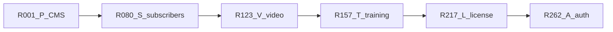
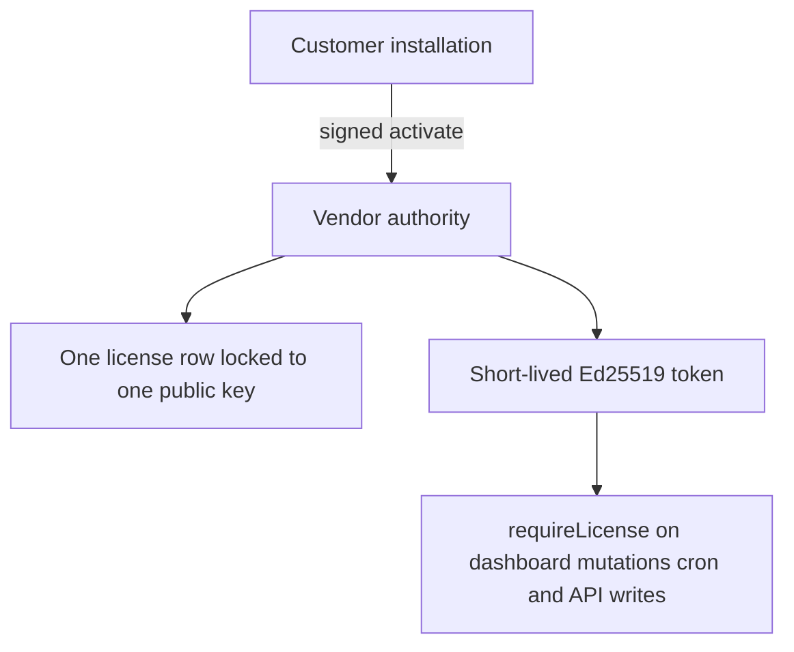
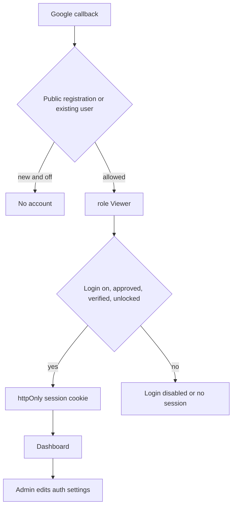

# Combined refs R001–R291

Say **implement R042** (or the original id, such as **P2-14**, **L3-01**, or **A2-01**). That ref is the whole task. Do not continue to the next ref unless you ask.

Specs for the first four blocks stay in the source plans. The licensing spec is in this file.

- CMS gap: [numbered_cms_refs_7ecd08c6.plan.md](.cursor/plans/numbered_cms_refs_7ecd08c6.plan.md) and [full_cms_gap_plan_8a7c0c53.plan.md](.cursor/plans/full_cms_gap_plan_8a7c0c53.plan.md)
- Subscribers: [content_subscriptions_af1362e2.plan.md](.cursor/plans/content_subscriptions_af1362e2.plan.md)
- Video library: [video_library_widget_0c5e2239.plan.md](.cursor/plans/video_library_widget_0c5e2239.plan.md)
- Training: [training_certificates_b50ce1b0.plan.md](.cursor/plans/training_certificates_b50ce1b0.plan.md)
- Licensing: **R217–R261** below
- Auth visibility and Viewer default: **R262–R291** below

Training follows the video library because it reuses `parseVideoUrl`, `buildEmbed`, and `src/components/video/`. Licensing does not depend on video or training. Auth visibility is last. It reuses the session cookie and the Admin, Editor, Author, and Viewer roles that already exist. In-app license notices use the notification helper from **R209** when that table exists, and always write the audit log.

## Shared work (do not build twice)

- **R025 (P2-14)** adds `users.password_hash` and the scrypt helper, and keeps Google in [src/auth.ts](src/auth.ts). **R081 (S1-02)** only confirms that column. **R088 (S3-01)** uses the same helper. **R091 (S3-04)** is the public `/account/login` page for the Subscriber role, on that same hash and the session cookie in [src/lib/auth/session.ts](src/lib/auth/session.ts). Password login from **R025** records failures through **R276**.
- **R264** makes [assignDefaultRole](src/server/services/access.service.ts) always assign Viewer. It replaces the current first-user-becomes-Admin branch. **R267** is the server CLI that creates the first Admin. **R027** may set a role only because an Admin is sending the invite. **R089** still assigns Subscriber and does not call `assignDefaultRole`. **R271** also applies to that signup: public registration off means no new subscriber row.
- **R070–R072 (P6-08, P6-09)** own the Stripe client and `POST` webhook for one-product Checkout. **R096 (S4-01)** reuses that client. **R099–R102 (S4-04 through S4-07)** add subscription events on the same route. Product checkout and the subscriber plan stay two products.
- **R123 (V1-01)** journals [src/db/migrations/20261022070000_page_views.sql](src/db/migrations/20261022070000_page_views.sql) without editing that SQL. **R157 (T1-01)** confirms the journal entry and stops.
- **R126–R127 (V2-01, V2-02)** own `parseVideoUrl` and `buildEmbed`. **R164 (T2-01)** calls them. **R186–R188 (T5-01 through T5-03)** wrap [src/components/video/](src/components/video/) from **R143–R145**. Training progress stays in `training_video_progress`, not `video_progress`.
- **R130 (V2-05)** adds the `test` script in [package.json](package.json). **R171 (T2-08)** and **R227 (L2-06)** only add tests. **R227** adds the script when **R130** has not.
- **R095 (S3-07)** sends role Subscriber to `/account`. **R173 (T3-02)** sends role Learner to `/dashboard/my-training`. **R239 (L5-02)** adds the license fail-closed check in the same dashboard layout and keeps both redirects. **R279** runs the session check in that layout before those redirects.
- License key hashing follows [src/server/services/api-keys.service.ts](src/server/services/api-keys.service.ts): sha256 via Node `crypto`, prefix stored, plaintext returned once. Signing uses Node `crypto` Ed25519. Do not add a second crypto package.
- **R048 (P5-01)** is a single Video block. **R150 (V6-02)** is the `VideoLibrary` widget. Both stay.

New tables from **R012 (P2-01)** onward include `site_id` defaulting to `default` until **R034 (P3-03)** backfills it.

## Gates

- Do not start **R040 (P4-01)** until **R034 (P3-03)**.
- Do not start **R073 (P7-01)** until **R001** and **R002**.
- Do not start **R086 (S2)** until **R080–R085**. **R105 (S5)** needs **R086–R087** and **R090–R091**. **R096 (S4)** needs **R088–R095** and the Stripe route from **R072**.
- Do not start **R136 (V4)** until **R125, R126, R131, R132**.
- Do not start **R164 (T2-01)** until **R126**. Do not start **R186 (T5)** until **R143–R145**. Do not start **R178 (T4)** until **R163, R164, R172**.
- Do not start **R228 (L3-01)** until **R221–R226**. Do not start **R234** until **R228–R232**. Do not start **R239** until **R238**. Do not start **R245** until **R243** and **R244**. **R217** can start before **R001**; licensing does not wait on the CMS gap.
- Do not start **R265** until **R264**. Do not start **R270** until **R268**. Do not start **R282** until **R262** and **R268**. **R262** can start before **R001**. **R025** calls **R276** when that ref exists and does not add a second lockout table.

## R001–R079 — CMS gap (P1–P7)

### P1 — Finish what is started

- **R001** (P1-01) Register `Slider`, `Tabs`, and `Accordion` as keys of `builderConfig.components` in [src/builder/config.tsx](src/builder/config.tsx).
- **R002** (P1-02) Confirm those three blocks render on the public site.
- **R003** (P1-03) Show the contact-form options editor only for select and radio.
- **R004** (P1-04) Nullable `page_id` plus `post_id` on `page_views`. Record post views in the analytics service and beacon route.
- **R005** (P1-05) Mount the view beacon on post routes in [src/app/(site)/[[...slug]]/page.tsx](src/app/(site)/[[...slug]]/page.tsx). Depends on R004.
- **R006** (P1-06) Include posts on the analytics boards.
- **R007** (P1-07) Public language switcher using `translationGroupId` and hreflang.
- **R008** (P1-08) Wire `UrlField` on Hero, CTA, Pricing, and Image.
- **R009** (P1-09) Wire `IconPickerField` on Features.
- **R010** (P1-10) Turn off `typescript.ignoreBuildErrors` in [next.config.ts](next.config.ts) and fix the type errors.
- **R011** (P1-11) Replace [README.md](README.md) with Postgres, Google OAuth, storage, Gemini, and cron setup.

### P2 — Day-one table stakes

- **R012** (P2-01) `form_submissions` table. `site_id` defaults to `default`.
- **R013** (P2-02) First-party contact-form submit route.
- **R014** (P2-03) Admin form inbox: list, read, archive.
- **R015** (P2-04) CSV export of form submissions.
- **R016** (P2-05) Honeypot and optional Turnstile on form submit.
- **R017** (P2-06) Email the site owner via SMTP or Resend from env.
- **R018** (P2-07) `redirects` table with `site_id`.
- **R019** (P2-08) Middleware resolves redirects before the catch-all page.
- **R020** (P2-09) Redirect CSV import.
- **R021** (P2-10) Publishing a slug change offers to create a redirect.
- **R022** (P2-11) Postgres full-text on published pages and posts.
- **R023** (P2-12) Public `/search` page.
- **R024** (P2-13) `GET /api/v1/search`.
- **R025** (P2-14) Email and password login for staff. Add nullable `users.password_hash` and one scrypt helper. Keep Google. Record failures through R276 when that helper exists.
- **R026** (P2-15) Magic-link login.
- **R027** (P2-16) Invite flow for new users. An Admin may choose the role on the invite. A missing role uses Viewer from R264. This path does not make the first Google user Admin.
- **R028** (P2-17) Optional TOTP for Admins.
- **R029** (P2-18) Review queue for `status=review`: approve and request changes.
- **R030** (P2-19) Email the author on review actions.
- **R031** (P2-20) OpenAPI spec from zod schemas in [src/server/api/v1.ts](src/server/api/v1.ts).

### P3 — Multi-site

- **R032** (P3-01) `sites` table: name, primary host, extra domains, locale list.
- **R033** (P3-02) `site_memberships`: user, site, role.
- **R034** (P3-03) Add `site_id` to content tables and backfill `default`.
- **R035** (P3-04) Resolve the public site from the request host.
- **R036** (P3-05) Admin site switcher. Permissions against the active site.
- **R037** (P3-06) Per-site locale list. English unprefixed.
- **R038** (P3-07) Translated menus.
- **R039** (P3-08) Translated site name, description, and default SEO.

### P4 — Headless

Do not start until R034.

- **R040** (P4-01) `collections` and `collection_fields` tables.
- **R041** (P4-02) Validate collection entry JSON against the field list.
- **R042** (P4-03) Generated admin list and edit screens for collections.
- **R043** (P4-04) `CollectionItem` block and `/{collection}/{slug}` route.
- **R044** (P4-05) Scoped API keys: `content:read`, `content:write`, `media:write`.
- **R045** (P4-06) Draft-first write endpoints for pages, posts, entries, and media.
- **R046** (P4-07) Postgres rate limit shared across instances.
- **R047** (P4-08) Signed webhooks and a delivery log.

### P5 — Builder

- **R048** (P5-01) Video block (single embed, not the library widget).
- **R049** (P5-02) Embed block.
- **R050** (P5-03) Logo cloud block.
- **R051** (P5-04) Team block.
- **R052** (P5-05) Timeline block.
- **R053** (P5-06) Map block.
- **R054** (P5-07) Spacer block.
- **R055** (P5-08) Button block.
- **R056** (P5-09) Code block.
- **R057** (P5-10) Newsletter block wired to the form inbox. Needs R012.
- **R058** (P5-11) Image-morph block from [image_morphing_block_544e3097.plan.md](.cursor/plans/image_morphing_block_544e3097.plan.md).
- **R059** (P5-12) Load Puck components from `src/builder/custom/`.
- **R060** (P5-13) Document the local plugin registration type.
- **R061** (P5-14) Soft lock and presence on pages and posts.
- **R062** (P5-15) One A/B variant per page with cookie split and beacon.
- **R063** (P5-16) Analytics group by variant and manual pick winner.

### P6 — Comments and one-product Stripe

- **R064** (P6-01) Threaded post comments: pending, approved, spam.
- **R065** (P6-02) Public comment form for guests or signed-in users.
- **R066** (P6-03) Comment moderation queue.
- **R067** (P6-04) Comments post block.
- **R068** (P6-05) Email the post author when a comment is approved.
- **R069** (P6-06) `products` and `orders` tables.
- **R070** (P6-07) Product grid block and Buy button.
- **R071** (P6-08) Stripe Checkout for one product. Add the shared Stripe client here.
- **R072** (P6-09) Stripe webhook marks the order paid. Orders inbox. This route later gains subscription events in R099.

### P7 — Ship

- **R073** (P7-01) Per-site baked export of published content, menus, theme, and media. Depends on R001 and R002.
- **R074** (P7-02) Export report: forms and checkout need external URLs.
- **R075** (P7-03) Playwright: sign in, edit, publish, view, submit a form, follow a redirect.
- **R076** (P7-04) Vitest for routes, redirects, collection validation, and the block registry.
- **R077** (P7-05) docker-compose for app, Postgres, and optional MinIO.
- **R078** (P7-06) Lighthouse CI on the home page and a blog post.
- **R079** (P7-07) GitHub Actions for lint, typecheck, unit tests, and Playwright.

## R080–R122 — Subscriber-only posts and pages (S1–S6)

One subscription unlocks every post or page with `subscribers_only`. Staff stay entitled. Role Subscriber is not. Spec: content subscriptions plan.

### S1 — Schema

- **R080** (S1-01) `pages.subscribers_only` and `posts.subscribers_only`, default false, plus a migration.
- **R081** (S1-02) Confirm `users.password_hash` from R025. Do not add a second column.
- **R082** (S1-03) `subscriptions` table: user, Stripe customer, Stripe subscription, status, period end.
- **R083** (S1-04) `subscription_enabled` and `subscription_label` on `site_settings`.
- **R084** (S1-05) Subscriber role with no dashboard permissions. Signup assigns it directly.
- **R085** (S1-06) Optional `STRIPE_SECRET_KEY`, `STRIPE_WEBHOOK_SECRET`, `STRIPE_PRICE_ID`. App boots when empty. Reuse names already added for R071 if present.

### S2 — Entitlement

- **R086** (S2-01) `hasAccess(userId)` is true only for `active` or `trialing`.
- **R087** (S2-02) Admin, Editor, Author, and Viewer are entitled. Subscriber is not.

### S3 — Visitor account

- **R088** (S3-01) Use the scrypt helper from R025. Do not add a second hasher.
- **R089** (S3-02) Signup creates the user and sets role Subscriber. It does not call `assignDefaultRole`. When R271 is present, public registration off rejects this signup.
- **R090** (S3-03) Public `/subscribe` page: name, email, password.
- **R091** (S3-04) `/account/login` writes the existing session cookie.
- **R092** (S3-05) `/account` shows email and subscription status.
- **R093** (S3-06) Subscriber logout.
- **R094** (S3-07) Dashboard layout sends role Subscriber to `/account`.
- **R095** (S3-08) Header link to Subscribe or Account.

### S4 — Stripe subscription

- **R096** (S4-01) Use the Stripe client from R071.
- **R097** (S4-02) Checkout session in `subscription` mode, `metadata.userId`, price from `STRIPE_PRICE_ID`.
- **R098** (S4-03) `/subscribe` starts that session after the account exists.
- **R099** (S4-04) Verify the Stripe signature on the webhook from R072.
- **R100** (S4-05) Handle `checkout.session.completed` for subscriptions.
- **R101** (S4-06) Handle subscription updated and deleted.
- **R102** (S4-07) `past_due`, `canceled`, `incomplete`, and `unpaid` stay locked.
- **R103** (S4-08) Stripe Customer Portal route.
- **R104** (S4-09) Clear message when Stripe env vars are missing.

### S5 — Public gate

- **R105** (S5-01) Expose `subscribersOnly` on public post and page loads.
- **R106** (S5-02) Strip locked post body and canvas before render.
- **R107** (S5-03) Strip locked page content before render.
- **R108** (S5-04) Paywall with title, excerpt, and subscribe or login links.
- **R109** (S5-05) Draft preview still shows the full body.
- **R110** (S5-06) Omit locked post body and layout from `/api/v1`.
- **R111** (S5-07) Omit locked page content from `/api/v1`.
- **R112** (S5-08) Set `isAccessibleForFree` false on locked JSON-LD.

### S6 — Editor

- **R113** (S6-01) Post form field and validation for subscribers only.
- **R114** (S6-02) Subscribers-only switch on the post sidebar.
- **R115** (S6-03) Persist the post flag on save.
- **R116** (S6-04) Copy the post flag when duplicating.
- **R117** (S6-05) Page form field and validation for subscribers only.
- **R118** (S6-06) Subscribers-only switch on the page sidebar.
- **R119** (S6-07) Persist the page flag on save.
- **R120** (S6-08) Copy the page flag when duplicating.
- **R121** (S6-09) Settings switch and price label.
- **R122** (S6-10) Subscribers list for `settings.manage`.

## R123–R156 — Video library (V1–V7)

URL records only: YouTube, Vimeo, and direct HTTPS `.mp4` / `.webm`. No uploads. Spec: video library plan.

### V1 — Schema

- **R123** (V1-01) Journal the existing `page_views` SQL so later migrations do not recreate it.
- **R124** (V1-02) `video_playlists`, `videos`, `video_progress`, and `site_settings.video_settings`.
- **R125** (V1-03) Generate the Drizzle migration. It adds video tables and `video_settings` only.

### V2 — Parsers

- **R126** (V2-01) `parseVideoUrl` for YouTube, Vimeo, and direct MP4/WebM.
- **R127** (V2-02) `buildEmbed` allowlisted iframe src from a parsed id.
- **R128** (V2-03) `videoSettingsSchema` and defaults.
- **R129** (V2-04) `clampProgress` completion rule.
- **R130** (V2-05) `node:test` for parsers, embed hosts, settings, and progress clamp, plus a `test` script.
- **R131** (V2-06) Official oEmbed client for YouTube and Vimeo only.

### V3 — Permissions and settings

- **R132** (V3-01) `videos.create`, `videos.edit`, `videos.publish`, `videos.delete`.
- **R133** (V3-02) Audit target `video`.
- **R134** (V3-03) Persist `videoSettings` in the site settings service and action.
- **R135** (V3-04) Video library section on the settings form.

### V4 — Admin

- **R136** (V4-01) Dashboard video routes and sidebar item.
- **R137** (V4-02) Playlist service and actions.
- **R138** (V4-03) Playlist panel on the videos page.
- **R139** (V4-04) Video create and update with parser, provider flags, and oEmbed fill.
- **R140** (V4-05) Publish, unpublish, soft-delete, and reorder.
- **R141** (V4-06) Video list table.
- **R142** (V4-07) Create and edit form with invalid-URL message.

### V5 — Player

- **R143** (V5-01) Native player controls for direct MP4 and WebM.
- **R144** (V5-02) YouTube and Vimeo iframe player with unavailable fallback.
- **R145** (V5-03) Native-only seek restriction.
- **R146** (V5-04) Video list with search, playlist filter, and load more.
- **R147** (V5-05) Sidebar and stacked library layouts.
- **R148** (V5-06) Admin preview dialog.

### V6 — Public block

- **R149** (V6-01) Published-video query for the block, including catalog mode and viewer access.
- **R150** (V6-02) Register the `VideoLibrary` Puck block.
- **R151** (V6-03) `saveVideoProgress` no-ops for anonymous visitors and clamps on the server.
- **R152** (V6-04) Resume start position for native, YouTube, and Vimeo.
- **R153** (V6-05) Wire progress into the widget when the setting is on.

### V7 — Checks

- **R154** (V7-01) Permission matrix test for the four video keys.
- **R155** (V7-02) Lint and `tsc` on the touched files.
- **R156** (V7-03) Browser check of the admin form and the public widget.

## R157–R216 — Training certificates (T1–T8)

Courses, playback, quizzes, PDF certificates, both dashboards, in-app notifications. Spec: training plan. Playback numbers are client estimates.

### T1 — Schema

- **R157** (T1-01) Confirm R123 journaled `page_views`. Do not journal it again.
- **R158** (T1-02) `training_courses`, `training_course_items`, and `training_enrollments`.
- **R159** (T1-03) `training_video_progress` and `course_progress`. Depends on R158.
- **R160** (T1-04) `training_questions` and `training_attempts`. Depends on R158.
- **R161** (T1-05) `certificates`, one issued row per user and course. Depends on R158.
- **R162** (T1-06) `notifications` and `site_settings.training_settings`.
- **R163** (T1-07) Drizzle migration for the training tables only. Depends on R157–R162.

### T2 — Rules

- **R164** (T2-01) Parse a course item as media, YouTube, Vimeo, or direct MP4/WebM by calling R126.
- **R165** (T2-02) Merge watched ranges without counting seeks across a gap.
- **R166** (T2-03) Accept a playback event with stale, duplicate, and wall-clock guards. Depends on R165.
- **R167** (T2-04) Course completion rules from progress, quiz, and approval.
- **R168** (T2-05) Score a quiz on the server and enforce attempt limits.
- **R169** (T2-06) Certificate number, verify token, and eligibility.
- **R170** (T2-07) Notification dedupe keys.
- **R171** (T2-08) `node:test` for R164–R170. The `test` script already exists from R130.

### T3 — Permissions and settings

- **R172** (T3-01) `training.manage`, `training.learn`, and the Learner role.
- **R173** (T3-02) Send a Learner away from non-training dashboard routes. Keep the Subscriber redirect from R094.
- **R174** (T3-03) `trainingSettingsSchema` and defaults.
- **R175** (T3-04) Persist training settings in the site settings service and action.
- **R176** (T3-05) Training section on the settings form.
- **R177** (T3-06) Audit targets for course, enrollment, and certificate.

### T4 — Course admin

- **R178** (T4-01) Training routes and sidebar items.
- **R179** (T4-02) Course create, update, and publish service.
- **R180** (T4-03) Course list.
- **R181** (T4-04) Course editor for title, description, cover, dates, and enrollment.
- **R182** (T4-05) Ordered course items from the media picker or a video URL.
- **R183** (T4-06) Per-course completion requirement fields.
- **R184** (T4-07) Assign and unassign individual users.
- **R185** (T4-08) Quiz question editor.

### T5 — Player

- **R186** (T5-01) HTML5 playback adapter using the native player from R143.
- **R187** (T5-02) YouTube IFrame API adapter using R144.
- **R188** (T5-03) Vimeo Player.js adapter using R144.
- **R189** (T5-04) Heartbeat on play, pause, ended, and page leave.
- **R190** (T5-05) `saveTrainingProgress` server action. Writes `training_video_progress` only.
- **R191** (T5-06) Resume from last position when the setting is on.
- **R192** (T5-07) Course player page for an enrolled learner.

### T6 — Completion and certificates

- **R193** (T6-01) Recalculate `course_progress` in a transaction.
- **R194** (T6-02) Manual completion approval.
- **R195** (T6-03) Quiz submit action.
- **R196** (T6-04) Certificate PDF layout with `pdf-lib` and a QR code.
- **R197** (T6-05) Store the PDF through `storage()`.
- **R198** (T6-06) Auto-issue one certificate when eligibility passes.
- **R199** (T6-07) Revoke a certificate.
- **R200** (T6-08) Reissue a certificate.
- **R201** (T6-09) Public verification page.
- **R202** (T6-10) Learner certificate download.

### T7 — Dashboards

- **R203** (T7-01) Admin overview counts from SQL aggregates.
- **R204** (T7-02) User progress table.
- **R205** (T7-03) Course progress table.
- **R206** (T7-04) CSV export of training progress.
- **R207** (T7-05) Learner training home.
- **R208** (T7-06) Learner course page with resume, quiz, and certificate status.

### T8 — Notifications and checks

- **R209** (T8-01) Idempotent notification insert.
- **R210** (T8-02) Notify on assign, complete, issue, and revoke.
- **R211** (T8-03) Cron reminders for due dates and expiring certificates.
- **R212** (T8-04) Unread notification list in the dashboard shell.
- **R213** (T8-05) Audit log on course, assignment, approval, issue, revoke, and reissue.
- **R214** (T8-06) `docs/training.md` with provider limits.
- **R215** (T8-07) Lint, `tsc`, and the test script.
- **R216** (T8-08) Browser check of admin, learner, download, and verify.

## R217–R261 — Single license, single item, single installation (L1–L8)

One license authorizes product `next-cms` on one installation. Say **implement R228** to do only that piece.

This repo is a self-hosted Next.js 16 App Router app on Postgres and Drizzle. Staff auth, roles, audit, and API-key hashing already exist. The process and the database run on whoever deploys the source. There is no compiled client and no vendor-controlled runtime inside a customer deploy.

Run two roles of this same codebase:

- **Authority** (`LICENSE_ROLE=authority`): the vendor deployment. It stores license hashes, binds installations, and signs tokens. `LICENSE_SIGNING_PRIVATE_KEY` stays in that server’s env. It is never a `NEXT_PUBLIC_` variable, never written to the repo, and never sent to a browser.
- **Installation** (`LICENSE_ROLE=installation`): a customer deployment. It keeps `LICENSE_INSTALLATION_PRIVATE_KEY` in server env, registers the matching public key, and calls `LICENSE_AUTHORITY_URL`. It verifies tokens with `LICENSE_SIGNING_PUBLIC_KEY`.

The licensed item is the product id `next-cms`, a constant in code. A license row cannot be pointed at another product. This is separate from the shop products in **R069** and the subscriber flag in **R080**.

What the authority database can enforce: one active binding, an atomic claim under concurrent requests, hashed keys, revocation of new tokens, rate limits, and an audit trail.

What an installation check can enforce: reject a bad signature, a wrong product, a wrong installation, and a token past its expiry, for as long as this code is the code that is running.

Known limits, written so they are not treated as bugs:

- A deploy that can edit this source can remove the guard. The private signing key still cannot be derived from the public key, so a removed guard is a local bypass, and forged tokens still fail on any install that keeps the verifier.
- A disconnected installation keeps working until the current token expires. Revocation applies on the next online validate or heartbeat. There is no push channel.
- IP address, hostname, MAC address, and user agent are not installation identity.
- `max_installations` is a database check constraint of `1`. The settings screen has no control that raises it, and no control that turns enforcement off.

Policy lives in `site_settings.license_settings` on the authority: heartbeat interval, offline grace capped in code, default expiry, reassignment cooldown and limit, activation rate limit, and which events notify. `LICENSE_ENFORCEMENT=off` works only when `NODE_ENV` is `development` or `test`. Production ignores it.

### L1 — Schema

Depends on nothing else in this checklist. Reuse `baseColumns` and the user FK. Add [src/db/schemas/licenses.schema.ts](src/db/schemas/licenses.schema.ts) and export it from [src/db/schema.ts](src/db/schema.ts).

- **R217** (L1-01) `licenses`: internal id, random `public_id`, `key_hash`, `key_prefix`, `product_id`, nullable `owner_user_id`, status `pending|active|suspended|expired|revoked`, `issued_at`, nullable `activated_at`, nullable `expires_at`, `max_installations` default `1` with a check constraint that it stays `1`, nullable current installation id, `last_validated_at`, `last_validation_result`, `reassignment_count`, timestamps. Unique `public_id` and unique `key_hash`.
- **R218** (L1-02) `license_installations`: random public id, Ed25519 `public_key`, license id, status, `last_seen_at`, timestamps. Partial unique index: one `active` row per `license_id`. Depends on R217.
- **R219** (L1-03) `license_events`: license id, installation public id, type, outcome, reason, actor id, timestamp. `license_nonces`: hash of the nonce, expiry. No license key, private key, or bearer token column. Depends on R217.
- **R220** (L1-04) `site_settings.license_settings` jsonb in [src/db/schemas/pages.schema.ts](src/db/schemas/pages.schema.ts), same pattern as `themeTokens`. Fields are the policy list above. No enforcement switch and no max-installations field.
- **R221** (L1-05) `npm run db:generate`. The new SQL adds the license tables and `license_settings` only. Depends on R217–R220.

### L2 — Keys and tokens

No UI. No new npm package. Use Node `crypto`, as [src/server/services/api-keys.service.ts](src/server/services/api-keys.service.ts) already does for hashes.

- **R222** (L2-01) `generateLicenseKey` and `hashLicenseKey` in [src/lib/license/keys.ts](src/lib/license/keys.ts). Prefix `ncms_lic_`. Return the plaintext once. Persist the sha256 hash and the prefix.
- **R223** (L2-02) `signLicenseToken` in [src/lib/license/token.ts](src/lib/license/token.ts). Ed25519. Claims: license public id, product id, installation public id, issued time, expiry, token version, issuer, audience, `kid`. The private key is read from server env on the authority.
- **R224** (L2-03) Installation key pair helper. Generate with `crypto.generateKeyPairSync('ed25519')`. Document that the private key is written to server env or a server-only file outside the repo. The activate request sends the public key. Logs and API responses omit both the license key and the private key.
- **R225** (L2-04) `verifyLicenseToken` checks the signature, issuer, audience, expiry, product id `next-cms`, and installation public id. Reject malformed tokens.
- **R226** (L2-05) Verify with the current public key, then the previous public key. New tokens are signed with the current `kid`. Depends on R225.
- **R227** (L2-06) `node:test` via `tsx` for R222–R226. Cover a forged signature, an expired token, a wrong product, a wrong installation, and a rotated key. Add the `test` script when R130 has not. Use keys generated in the test.

### L3 — Authority rules

Service: [src/server/services/license.service.ts](src/server/services/license.service.ts). Decisions happen in a transaction.

- **R228** (L3-01) `activate`: hash the presented key, lock the license row, reject unknown, wrong product, pending, suspended, expired, and revoked with one generic client error. The same installation public key refreshes the binding and does not insert a second row. A different public key leaves the row unchanged. Depends on R221–R226.
- **R229** (L3-02) `validate` and `heartbeat` for the bound public key. Update `last_validated_at` and `last_validation_result`. Return a new short-lived token when status is `active` and unexpired. Depends on R228.
- **R230** (L3-03) `deactivate` accepts a request signed by the bound installation key. Clears that binding only. Depends on R228.
- **R231** (L3-04) `reassign` is an admin operation. It clears the previous active installation, binds the new public key, increments `reassignment_count`, and writes both public ids, the actor, and the reason. A normal activate call does not take this path. Enforce the cooldown and the reassignment limit from R220. Depends on R228.
- **R232** (L3-05) Persist activation attempts in a small rate-limit table so the limit is shared across processes. Store a hash of the nonce until it expires and reject a repeat. Client errors stay generic. License events store the specific reason for the admin screen. Depends on R219.
- **R233** (L3-06) Extend [src/app/api/cron/publish/route.ts](src/app/api/cron/publish/route.ts) to set `expired` when `expires_at` has passed. Same `CRON_SECRET` bearer check. Depends on R217.

### L4 — HTTP

Routes under `src/app/api/licenses/`. Installation requests include a timestamp and a signature from R224. Reassign is not a public route.

- **R234** (L4-01) `POST /api/licenses/activate` calls R228. Depends on R228 and R232.
- **R235** (L4-02) `POST /api/licenses/validate` and `POST /api/licenses/heartbeat` call R229. Depends on R229 and R232.
- **R236** (L4-03) `POST /api/licenses/deactivate` calls R230. Depends on R230.
- **R237** (L4-04) `GET /api/licenses/status` returns status, expiry, and bound installation public id for a signed installation. It omits the key hash, the prefix, and the owner email. Depends on R229.

### L5 — Server enforcement

- **R238** (L5-01) `requireLicense` in [src/server/services/license.service.ts](src/server/services/license.service.ts). On an installation it verifies the cached token with R225. Past grace, or when the authority has answered revoked or suspended, it fails closed. It caches a successful online result until the token expiry.
- **R239** (L5-02) [src/app/(admin)/dashboard/layout.tsx](src/app/(admin)/dashboard/layout.tsx) calls R238 before the page renders. Keep the Subscriber redirect from R094 and the Learner redirect from R173 when those refs exist.
- **R240** (L5-03) Call R238 from `permissionProcedure` so dashboard mutations are covered in one place. Depends on R238.
- **R241** (L5-04) Call R238 from the publish cron and from mutating `/api/v1` handlers. Published public GET pages stay available. Depends on R238.
- **R242** (L5-05) Read `LICENSE_ENFORCEMENT` in [src/env.mjs](src/env.mjs). When `NODE_ENV` is `production`, R238 runs even if the variable is `off`. `development` and `test` may set `off`. Add the authority and installation secrets to the server env schema. None are client env vars.

### L6 — Administration

Screens under `src/app/(admin)/dashboard/(shell)/licenses/`. The authority deployment shows them. An installation deployment does not issue licenses.

- **R243** (L6-01) Add `licenses.manage` to [src/config/permissions.ts](src/config/permissions.ts), Admin only. Add audit target `license` and the license actions on [src/server/services/audit.service.ts](src/server/services/audit.service.ts). Audit details omit secrets.
- **R244** (L6-02) Routes in [src/config/pages.ts](src/config/pages.ts) and a sidebar item in [src/menus/index.tsx](src/menus/index.tsx), visible with `licenses.manage`.
- **R245** (L6-03) Issue a `pending` license for product `next-cms`. Show the plaintext key once, then drop it. Audit the create. Depends on R222, R243, and R244.
- **R246** (L6-04) Assign `owner_user_id`. Depends on R245.
- **R247** (L6-05) List: public id, prefix, status, owner, expiry, bound installation. Search, filter, sort, pagination. Depends on R245.
- **R248** (L6-06) Detail page: status, current installation public key id, and `license_events`. Depends on R219 and R247.
- **R249** (L6-07) Suspend, revoke, and renew. Each asks for confirmation. Revoke and suspend block the next token. Renew updates `expires_at`. Audit each one. Depends on R248.
- **R250** (L6-08) Reassign and deactivate actions call R231 and R230. Confirmation includes a reason. Show the previous and next installation public ids. Depends on R231 and R248.
- **R251** (L6-09) License section on [settings-form.tsx](src/app/(admin)/dashboard/(shell)/settings/_components/settings-form.tsx), gated by `settings.manage`. Heartbeat, grace (rejected above the code cap), default expiry, reassignment cooldown and limit, rate limit, notification toggles. Depends on R220.

### L7 — Notices and abuse

- **R252** (L7-01) On activation conflict, revocation, and expiry inside the reminder window, write a license event and an audit row. When the notifications helper from R209 exists, insert an in-app row with a dedupe key. Skip the in-app insert when that table is absent. Depends on R219 and R249.
- **R253** (L7-02) Record rate-limit hits, second-installation attempts, and bad signatures as license events. Do not revoke because the caller IP changed or a heartbeat was late. Depends on R232.

### L8 — Tests and docs

Tests use generated keys and `NODE_ENV=test`. They do not read production secrets.

- **R254** (L8-01) Tests for a valid activate, an unknown key, the wrong product, a second installation, and a repeat from the same installation. Depends on R228.
- **R255** (L8-02) Two overlapping activate calls for one license and two public keys: one succeeds, one fails, one active installation row remains. Depends on R228.
- **R256** (L8-03) Expired, revoked, and suspended licenses, a modified token, a wrong installation claim, and verification after key rotation. Depends on R226 and R229.
- **R257** (L8-04) Reassign requires `licenses.manage`. A second overlapping reassign still leaves one active installation. Depends on R231.
- **R258** (L8-05) Grace boundary, rate limit, replayed nonce, `requireLicense` on a protected entry, and an audit row for revoke. Depends on R232, R238, and R249.
- **R259** (L8-06) [docs/licensing.md](docs/licensing.md): authority versus installation, where each key lives, dev and test `LICENSE_ENFORCEMENT=off`, production ignoring that variable, grace versus immediate revocation, and the source-edit limit from this section.
- **R260** (L8-07) `npm run lint`, `tsc --noEmit`, and the license tests. Fix issues these refs introduced.
- **R261** (L8-08) Browser, on an authority: issue a license, confirm the key is shown once, suspend or revoke with confirmation, and reassign. Confirm the settings form has no control that sets max installations above 1 or turns enforcement off. Depends on R250 and R251.

## R262–R291 — Login visibility and default Viewer (A1–A8)

Say **implement R264** to do only that piece. Reuse the current session, roles, and audit log. Do not add a second login system or a second Administrator role.

What already exists:

- Google sign-in at `/login` and [src/app/login/google/callback/route.ts](src/app/login/google/callback/route.ts). [AuthService.create](src/server/services/auth.services.ts) upserts the user and does not set `roleId`.
- [assignDefaultRole](src/server/services/access.service.ts) runs on first access. The first user with no role becomes Admin. Later users become Viewer.
- Roles Admin, Editor, Author, and Viewer live in [src/config/permissions.ts](src/config/permissions.ts). Viewer has no permission rows. Admin is the administrator role. Author stays.
- Sessions are random ids in the `session` table. The `session` cookie is `httpOnly`, `SameSite=lax`, and `secure` in production ([src/lib/auth/session.ts](src/lib/auth/session.ts)). Lifetime is a fixed 30 days. Expired rows are rejected.
- User status is `Active` or `Inactive`. Role changes go through `setUserRole` with `settings.manage` and an audit `role_change`.
- Published pages under the public site are readable without a session. The dashboard layout loads the current user, and the sidebar sends a missing session to `/login`.

Gaps these refs close: the first Google user becomes Admin, login cannot be turned off, registration cannot be turned off, approval and lockout are absent, and session lifetime ignores settings. Hiding the login link must leave the dashboard and mutating APIs refused.

Defaults, chosen so a current install still shows login until an admin changes it:

- Login enabled.
- Public registration enabled, so a new Google email can still create a row.
- Email verification off. Admin approval off.
- Session lifetime 30 days, matching the code today. Code rejects a value outside 1 hour to 90 days.
- Five failed attempts, then a 15 minute lockout.
- New accounts get Viewer. The settings screen shows that as a fixed label. It is not a dropdown.

Bootstrap: after the first Google login the account is Viewer. On the server, `npm run auth:promote -- user@example.com` sets Admin. If login is later turned off, an existing session can turn it back on. A logged-out admin uses `npm run auth:enable-login`, which updates the database and has no HTTP route. Both commands require shell access to the deployment.

### A1 — Settings and columns

- **R262** (A1-01) `site_settings.auth_settings` jsonb in [src/db/schemas/pages.schema.ts](src/db/schemas/pages.schema.ts), same pattern as `themeTokens`. Fields: `loginEnabled`, `publicRegistrationEnabled`, `requireEmailVerification`, `requireAdminApproval`, `sessionLifetimeHours`, `maxFailedAttempts`, `lockoutMinutes`, `loginDisabledMessage`. Zod defaults as listed above. No writable default-role field.
- **R263** (A1-02) On `users`: nullable `approved_at`, `failed_login_count` default `0`, nullable `locked_until`. Backfill `approved_at` from `created_at` for existing rows so current users stay approved. Drizzle migration for this column set and `auth_settings` only. Depends on R262.

### A2 — Viewer by default

- **R264** (A2-01) `assignDefaultRole` always sets Viewer inside a transaction. It takes no role from its caller. Users who already have `roleId` are left unchanged. Delete the first-user-becomes-Admin branch. Update the copy in [users-and-roles.tsx](src/app/(admin)/dashboard/(shell)/users/_components/users-and-roles.tsx) that describes that branch.
- **R265** (A2-02) [AuthService.create](src/server/services/auth.services.ts) and the Google callback call R264 only when `roleId` is null. Ignore `role`, `roleId`, and any other privilege field on the provider payload or request body. Depends on R264.
- **R266** (A2-03) `setUserRole` remains `permissionProcedure(settings.manage)`. Audit `role_change` with the actor, the target user, and the new role name. A request whose actor lacks `settings.manage` throws before the update. Depends on R264.
- **R267** (A2-04) `src/db/scripts/promote-admin.ts` and `npm run auth:promote`. It sets the Viewer or roled user with that email to Admin using `DATABASE_URL`. It does not listen on HTTP. Document the command in the script header. Depends on R264.

### A3 — Login and registration switches

- **R268** (A3-01) `getAuthSettings` in [src/server/services/site-settings.service.ts](src/server/services/site-settings.service.ts). Server-only. Depends on R262.
- **R269** (A3-02) When `loginEnabled` is false, remove login links and the Google button from the public header, the login form, and other entry points that render them. Depends on R268.
- **R270** (A3-03) `/login` renders `loginDisabledMessage` and no form when login is disabled. `GET /login/google` and the callback respond with that same refusal and do not start a session. A session that already exists keeps working. Depends on R268.
- **R271** (A3-04) When `publicRegistrationEnabled` is false, the Google callback rejects an email that has no user row. An existing user can still sign in. **R089** uses this same check. Depends on R268.
- **R272** (A3-05) When `requireAdminApproval` is true, a new user is stored with `approved_at` null and status `Inactive`. `login` does not create a session for that user. Existing backfilled users stay approved. Depends on R263 and R265.
- **R273** (A3-06) When `requireEmailVerification` is true and `emailVerified` is false, do not create a session. Google’s `email_verified` still maps onto `emailVerified`. Depends on R265.
- **R274** (A3-07) `validateSession` returns null for `Inactive`, for `approved_at` null while approval is required, and while `locked_until` is in the future. Stop writing the raw session id into logs. Depends on R263.

### A4 — Session and abuse

- **R275** (A4-01) `createSession` sets `expiresAt` from `sessionLifetimeHours`. Keep the halfway refresh using that same length. Logout keeps deleting the session row and clearing the cookie. Depends on R268.
- **R276** (A4-02) `auth_attempts` rows keyed by a hash of the email or IP, plus `failed_login_count` and `locked_until` on the user. Google start, the callback, and the password login from R025 call one helper. Over the limit, the response is generic. A successful login clears the counter. Depends on R263.
- **R277** (A4-03) A post-login `next` path must start with a single `/` and must not be protocol-relative. The Google callback continues to land on the dashboard path. Depends on R270.
- **R278** (A4-04) Leave the `session` cookie `httpOnly`, `SameSite=lax`, and `secure` in production. On the login routes, reject a request whose `Origin` host is present and does not match the app host. The OAuth `state` cookie stays the CSRF check for Google.

### A5 — Server enforcement

- **R279** (A5-01) [src/app/(admin)/dashboard/layout.tsx](src/app/(admin)/dashboard/layout.tsx) requires a valid session before the Subscriber redirect (R094), the Learner redirect (R173), or the license check (R239). Missing session goes to `/login` when login is enabled, and to the disabled message when it is not. Depends on R270 and R274.
- **R280** (A5-02) Users, settings, and license pages call `assertPermission` on the server. Viewer has none of `settings.manage`, `licenses.manage`, or user-admin actions. Editor does not receive `settings.manage`. A hidden button is not the check. Depends on R266.
- **R281** (A5-03) Published public pages and public GET content stay available with no session. Dashboard, settings, user management, license management, and mutating server actions require a session from R274.

### A6 — Admin screen

- **R282** (A6-01) Authentication & Access section on [settings-form.tsx](src/app/(admin)/dashboard/(shell)/settings/_components/settings-form.tsx), gated by `settings.manage`. Toggles for login, public registration, email verification, and admin approval. Selectors for session lifetime, attempt limit, and lockout duration. Read-only text: default role Viewer. Server zod rejects a body that tries to set another default role, and rejects lifetime or lockout outside the caps. Turning login off asks for confirmation and names the `auth:enable-login` command. Audit `settings_change`. Depends on R262 and R268.
- **R283** (A6-02) On the users screen, an Admin with `settings.manage` can approve a pending user. That sets `approved_at` and status `Active` in one transaction and writes `role_change` or `update` audit details that name the approval. The approved role stays Viewer unless an admin changes it afterward. Depends on R272 and R266.

### A7 — Recovery

- **R284** (A7-01) `src/db/scripts/enable-login.ts` and `npm run auth:enable-login`. It sets `loginEnabled` true through `DATABASE_URL`. No route, cookie, or token on the public site. Depends on R262.
- **R285** (A7-02) [docs/auth.md](docs/auth.md): the defaults, why the first Google user is Viewer, `auth:promote` and `auth:enable-login`, the Subscriber exception for R089, the invite exception for R027, and which routes stay public.

### A8 — Tests

Use `node:test`. Add the `test` script only when R130 and R227 have not. No production session ids or passwords in fixtures.

- **R286** (A8-01) A new user and a Google create receive Viewer. A body that sends Administrator or Admin is stored as Viewer. The first user in an empty role table is Viewer. Depends on R264 and R265.
- **R287** (A8-02) A Viewer session is rejected for the settings action, the user-role action, and a license admin action. An Editor session is rejected for `settings.manage`. An unauthenticated call is rejected. Depends on R280.
- **R288** (A8-03) Login disabled: `/login` has no Google start, and the callback does not create a session. Registration disabled: an unknown email does not insert a user. Pending, inactive, and expired sessions fail R274. Depends on R270, R271, and R274.
- **R289** (A8-04) The attempt after the configured limit locks the account. A Viewer role-change call throws and leaves an audit row. A published public page handler does not require a session. The enable-login script sets `loginEnabled` true. Depends on R276, R266, R281, and R284.
- **R290** (A8-05) `npm run lint`, `tsc --noEmit`, and the auth tests. Fix issues these refs introduced.
- **R291** (A8-06) Browser: open Authentication & Access, turn login off, confirm the confirmation step, open `/login` and see the disabled message and no Google button, then turn login back on from the still-valid session. Confirm the default role control is text reading Viewer. Depends on R269, R270, and R282.

## Milestones

- Demoable CMS: through **R031** (end of P2).
- Agency CMS: through **R039** (end of P3).
- Headless CMS: through **R047** (end of P4).
- Builder parity: through **R063** (end of P5).
- Comments and one-product checkout: through **R072**.
- Shippable CMS: through **R079**.
- Subscriber unlock: through **R122**.
- Video library widget: through **R156**.
- Training and certificates: through **R216**.
- Single-install licensing: through **R261**.
- Login visibility and default Viewer: through **R291**.
