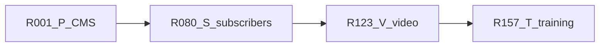

# Combined refs R001–R216

Say **implement R042** (or the original id, such as **P2-14**). That ref is the whole task. Do not continue to the next ref unless you ask.

Specs stay in the source plans. This file is only the order, the dedupe rules, and the task line.

- CMS gap: [numbered_cms_refs_7ecd08c6.plan.md](.cursor/plans/numbered_cms_refs_7ecd08c6.plan.md) and [full_cms_gap_plan_8a7c0c53.plan.md](.cursor/plans/full_cms_gap_plan_8a7c0c53.plan.md)
- Subscribers: [content_subscriptions_af1362e2.plan.md](.cursor/plans/content_subscriptions_af1362e2.plan.md)
- Video library: [video_library_widget_0c5e2239.plan.md](.cursor/plans/video_library_widget_0c5e2239.plan.md)
- Training: [training_certificates_b50ce1b0.plan.md](.cursor/plans/training_certificates_b50ce1b0.plan.md)

Training is last because its plan reuses `parseVideoUrl`, `buildEmbed`, and `src/components/video/` from the video library. The other three files stay in the order you listed.

## Shared work (do not build twice)

- **R026 (P2-14)** adds `users.password_hash` and the scrypt helper, and keeps Google in [src/auth.ts](src/auth.ts). **R081 (S1-02)** only confirms that column. **R088 (S3-01)** uses the same helper. **R091 (S3-04)** is the public `/account/login` page for the Subscriber role, on that same hash and the session cookie in [src/lib/auth/session.ts](src/lib/auth/session.ts).
- **R070–R072 (P6-08, P6-09)** own the Stripe client and `POST` webhook for one-product Checkout. **R096 (S4-01)** reuses that client. **R099–R102 (S4-04 through S4-07)** add subscription events on the same route. Product checkout and the subscriber plan stay two products.
- **R123 (V1-01)** journals [src/db/migrations/20261022070000_page_views.sql](src/db/migrations/20261022070000_page_views.sql) without editing that SQL. **R157 (T1-01)** confirms the journal entry and stops.
- **R126–R127 (V2-01, V2-02)** own `parseVideoUrl` and `buildEmbed`. **R164 (T2-01)** calls them. **R186–R188 (T5-01 through T5-03)** wrap [src/components/video/](src/components/video/) from **R143–R145**. Training progress stays in `training_video_progress`, not `video_progress`.
- **R130 (V2-05)** adds the `test` script in [package.json](package.json). **R171 (T2-08)** only adds training tests.
- **R095 (S3-07)** sends role Subscriber to `/account`. **R173 (T3-02)** sends role Learner to `/dashboard/my-training`. The later ref must keep both redirects.
- **R048 (P5-01)** is a single Video block. **R150 (V6-02)** is the `VideoLibrary` widget. Both stay.

New tables from **R012 (P2-01)** onward include `site_id` defaulting to `default` until **R034 (P3-03)** backfills it.

## Gates

- Do not start **R040 (P4-01)** until **R034 (P3-03)**.
- Do not start **R073 (P7-01)** until **R001** and **R002**.
- Do not start **R086 (S2)** until **R080–R085**. **R105 (S5)** needs **R086–R087** and **R090–R091**. **R096 (S4)** needs **R088–R095** and the Stripe route from **R072**.
- Do not start **R136 (V4)** until **R125, R126, R131, R132**.
- Do not start **R164 (T2-01)** until **R126**. Do not start **R186 (T5)** until **R143–R145**. Do not start **R178 (T4)** until **R163, R164, R172**.

## R001–R079 — CMS gap (P1–P7)

### P1 — Finish what is started

- **R001** (P1-01) Register `Slider`, `Tabs`, and `Accordion` as keys of `builderConfig.components` in [src/builder/config.tsx](src/builder/config.tsx).
- **R002** (P1-02) Confirm those three blocks render on the public site.
- **R003** (P1-03) Show the contact-form options editor only for select and radio.
- **R004** (P1-04) Nullable `page_id` plus `post_id` on `page_views`. Record post views in the analytics service and beacon route.
- **R005** (P1-05) Mount the view beacon on post routes in [src/app/(site)/[[...slug]]/page.tsx](src/app/(site)/[[...slug]]/page.tsx). Depends on R004.
- **R006** (P1-06) Include posts on the analytics boards.
- **R007** (P1-07) Public language switcher using `translationGroupId` and hreflang.
- **R008** (P1-08) Wire `UrlField` on Hero, CTA, Pricing, and Image.
- **R009** (P1-09) Wire `IconPickerField` on Features.
- **R010** (P1-10) Turn off `typescript.ignoreBuildErrors` in [next.config.ts](next.config.ts) and fix the type errors.
- **R011** (P1-11) Replace [README.md](README.md) with Postgres, Google OAuth, storage, Gemini, and cron setup.

### P2 — Day-one table stakes

- **R012** (P2-01) `form_submissions` table. `site_id` defaults to `default`.
- **R013** (P2-02) First-party contact-form submit route.
- **R014** (P2-03) Admin form inbox: list, read, archive.
- **R015** (P2-04) CSV export of form submissions.
- **R016** (P2-05) Honeypot and optional Turnstile on form submit.
- **R017** (P2-06) Email the site owner via SMTP or Resend from env.
- **R018** (P2-07) `redirects` table with `site_id`.
- **R019** (P2-08) Middleware resolves redirects before the catch-all page.
- **R020** (P2-09) Redirect CSV import.
- **R021** (P2-10) Publishing a slug change offers to create a redirect.
- **R022** (P2-11) Postgres full-text on published pages and posts.
- **R023** (P2-12) Public `/search` page.
- **R024** (P2-13) `GET /api/v1/search`.
- **R025** (P2-14) Email and password login for staff. Add nullable `users.password_hash` and one scrypt helper. Keep Google.
- **R026** (P2-15) Magic-link login.
- **R027** (P2-16) Invite flow for new users.
- **R028** (P2-17) Optional TOTP for Admins.
- **R029** (P2-18) Review queue for `status=review`: approve and request changes.
- **R030** (P2-19) Email the author on review actions.
- **R031** (P2-20) OpenAPI spec from zod schemas in [src/server/api/v1.ts](src/server/api/v1.ts).

### P3 — Multi-site

- **R032** (P3-01) `sites` table: name, primary host, extra domains, locale list.
- **R033** (P3-02) `site_memberships`: user, site, role.
- **R034** (P3-03) Add `site_id` to content tables and backfill `default`.
- **R035** (P3-04) Resolve the public site from the request host.
- **R036** (P3-05) Admin site switcher. Permissions against the active site.
- **R037** (P3-06) Per-site locale list. English unprefixed.
- **R038** (P3-07) Translated menus.
- **R039** (P3-08) Translated site name, description, and default SEO.

### P4 — Headless

Do not start until R034.

- **R040** (P4-01) `collections` and `collection_fields` tables.
- **R041** (P4-02) Validate collection entry JSON against the field list.
- **R042** (P4-03) Generated admin list and edit screens for collections.
- **R043** (P4-04) `CollectionItem` block and `/{collection}/{slug}` route.
- **R044** (P4-05) Scoped API keys: `content:read`, `content:write`, `media:write`.
- **R045** (P4-06) Draft-first write endpoints for pages, posts, entries, and media.
- **R046** (P4-07) Postgres rate limit shared across instances.
- **R047** (P4-08) Signed webhooks and a delivery log.

### P5 — Builder

- **R048** (P5-01) Video block (single embed, not the library widget).
- **R049** (P5-02) Embed block.
- **R050** (P5-03) Logo cloud block.
- **R051** (P5-04) Team block.
- **R052** (P5-05) Timeline block.
- **R053** (P5-06) Map block.
- **R054** (P5-07) Spacer block.
- **R055** (P5-08) Button block.
- **R056** (P5-09) Code block.
- **R057** (P5-10) Newsletter block wired to the form inbox. Needs R012.
- **R058** (P5-11) Image-morph block from [image_morphing_block_544e3097.plan.md](.cursor/plans/image_morphing_block_544e3097.plan.md).
- **R059** (P5-12) Load Puck components from `src/builder/custom/`.
- **R060** (P5-13) Document the local plugin registration type.
- **R061** (P5-14) Soft lock and presence on pages and posts.
- **R062** (P5-15) One A/B variant per page with cookie split and beacon.
- **R063** (P5-16) Analytics group by variant and manual pick winner.

### P6 — Comments and one-product Stripe

- **R064** (P6-01) Threaded post comments: pending, approved, spam.
- **R065** (P6-02) Public comment form for guests or signed-in users.
- **R066** (P6-03) Comment moderation queue.
- **R067** (P6-04) Comments post block.
- **R068** (P6-05) Email the post author when a comment is approved.
- **R069** (P6-06) `products` and `orders` tables.
- **R070** (P6-07) Product grid block and Buy button.
- **R071** (P6-08) Stripe Checkout for one product. Add the shared Stripe client here.
- **R072** (P6-09) Stripe webhook marks the order paid. Orders inbox. This route later gains subscription events in R099.

### P7 — Ship

- **R073** (P7-01) Per-site baked export of published content, menus, theme, and media. Depends on R001 and R002.
- **R074** (P7-02) Export report: forms and checkout need external URLs.
- **R075** (P7-03) Playwright: sign in, edit, publish, view, submit a form, follow a redirect.
- **R076** (P7-04) Vitest for routes, redirects, collection validation, and the block registry.
- **R077** (P7-05) docker-compose for app, Postgres, and optional MinIO.
- **R078** (P7-06) Lighthouse CI on the home page and a blog post.
- **R079** (P7-07) GitHub Actions for lint, typecheck, unit tests, and Playwright.

## R080–R122 — Subscriber-only posts and pages (S1–S6)

One subscription unlocks every post or page with `subscribers_only`. Staff stay entitled. Role Subscriber is not. Spec: content subscriptions plan.

### S1 — Schema

- **R080** (S1-01) `pages.subscribers_only` and `posts.subscribers_only`, default false, plus a migration.
- **R081** (S1-02) Confirm `users.password_hash` from R025. Do not add a second column.
- **R082** (S1-03) `subscriptions` table: user, Stripe customer, Stripe subscription, status, period end.
- **R083** (S1-04) `subscription_enabled` and `subscription_label` on `site_settings`.
- **R084** (S1-05) Subscriber role with no dashboard permissions. Signup assigns it directly.
- **R085** (S1-06) Optional `STRIPE_SECRET_KEY`, `STRIPE_WEBHOOK_SECRET`, `STRIPE_PRICE_ID`. App boots when empty. Reuse names already added for R071 if present.

### S2 — Entitlement

- **R086** (S2-01) `hasAccess(userId)` is true only for `active` or `trialing`.
- **R087** (S2-02) Admin, Editor, Author, and Viewer are entitled. Subscriber is not.

### S3 — Visitor account

- **R088** (S3-01) Use the scrypt helper from R025. Do not add a second hasher.
- **R089** (S3-02) Signup creates the user and sets role Subscriber. It does not call `assignDefaultRole`.
- **R090** (S3-03) Public `/subscribe` page: name, email, password.
- **R091** (S3-04) `/account/login` writes the existing session cookie.
- **R092** (S3-05) `/account` shows email and subscription status.
- **R093** (S3-06) Subscriber logout.
- **R094** (S3-07) Dashboard layout sends role Subscriber to `/account`.
- **R095** (S3-08) Header link to Subscribe or Account.

### S4 — Stripe subscription

- **R096** (S4-01) Use the Stripe client from R071.
- **R097** (S4-02) Checkout session in `subscription` mode, `metadata.userId`, price from `STRIPE_PRICE_ID`.
- **R098** (S4-03) `/subscribe` starts that session after the account exists.
- **R099** (S4-04) Verify the Stripe signature on the webhook from R072.
- **R100** (S4-05) Handle `checkout.session.completed` for subscriptions.
- **R101** (S4-06) Handle subscription updated and deleted.
- **R102** (S4-07) `past_due`, `canceled`, `incomplete`, and `unpaid` stay locked.
- **R103** (S4-08) Stripe Customer Portal route.
- **R104** (S4-09) Clear message when Stripe env vars are missing.

### S5 — Public gate

- **R105** (S5-01) Expose `subscribersOnly` on public post and page loads.
- **R106** (S5-02) Strip locked post body and canvas before render.
- **R107** (S5-03) Strip locked page content before render.
- **R108** (S5-04) Paywall with title, excerpt, and subscribe or login links.
- **R109** (S5-05) Draft preview still shows the full body.
- **R110** (S5-06) Omit locked post body and layout from `/api/v1`.
- **R111** (S5-07) Omit locked page content from `/api/v1`.
- **R112** (S5-08) Set `isAccessibleForFree` false on locked JSON-LD.

### S6 — Editor

- **R113** (S6-01) Post form field and validation for subscribers only.
- **R114** (S6-02) Subscribers-only switch on the post sidebar.
- **R115** (S6-03) Persist the post flag on save.
- **R116** (S6-04) Copy the post flag when duplicating.
- **R117** (S6-05) Page form field and validation for subscribers only.
- **R118** (S6-06) Subscribers-only switch on the page sidebar.
- **R119** (S6-07) Persist the page flag on save.
- **R120** (S6-08) Copy the page flag when duplicating.
- **R121** (S6-09) Settings switch and price label.
- **R122** (S6-10) Subscribers list for `settings.manage`.

## R123–R156 — Video library (V1–V7)

URL records only: YouTube, Vimeo, and direct HTTPS `.mp4` / `.webm`. No uploads. Spec: video library plan.

### V1 — Schema

- **R123** (V1-01) Journal the existing `page_views` SQL so later migrations do not recreate it.
- **R124** (V1-02) `video_playlists`, `videos`, `video_progress`, and `site_settings.video_settings`.
- **R125** (V1-03) Generate the Drizzle migration. It adds video tables and `video_settings` only.

### V2 — Parsers

- **R126** (V2-01) `parseVideoUrl` for YouTube, Vimeo, and direct MP4/WebM.
- **R127** (V2-02) `buildEmbed` allowlisted iframe src from a parsed id.
- **R128** (V2-03) `videoSettingsSchema` and defaults.
- **R129** (V2-04) `clampProgress` completion rule.
- **R130** (V2-05) `node:test` for parsers, embed hosts, settings, and progress clamp, plus a `test` script.
- **R131** (V2-06) Official oEmbed client for YouTube and Vimeo only.

### V3 — Permissions and settings

- **R132** (V3-01) `videos.create`, `videos.edit`, `videos.publish`, `videos.delete`.
- **R133** (V3-02) Audit target `video`.
- **R134** (V3-03) Persist `videoSettings` in the site settings service and action.
- **R135** (V3-04) Video library section on the settings form.

### V4 — Admin

- **R136** (V4-01) Dashboard video routes and sidebar item.
- **R137** (V4-02) Playlist service and actions.
- **R138** (V4-03) Playlist panel on the videos page.
- **R139** (V4-04) Video create and update with parser, provider flags, and oEmbed fill.
- **R140** (V4-05) Publish, unpublish, soft-delete, and reorder.
- **R141** (V4-06) Video list table.
- **R142** (V4-07) Create and edit form with invalid-URL message.

### V5 — Player

- **R143** (V5-01) Native player controls for direct MP4 and WebM.
- **R144** (V5-02) YouTube and Vimeo iframe player with unavailable fallback.
- **R145** (V5-03) Native-only seek restriction.
- **R146** (V5-04) Video list with search, playlist filter, and load more.
- **R147** (V5-05) Sidebar and stacked library layouts.
- **R148** (V5-06) Admin preview dialog.

### V6 — Public block

- **R149** (V6-01) Published-video query for the block, including catalog mode and viewer access.
- **R150** (V6-02) Register the `VideoLibrary` Puck block.
- **R151** (V6-03) `saveVideoProgress` no-ops for anonymous visitors and clamps on the server.
- **R152** (V6-04) Resume start position for native, YouTube, and Vimeo.
- **R153** (V6-05) Wire progress into the widget when the setting is on.

### V7 — Checks

- **R154** (V7-01) Permission matrix test for the four video keys.
- **R155** (V7-02) Lint and `tsc` on the touched files.
- **R156** (V7-03) Browser check of the admin form and the public widget.

## R157–R216 — Training certificates (T1–T8)

Courses, playback, quizzes, PDF certificates, both dashboards, in-app notifications. Spec: training plan. Playback numbers are client estimates.

### T1 — Schema

- **R157** (T1-01) Confirm R123 journaled `page_views`. Do not journal it again.
- **R158** (T1-02) `training_courses`, `training_course_items`, and `training_enrollments`.
- **R159** (T1-03) `training_video_progress` and `course_progress`. Depends on R158.
- **R160** (T1-04) `training_questions` and `training_attempts`. Depends on R158.
- **R161** (T1-05) `certificates`, one issued row per user and course. Depends on R158.
- **R162** (T1-06) `notifications` and `site_settings.training_settings`.
- **R163** (T1-07) Drizzle migration for the training tables only. Depends on R157–R162.

### T2 — Rules

- **R164** (T2-01) Parse a course item as media, YouTube, Vimeo, or direct MP4/WebM by calling R126.
- **R165** (T2-02) Merge watched ranges without counting seeks across a gap.
- **R166** (T2-03) Accept a playback event with stale, duplicate, and wall-clock guards. Depends on R165.
- **R167** (T2-04) Course completion rules from progress, quiz, and approval.
- **R168** (T2-05) Score a quiz on the server and enforce attempt limits.
- **R169** (T2-06) Certificate number, verify token, and eligibility.
- **R170** (T2-07) Notification dedupe keys.
- **R171** (T2-08) `node:test` for R164–R170. The `test` script already exists from R130.

### T3 — Permissions and settings

- **R172** (T3-01) `training.manage`, `training.learn`, and the Learner role.
- **R173** (T3-02) Send a Learner away from non-training dashboard routes. Keep the Subscriber redirect from R094.
- **R174** (T3-03) `trainingSettingsSchema` and defaults.
- **R175** (T3-04) Persist training settings in the site settings service and action.
- **R176** (T3-05) Training section on the settings form.
- **R177** (T3-06) Audit targets for course, enrollment, and certificate.

### T4 — Course admin

- **R178** (T4-01) Training routes and sidebar items.
- **R179** (T4-02) Course create, update, and publish service.
- **R180** (T4-03) Course list.
- **R181** (T4-04) Course editor for title, description, cover, dates, and enrollment.
- **R182** (T4-05) Ordered course items from the media picker or a video URL.
- **R183** (T4-06) Per-course completion requirement fields.
- **R184** (T4-07) Assign and unassign individual users.
- **R185** (T4-08) Quiz question editor.

### T5 — Player

- **R186** (T5-01) HTML5 playback adapter using the native player from R143.
- **R187** (T5-02) YouTube IFrame API adapter using R144.
- **R188** (T5-03) Vimeo Player.js adapter using R144.
- **R189** (T5-04) Heartbeat on play, pause, ended, and page leave.
- **R190** (T5-05) `saveTrainingProgress` server action. Writes `training_video_progress` only.
- **R191** (T5-06) Resume from last position when the setting is on.
- **R192** (T5-07) Course player page for an enrolled learner.

### T6 — Completion and certificates

- **R193** (T6-01) Recalculate `course_progress` in a transaction.
- **R194** (T6-02) Manual completion approval.
- **R195** (T6-03) Quiz submit action.
- **R196** (T6-04) Certificate PDF layout with `pdf-lib` and a QR code.
- **R197** (T6-05) Store the PDF through `storage()`.
- **R198** (T6-06) Auto-issue one certificate when eligibility passes.
- **R199** (T6-07) Revoke a certificate.
- **R200** (T6-08) Reissue a certificate.
- **R201** (T6-09) Public verification page.
- **R202** (T6-10) Learner certificate download.

### T7 — Dashboards

- **R203** (T7-01) Admin overview counts from SQL aggregates.
- **R204** (T7-02) User progress table.
- **R205** (T7-03) Course progress table.
- **R206** (T7-04) CSV export of training progress.
- **R207** (T7-05) Learner training home.
- **R208** (T7-06) Learner course page with resume, quiz, and certificate status.

### T8 — Notifications and checks

- **R209** (T8-01) Idempotent notification insert.
- **R210** (T8-02) Notify on assign, complete, issue, and revoke.
- **R211** (T8-03) Cron reminders for due dates and expiring certificates.
- **R212** (T8-04) Unread notification list in the dashboard shell.
- **R213** (T8-05) Audit log on course, assignment, approval, issue, revoke, and reissue.
- **R214** (T8-06) `docs/training.md` with provider limits.
- **R215** (T8-07) Lint, `tsc`, and the test script.
- **R216** (T8-08) Browser check of admin, learner, download, and verify.

## Milestones

- Demoable CMS: through **R031** (end of P2).
- Agency CMS: through **R039** (end of P3).
- Headless CMS: through **R047** (end of P4).
- Builder parity: through **R063** (end of P5).
- Comments and one-product checkout: through **R072**.
- Shippable CMS: through **R079**.
- Subscriber unlock: through **R122**.
- Video library widget: through **R156**.
- Training and certificates: through **R216**.
