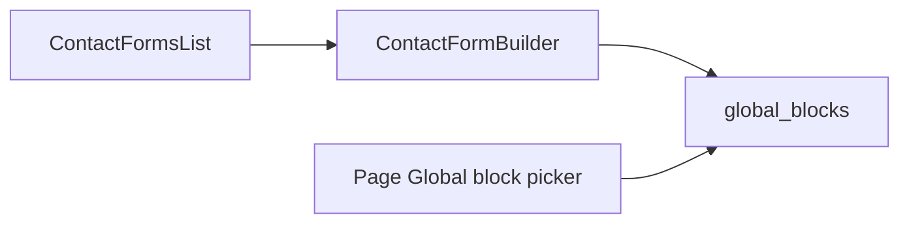

---

name: Contact form builder
overview: Use a country-aware phone input on the Contact form block, show the options list only for dropdown and radio, and add a contact-forms list whose builder saves each form as a global block pages can embed.
todos:
- id: phone
  content: Render tel fields with react-phone-number-input and post E.164 via a hidden input
  status: pending
- id: options
  content: Show the options textarea only when the field type is dropdown or radio
  status: pending
- id: routes
  content: Add the contact forms list and builder, stored as contact-form global blocks pages can embed
  status: pending
  isProject: false

---

# Contact form phone, options, and global builder

The Contact form block already lives in [`src/builder/config.tsx`](src/builder/config.tsx) and renders in [`src/builder/blocks/contact-form-client.tsx`](src/builder/blocks/contact-form-client.tsx). Phone is a plain `<input type="tel">`, and **Options, one per line** stays visible for every field. The page at `/dashboard/pages/j99dd0rm1m0qg7qukvumonkz/builder` keeps that inline block; these field changes apply there immediately. New shared forms are separate globals.

## Phone input

Install [`react-phone-number-input`](https://www.npmjs.com/package/react-phone-number-input). Leave the admin `PhoneNumberInput` (`react-phone-input-2`) alone.

In [`src/builder/blocks/contact-form-client.tsx`](src/builder/blocks/contact-form-client.tsx), render `PhoneInput` when `type === 'tel'`:

- `international` and `defaultCountry="US"`, so the stored value is E.164 (`+14155552671`).
- Keep the visible input unnamed. A hidden `<input name={field.name}>` carries the E.164 value so the existing `FormData` POST is unchanged.
- Put `required` on the visible number input.

Import `react-phone-number-input/style.css` from that client file (Puck copies parent stylesheets into the canvas iframe). In [`src/builder/site.css`](src/builder/site.css), restyle `.site-root .PhoneInput` to match `.s-input` (border, radius, background, text color) so the country selector and number sit in one row.

## Options field shows only for dropdown and radio

Puck cannot hide one array subfield with `resolveFields` (that API sees the whole block, not the open row). Replace the options textarea in the Contact form `arrayFields` with a custom field in [`src/builder/fields/client-fields.tsx`](src/builder/fields/client-fields.tsx).

It reads the open row from `usePuck` (`selectedItem.props.fields[index].type`, index parsed from the field name `fields[n].options`). Render the labeled textarea only when that type is `select` or `radio`. Any other type returns nothing, and the stored options string is left in place so switching back does not wipe it.

## Contact forms as global blocks

No new table. Each form is a row in `global_blocks` with a reserved category `contact-form`, so the existing Global block picker and public `GlobalRef` render already embed it. Editing the form updates every page that references it.

- List at `/dashboard/contact-forms` under the dashboard shell, modeled on the globals list in [`templates-and-globals.tsx`](src/app/(admin)/dashboard/(shell)/templates/_components/templates-and-globals.tsx): name, page usage, rename (name only), delete, and **New contact form**.
- Create calls `saveGlobalBlock` with category `contact-form` and one Contact form section (same default fields as the block: name, email, message), then opens the builder.
- Builder at `/dashboard/contact-forms/[id]` (fullscreen), `kind: 'contact-form'`. It uses the same config as a global block (no nested Global block, no page root fields) and the same save path, but the header says Contact form, Back goes to the list, and save always writes category `contact-form`. Toast: the form is live on every page that embeds it. No publish, autosave, revisions, Page tab, or Save as global — same chrome rules as `kind === 'global'` in [`builder-editor.tsx`](src/app/(admin)/dashboard/(fullscreen)/pages/[id]/builder/_components/builder-editor.tsx), [`builder-chrome.tsx`](src/app/(admin)/dashboard/(fullscreen)/pages/[id]/builder/_components/builder-chrome.tsx), and [`builder-shell.tsx`](src/app/(admin)/dashboard/(fullscreen)/pages/[id]/builder/_components/builder-shell.tsx).
- 404 unless the row’s category is `contact-form`. A contact-form id opened at `/dashboard/templates/globals/[id]` redirects to the new builder.
- The Templates & Globals list omits `contact-form` rows so each form is managed in one place. `listGlobalBlockOptions` still returns them, labeled `Name (contact form)`, so a page inserts one with the Global block picker.
- Sidebar item **Contact forms** in [`src/menus/index.tsx`](src/menus/index.tsx), and the paths in [`src/config/pages.ts`](src/config/pages.ts). `saveGlobalBlock` also revalidates the new list.

## Verification

On the linked page builder, select the Contact form, add a Phone field, and confirm the country selector plus number input. Set a field to Dropdown or Radio and confirm Options appears; set it to Text and confirm Options disappears. Create a form at `/dashboard/contact-forms`, save it, embed it with Global block on that page, and confirm the canvas shows the shared form. On the public page, submit and confirm `FormData` includes the E.164 phone value and the chosen option.
