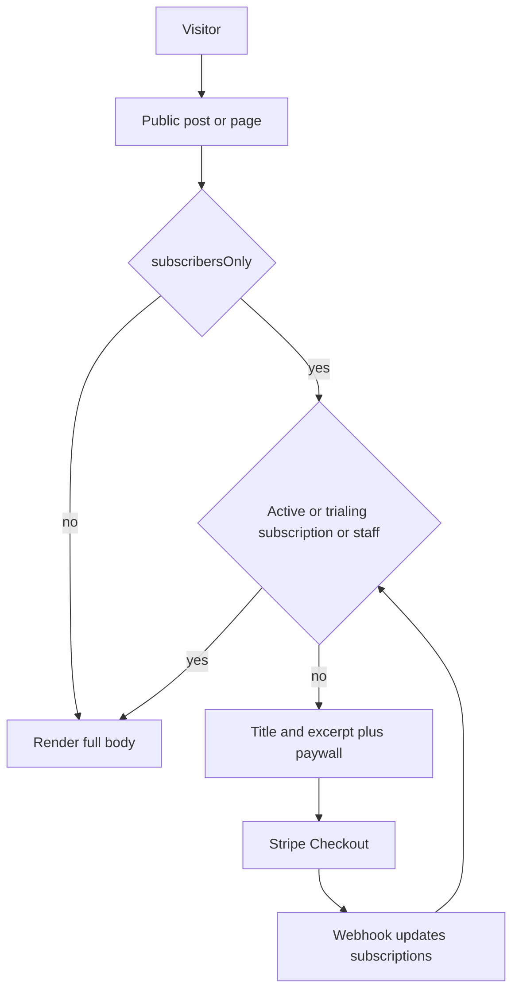
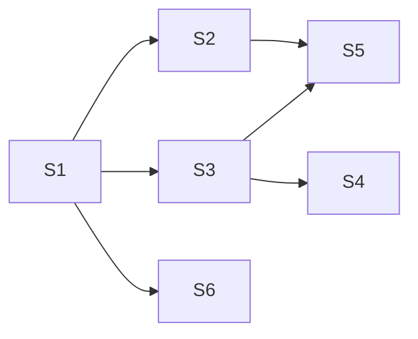

# Subscriber-only posts and pages

One paid subscription unlocks every gated post and page. Name one ref, such as **S5-02**, to implement only that piece.

The public site already serves content only when `status` is `published` and `visibility` is `public` ([src/server/services/blog.service.ts](src/server/services/blog.service.ts), [src/server/services/public-site.service.ts](src/server/services/public-site.service.ts)). There is no visitor account and no Stripe. Staff sign in with Google at `/login`.

## Order

- **S1** is the schema. Nothing else starts before it.
- **S6** (the editor switch) can follow **S1** without Stripe or visitor accounts.
- **S4** needs **S3** (a subscriber user to attach the Stripe customer to).
- **S5** needs **S2** (the entitlement check) and the `/subscribe` and `/account/login` routes from **S3-03** and **S3-04**.

## S1 — Schema

- **S1-01** `pages.subscribers_only` and `posts.subscribers_only`, boolean, default `false`, in [src/db/schemas/pages.schema.ts](src/db/schemas/pages.schema.ts). Drizzle migration.
- **S1-02** `users.password_hash`, nullable text, in [src/db/schemas/auth.schema.ts](src/db/schemas/auth.schema.ts). Google staff accounts stay passwordless.
- **S1-03** `subscriptions`: `user_id` unique, `stripe_customer_id`, `stripe_subscription_id`, `status`, `current_period_end`.
- **S1-04** `site_settings.subscription_enabled` (default false) and `subscription_label` (display text such as “$9 / month”) in [src/db/schemas/pages.schema.ts](src/db/schemas/pages.schema.ts).
- **S1-05** Role `Subscriber` in [src/config/permissions.ts](src/config/permissions.ts) and [src/server/services/access.service.ts](src/server/services/access.service.ts). No dashboard permissions. Seeded with the other roles. Signup must assign this role itself so `assignDefaultRole` cannot make the first subscriber Admin or a later one Viewer.
- **S1-06** Optional `STRIPE_SECRET_KEY`, `STRIPE_WEBHOOK_SECRET`, and `STRIPE_PRICE_ID` in [src/env.mjs](src/env.mjs). The app still boots when they are empty.

## S2 — Who can read the body

- **S2-01** `hasAccess(userId)` is true only when that user’s subscription status is `active` or `trialing`.
- **S2-02** A session with role Admin, Editor, Author, or Viewer is entitled. Role Subscriber is not. Draft preview is unchanged and still shows the full draft.

## S3 — Visitor account

Staff Google login stays at `/login`. Subscribers use email and password.

- **S3-01** Hash and verify passwords with Node `scrypt`.
- **S3-02** Signup action creates the user and sets role Subscriber directly. It does not call `assignDefaultRole`.
- **S3-03** Public `/subscribe` page: name, email, password.
- **S3-04** `/account/login` writes the existing `session` cookie from [src/lib/auth/session.ts](src/lib/auth/session.ts).
- **S3-05** `/account` shows email and subscription status.
- **S3-06** Logout clears that session.
- **S3-07** [src/app/(admin)/dashboard/layout.tsx](src/app/(admin)/dashboard/layout.tsx) sends role Subscriber to `/account`.
- **S3-08** Header in [src/app/(site)/layout.tsx](src/app/(site)/layout.tsx) links to Subscribe or Account.

## S4 — Stripe

- **S4-01** Stripe client from `STRIPE_SECRET_KEY`.
- **S4-02** Checkout session, `mode: subscription`, `metadata.userId`, price from `STRIPE_PRICE_ID`.
- **S4-03** `/subscribe` starts that session after the account exists.
- **S4-04** `POST /api/billing/webhook` verifies the Stripe signature on the raw body.
- **S4-05** `checkout.session.completed` upserts `subscriptions` for `metadata.userId`.
- **S4-06** `customer.subscription.updated` and `customer.subscription.deleted` update status and `current_period_end`.
- **S4-07** `past_due`, `canceled`, `incomplete`, and `unpaid` do not unlock content. Only `active` and `trialing` do.
- **S4-08** Billing portal route from `/account`.
- **S4-09** When Stripe env vars are missing, checkout explains that billing is not configured. The paywall still renders.

## S5 — Public gate

Everyone who is not entitled gets the title, excerpt, featured image, and date. The body never reaches the HTML.

- **S5-01** Include `subscribersOnly` on the public post and page types returned by `blogService.getPublished` and `publicSiteService.getPublished`.
- **S5-02** For a locked post, drop `body` and `canvas` before `Render` in [src/app/(site)/[[...slug]]/page.tsx](src/app/(site)/[[...slug]]/page.tsx).
- **S5-03** For a locked page, drop builder JSON and rich-text HTML before render.
- **S5-04** Paywall: title, excerpt, and links to `/subscribe` and `/account/login`. Blog lists already show excerpts only.
- **S5-05** Preview drafts still render the full body.
- **S5-06** `GET /api/v1/posts/[slug]` returns `locked: true` and omits `body` and `layout` when the post is gated.
- **S5-07** `GET /api/v1/pages/[slug]` returns `locked: true` and omits `content` when the page is gated. Editors still open the full document in the dashboard.
- **S5-08** JSON-LD on a locked post sets `isAccessibleForFree` to false. The teaser URL stays in the sitemap.

## S6 — Editor

- **S6-01** `subscribersOnly` on the post zod schema and form defaults.
- **S6-02** “Subscribers only” switch next to Visibility in [src/app/(admin)/dashboard/(shell)/posts/form.tsx](src/app/(admin)/dashboard/(shell)/posts/form.tsx).
- **S6-03** Persist the flag in the post save path.
- **S6-04** Copy the flag when a post is duplicated.
- **S6-05** `subscribersOnly` on the page zod schema and form defaults.
- **S6-06** “Subscribers only” switch next to Visibility in [src/app/(admin)/dashboard/(shell)/pages/_components/sidebar-editor.tsx](src/app/(admin)/dashboard/(shell)/pages/_components/sidebar-editor.tsx).
- **S6-07** Persist the flag in the page save path.
- **S6-08** Copy the flag when a page is duplicated.
- **S6-09** Settings: enable switch and price label, under `settings.manage`.
- **S6-10** Subscribers screen: email, status, and period end, for `settings.manage`, plus a dashboard menu item.
