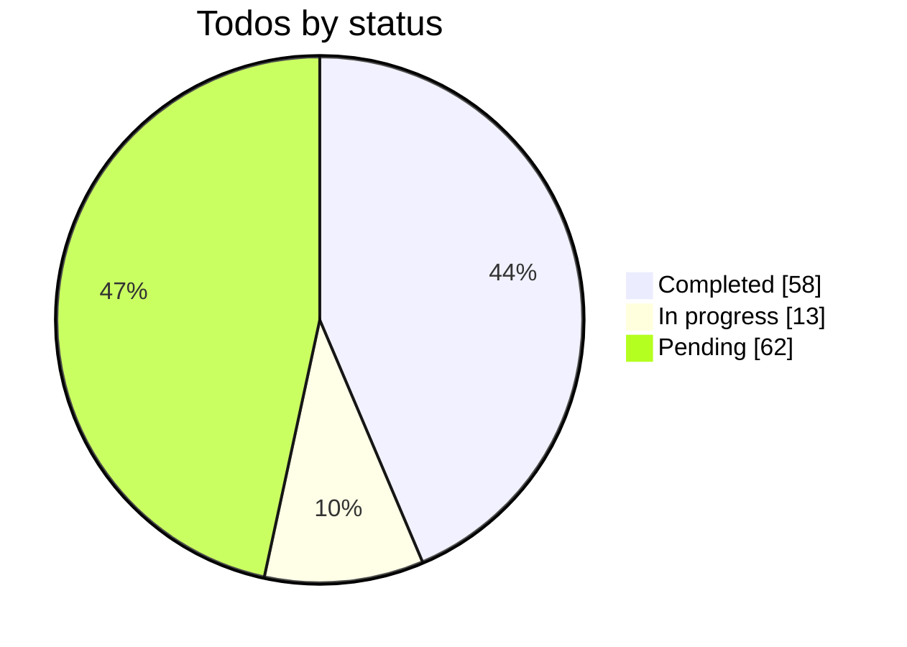

<!-- progress:start -->
## Progress

Updated 2026-10-30 by `scripts/plan-progress.mjs`. Do not edit this block by hand.

**58 of 133 completed (43.6%)** · 13 in progress · 62 pending

`█████████████░░░░░░░░░░░░░░░░░` 43.6%

| Section | Refs | Total | Done | In progress | Pending | % done | Bar |
|---|---|---|---|---|---|---|---|
| Engine (ENG) | R680–R710 | 31 | 19 | 5 | 7 | 61.3% | `██████░░░░` |
| Editor UX (UXE) | R711–R736 | 26 | 22 | 1 | 3 | 84.6% | `████████░░` |
| Data saving (DAT) | R737–R754 | 18 | 4 | 2 | 12 | 22.2% | `██░░░░░░░░` |
| Packages (PKG) | R755–R772 | 18 | 1 | 2 | 15 | 5.6% | `█░░░░░░░░░` |
| Extension API (EXT) | R773–R795 | 23 | 5 | 2 | 16 | 21.7% | `██░░░░░░░░` |
| Robustness (ROB) | R796–R812 | 17 | 7 | 1 | 9 | 41.2% | `████░░░░░░` |
| **Total** | | **133** | **58** | **13** | **62** | **43.6%** | `████░░░░░░` |


<!-- progress:end -->


# Custom builder engine refs R680–R710, modern editor experience R711–R736, data saving and fetching R737–R754, standalone builder package R755–R772, block extension API R773–R795, and robustness refs R796–R812

Also tracked in [combined_cms_refs_f96163bc.plan.md](combined_cms_refs_f96163bc.plan.md). Keep step statuses in both files in sync. No step is started.

---

# Implementation batches

<!-- BEGIN: engine-implementation-batches -->

Checked against the code on 2026-10-29. Every step from R680 to R812 belongs to exactly one batch. Each batch is sized for one branch and pull request; batches marked parallel touch different files and can run in separate sessions.

## Status from the code

Updated 2026-10-29 after batch B0. Details in [builder_engine_b0_audit.md](builder_engine_b0_audit.md).

- **R681, R682, R683, R684, R685, R796, R808 completed.**
  - `npm test` runs 75 tests, all passing: converter, loaders, layout, and a new `renderer.test.tsx` comparing `BuilderRenderer` with Puck `Render` for flat pages, Columns, Container, and Tabs.
  - `pnpm builder:check-documents` checks all 63 stored documents: each round-trips unchanged and renders the same HTML as Puck.
- **Fixed in B0:**
  - The converter type error.
  - Nested blocks rendered empty, because slots were passed as React elements; they are now slot functions, as Puck passes them.
  - The renderer skipped `MotionScope`, so page transitions were lost.
  - The converter wrote nested children to `zones`, which Puck 0.20 `slot` fields do not read; it now writes them inline by default.
  - `loaders.test.ts` crashed on `server-only`; loaders now import server actions when they run.
- **New:** `scripts/server-only-stub.mjs` lets Node tests and scripts import server code.
- **R680 in progress.** Problems found in the code are listed; the team's own Puck problems still need adding.
- **B1 (2026-10-29): R755 and R809 completed, R756 and R757 in progress.**
  - pnpm workspace with `packages/*`; `package-lock.json` removed; the Dockerfile copies the workspace manifests before `pnpm i`.
  - `@nextcms/builder-core` holds the document format, Puck converter, renderer (`renderDocument`, `renderNodes`, `transformProps`), and loader registry (`createLoaderRegistry`), with 15 tests of its own and no Puck or app imports.
  - The app's `src/builder/renderer.tsx` and `loaders.ts` now sit on the core and keep only CMS parts: block registry, site root, panels, and the four CMS loaders.
  - A Biome rule fails any `@/` app import inside `packages/`.
  - Left for R756: `builder-react`, `builder-blocks`, and `builder-next` are created with their code in B3, B4, and B11. Left for R757: blocks and controls still import app UI and move behind adapters in B4.
- **B6 (2026-10-29): R738, R739, R740, R744 completed; R737 and R741 in progress; R742, R743, R745, R746 pending.**
  - Baseline (R737), dev database: the Puck builder autosaves the whole page 3 s after the last change; stored drafts average 234 bytes JSON (largest template 4.8 KB); a 500-block page is about 180 KB per save and its draft write takes 27 ms median (44 ms max) in Postgres; 19 revisions use 48 kB. Not measured yet: public TTFB cached and uncached, and database queries per request; these need a production build and come with R753.
  - Version check (R738): `page_contents.version` (migration `20261029131123_page_content_version`) is bumped by every draft write, from either editor; the new editor sends the version it started from and gets the stored page back on a conflict, with Keep my changes or Use the saved version.
  - Patch saves (R739): `diffDocuments` and `applyPatch` in builder-core; unchanged nodes keep their object identity, so the diff compares references (equivalent to building it from the command log). A one-block edit on a 500-block page sends under 1% of the page. The server applies the patch under a row lock and stores Puck data, so both editors keep reading the same draft.
  - Save queue (R740): typing waits 1 s, adding, moving, and deleting save at once; one request at a time; retries at 1, 2, 5, 10, then 30 s; offline state; a local copy in IndexedDB with Restore or Discard on the next visit; a warning when leaving with unsaved changes. The queue starts from an effect, so React Strict Mode cannot create a second saving queue.
  - Validate on save (R741): structure, 2 MB and 5,000-block limits, known block types, and schema checks for native blocks (`src/builder/validate-document.ts`). Left: the Puck builder's save path does not run these checks, and rendering still sanitizes (kept as defense in depth).
  - One-trip load (R744): the editor route loads the page, settings, and block data on the server in one request.
  - Pending: compact revisions as patches (R742), asset ids instead of URLs (R743), lazy side panels with TanStack Query once those panels exist (R745), per-block code splitting (R746).
- **B5 (2026-10-29): R692 completed; R695 and R696 in progress.**
  - Layers panel: tree with slot headings, select, hover highlight, rename (double-click or F2), hide on the canvas, lock, and drag to reorder or move into a slot. Rename, hide, and lock are node `meta`, kept in Puck data as `__editor` and never passed to blocks (stripped in the Puck render adapters too). Drag uses pointer events like the canvas instead of dnd-kit, so one drag model covers both.
  - Resize handles: CMS handles for section width (%), bottom spacing (px, pins desktop first because spacing applies only with a desktop value), and Spacer height; a drag is one undo step, Escape cancels, arrow keys are the keyboard alternative. The desktop canvas is never narrower than 1024px, so media queries match the device being edited.
  - Inline text: double-click text on the canvas to edit the prop it shows (Enter saves, Escape cancels); the block re-mounts afterwards.
  - Left for R695: flex and grid track handles for Container. Left for R696: rich text with the Tiptap toolbar (plain text props only today).
- **B4 (2026-10-29): R693, R694, R773–R776, R783 completed; R697 and R784 in progress.**
  - builder-core: `defineBlock` with Zod inference, `slot()`, defaults from the schema or a context function, fields generated from Zod types, `validateProps`, field definitions (list, object, groups, `when`, computed), and per-device value helpers.
  - builder-react: inspector with a field registry (`defineField`; Puck-style custom fields plug in), device switch that resizes the canvas, per-device fields with inherit and reset.
  - CMS: an editor bridge (`src/builder/controls/editor-bridge.tsx`) so the section, colour, device, and contact-form controls work in both editors; the Puck builder provides it through `PuckEditorBridge`. Definitions in `src/builder/definitions/`: Hero, Button, and Spacer written with `defineBlock` (same defaults as Puck, tested), the other blocks read from the Puck config by an adapter.
  - Left for R697: port the remaining blocks from the adapter to `defineBlock`. Left for R784: tabs (fields are grouped in sections) and drag-to-reorder in lists (up and down buttons today).
- **B3 (2026-10-29): R687–R691 completed.** Commands, history, nesting rules, and slot normalization in builder-core; new `@nextcms/builder-react` (store, iframe canvas with overlays, pointer drag and drop with drop lines and auto-scroll, keyboard). Preview at `/dashboard/pages/{id}/editor` (not saved yet; saving is R698/R740). Canvas drag uses a small pointer engine instead of dnd-kit, because dnd-kit cannot follow a pointer into an iframe. Browser-checked: select, insert, drag to move, drag into a nested column, a refused Columns-in-Columns drop, undo, and every keyboard action.
- **B2 (2026-10-29): R686 and R804 completed, R702 and R810 in progress, Gate 34 (R708) approved by the user on 2026-10-29.**
  - Each site has `render_engine` (`puck` or `core`), switched in Dashboard → Sites and logged in the audit log; `BUILDER_RENDER_ENGINE` forces one engine for every site (kill switch). Migration `20261029050007_site_render_engine`.
  - The public page, post, collection template, A/B variant, and `/api/v1` pages and posts render through `renderBuilderContent` and `resolveBuilderData` in `src/builder/render-content.tsx`.
  - Fixed on the way: the renderer was missing Gallery, CollectionItem, and every post block; it matched Puck's client build instead of the server build Next uses; the converter gave blocks without an id a random one; A/B variant B never loaded block data.
  - Evidence and rollout steps: [builder_dual_engine_playbook.md](builder_dual_engine_playbook.md). There is no static export path in the code yet, so R686's export part has nothing to switch.
  - Left for R702 and R810: choosing the editor per site and testing writes from both engines, once the new editor exists (B3).

## Batches

| Batch | Name | When | Steps | Refs |
|---|---|---|---|---|
| B0 | Finish the foundations | now | 7 | R680 … R808 (see list) |
| B1 | Packages first | after B0 | 4 | R755, R756, R757, R809 |
| B2 | Public site on the new renderer | after B1 | 5 | R686, R702, R804, R810, R708 |
| B3 | Editor core | after Gate 34 | 5 | R687, R688, R689, R690, R691 |
| B4 | Block API and inspector | after B3 | 9 | R697 … R784 (see list) |
| B5 | Canvas tools | after B4, parallel with B6 | 3 | R692, R695, R696 |
| B6 | Saving and loading data | after B4, parallel with B5 | 10 | R737 … R746 (see list) |
| B7 | Parity with Puck | after B5 and B6 | 6 | R698, R699, R700, R797, R798, R709 |
| B8 | Modern UX: shell and canvas | after Gate 35, parallel with B10 | 11 | R711 … R721 (see list) |
| B9 | Modern UX: inspector to guidance | after B8 | 16 | R722 … R736 (see list) |
| B10 | Extension API | after Gate 35, parallel with B8 | 19 | R777 … R795 (see list) |
| B11 | Package polish and release | after B10, parallel with B12 | 16 | R758 … R772 (see list) |
| B12 | Publish and public performance | after Gate 34 and B6, parallel with B11 | 9 | R747 … R754 (see list) |
| B13 | Quality and operations | after B9 to B12 | 9 | R701 … R812 (see list) |
| B14 | Migration and Puck removal | last | 3 | R703, R707, R710 |
| B15 | Shared editor UI package | after B9, parallel with B10 to B12 | 10 phases | E0–E9 (refs already in other batches, see list) |

### B0 — Finish the foundations (now)

Fix the converter type error (converter.ts:194), make loaders.test.ts run (it crashes on the server-only import), add a renderer test, run the converter round trip over every stored page, list the Puck problems (R680) and the API inventory (R681), publish non-goals (R796), and size the migration cost for other plans (R808).

Steps: R680, R681, R683, R684, R685, R796, R808.

### B1 — Packages first (after B0)

pnpm workspace, package split, and decoupling from app imports, before more engine code lands, so nothing is written twice. Move document.ts, converter.ts, renderer.tsx, and loaders.ts into builder-core here.

Steps: R755, R756, R757, R809.

### B2 — Public site on the new renderer (after B1)

Per-site flag, switch the public site, preview, and /api/v1 to the new renderer with screenshot diffs, the dual-engine playbook and test matrix, then Gate 34.

Steps: R686, R702, R804, R810, R708.

### B3 — Editor core (after Gate 34)

Store, command layer with undo and redo, iframe canvas, dnd-kit drag and drop, keyboard control.

Steps: R687, R688, R689, R690, R691.

### B4 — Block API and inspector (after B3)

One typed defineBlock API (ENG-18 plus EXT-01 to EXT-04), inspector with field registry, responsive values, custom and composed fields. Port blocks here.

Steps: R697, R773, R774, R775, R776, R693, R694, R783, R784.

### B5 — Canvas tools (after B4, parallel with B6)

Layers panel, resize handles, inline text editing.

Steps: R692, R695, R696.

### B6 — Saving and loading data (after B4, parallel with B5)

Baseline, version checks, patch saves, save queue with offline copy, validate once, compact revisions, asset ids, one-trip editor load, lazy panels, code split per block.

Steps: R737, R738, R739, R740, R741, R742, R743, R744, R745, R746.

### B7 — Parity with Puck (after B5 and B6)

Builder chrome, every builder kind, AI and motion, editor error and network UX, then Gate 35.

Steps: R698, R699, R700, R797, R798, R709.

### B8 — Modern UX: shell and canvas (after Gate 35, parallel with B10)

Panels, command palette, quick insert, insert panel, patterns, zoom and multi-device, guides, breadcrumb, multi-select, floating toolbar, empty states.

Steps: R711, R712, R713, R714, R715, R716, R717, R718, R719, R720, R721.

### B9 — Modern UX: inspector to guidance (after B8)

Inspector tabs, visual controls, style classes, state styles, history, version compare, comments, presence, AI assist, live checks, onboarding, preferences, fast feel, usability test, accessibility specifics, then Gate 37.

Steps: R722, R723, R724, R725, R726, R727, R728, R729, R730, R731, R732, R733, R734, R735, R807, R736.

### B10 — Extension API (after Gate 35, parallel with B8)

Traits, schema helpers, extendBlock, presets, escape hatches, UI overrides, permissions, wrap components, loaders, block versions, scaffold, playground, dev warnings, test helpers, recipes, security review, then Gate 40.

Steps: R777, R778, R779, R780, R781, R782, R785, R786, R787, R788, R789, R790, R791, R792, R793, R794, R800, R805, R795.

### B11 — Package polish and release (after B10, parallel with B12)

Public API, adapters, plugins, styling, framework support, i18n, entry points, dogfooding, examples, docs, tests, release, then Gate 39.

Steps: R758, R759, R760, R761, R762, R763, R764, R765, R766, R767, R768, R769, R770, R771, R801, R772.

### B12 — Publish and public performance (after Gate 34 and B6, parallel with B11)

Publish-time compile, tag caching, static shell, global block usage table, indexes, batched loaders, CI budgets, large documents, then Gate 38.

Steps: R747, R748, R749, R750, R751, R752, R753, R806, R754.

### B13 — Quality and operations (after B9 to B12)

Performance budget, unit and e2e tests, editor accessibility, telemetry, visual regression and adapter contracts, fuzz tests, recovery drills, then Gate 41.

Steps: R701, R704, R705, R706, R799, R802, R803, R811, R812.

### B14 — Migration and Puck removal (last)

Migrate stored content with backup and rollback, remove @measured/puck, then Gate 36.

Steps: R703, R707, R710.

### B15 — Shared editor UI package (after B9, parallel with B10 to B12)

Turn the AI Studio prototype into `@nextcms/editor-ui`: generic editor chrome (`--ne-*` tokens, primitives, shell, library, layers tree, inspector parts, overlays, feedback states) shared by the page builder and the dashboard builder. Full phase guide with prompts and checks: [editor_ui_package_implementation.md](editor_ui_package_implementation.md).

Prototype finished: [KantaPaul/NextCMS-Shared-Editor-UI-Builder-Prototypes](https://github.com/KantaPaul/NextCMS-Shared-Editor-UI-Builder-Prototypes) (commit `921e6be`). Its `src/editor-ui` already holds about 53 components with no page or dashboard imports, so E1–E5 port and adapt them. Checked on 2026-10-30, the main gaps are: Tailwind v4 classes while the app uses Tailwind 3.4 (the package ships its own compiled CSS); no RTL; panel sizes not persisted; `EditorShell` slots and command-palette state need reshaping; no `ResizeHandles` or `useKeyboardMove`. Details are in section 0 of the guide. Primitives are built on shadcn/ui, with the package's own copies restyled to `--ne-*` tokens (section 2a).

This batch adds no new refs. Its phases deliver parts of refs that stay owned by their own batch; mark a ref done only when its owning batch's definition is met. Stop and review after E3 and after E6.

| Phase | Name | Size | Refs touched |
|---|---|---|---|
| E0 | Audit the prototype (no code) | small | — |
| E1 | `editor-ui` package skeleton | small | R755, R757, R766 |
| E2 | Tokens and primitives | medium | R723, R733, R763 |
| E3 | Shell, panels, and feedback | medium | R711, R797, R798 |
| E4 | Library, layers tree, inspector parts | medium | R692, R693, R714, R722 |
| E5 | Overlays and accessibility helpers | medium | R689, R695, R706, R717, R720, R807 |
| E6 | Adopt the shell in the page builder (behind a flag) | large | R698, R709, R711–R722 |
| E8 | Dynamic wiring (adapters replace mocks) | large | R685, R738–R744, R788 |
| E7 | Dashboard builder on the same package (if in this repo) | large | R761, R767 |
| E9 | Quality, docs, and release | medium | R704, R705, R769–R771, R802 |

Phases run in the order listed (E8 before E7).

## Gate order

Gate 34 (R708, end of B2) → Gate 35 (R709, end of B7) → Gates 37, 40, 39, 38 (B9, B10, B11, B12) → Gate 41 (R812, B13) → Gate 36 (R710, B14). B15 has no gate of its own; its review points are after E3 and E6.

<!-- END: engine-implementation-batches -->

---

<!-- BEGIN: custom-builder-engine -->

## Is it possible?

Yes. Puck is the editor shell and the `Render` call, not the blocks. The 15 block files in `src/builder/blocks/` are plain React components that take props, and the style system (`style.ts`, `Responsive<T>`, the controls in `src/builder/controls/`) is already ours. So the plan replaces the **engine** (document format, editor state, canvas, drag and drop, inspector wiring, renderer) and keeps the blocks, styles, and controls.

Puck in the code today (checked 2026-10-28):

- 20 files import `@measured/puck`, about 6,000 lines. The largest are `src/builder/config.tsx` (1,499 lines), `builder-editor.tsx`, `builder-shell.tsx`, `layers-panel.tsx`, `selection-card.tsx`, and `section-inspector.tsx`.
- APIs used: `Puck`, `Render`, `resolveAllData`, `createUsePuck`, `useGetPuck`, `usePuck`, `Drawer`, `ActionBar`, `overrides`, `viewports`, `dispatch`, `resolveData`, and `slot` fields.
- The public site, `/api/v1/pages/[slug]`, and `/api/v1/posts/[slug]` depend on Puck at runtime through `Render` and `resolveAllData`.
- `@dnd-kit/core` and `@dnd-kit/sortable` are already installed and power the analytics board builder; Tiptap is already installed.
- Stored content lives in `page_contents` and `post_contents` (draft and published) plus revisions, all in Puck `Data` JSON.

## Approach

1. **Renderer first (R682–R686).** Define the new format, convert Puck data both ways, and render it on the server without Puck. This removes Puck from the public site with no editor risk, and the flag can switch back.
2. **Editor core (R687–R697).** Build the store, commands, iframe canvas, drag and drop, layers, inspector, responsive editing, resize handles, and inline text. Port blocks to the new definition API.
3. **Parity (R698–R701).** Port every builder kind and feature that runs on Puck today.
4. **Rollout (R702–R707).** Per-site flag, data migration with rollback, tests, accessibility, then remove Puck.

Do not start the editor core before Gate 34 (R708). Do not remove Puck before Gate 36 (R710).

## Steps

- **R680 (ENG-01):** Record every Puck problem the team hits, each with repro steps, the page or block it breaks, and whether a Puck upgrade or setting already fixes it.
- **R681 (ENG-02):** Inventory every Puck API, override, field type, and route in use (20 files, including Puck, Render, resolveAllData, createUsePuck, useGetPuck, slots, overrides, viewports) and map each to its replacement.
- **R682 (ENG-03):** Define the versioned page document format: a node map keyed by id, named child slots per node, root props, and per-device prop values that match Responsive<T> in src/builder/style.ts.
- **R683 (ENG-04):** Two-way converter between Puck Data (content, zones, slot props) and the new format, with round-trip tests on every seeded and stored page, post, template, and global block.
- **R684 (ENG-05):** Server renderer that renders a document with the existing block components and no Puck, as React Server Components where a block allows it.
- **R685 (ENG-06):** Server data loaders per block (blog posts, global refs, contact forms, query loops) replacing resolveAllData, scoped to the site and cache-safe.
- **R686 (ENG-07):** Switch the public site, preview, /api/v1 pages and posts, and export to the new renderer behind a flag, with a screenshot diff against Puck Render on every seeded page.
- **R687 (ENG-08):** Editor store: node map, selection, hover, clipboard, and dirty state on React context and useSyncExternalStore, so only changed nodes re-render; no new state library.
- **R688 (ENG-09):** Command layer: insert, move, delete, duplicate, update props, wrap, and unwrap as commands with undo and redo, merging a drag or a typing burst into one undo step.
- **R689 (ENG-10):** Canvas in an iframe with site styles and theme tokens injected, rendering the same block components; selection, hover, and labels drawn as an overlay outside block DOM.
- **R690 (ENG-11):** Drag and drop with dnd-kit (already used by analytics boards): from the block library, within and between nested slots, with drop lines, auto-scroll, and allowed-children rules.
- **R691 (ENG-12):** Keyboard control: select parent, child, and sibling; move up and down; delete, duplicate, copy, paste, undo, redo; Escape to deselect.
- **R692 (ENG-13):** Layers panel on the new tree with drag reorder, expand and collapse, rename, hide, and lock.
- **R693 (ENG-14):** Inspector with a field registry (text, textarea, select, number, url, color, image, icon, rich text, list, object, custom) reusing the controls in src/builder/controls and src/builder/fields, plus conditional fields.
- **R694 (ENG-15):** Responsive editing: the device switch resizes the iframe; each field can hold per-device values with inheritance and reset to inherited.
- **R695 (ENG-16):** Canvas resize handles for container width, spacing, and flex or grid tracks, each drag committing one undoable command, with numeric input as the keyboard alternative.
- **R696 (ENG-17):** Inline text editing on the canvas for headings, buttons, and rich text using the project's Tiptap setup.
- **R697 (ENG-18):** Block definition API: one definition per block with type, label, category, icon, fields, defaults, slots, allowed children, loader, and render; port every block now in src/builder/config.tsx.
- **R698 (ENG-19):** Port the builder chrome: save draft, publish, autosave, editor lock, unsaved-changes guard, revisions and restore.
- **R699 (ENG-20):** Port every builder kind: pages, posts, post templates, page templates, global blocks with GlobalRef, contact forms, and the save-as-template and save-as-global dialogs.
- **R700 (ENG-21):** Port AI dialogs, motion and animation preview, theme tokens, and selection card actions.
- **R701 (ENG-22):** Performance budget: a 500-block page keeps smooth drag and typing, the editor bundle stays under a set size, and the public renderer ships no editor code.
- **R702 (ENG-23):** Per-site flag to choose the Puck or new editor during rollout, with both reading and writing the same stored format through the converter.
- **R703 (ENG-24):** One-time migration of page_contents, post_contents, revisions, templates, and global blocks to the new format, with a backup and a tested rollback script.
- **R704 (ENG-25):** Unit tests for the converter, commands and undo, nesting rules, responsive inheritance, and renderer output.
- **R705 (ENG-26):** End-to-end tests: add, nest, drag between containers, resize, undo, save, publish, and public render on two sites.
- **R706 (ENG-27):** Editor accessibility: keyboard alternative to every drag, visible focus, labelled controls, and screen reader announcements for moves.
- **R707 (ENG-28):** Remove @measured/puck after rollout, and update the docs and plans that assume Puck (container rules, MKT, QRY).
- **R708 (ENG-29):** Gate 34 approval: document format, converter round trip, and the server renderer verified; the public site runs without Puck.
- **R709 (ENG-30):** Gate 35 approval: editor core and every builder kind reach parity with the Puck editor.
- **R710 (ENG-31):** Gate 36 approval: migration, rollback, tests, performance budget, and Puck removal verified.

## Non-goals (first release through Gate 41)

- Full real-time OT/CRDT co-editing (presence and soft locks only).
- Native mobile editor app.
- Non-React host applications.
- Visual page builder aimed at non-developers with no code.
- Headless-only usage that never loads the React editor package.

Documented in R796; revisit only after Gate 41.

## Rules

- Keep every block component engine-agnostic: props in, children through a slot render function. New blocks written during the rewrite (for example the in-progress Container in `src/builder/blocks/container.tsx`) must follow this so they move over without changes.
- The converter is the contract. Every stored page must survive Puck → new → Puck and render the same.
- No new state or drag library: React context, `useSyncExternalStore`, and dnd-kit.
- Store layout intent, not pixel positions. Sanitize and validate every stored prop; no arbitrary CSS.
- TypeScript strict, no `any`.
- Site scoping, preview rules, and caching follow the multisite plan (R463–R475) and site slug routing (R644–R667).
- Every user-visible failure path (loader, schema, missing global, network, conflict) has a defined surface (R797–R798).

## How this changes other plans

- The Container, Flexbox, and Grid plan ([container_flex_grid_refs.plan.md](container_flex_grid_refs.plan.md), R393–R412, R668–R679) says "do not replace Puck" and relies on Puck slots. If this plan is approved, read "Puck slots" there as "the engine's named slots", and build R400 (resize handles) only once, as R695.
- Market-gap steps that touch the editor (undo, redo, shortcuts in R476–R477, copy style in R478) land in R688, R691, and R693 instead of on Puck.
- Query Loop (QRY) and dynamic content (BLD-21 to BLD-26) loaders should use the R685 loader API.

## Risks

- **Parity takes the longest.** Puck gives drag and drop, iframe preview, history, fields, and layers for free; each must be rebuilt and tested.
- **Data migration.** A bad conversion breaks live pages, so the flag, round-trip tests, backup, and rollback come before any write.
- **Two engines during rollout.** Keep the rollout short and freeze new Puck-only features once Gate 34 passes.
- **Error and recovery gaps.** Without explicit loader/schema/global-block failure UX (R797–R798) and recovery drills (R811), editors can lose work or ship broken pages.
- **Permissions and security.** Field/block permissions and the extension surface need design before public packages ship (R800, R805).
- **Observability blind spots.** Without rewrite-specific telemetry (R799) and a dual-engine playbook (R804), rollout decisions stay anecdotal.

## Approval gates

- **Gate 34 (R708):** approve only after the format is documented, every stored document round-trips, and the public site, preview, and API render through the new renderer with no visual diff.
- **Gate 35 (R709):** approve only after every builder kind works in the new editor, including undo, redo, nesting, responsive values, layers, and keyboard control.
- **Gate 36 (R710):** approve only after migration and rollback are rehearsed on a copy of production data, the tests and performance budget pass, and `@measured/puck` is removed.

<!-- END: custom-builder-engine -->

---

# Modern editor experience refs R711–R736

<!-- BEGIN: modern-editor-ux -->

## Goal

Make the new editor feel like a current design tool (Framer, Webflow, Figma, Notion, Elementor 4, Wix Studio), not only match Puck. These steps build on the engine from R680–R710. Start them after Gate 34 (R708), alongside the editor core; finish before Gate 37.

Already planned elsewhere and not repeated: undo and redo buttons and shortcuts (MKT-01, MKT-02, done in R688 and R691), copy and paste style (MKT-03), section JSON import and export (MKT-07), soft lock (P5-14), global tokens (BLD-27 to BLD-31), accessibility and performance diagnostics (RFB-16, RFB-23), conditional controls (BLD-33).

## Steps

### Editor shell and navigation

- **R711 (UXE-01):** Editor layout with insert panel, canvas, and inspector as resizable, collapsible panels whose sizes are remembered per user, plus a focus mode that hides every panel.
- **R712 (UXE-02):** Command palette (Cmd/Ctrl+K) to insert any block, jump to a layer, run any editor action, open another page, and search settings.
- **R713 (UXE-03):** Quick insert on the canvas: type / in an empty spot or click the + shown between blocks on hover, with search and keyboard selection.
- **R714 (UXE-04):** Insert panel with search, categories, recent and favorite blocks, a live preview on hover, and click to insert at the selection or drag to place.
- **R715 (UXE-05):** Patterns library of sections and full pages with live thumbnails and filters, inserted as editable copies; users save their own patterns to a per-site team library.

### Canvas

- **R716 (UXE-06):** Canvas zoom and pan (fit, 25–200%, space-drag, pinch) and a multi-device view showing desktop, tablet, and mobile side by side with linked selection.
- **R717 (UXE-07):** Smart guides: show padding, margin, and gap on hover, distances between elements, and alignment guides while dragging or resizing.
- **R718 (UXE-08):** Breadcrumb of the selected block's parents under the canvas; click a crumb to select that parent.
- **R719 (UXE-09):** Multi-select with Shift or Cmd click and a marquee inside a container, with group delete, duplicate, wrap, align, and shared style edits.
- **R720 (UXE-10):** Floating toolbar beside the selection with the main actions for that block type, plus a right-click menu with every action and its shortcut.
- **R721 (UXE-11):** Empty states and drop hints: an empty container offers layout presets and a + button, and a blocked drop says why it is not allowed.

### Inspector and styling

- **R722 (UXE-12):** Inspector tabs for Content, Style, and Advanced with search inside settings, a dot on every changed field, and reset per field and per device.
- **R723 (UXE-13):** Visual style controls: a box-model widget for spacing, alignment pads for flex and grid, number inputs you drag to change, unit switching, and a design token picker in every color and size field.
- **R724 (UXE-14):** Reusable style classes: save a block's style as a named class, apply it to other blocks, see where it is used, and detach it; builds on the global tokens in BLD-27 to BLD-31.
- **R725 (UXE-15):** State styles: a switch in the inspector to edit hover, focus, and active styles, previewed on the canvas.

### History, versions, and recovery

- **R726 (UXE-16):** History panel listing named steps you can jump back to, a visible autosave status, and recovery of unsaved work after a crash or closed tab.
- **R727 (UXE-17):** Version compare: two revisions side by side with changed blocks highlighted, and restore of a single block from an older version.

### Collaboration

- **R728 (UXE-18):** Comments pinned to blocks on the canvas with mentions, replies, resolve, and notifications; reviewers can comment without edit rights; shares storage with AGY-08 preview feedback.
- **R729 (UXE-19):** Live presence: avatars of others on the page, their selection outlines, and a lock on the block someone is editing, extending the P5-14 soft lock; full real-time co-editing stays out of scope for the first release.

### AI in context

- **R730 (UXE-20):** AI assist on the selection: generate a section from a prompt, rewrite, shorten, or translate text, write alt text, and suggest layout variants; every result is previewed first and undoable, building on the AI dialogs ported in R700.

### Guidance and quality

- **R731 (UXE-21):** Live checks panel while editing for accessibility (RFB-16), SEO, broken links, missing alt text, heading order, and heavy blocks (RFB-23); click an issue to select the block.
- **R732 (UXE-22):** First-run experience: a start screen (blank, template, or AI), a short guided tour, contextual tips, and a keyboard shortcut sheet.
- **R733 (UXE-23):** Editor preferences: light or dark editor theme, density, reduced motion, panel positions, default units, and a right-to-left editor UI.
- **R734 (UXE-24):** Fast feel: selection under 50 ms, optimistic updates, skeletons instead of spinners, no layout jumps when panels open, and full use on a 13-inch laptop and a touch tablet.
- **R735 (UXE-25):** Usability test with five real users on five tasks (build a hero, nest a grid, fix the mobile layout, reuse a section, publish), fix the top problems, and record time per task before and after.

### Gate

- **R736 (UXE-26):** Gate 37 approval: the modern editor experience passes the usability test, accessibility checks, and performance budget.

## Rules

- Every action is reachable three ways: mouse, keyboard shortcut, and the command palette.
- Every change goes through the R688 command layer, so it is undoable and appears in history.
- Panels, toolbars, and overlays never shift the canvas content or block drag and drop.
- Meet WCAG 2.2 AA in the editor UI itself, and respect reduced motion.
- Multi-select, smart guides, floating toolbar, and marquee selection have explicit keyboard and screen-reader paths (R807).
- Editor chrome, command palette, empty states, onboarding, and errors are localizable; RTL preference drives real layout direction (R801).
- Measure before and after: time per task in the usability test, and selection and drag latency.

## Approval gates

- **Gate 37 (R736):** approve only after the usability test shows faster task times than the Puck editor, the editor UI passes WCAG 2.2 AA checks, and the R701 performance budget still holds.

<!-- END: modern-editor-ux -->

---

# Builder data saving and fetching refs R737–R754

<!-- BEGIN: builder-data-performance -->

## Goal

Use current best practice for how the builder saves and loads page data, and how the public site fetches it, so editing feels instant, no work is lost, and public pages are served from cache.

## Today (checked 2026-10-28)

- Autosave waits 3 seconds, then sends the whole document to `pagesService.saveDraft`.
- No version check: two editors silently overwrite each other (last write wins).
- Autosave revisions are full copies of the document, written at most once per interval.
- Publishing calls `revalidatePublicSite`, which clears the whole site layout.
- TanStack Query and Zustand are installed; nothing uses the Next.js 16 `use cache` and `cacheTag` APIs yet.

## Steps

### Measure first

- **R737 (DAT-01):** Baseline before changes: save payload size, save latency, revision table growth per hour of editing, editor load time, public page TTFB cached and uncached, and database queries per public request, recorded in this plan.

### Saving

- **R738 (DAT-02):** Version check on every save: each document has a version number, saves send the version they started from, and a stale save gets a conflict response that the editor shows as reload or compare, replacing today's silent last-write-wins.
- **R739 (DAT-03):** Patch saves: the editor sends only the changed nodes, built from the R688 command log, and the server applies them in one transaction and validates the result; a full save remains the fallback.
- **R740 (DAT-04):** Save queue: debounce typing (about 1 second), save at once on structural changes and when leaving the page, keep one request in flight and merge the rest, retry with backoff, and keep a local IndexedDB copy so offline or failed saves are never lost.
- **R741 (DAT-05):** Validate and normalize once on save (schema, sanitize, size limits per document and per field), so render paths trust stored data and skip re-validation on every request.
- **R742 (DAT-06):** Revision storage: full snapshots on publish and manual save, autosave revisions stored as patches against the last snapshot, a retention policy that keeps every named and published version, and rebuild of any revision on demand.
- **R743 (DAT-07):** Store media as asset ids, never URLs or base64, in the document; resolve size, srcset, and alt text at render time.

### Loading the editor

- **R744 (DAT-08):** Load the editor in one server round trip: page, draft, site settings, theme tokens, referenced global blocks, and block metadata fetched in parallel and streamed, with no client request waterfall.
- **R745 (DAT-09):** Load secondary panels on open (patterns, media library, revisions, comments) with pagination, cached per session using TanStack Query, which is already installed.
- **R746 (DAT-10):** Split editor code per block: field editors and heavy client code load on demand, and the canvas loads only the blocks the page uses until the insert panel opens.

### Publishing and the public site

- **R747 (DAT-11):** Publish once, render fast: on publish, store a render-ready published document (normalized, style classes generated, global block versions pinned) so public requests skip that work; live data loaders still run per request.
- **R748 (DAT-12):** Fine-grained public caching with the Next.js 16 cache APIs (use cache, cacheTag) per site, page, locale, and global block; publish revalidates only the tags it changed instead of the whole site layout, extending SLG-21 and OZ-06.
- **R749 (DAT-13):** Static shell with streamed dynamic parts: cache the page HTML and stream forms, filtered query loops, and per-visitor parts inside Suspense.
- **R750 (DAT-14):** Global block usage table updated on save, so editing a global block revalidates only the pages that use it.

### Database

- **R751 (DAT-15):** Indexes for the editor and public reads: page_contents (page_id, kind), page_revisions (page_id, kind, created_at), pages (site_id, language, slug, status), and the post equivalents, checked with EXPLAIN on seeded data.
- **R752 (DAT-16):** Batch block data loads per request with React cache so N blocks of the same type make one query, select only the needed columns, and cap document size.

### Proof

- **R753 (DAT-17):** Performance tests in CI on a seeded 500-block page: save under 300 ms at p95, editor ready under 2 s, cached public TTFB under 100 ms, plus slow-query logging in development.

### Gate

- **R754 (DAT-18):** Gate 38 approval: conflict-safe saving, patch saves, offline recovery, editor load, and public caching meet the R753 budgets.

## Rules

- Never lose an edit: a save is acknowledged only after the database commit, and unsent changes survive a reload.
- Never overwrite another person's work without telling them.
- The public site never runs editor code and never reads draft data outside preview.
- Every cache key and tag includes the site; follow the multisite plan (R463–R475) and site slug routing (R644–R667).
- Change one thing at a time and compare against the R737 baseline.
- Document size and field limits are enforced on save; recovery drills (R811) must pass before Gate 38.
- XSS surface in rich text and custom fields is reviewed as part of R805.

## Related steps not repeated here

OZ-06 and OZ-07 (site-wide caching and query profiling), QRY-28 (listing cache), ECM-37 (shop cache), ENG-06 (block data loaders), ENG-22 (editor performance budget), UXE-16 (autosave status and crash recovery).

<!-- END: builder-data-performance -->

---

# Standalone builder package refs R755–R772

<!-- BEGIN: builder-package -->

## Goal

Ship the new builder as installable packages that any React or Next.js app can use with a few lines of code, and have this CMS use them the same way.

## Today (checked 2026-10-28)

- One Next.js app, not a monorepo; both package-lock.json and pnpm-lock.yaml are committed.
- 20 files in src/builder import app code: shadcn UI (24 imports), @/lib/utils (18), media and video components, server actions, and database schemas.
- Puck is still the engine; the new engine (R680–R710) does not exist yet.

## Target usage

```tsx
// Editor
import { BuilderEditor, createBuilderConfig } from '@nextcms/builder-react';
import { defaultBlocks } from '@nextcms/builder-blocks';
import '@nextcms/builder-react/styles.css';

const config = createBuilderConfig({ blocks: [...defaultBlocks, MyHero] });

<BuilderEditor
  config={config}
  value={doc}
  adapters={{ storage: myStorage, media: myMediaPicker }}
/>;

// Public page, no editor code shipped
import { BuilderRenderer } from '@nextcms/builder-core/renderer';
<BuilderRenderer config={config} document={doc} />;
```

## Steps

### Workspace and package split

- **R755 (PKG-01):** Turn the repo into a pnpm workspace with the app at the root plus packages/* (moving the app to apps/cms is deferred), keep one lockfile by removing package-lock.json, use the @nextcms scope, and ship packages as TypeScript source compiled by the host (a tsup build is added for release in R771).
- **R756 (PKG-02):** Split the builder into packages: builder-core (document format, validation, commands, store, converter, renderer, no UI), builder-react (editor UI), builder-blocks (default block library, optional), and builder-next (Next.js helpers, optional).
- **R757 (PKG-03):** Decouple from the app: remove every import of the app's database, server actions, config, shadcn components, media, and video from builder code, replacing them with adapters; a lint rule blocks @/ imports inside packages.

### Easy public API

- **R758 (PKG-04):** Small public API: defineBlock, defineField, createBuilderConfig, BuilderEditor, BuilderRenderer, useBuilder hooks, and validateDocument, migrateDocument, and serializeDocument; everything else stays internal.
- **R759 (PKG-05):** Adapters the host provides, each optional with a working default: storage (load, patch save, version conflict), media picker and upload, link picker, data sources for dynamic content and query loops, permissions, AI, translation, and comments and presence transport.
- **R760 (PKG-06):** Custom blocks in a few lines: the host registers its own React component with a Zod props schema; fields, defaults, and validation are generated from it, with slots and server loaders; this is the RFB-02 and RFB-04 contract.
- **R761 (PKG-07):** Plugin API for panels, toolbar actions, commands, field types, and canvas overlays; the CMS features (templates, global blocks, contact forms, AI, revisions) are built as plugins on it.
- **R762 (PKG-08):** Exported document format version with migrate functions, so hosts upgrade stored data when they upgrade the package.

### Works anywhere

- **R763 (PKG-09):** Self-contained styling: the editor UI ships compiled, prefixed CSS with CSS variables for theming, so the host needs no Tailwind or shadcn; light and dark themes; blocks read theme tokens.
- **R764 (PKG-10):** Framework support: plain React 18 and 19 for the editor and renderer, an SSR-safe renderer with a React Server Components entry, and optional Next.js helpers; tested in a Vite React app and a Next.js app.
- **R765 (PKG-11):** Editor UI text in English by default with host-supplied translations and right-to-left support.
- **R766 (PKG-12):** Separate entry points (core, editor, renderer, blocks), ESM with type definitions, tree-shakeable, and a renderer entry with no editor code; bundle size budgets checked in CI.

### Prove it and ship it

- **R767 (PKG-13):** The CMS app uses the packages exactly like an outside user, through the public API only, with no deep imports.
- **R768 (PKG-14):** Examples folder: a Vite React example and a Next.js example, each getting an editor that saves to localStorage in under 50 lines.
- **R769 (PKG-15):** Docs: getting started, config, blocks, fields, adapters, plugins, theming, document format, and upgrade guide, plus an API reference generated from the types with TypeDoc.
- **R770 (PKG-16):** Tests per package, adapter contract tests any host can run against its own adapters, and both examples built and smoke-tested in CI.
- **R771 (PKG-17):** Release with Changesets for versions and changelogs; decide public npm or a private registry and the package license together with the licensing plan (R217–R261), since the CMS is sold as licensed software.

### Gate

- **R772 (PKG-18):** Gate 39 approval: both examples and the CMS app run on the published packages through the public API, with docs, tests, and size budgets passing.

## Order

Do R755–R757 (and the thin public surface in R809) before the engine work starts, so ENG code is written inside the packages from the first line. Prefer minimum-viable packages first, then expand, to avoid rewriting ENG code twice. Then R758–R762 shape the API while ENG-03 to ENG-18 are built. R763–R766 and R767–R771 follow before Gate 35 (R709).

## Rules

- Packages never import the host app; everything app-specific comes through adapters or plugins.
- No package needs a database, Next.js, Tailwind, or shadcn to work.
- The renderer entry never pulls in editor code.
- Breaking changes need a major version, a migrate function, and an upgrade guide entry.

## Related steps not repeated here

RFB-02 and RFB-04 (component adapter contract), RFB-06 (wrapping project components), RFB-21 (extension packs), MKT-07 (JSON import and export), DAT-02 and DAT-03 (version checks and patch saves, which the storage adapter carries).

<!-- END: builder-package -->

---

# Block extension and custom components refs R773–R795

<!-- BEGIN: builder-extension-api -->

## Goal

Make blocks easy to customize: extend props without forking, reuse prop groups across blocks, add custom fields, and turn any React component into a block with full TypeScript inference. This is the detailed design for the PKG-04 public API, PKG-06 custom blocks, and PKG-07 plugins.

## Example

```tsx
import { z } from 'zod';
import { defineBlock, extendBlock, slot, responsive, token } from '@nextcms/builder-core';
import { withStyle, withAnimation } from '@nextcms/builder-core/traits';
import { Hero } from '@nextcms/builder-blocks';

// 1. A custom block: props are inferred from the schema
export const PricingCard = defineBlock({
  type: 'PricingCard',
  label: 'Pricing card',
  category: 'Marketing',
  schema: z.object({
    title: z.string().default('Pro'),
    price: z.number().min(0).default(29),
    accent: token('color').default('primary'),
    columns: responsive(z.number().int().min(1).max(4)).default({ desktop: 3, mobile: 1 }),
    features: slot({ allow: ['Text', 'IconList'], max: 10 }),
  }),
  traits: [withStyle(), withAnimation()],
  presets: { Highlighted: { accent: 'accent' } },
  render: ({ title, price, features }) => (
    <article><h3>{title}</h3><p>${price}</p>{features}</article>
  ),
});

// 2. Extend a built-in block without forking it
export const BrandHero = extendBlock(Hero, {
  fields: { add: { badge: z.string().optional() }, hide: ['secondaryButton'] },
  defaults: { align: 'center' },
  render: (props, Base) => (
    <>{props.badge && <span>{props.badge}</span>}<Base {...props} /></>
  ),
});
```

## Steps

### Typed block definition

- **R773 (EXT-01):** defineBlock with full type inference: props are inferred from the Zod schema, so render, defaults, loaders, and fields all autocomplete and type-check with no hand-written prop types.
- **R774 (EXT-02):** Editor metadata on every block: label, icon, category, keywords for search, thumbnail, inline-editable props, and placeholder text, all optional with sensible defaults.
- **R775 (EXT-03):** Defaults as a value or a function of context (site, locale, theme tokens, parent block), so new blocks start right for where they are dropped.
- **R776 (EXT-04):** Named slots with allowed block types, min and max children, and default children, declared in the schema with slot().

### Extending props without forking

- **R777 (EXT-05):** Prop traits: reusable prop groups such as withStyle, withLayout, withAnimation, withVisibility, withDynamic, and withA11y that any block opts into with traits: [...], each bringing its schema, fields, defaults, and render wrapper.
- **R778 (EXT-06):** Schema helpers that wrap any field type: responsive(...) for per-device values, token(...) for design tokens, dynamic(...) for data bindings, and translatable(...) for per-locale text.
- **R779 (EXT-07):** extendBlock to customize an existing block (built-in or third party): add or hide fields, change defaults, add presets, and wrap or replace render while receiving the original as Base.
- **R780 (EXT-08):** Extend every block at once from a plugin (for example a tracking id or test id prop), with a clear order when several plugins extend the same block.
- **R781 (EXT-09):** Presets and variants per block: named prop sets (for example Hero Split and Hero Centered) shown in the insert panel; the host can add presets to built-in blocks.
- **R782 (EXT-10):** Safe escape hatches: allowlisted class names, data attributes, and token-based style overrides; never raw CSS strings or arbitrary HTML attributes.

### Custom fields and editor UI

- **R783 (EXT-11):** defineField for custom field types: schema, input component, compact preview, and validation message, usable inside object, list, and responsive fields.
- **R784 (EXT-12):** Field composition: object, list with sortable items, tabs and groups, conditional visibility (BLD-33), and computed read-only fields.
- **R785 (EXT-13):** Typed UI overrides for editor parts (inspector header, block card, toolbar, empty state, canvas overlay) through a component map, replacing the Puck overrides pattern.
- **R786 (EXT-14):** Per-block and per-field permissions: hide or lock fields by role, and lock props in templates so page editors cannot change them.

### Custom components the easy way

- **R787 (EXT-15):** Wrap any existing React component as a block in one call, mapping its props to a schema; works with server components, and client components keep their use client boundary.
- **R788 (EXT-16):** Typed server loaders per block with site, locale, preview, and cache context, batched per request (DAT-16), so custom blocks fetch data safely.
- **R789 (EXT-17):** Block versioning: each block has a version and a migrate function, so props saved by old versions upgrade when the block changes.
- **R790 (EXT-18):** Scaffold command that creates a new block with component, schema, presets, preview, and test in one step.

### Developer experience

- **R791 (EXT-19):** Block playground page that shows every block with its fields, presets, and devices, and checks that defaults pass the schema.
- **R792 (EXT-20):** Development warnings for unknown props, schema mismatches in stored data, missing slots, and slow loaders, shown in the console and the editor.
- **R793 (EXT-21):** Test helpers to render a block with props, build valid fixture props from the schema, and run the adapter contract tests.
- **R794 (EXT-22):** Recipes in the docs: custom hero, card grid with a loader, extend a built-in block, add a trait, custom color field, lock fields in a template, and wrap a third-party component.

### Gate

- **R795 (EXT-23):** Gate 40 approval: a developer new to the project builds a custom block, extends a built-in block, and adds a trait using only the docs, and the CMS blocks themselves use this API.

## Best-practice rules

- **Schema is the single source of truth.** Types, fields, defaults, validation, docs, and fixtures all come from one Zod schema.
- **Composition over inheritance.** Traits, slots, and extendBlock compose; no class hierarchies, no copying a block to change one prop.
- **Opt in, never surprise.** Traits and plugin extensions are explicit and ordered; a block only gets props it asked for.
- **Stored data stays valid.** Every schema change ships with a block version and a migrate function.
- **Safe by default.** Style overrides go through tokens and allowlists; no raw CSS or arbitrary attributes in stored props.
- **Dogfood it.** Every built-in CMS block is written with this public API, so the API stays good enough for others.

## Order

Build R773–R776 with ENG-18 (block definition API), R777–R782 and R783–R786 before porting blocks in ENG-18 finishes, and R787–R794 before Gate 39 (R772).

## Related steps not repeated here

PKG-04, PKG-06, PKG-07 (public API, custom blocks, plugins), RFB-02, RFB-04, RFB-06 (component adapter contract), BLD-22 and BLD-27 to BLD-31 (dynamic values and tokens, used by dynamic() and token()), BLD-33 (conditional fields), MKT-04 (allowlisted classes), DAT-16 (batched loaders).

<!-- END: builder-extension-api -->

---

# Robustness, operations, and safety refs R796–R812

<!-- BEGIN: builder-robustness -->

## Goal

Close the gaps that turn a correct engine into a production-safe one: explicit non-goals, error and recovery UX, telemetry, permissions, editor i18n, stronger testing, dual-engine operations, security of the document and extension surface, and large-document handling.

## Non-goals (published in R796)

- Full OT/CRDT real-time co-editing (presence + soft locks only).
- Native mobile editor.
- Non-React host applications.
- Visual builder for non-developers.
- Pure headless usage that never ships the React editor.

## Steps

### Scope and clarity

- **R796 (ROB-01):** Non-goals document for the whole builder rewrite: full OT/CRDT co-editing, native mobile editor, non-React hosts, visual page builder for non-developers, and headless-only usage without the React editor stay out of scope for Gates 34–41.

### Error handling and recovery

- **R797 (ROB-02):** Editor error surfaces: what the user sees when a block loader fails, schema validation fails on load, a global block is missing, or the document is corrupt; include quarantine mode, open-as-read-only, and guided repair.
- **R798 (ROB-03):** Network and API error UX while editing: retry, offline banner, conflict compare, and never lose the local command log.
- **R811 (ROB-16):** Document recovery drills: restore from backup, rebuild a revision from patches, and open a partially migrated document safely.

### Observability

- **R799 (ROB-04):** Telemetry for the rewrite: editor error reporting, feature-flag usage (Puck vs new engine per site), save success and conflict rates, and Core Web Vitals impact after migration.

### Permissions

- **R800 (ROB-05):** Permissions model: field-level and block-level permissions enforced in the command layer and UI, role-based insert/delete/publish restrictions, and how the permissions adapter (PKG-05) constrains actions. Builds on EXT-14 (R786).

### Internationalization

- **R801 (ROB-06):** Editor i18n: localize chrome, command palette, empty states, onboarding, and error messages; wire the RTL preference (R733) to real layout direction and test with at least one RTL locale.

### Testing depth

- **R802 (ROB-07):** Visual regression suite on the canvas that runs on every PR, plus contract tests for every adapter (storage, media, data sources, permissions, AI, comments).
- **R803 (ROB-08):** Property-based and fuzz tests on the converter, command layer, nesting rules, and responsive inheritance.
- **R810 (ROB-15):** Dual-engine test matrix: both engines reading and writing the same pages, converter round-trips under concurrent edits, and screenshot + HTML/prop diffs.

### Dual-engine operations

- **R804 (ROB-09):** Dual-engine operational playbook: expected dual-mode duration, criteria to flip a site permanently, rollback after publish, monitoring, and a kill-switch if the new renderer produces bad public pages.
- **R808 (ROB-13):** Estimate and track migration cost for other plans that currently assume Puck (MKT, QRY, container/flex/grid, market-gap shortcuts).

### Security

- **R805 (ROB-10):** Security of the document format and extension surface: XSS surface in rich text and custom fields, size and DoS limits, and sandboxing expectations for untrusted custom blocks.

### Scale and accessibility

- **R806 (ROB-11):** Large-document handling beyond the 500-block budget: progressive node-tree loading, virtualized layers panel, and deferred field editors.
- **R807 (ROB-12):** Accessibility specifics for multi-select, smart guides, floating toolbar, and marquee selection (keyboard and screen-reader paths).

### Package sequencing

- **R809 (ROB-14):** Minimum-viable packages first: land PKG-01–03 and a thin public surface before ENG work, then expand packages; avoid rewriting ENG code twice.

### Gate

- **R812 (ROB-17):** Gate 41 approval: non-goals published, error recovery and telemetry live, permissions and i18n verified, dual-engine playbook rehearsed, security review passed, and large-document + a11y tests green.

## Rules

- Non-goals are written down and linked from every gate checklist; scope creep requires an explicit decision to reopen them.
- No save is acknowledged until the database commit succeeds; the local command log survives reload and offline periods.
- Permissions are enforced in the command layer, not only in the UI.
- Every adapter has a contract test; the canvas has visual regression coverage on PR.
- Dual-engine mode has a written playbook and a kill-switch before any production site is flipped.
- Security review of the document format and extension surface is a Gate 41 prerequisite.

## Order

- R796 and R809 early (with or just after PKG-01–03).
- R797–R798 and R811 before Gate 36 and Gate 38.
- R799 and R804 before any broad production rollout.
- R800 and R805 before Gate 39 (public packages).
- R801, R802, R803, R807, R810 before Gate 37 and Gate 41.
- R806 can follow the 500-block performance work (R701 / R753).
- R812 is the final gate after 34–40.

## Related steps not repeated here

ENG-22 / R701 (performance budget), DAT-02 / DAT-03 / DAT-04 (version checks, patch saves, save queue), UXE-16 / R726 (autosave and crash recovery), PKG-05 (adapters), EXT-14 / R786 (per-block and per-field permissions), R733 (RTL preference).

<!-- END: builder-robustness -->