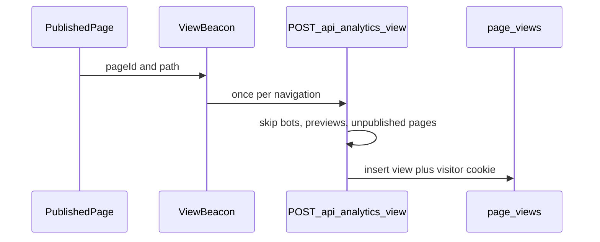

# Dashboard analytics

The page at [`src/app/(admin)/dashboard/(shell)/page.tsx`](src/app/(admin)/dashboard/(shell)/page.tsx) currently renders only “Welcome”. There is no visitor table. Google Analytics stays as the existing site script; this dashboard reads data stored in Postgres.

## What the page shows

Match the existing stat-card style already used on the pages list (`rounded-lg border border-steel-200`).

**Traffic (7 or 30 days, via `?range=7|30`, default 30)**

- Views and unique visitors for the selected range
- Daily view bars (plain SVG, no chart library)
- Top pages and top referrer hostnames
- Empty state when nothing has been recorded yet

**Content (current CMS data)**

- Page counts by status, reusing `pagesServices.getStatusCounts()`
- Media file count and total size, active user count
- Latest audit rows from `auditService.list()`
- Recently updated pages, linking to [`PAGES.DASHBOARD.PAGES.EDIT`](src/config/pages.ts)

## How a visit is recorded

Public pages can be cached, so the count is not taken inside the server render. A client beacon runs only for published, non-preview pages.

- New `page_views` table on [`src/db/schemas/pages.schema.ts`](src/db/schemas/pages.schema.ts): `pageId` (cascade), `path`, `referrerHost` (hostname only), `visitorId`, `createdAt`. Indexes on `created_at` and `(page_id, created_at)`.
- Generate and apply a Drizzle migration the same way as [`src/db/migrations/20261015073208_page_builder_port.sql`](src/db/migrations/20261015073208_page_builder_port.sql).
- [`src/app/(site)/[[...slug]]/page.tsx`](src/app/(site)/[[...slug]]/page.tsx) mounts the beacon only when `isDraft` is false.
- `POST /api/analytics/view` sets an httpOnly `cms_vid` cookie when missing, checks the page is published and public, ignores preview cookies and common bot user agents, and skips a repeat from the same visitor and page within 10 seconds. It does not store IP or user agent.
- Queries live in `src/server/services/analytics.service.ts`. The dashboard page stays a server component behind the existing admin layout.
