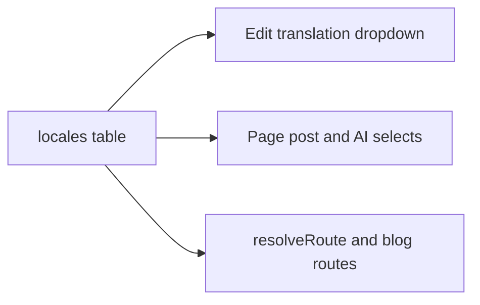

# Dynamic language list

The translation dropdown on the page edit screen, and every other language select, reads the constant in [src/db/schemas/shared.schema.ts](src/db/schemas/shared.schema.ts):

```59:67:src/db/schemas/shared.schema.ts
export const SUPPORTED_LANGUAGES = [
  { value: 'en', label: 'English' },
  { value: 'es', label: 'Spanish' },
  { value: 'fr', label: 'French' },
  { value: 'de', label: 'German' },
  { value: 'ja', label: 'Japanese' },
] as const;
```

Public URLs use the same constant. [src/config/pages.ts](src/config/pages.ts) leaves `en` unprefixed, and [src/server/services/public-site.service.ts](src/server/services/public-site.service.ts) treats a first segment as a language only when it is in `LANGUAGE_CODES`. A language that exists only in the edit dropdown would save a draft the public site cannot route.

Locales are their own table, not a JSON blob on `site_settings`. The edit screen reads rows from that table. It does not accept a free-text language per page.



## Locales table

Add `locales` in [src/db/schemas/pages.schema.ts](src/db/schemas/pages.schema.ts) and export it from [src/db/schema.ts](src/db/schema.ts).

Columns:

- `id` from `baseColumns`
- `code` text, unique, not null. Lowercase BCP 47 primary tag (`en`, `pt`, `zh-hans` allowed by the shape check)
- `label` varchar, not null
- `isDefault` boolean, default false
- `enabled` boolean, default true
- `sortOrder` integer, not null, so the dropdown order is explicit
- `createdAt` and `updatedAt` only. No soft delete. Disabling hides a locale; deleting is refused while content still uses the code

Constraints, matching the partial unique index already used by `post_templates_default_unique`:

- Unique index on `code`
- Partial unique index where `isDefault = true`, so only one default row
- The default row must stay `enabled`. The service rejects a save that disables it or leaves zero defaults

Code shape: `/^[a-z]{2,3}(-[a-z0-9]{2,8})?$/`. Reject codes that collide with routes: `blog`, `dashboard`, `api`, `media`, `login`, `search`.

Foreign keys from the existing language columns to `locales.code`, with `ON UPDATE CASCADE` and `ON DELETE RESTRICT`:

- `pages.language` and `posts.language` (both `text`, default `en`, not null)
- `categories.language` and `tags.language` (nullable)

Renaming a code updates those rows. A locale that pages, posts, categories, or tags still reference cannot be deleted. Disabling does not remove the row, so those foreign keys stay valid.

Migration inserts the current five languages if the codes are missing:

- `en` English, default, enabled, sort 0
- `es` Spanish, `fr` French, `de` German, `ja` Japanese, enabled, sorts 1–4

[src/db/seed/index.ts](src/db/seed/index.ts) inserts the same rows with `onConflictDoNothing` on `code`, so a re-seed does not reset labels an admin has edited.

`SUPPORTED_LANGUAGES` remains only as that seed list, not as the live list.

## Settings editor

On [src/app/(admin)/dashboard/(shell)/settings/_components/settings-form.tsx](src/app/(admin)/dashboard/(shell)/settings/_components/settings-form.tsx), add a Languages section for users who already have `settings.manage`. It lists locale rows and can add, rename label or code, reorder, enable or disable, and choose the default. Each action is its own server call against the `locales` table, not a JSON field on the site-settings save.

Changing the default rewrites public URLs (`/about` becomes `/{oldDefault}/about`, and the new default drops its prefix). The form states that next to the default control.

## Admin consumers

Pass enabled locale rows from the server into client screens, ordered by `sortOrder`. Replace `SUPPORTED_LANGUAGES` in:

- [src/app/(admin)/dashboard/(shell)/pages/_components/share-panel.tsx](src/app/(admin)/dashboard/(shell)/pages/_components/share-panel.tsx). “Add a language…” stays a select of enabled locales minus this page’s language and its `translationGroupId` siblings.
- [src/app/(admin)/dashboard/(shell)/pages/_components/sidebar-editor.tsx](src/app/(admin)/dashboard/(shell)/pages/_components/sidebar-editor.tsx) and the posts language field in [src/app/(admin)/dashboard/(shell)/posts/form.tsx](src/app/(admin)/dashboard/(shell)/posts/form.tsx).
- Language filters in the pages and posts tables.
- The AI language selects in [src/app/(admin)/dashboard/(fullscreen)/pages/[id]/builder/_components/ai-dialogs.tsx](src/app/(admin)/dashboard/(fullscreen)/pages/[id]/builder/_components/ai-dialogs.tsx).

[src/app/(admin)/dashboard/(shell)/pages/_modules/pages.service.ts](src/app/(admin)/dashboard/(shell)/pages/_modules/pages.service.ts) `createTranslation` rejects a code that is not an enabled row, and rejects a code another sibling in the group already uses. The same check applies when the sidebar changes `language` on an existing translation. Posts get the same enabled-code check. The foreign key is the backstop for a code that does not exist at all.

[src/db/validations/pages.validation.ts](src/db/validations/pages.validation.ts) and [src/db/validations/posts.validation.ts](src/db/validations/posts.validation.ts) stop refining against a module-level array. The server action loads enabled rows and checks the code there. Keep `isLocaleCode` for the shape check on create and rename.

## Public routing

Load enabled rows once per request (cached) and pass `{ codes, defaultCode }` into:

- `resolveRoute` in [src/server/services/public-site.service.ts](src/server/services/public-site.service.ts)
- `resolvePostRoute` in [src/server/services/blog.service.ts](src/server/services/blog.service.ts)
- `PAGES.SITE.page` and `PAGES.SITE.post` in [src/config/pages.ts](src/config/pages.ts), which today assume the default is `en`
- Sitemap alternates, hreflang in [src/app/(site)/[[...slug]]/page.tsx](src/app/(site)/[[...slug]]/page.tsx), and `lang` on `GET /api/v1/pages` and `GET /api/v1/posts`

The default locale stays unprefixed. Any other enabled code is a prefix. Unknown first segments stay ordinary slugs.

Add a compact language switcher in the public header. It lists enabled locales and links to the current page or post’s sibling in that language when a `translationGroupId` match exists. Locales with no sibling are omitted for that URL.

## Check

In Settings, add a `pt` / Portuguese row and disable `ja`. On a page edit screen, “Add a language…” offers Portuguese and not Japanese. Creating the Portuguese draft opens its edit page, and the public URL is `/pt/{slug}`. `/ja/{slug}` no longer resolves as a language. English URLs stay unprefixed while the English row is the default. A second Create for Portuguese on the same translation group is rejected. Deleting Portuguese while that page exists is rejected by the foreign key.
