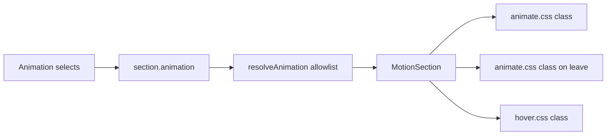

# Entrance, exit, and hover controls

These three controls go on the existing **Animation** group in [src/builder/controls/section-inspector.tsx](src/builder/controls/section-inspector.tsx). That group is already on every block through `section` in [src/builder/config.tsx](src/builder/config.tsx), so they are global inspector controls, not new per-block fields. Page transition stays a separate root setting.

Elementor’s controls are grouped selects, not icon grids. The catalogs match the docs:

- [Entrance](https://developers.elementor.com/docs/editor-controls/control-animation): Animate.css “in” groups (Fading, Zooming, Bouncing, Sliding, Rotating, Attention seekers, Light speed, Specials)
- [Exit](https://developers.elementor.com/docs/editor-controls/control-exit-animation): the matching “out” groups
- [Hover](https://developers.elementor.com/docs/editor-controls/control-hover-animation): Elementor’s Hover.css set (`grow`, `shrink`, `pulse`, `pulse-grow`, `pulse-shrink`, `push`, `pop`, `bounce-in`, `bounce-out`, `rotate`, `grow-rotate`, `float`, `sink`, `bob`, `hang`, `skew`, `skew-forward`, `skew-backward`, `wobble-*`, `buzz`, `buzz-out`)

Stored values stay short keys. A const map is the only place that turns a key into a class. Unknown keys are dropped by `pick`.

## Data model ([src/builder/style.ts](src/builder/style.ts))

- Replace the short `ENTRANCES` / `HOVERS` lists with the Elementor keys, and add `EXITS`.
- Add `exit` on `AnimationSettings` (default `'none'`).
- `resolveAnimation` returns null only when entrance, exit, and hover are all `none`.
- Keep saved pages working with aliases resolved before `pick`: `fade` → `fadeIn`, `fade-up` → `fadeInUp`, `fade-down` → `fadeInDown`, `slide-left` → `slideInLeft`, `slide-right` → `slideInRight`, `zoom` → `zoomIn`, `lift` → `float`, `scale` → `grow`. `blur` and `glow` stay as extra keys so those pages do not change.

## Inspector

- Extend `SelectInput` in [src/builder/controls/primitives.tsx](src/builder/controls/primitives.tsx) with optional `<optgroup>` groups.
- In [src/builder/controls/animation.tsx](src/builder/controls/animation.tsx), replace the Entrance and Hover icon grids with those grouped selects, and add Exit the same way. Default option is None.
- Keep trigger, duration, delay, easing, repeat, stagger, and the device toggles. Show trigger and timing when an entrance or an exit is set. Show the device row when any of the three is set.

## Playback ([src/builder/motion.tsx](src/builder/motion.tsx))

Entrance and exit stop using motion variants and use [animate.css](https://animate.style/) (v4 classes such as `animate__animated animate__fadeInUp`). Import it from [src/app/layout.tsx](src/app/layout.tsx) next to `site.css`.

- Duration and delay set `--animate-duration` and `--animate-delay` from the existing sliders.
- `ease-out` keeps a smooth curve; `spring` maps to a bouncy `animation-timing-function`. Both are fixed strings, not user CSS.
- The same triggers stay: load, scroll into view, hover, click. “In” animations (everything except attention seekers) stay hidden with a `data-motion-hold` attribute until the trigger fires, then the allowlisted class is added. Attention seekers stay visible and just play.
- Exit plays when the block leaves the viewport. `animation-fill-mode` keeps the end frame until it enters again. Repeat “first time only” plays exit once; “every time” replays it.
- Reduced motion, a device that is turned off, and the builder without Motion preview never add the class and never hide the block.
- Stagger still targets `MotionItem` children. Pass the existing loop index into `MotionItem` and set each child’s delay to `delay + index * 0.08s`.

Hover is a small stylesheet, [src/builder/hover.css](src/builder/hover.css), scoped under `.site-root`, with one fixed class per allowlisted effect (Elementor’s Hover.css motions, plus the current glow). It applies on the section, or on each item when the block is in `STAGGER_BLOCKS`. It does not run when motion is disabled. `blur` stays the current filter entrance, implemented as one local keyframe, because Animate.css has no blur.

