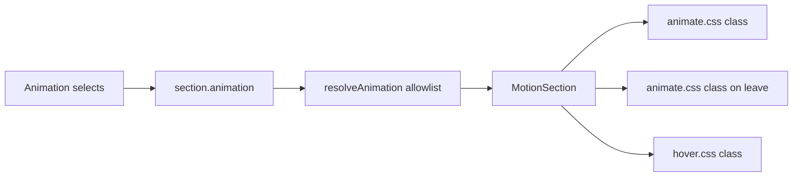

---

name: Elementor animation controls
overview: Add Elementor-style entrance, exit, and hover animation selects to the shared Style tab on every block, played through allowlisted Animate.css and hover classes so stored JSON still cannot inject arbitrary CSS.
todos:
- id: catalogs
  content: Add Elementor entrance, exit, and hover allowlists plus legacy aliases in style.ts
  status: completed
- id: selects
  content: Add grouped SelectInput and wire entrance, exit, and hover selects in the Animation group
  status: completed
- id: playback
  content: Play entrance and exit with animate.css, hover with a local allowlisted stylesheet, including stagger, reduced motion, and builder preview
  status: completed
- id: verify
  content: Typecheck and verify entrance, exit, and hover in the builder Motion preview and on a public page
  status: pending
  isProject: false

---

# Entrance, exit, and hover controls

## Implementation audit (2026-10-16)

| Todo         | Status       | Notes                                                                                                                                                                                                                                                                                                                                                                      |
| ------------ | ------------ | -------------------------------------------------------------------------------------------------------------------------------------------------------------------------------------------------------------------------------------------------------------------------------------------------------------------------------------------------------------------------- |
| **catalogs** | ✅ completed | `src/builder/animation-catalog.ts` — `ENTRANCE_GROUPS` / `EXIT_GROUPS` / `HOVER_GROUPS`, flat allowlists, aliases (`fade`→`fadeIn`, `lift`→`float`, …), `ENTRANCE_CLASS` / `EXIT_CLASS` / `HOVER_CLASS`, `ATTENTION_SEEKERS`. Re-exported from `style.ts`. `AnimationSettings.exit` + `resolveAnimation` returns null only when entrance, exit, and hover are all `none`.  |
| **selects**  | ✅ completed | `GroupedSelect` in `primitives.tsx`. `animation.tsx` uses grouped Entrance / Exit / Hover selects; trigger, duration, delay, easing, repeat, stagger, device toggles kept; timing shown when entrance or exit set.                                                                                                                                                         |
| **playback** | ✅ completed | `motion.tsx` applies allowlisted Animate.css / local blur / hover.css classes; `--animate-duration` / delay; reduced motion + device gates; `data-motion-hold`; exit on leave viewport; stagger delay on `MotionItem`. `layout.tsx` imports `animate.css` + `hover.css`. `package.json` has `animate.css`.                                                                 |
| **verify**   | ⏳ pending   | Needs local `pnpm tsc --noEmit` and manual builder / public-page checks.                                                                                                                                                                                                                                                                                                   |

These three controls go on the existing **Animation** group in [src/builder/controls/section-inspector.tsx](src/builder/controls/section-inspector.tsx). That group is already on every block through `section` in [src/builder/config.tsx](src/builder/config.tsx), so they are global inspector controls, not new per-block fields. Page transition stays a separate root setting.

Elementor’s controls are grouped selects, not icon grids. The catalogs match the docs:

- [Entrance](https://developers.elementor.com/docs/editor-controls/control-animation): Animate.css “in” groups (Fading, Zooming, Bouncing, Sliding, Rotating, Attention seekers, Light speed, Specials)
- [Exit](https://developers.elementor.com/docs/editor-controls/control-exit-animation): the matching “out” groups
- [Hover](https://developers.elementor.com/docs/editor-controls/control-hover-animation): Elementor’s Hover.css set (`grow`, `shrink`, `pulse`, `pulse-grow`, `pulse-shrink`, `push`, `pop`, `bounce-in`, `bounce-out`, `rotate`, `grow-rotate`, `float`, `sink`, `bob`, `hang`, `skew`, `skew-forward`, `skew-backward`, `wobble-*`, `buzz`, `buzz-out`)

Stored values stay short keys. A const map is the only place that turns a key into a class. Unknown keys are dropped by `pick`.

## Data model ([src/builder/style.ts](src/builder/style.ts) + [animation-catalog.ts](src/builder/animation-catalog.ts))

- Elementor keys in catalogs; `exit` on `AnimationSettings`.
- `resolveAnimation` null only when entrance, exit, and hover are all `none`.
- Legacy aliases before `pick`.

## Inspector

- `GroupedSelect` + entrance / exit / hover in [animation.tsx](src/builder/controls/animation.tsx).

## Playback ([src/builder/motion.tsx](src/builder/motion.tsx))

Animate.css + [hover.css](src/builder/hover.css); imported from [layout.tsx](src/app/layout.tsx).

