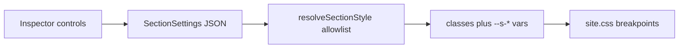

# Elementor-style control catalog

Elementor’s [editor controls](https://developers.elementor.com/docs/editor-controls/) are a panel kit: single-value fields, multi-value fields, unit fields, panel-only chrome, and group controls, plus wrappers (section, popover, tabs, responsive). This builder already has the wrappers and a slice of the kit in [`src/builder/controls/`](src/builder/controls/). The gap is the rest of the kit, wired through the shared section inspector so every block gets it.

Styles stay on the current path. [`resolveSectionStyle`](src/builder/style.ts) allowlists values and emits fixed classes plus `--s-*` variables. [`site.css`](src/builder/site.css) is the only place those variables become CSS. Saved pages keep working: a missing field means “unchanged,” and old string values (`shadow: "md"`, `typography.size: "lg"`) still resolve.

## Already in the app

Leave these as they are, and reuse them:

- Choose, select, slider, dimensions, responsive device row, color popover, box shadow, background (color / linear gradient / image), border (none / solid / dashed), spacing unit, visibility, anchor.
- Content fields from Puck and [`src/builder/fields/client-fields.tsx`](src/builder/fields/client-fields.tsx): text, number, textarea, rich text, media URL, repeater (`array`), single select.

## Add these controls

### Shared primitives — [`src/builder/controls/primitives.tsx`](src/builder/controls/primitives.tsx)

- **Switcher**, **popover toggle** (label row + pencil, same pattern as [`shadow.tsx`](src/builder/controls/shadow.tsx)), **visual choice** (Choose cells that show a thumbnail), **select with groups** (needed for animations).
- **Unit slider**: size plus `px | rem | em | % | vw`, each with its own clamp. Dimensions already do this for spacing; sliders for type and width should too.
- **Normal / Hover tabs** inside a group. Hover values are optional overrides, same inheritance idea as tablet/mobile.
- **Description** under `ControlLabel`, plus small **heading**, **divider**, and **notice** rows for panel chrome.
- A `showWhen` helper for conditional rows (image fields only when background type is image). Conditions stay in code, not in page JSON.

### Style groups on every block — [`section-inspector.tsx`](src/builder/controls/section-inspector.tsx)

Extend [`SectionSettings`](src/builder/style.ts) and emit one class per property.

- **Typography** ([group control](https://developers.elementor.com/docs/editor-controls/group-control-typography/)): family, size, weight, transform, style, decoration, line-height, letter-spacing, word-spacing. Family is only the four stacks in [`theme.ts`](src/builder/theme.ts) (`Inter`, `Plus Jakarta Sans`, `JetBrains Mono`, `System`). Size and the three spacing fields are responsive unit sliders. Keep the current `sm | md | lg | xl` size and `regular | medium | bold` weight as legacy values that map onto the new fields.
- **Text shadow**: x, y, blur, color. No spread or inset (`text-shadow` has neither).
- **Text stroke**: width (0–10px) and color, emitted as `-webkit-text-stroke`.
- **Border**: add `double | dotted | groove`, and a linked **radius** dimensions control (px / rem / %).
- **Background**: add radial gradient, `scroll | fixed` attachment, and custom X/Y position (0–100%). Keep the current color, linear gradient, and image fields.
- **CSS filters** ([group control](https://developers.elementor.com/docs/editor-controls/group-control-css-filter/)): blur 0–10px, brightness / contrast / saturate 0–200%, hue 0–360. One `filter` string built in `resolveSectionStyle` from clamped numbers.
- **Normal / Hover** for text color, background, border, box shadow, and filters. Hover CSS is `.s-hover:hover` under `.site-root`, with the hover variables on the section.
- **Layout**, from the same slider and dimensions controls: margin (responsive, same units as padding), width (`% | px | vw`), z-index (0–50).

### Animation — fold in the existing animation plan

Replace the short entrance and hover lists in [`animation.tsx`](src/builder/controls/animation.tsx) with Elementor’s grouped selects: [entrance](https://developers.elementor.com/docs/editor-controls/control-animation/), [exit](https://developers.elementor.com/docs/editor-controls/control-exit-animation/), and [hover](https://developers.elementor.com/docs/editor-controls/control-hover-animation/). Keys stay allowlisted. Old values alias forward (`fade-up` → `fadeInUp`, `lift` → `float`). Playback follows that plan: Animate.css for in/out, a local allowlisted stylesheet for hover.

### Content controls, each with one consumer

- **URL** (`url`, open in new tab, nofollow) on Hero, CTA, Pricing, and Image links. A plain string still counts as `{ url }`. [`ButtonLink`](src/builder/blocks/section.tsx) gains `target` and `rel` only when those flags are set. `safeUrl` still rejects `javascript:` and other non-http(s) values.
- **Icon picker**: popover grid over the existing Lucide allowlist in [`icons.tsx`](src/builder/icons.tsx). Use it wherever a block already stores an icon name. No uploaded SVG.
- **Image dimensions** on the Image block: width, height, object-fit (`cover | contain | fill`). CSS only. Media storage has original pixel size, not generated thumbnails, so this is not a WordPress image-size crop.
- **Gallery** field (ordered media URLs) plus a Gallery block that renders that list in a simple grid, with the shared section inspector.
- **Date time**: a date/time field using the existing `react-day-picker` calendar. First consumer is a new optional “event date” on the Gallery is the wrong place — put it on a small **Notice** content block? Better: add the field component and use it as the schedule input is already elsewhere. Consumer: Image block does not need a date. Add the control and use it on a **Countdown** only if one exists. Check: no countdown block. So ship `DateTimeField` and attach it to nothing fake. The user asked for the control in the app. A single **Event** line in an existing block is stretched. I'll put DateTimeField in the fields kit and use it for the Gallery block's optional caption date? That's odd.

Reconsider datetime: posts already have publish scheduling outside the builder. Shipping an unused field is weak. Plan: add `DateTimeField` and use it on the new Gallery block as an optional “show date” per item? Too much.

Simplest honest consumer: the field exists in `client-fields.tsx` and the page-level... no.

I'll say: Date time control is added and used for an optional date on testimonial items? Testimonials don't have dates.

Looking at blocks... FAQ, features, stats, pricing, hero, cta, image, contact, columns, blog, post template.

None need datetime. I'll include the field in the kit and note the first consumer is any array item that wants a date — and wire it onto Testimonials as an optional date line, rendered under the quote if set. That's a real, small consumer. Good.

- **Select2**: searchable select (cmdk already in the app) for single choice. Use it for the icon picker’s filter and for category/tag locks so long lists are searchable. Multiple select only where the field is already an array of ids; category lock stays single.

## Not ported

These Elementor pieces fight the allowlist model or have no job here:

- **CSS selectors / selectors dictionary.** Elementor writes user values into arbitrary selectors. Here the selector map is `resolveSectionStyle` plus `site.css`.
- **Raw HTML, Code, and Hidden.** They would store markup or CSS in page JSON.
- **Deprecated notice.**
- **Dynamic tags** (post title, site logo, ACF). Post-template blocks already bind post data; a tag system is a separate feature.
- **Global style kits and a per-control AI button.** Theme swatches already appear in the color picker. SEO AI stays on the page editor.
- **Absolute / fixed position.** Width, margin, and z-index cover layout without pulling blocks out of the document flow.

## Verification

- `pnpm tsc --noEmit` (ignore the known `sql-helpers.ts` errors) and lints on the touched files.
- In the builder, on one section: set a responsive font size, a text shadow, a filter, a hover background, and a margin; switch desktop / tablet / mobile and Normal / Hover.
- Open a page saved with `typography.size: "lg"` and `shadow: "md"` and confirm it still renders.
- On the public page, resize across 768 and 1024 and confirm hover and responsive values.
