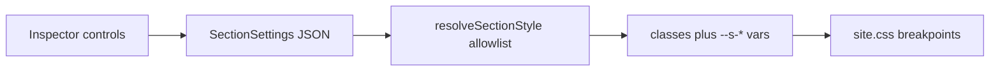

# Elementor-style control catalog

## Implementation audit (2026-10-16)

| Todo | Status | Notes |
|------|--------|-------|
| **primitives** | ✅ completed | `Switcher`, `VisualChoose`, `GroupedSelect`, `UnitSlider`, `StateTabs`, `Description`, `PanelHeading`, `Divider`, `Notice`, `ShowWhen` in `primitives.tsx`. |
| **typography** | ✅ completed | `TypographyControl` + resolve + site.css; legacy size/weight still resolve. |
| **border-bg** | ✅ completed | Border styles/radius; radial gradient, attachment, pos; hover StateTabs. |
| **filters-layout** | ✅ completed | `FilterControl`; Layout margin / width / z-index. |
| **animation** | ✅ completed | See `elementor_animation_controls_e45c47ac.plan.md` — catalogs, grouped selects, Animate.css + hover.css playback on main. |
| **content-fields** | 🟡 in progress | **Done:** `UrlField`, `IconPickerField`, `DateTimeField`, `SearchableSelectField`; `resolveLinkProps` / `ButtonLink`; **Image** `imageWidth` / `imageHeight` / `objectFit`; **Gallery** block + config. **Still open:** wire `UrlField` into Hero/CTA/Pricing/Image links (still plain `text`); wire `IconPickerField` into Features (still `select` + `ICON_OPTIONS`); DateTime on Testimonials items + render under quote. |
| **verify** | ⏳ pending | Local `pnpm tsc --noEmit` + builder/public checks. |

Elementor’s [editor controls](https://developers.elementor.com/docs/editor-controls/) are a panel kit. Styles stay on allowlisted classes and CSS variables via `resolveSectionStyle` + `site.css`.

## Content controls remaining

- **URL** on Hero, CTA, Pricing, Image (plain string still valid as `{ url }`).
- **Icon picker** wherever a block stores an icon name.
- **Date time** optional on Testimonials items.

## Not ported

CSS selectors dictionary, raw HTML/Code/Hidden, dynamic tags, global style kits, absolute/fixed position.

## Verification

- `pnpm tsc --noEmit` and lints on touched files.
- Builder: responsive type, filter, hover, margin; legacy `typography.size: "lg"` / `shadow: "md"`.
- Public page across 768 / 1024.
