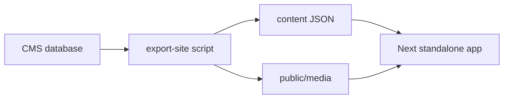

---

name: Export baked website
overview: Add an export that snapshots published pages, posts, menus, theme, and media into a standalone Next.js app. The generated app renders the public site with no CMS, auth, or database.
todos:
- id: render-split
  content: Split a database-free Puck render map from builder config so the export can render blocks without admin or DB imports.
  status: pending
- id: snapshot
  content: "Write the export script: published pages, posts, menus, settings, resolved globals, post catalog, and copied media."
  status: pending
- id: template
  content: Add the standalone Next.js export template (routes, local blog filter, sitemap, robots, Dockerfile, README).
  status: pending
- id: ui
  content: Add pnpm export:site and a settings download for users who can manage settings.
  status: pending
  isProject: false

---

# Export a deploy-ready public site

Published content is snapshotted into a self-contained Next.js app under `export/site` (gitignored), plus `export/site.zip`. Runtime is `output: 'standalone'` with a Dockerfile, so the folder deploys with `pnpm install && pnpm build && pnpm start` or `docker build`.

The CMS stays the editor. The export does not include the dashboard, auth, drafts, preview, the analytics beacon, or contact-form storage. Contact forms keep working only when a block has an external `actionUrl`.

## What gets baked

- Published, public pages (builder JSON after `resolveAllData`, or sanitized rich text) with SEO and language alternates. Routing stays the same as [`src/server/services/public-site.service.ts`](src/server/services/public-site.service.ts) and [`src/server/services/blog.service.ts`](src/server/services/blog.service.ts): `/`, `/{slug}`, `/{lang}`, `/{lang}/{slug}`, `/blog/{slug}`, `/{lang}/blog/{slug}`.
- Published posts, the post template layout, and related posts (those do not depend on the query string, so they are resolved once).
- Site settings, theme tokens, header and footer menus, `robots.txt`, and `sitemap.xml`.
- Media referenced by content or settings. Local `/media/...` files are copied from the storage root. Remote storage URLs are downloaded into `public/media` and rewritten. URLs that cannot be fetched stay remote and are listed in an export report.

Blog listing blocks stay request-aware. [`BlogPosts` `resolveData`](src/builder/config.tsx) filters by `q`, category, tag, sort, and page. The export writes the full published post catalog and repeats that filter in the generated app against JSON, so search and pagination still work without Postgres.

## Renderer shared with the CMS

[`src/builder/config.tsx`](src/builder/config.tsx) currently mixes render functions with admin fields and database `resolveData`. Split a database-free render map (block `render` only) that both the CMS config and the export use. The export copies that map plus the public block modules (`src/builder/blocks`, `site.css`, `hover.css`, theme/style/sanitize/motion) into the generated app. Admin field components and server actions are not copied.

Global blocks are expanded during export, before the JSON is written, so the generated app does not load globals from the CMS.

## How you run it

- `pnpm export:site` writes `export/site` and `export/site.zip`. Add `export/` to [`.gitignore`](.gitignore).
- Settings page ([`src/app/(admin)/dashboard/(shell)/settings/page.tsx`](src/app/(admin)/dashboard/(shell)/settings/page.tsx)), for users with `settings.manage`, gets an Export website action that downloads the same zip via an authenticated route.

The zip is source plus media, not `node_modules`. The included Dockerfile runs the production build.

## Check

Run the export against the current database, install and build `export/site`, and open the home page, a builder page, a blog post, and a blog list with a filter query. Confirm the CMS dashboard is absent from the export and media paths load from `public/media`.
