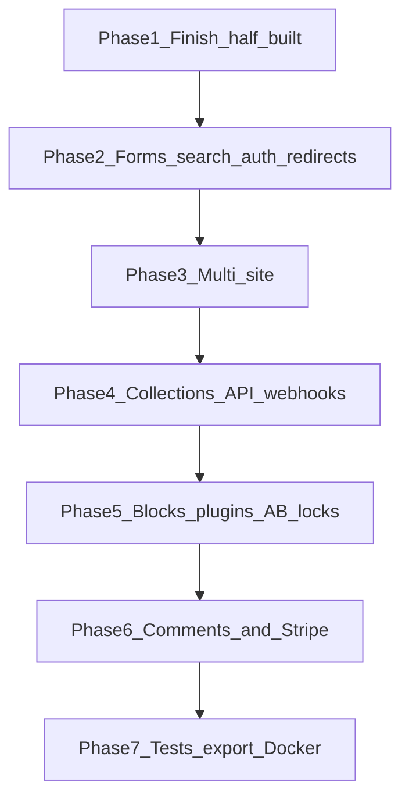

# Full-market implementation plan

This app is a self-hosted Next.js 16 CMS: Puck for pages, Tiptap for posts, Postgres, Google login, five fixed languages, a read-only `/api/v1`, and Gemini page generation. Phases 0–9 of [cms_page_builder_roadmap_db7c1a9b.plan.md](.cursor/plans/cms_page_builder_roadmap_db7c1a9b.plan.md) are in the code. Phase 10 (tests, distribution, plugins) is not. The market position is the gap between Payload (strong content model, weak freeform canvas) and Webflow or Builder.io (strong canvas, hosted only).

## What is already competitive

- Hybrid pages and posts, drafts vs published, revisions, preview tokens, scheduling via [src/server/services/scheduler.ts](src/server/services/scheduler.ts).
- Media (local or S3), SEO, sitemap, robots, menus, theme tokens, templates, global blocks.
- Elementor-style section controls and motion in [src/builder/style.ts](src/builder/style.ts) and [src/builder/motion.tsx](src/builder/motion.tsx).
- Roles in [src/config/permissions.ts](src/config/permissions.ts), audit log, analytics boards, AI generate/rewrite/SEO/alt text.

## What the market still expects and this repo lacks

Ship blockers already visible in code:

- `Slider`, `Tabs`, and `Accordion` exist in [src/builder/blocks/interactive.tsx](src/builder/blocks/interactive.tsx) and are named in the Layout category, but they are not keys of `builderConfig.components` in [src/builder/config.tsx](src/builder/config.tsx), so authors cannot insert them.
- Contact forms only POST to an optional `actionUrl` ([src/builder/blocks/contact-form-client.tsx](src/builder/blocks/contact-form-client.tsx)). No submissions table, inbox, email, or spam check.
- Page-view beacon runs for pages only. Posts never record traffic.
- Login is Google-only ([src/auth.ts](src/auth.ts)). No password, magic link, or second factor. `next-auth` and the `account` table are unused.
- No public locale switcher. Languages are hardcoded `en|es|fr|de|ja`. Menus, settings, and media are not translated.
- No redirects, site search, webhooks, custom collections, comments, payments, or multi-site (`site_settings.id` is the singleton `default`).
- API keys are all-or-nothing and read-only. Rate limit is in-memory.
- No tests, no CI, `typescript.ignoreBuildErrors: true` in `next.config.ts`. README is still the create-next-app stub. Baked export in [export_baked_website_8e0e5f9a.plan.md](.cursor/plans/export_baked_website_8e0e5f9a.plan.md) is unbuilt.
- Collaboration, A/B tests, and a plugin block API are absent. Image morphing is only a plan.

Out of scope even for this “full” plan, because each is its own product: tax and shipping engines, subscriptions, a WordPress-scale plugin marketplace, real-time CRDT co-editing inside Puck, and SAML. Collaboration here means locks and presence. Commerce means a catalog plus Stripe Checkout.

New tables from phase 2 onward get a `site_id` defaulting to `default`, so phase 3 is a backfill and a host map, not a second schema.

## Phase 1 — Finish what is already started

- Register `Slider`, `Tabs`, and `Accordion` in [src/builder/config.tsx](src/builder/config.tsx) using the existing panel helpers. Confirm they render on the public site.
- Show the contact-form options editor only for select and radio.
- Record post views: either a nullable `post_id` on `page_views` or a shared `content_views` table, and mount the beacon on post routes in [src/app/(site)/[[...slug]]/page.tsx](src/app/(site)/[[...slug]]/page.tsx). Include posts in the analytics boards.
- Add a public language switcher that follows `translationGroupId` and the existing hreflang data.
- Wire leftover content controls from [elementor_control_catalog_619bf531.plan.md](.cursor/plans/elementor_control_catalog_619bf531.plan.md): URL fields on Hero, CTA, Pricing, and Image; icon picker on Features.
- Turn off `typescript.ignoreBuildErrors` and fix the errors that surfaces. Replace the boilerplate [README.md](README.md) with real setup (Postgres, Google OAuth, storage, Gemini, cron).

## Phase 2 — Table stakes a buyer hits on day one

- **Forms.** `form_submissions` (site, form global id, payload JSON, status, spam flag). Contact forms post to a first-party route. Admin inbox under Contact forms with read, archive, and CSV export. Honeypot plus an optional Turnstile secret. Email the site owner through an SMTP or Resend adapter selected by env.
- **Redirects.** `redirects` (from path, to path, 301 or 302, site). Middleware resolves them before the catch-all page. CSV import. Publishing a slug change offers to create a redirect.
- **Search.** Postgres full-text on published page titles, text extracted from Puck JSON, and post bodies. Public `/search` page and `GET /api/v1/search`.
- **Auth.** Email and password with a hashed secret on `users`, plus magic link. Keep Google. Invite flow for new users instead of “first user is Admin, everyone else is Viewer” only. Optional TOTP for Admins.
- **Review queue.** A dashboard list of `status = review` with approve and request changes. Email the author. This uses the existing status; it does not add a workflow engine.
- **OpenAPI.** Generate a spec for the current read API from the zod schemas in [src/server/api/v1.ts](src/server/api/v1.ts).

## Phase 3 — Multi-site

Agencies cannot sell this as WordPress multisite or a Webflow workspace until content is scoped.

- `sites` (id, name, primary host, extra domains, locale list) and `site_memberships` (user, site, role).
- Add `site_id` to pages, posts, media, menus, taxonomies, globals, templates, settings, submissions, redirects, analytics, and API keys. Backfill `default`.
- Resolve the public site from the request host in [src/server/services/public-site.service.ts](src/server/services/public-site.service.ts). Admin gets a site switcher; permissions are checked against the active site.
- Per-site locale list replaces the hardcoded five languages. English can stay unprefixed per site.
- Translate menus and site name, description, and default SEO. Media alt text stays per asset; pages and posts stay one document per language, which is the model already in the schema.

## Phase 4 — Headless parity with Payload and Strapi

- **Custom collections.** `collections` and `collection_fields` (text, rich text, number, boolean, date, select, media, relation). Entries stored as JSON validated by the field list. Admin list and edit screens generated from that schema. A collection can target a Puck template the way Webflow CMS template pages do, using a `CollectionItem` block plus a `/{collection}/{slug}` route.
- **API.** Scoped keys (`content:read`, `content:write`, `media:write`). Write endpoints for pages, posts, entries, and media, all draft-first. Publish still requires `pages.publish`. Move the rate limit to Postgres or Redis so it survives more than one instance. Webhook subscriptions on publish, unpublish, form submit, and entry change, with a signed payload and a delivery log.
- Pages and posts stay first-class. Collections do not replace them.

## Phase 5 — Visual builder parity

- **Block library.** Add the blocks marketing sites expect and this catalog skips: Video, Embed, Logo cloud, Team, Timeline, Map, Spacer, Button, Code, Newsletter (wired to the form inbox), and the image-morph block from [image_morphing_block_544e3097.plan.md](.cursor/plans/image_morphing_block_544e3097.plan.md). Each uses the existing section inspector.
- **Plugins.** Load extra Puck components from `src/builder/custom/` without editing [src/builder/config.tsx](src/builder/config.tsx). Document the registration type. This is the phase 10 plugin API, kept local rather than a marketplace.
- **Editing safety.** Soft lock and presence on a page or post (who has it open, take-over after idle). Full co-editing of the same Puck document is deferred; Puck has no CRDT.
- **A/B.** A page can have one variant. Cookie split, beacon records the variant, analytics boards can group by variant. Manual “pick winner”, not a stats engine.

## Phase 6 — Comments and payments

- **Comments.** Threaded comments on posts, guest name and email or a signed-in user, moderation queue (pending, approved, spam), and a `Comments` post block. Email the post author on a new approved comment.
- **Commerce lite.** `products` (site, title, slug, description, images, price, currency, status) and `orders`. A Product grid block and a Buy button that creates a Stripe Checkout session. Webhook marks the order paid and shows it in an orders inbox. No cart with many lines in the first slice; one product per checkout. Subscriptions, tax, and shipping stay out.

## Phase 7 — Distribution

Fold in [export_baked_website_8e0e5f9a.plan.md](.cursor/plans/export_baked_website_8e0e5f9a.plan.md) per site: published content, menus, theme, media, local blog filter, no dashboard. Forms and checkout in the export keep working only through external URLs; say that in the export report.

- Playwright: sign in, edit a page, publish, view it, submit a form, follow a redirect.
- Vitest for public route resolution, redirect lookup, collection validation, and the block registry.
- `docker-compose` runs the app, Postgres, and an optional MinIO. One setup command. Lighthouse CI on the home page and a blog post, target 90 or better on performance once images go through `next/image`.
- GitHub Actions: lint, typecheck, unit tests, and the Playwright path.

## Suggested milestones

- **Demoable product** after phases 1–2: forms actually arrive, search and redirects work, and you can log in without Google.
- **Agency product** after phase 3: more than one site per install.
- **Headless product** after phase 4: custom content and webhooks.
- **Webflow-class canvas** after phase 5.
- **Full catch-up** after phases 6–7.

Do not start collections, webhooks, or Stripe until `site_id` exists. Do not start the baked export until phase 1 blocks render, or the snapshot will omit Slider, Tabs, and Accordion.