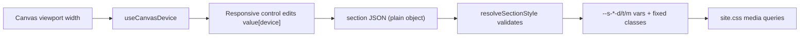

# Gear-trader style builder controls

## Goal
The floating card's Style and Layout controls should look and behave like gear-trader's `rest/src/components/builder/control`:
- Every control has one header row: the label on the left; device icons, a unit select or tabs on the right.
- Values are stored per device: desktop, tablet and mobile. Editing a field edits the device the canvas is currently showing.
- The color picker opens in a popover from a swatch.
- The shadow generator is a popover with numeric sliders.
- Background type is chosen with icon tabs placed beside the label.

Things that stay as they are:
- Storage stays plain objects in page JSON, not `JSON.stringify` strings.
- Values are validated through `pick`, `clamp`, `safeColor` and `safeUrl`, and rendered as fixed classes plus CSS variables.
- The collapsible groups (Colors, Typography, Border, Display, Animation, Spacing, ...) stay.

## Data model ([src/builder/style.ts](src/builder/style.ts))
- Add a generic helper. Old single-value pages keep working, because a non-object value counts as desktop.

```ts
export type MaybeResponsive<T> = T | Responsive<T>;
export function resolveResponsive<T>(v: MaybeResponsive<T> | undefined, device: Device, valid: (x: unknown) => T | undefined): T | undefined
```

- Make these fields `MaybeResponsive`:
  - `align`;
  - `typography.size` and `typography.weight`;
  - `display.minHeight` and `display.contentAlign`.
- Add a unit to spacing: `spacingUnit?: 'px' | 'rem' | 'em' | '%'`, validated with `pick`.
  - Clamp limits depend on the unit: px 0..400, rem/em 0..25, % 0..50.
  - The emitted variable value becomes `${n}${unit}`.
- Replace the `shadow` presets with a structured object, still accepting the legacy strings:

```ts
export type ShadowSettings = { x?: number; y?: number; blur?: number; spread?: number; color?: string; opacity?: number; inset?: boolean };
```

  - Clamp ranges: x and y -50..50, blur 0..100, spread -50..50, opacity 0..1.
  - The color goes through `safeColor` and is converted to `rgb(r g b / a)`.
  - The result is emitted as the `--s-shadow` variable plus a fixed `s-shadow` class.
  - Legacy `'sm' | 'md' | 'lg'` values still map to the current Tailwind classes.
- `resolveSectionStyle` emits per-device variables for the new responsive fields, using the same pattern as `responsiveSides`:
  - `--s-fs-{d|t|m}` (font size from an allowlisted rem map) and `--s-fw-*`;
  - `--s-ta-*` (text-align);
  - `--s-mh-*` (min-height: auto / 50vh / 100vh);
  - `--s-jc-*` (justify-content).
  - Each property is emitted with one class: `s-fs`, `s-fw`, `s-ta`, `s-mh`, `s-jc`.

## CSS ([src/builder/site.css](src/builder/site.css))
- Add mobile-first rules for `s-fs`, `s-fw`, `s-ta`, `s-mh` and `s-jc`.
- Put them inside the existing tablet and desktop media blocks (lines 95 and 105), next to the `s-p*` rules.
- Add `.site-root .s-shadow { box-shadow: var(--s-shadow); }`.

## Control primitives ([src/builder/controls/primitives.tsx](src/builder/controls/primitives.tsx))
- **`ControlLabel`** gets a `responsive` flag that renders `<DeviceRow/>` on the right, as gear-trader does. It also gets an `aside` slot for a unit select or tabs.
- **`Choose`** gets restyled to gear-trader's look:
  - one bordered row with `divide-x`, `rounded-sm`, equal `flex-1` cells;
  - the selected cell is `bg-steel-100 text-steel-900`;
  - tooltips come from `title`.
- **New `ResponsiveChoose`, `ResponsiveSelect` and `ResponsiveSlider`** wrap the primitives above.
  - They read and write `value[device]` through `useCanvasDevice()`.
  - When the current device has no value, they show the inherited value faded, with a "Reset" link that clears the override.
- **`Slider`** gets gear-trader's layout: a `w-3/4` range plus a small number box, and an optional `units` prop that renders a compact unit `<select>` in the header.
- **`SelectInput`** becomes full width under the label (gear-trader style) instead of label-left.

## New controls
- **[src/builder/controls/color-picker.tsx](src/builder/controls/color-picker.tsx)**: `ColorPicker`.
  - The trigger is an `h-6 w-14` swatch, or a pencil icon when empty.
  - It opens a `@radix-ui/react-popover` (already a dependency) containing:
    - a `react-colorful` `HexColorPicker`, a new dependency of about 3 KB;
    - a hex input;
    - a row of theme-token swatches from `metadata.themeTokens`;
    - a Clear button.
  - It replaces `ColorInput` everywhere: background, text color, border and shadow.
- **[src/builder/controls/shadow.tsx](src/builder/controls/shadow.tsx)**: `ShadowControl`.
  - Header: the label, a live preview chip, and a pencil button that opens the popover.
  - The popover holds sliders for Horizontal, Vertical, Blur, Spread and Opacity, a `ColorPicker`, an Inset toggle, and preset chips (None / S / M / L) that fill in the numbers.
  - It is removed from [src/builder/controls/border.tsx](src/builder/controls/border.tsx).

## Reworked controls
- **[src/builder/controls/background.tsx](src/builder/controls/background.tsx)**:
  - The type tabs become small icon buttons inside the label row (Brush / Gradient / Image), as gear-trader does.
  - Color and gradient fields use `ColorPicker`.
  - Image Size, Position and Repeat use the full-width select.
- **[src/builder/controls/dimensions.tsx](src/builder/controls/dimensions.tsx)**:
  - The header is the label, device icons, the link toggle and a unit select. It writes `spacingUnit` via a new `unit` / `onUnitChange` pair of props.
  - The four sides keep the range-plus-number rows.
  - Border width stays px-only (no unit select).
- **[src/builder/controls/section-inspector.tsx](src/builder/controls/section-inspector.tsx)** switches these controls to `ResponsiveChoose`:
  - text alignment;
  - base size and weight;
  - minimum height and content position.

  It also wires up the new `ShadowControl` and the unit for spacing.
- **[src/builder/controls/animation.tsx](src/builder/controls/animation.tsx)**: restyle only, using the new Choose, Slider and Select looks. Animation stays global, not per device, apart from the existing "play on" toggles.

## Flow



## Verification
- Run `pnpm tsc --noEmit`, ignoring the existing errors in `sql-helpers.ts`, and check `ReadLints` on the changed files.
- In the browser, in the builder:
  - Set center alignment on desktop and left on mobile, switch the device and confirm the canvas updates.
  - Pick a color in the popover.
  - Build a custom shadow.
  - Switch padding to rem.
  - Open an older page whose `align`/`shadow` are plain strings and confirm it still renders.
- On the public page, resize across 768 and 1024 px and confirm the per-device values apply.

## Out of scope
- An icon picker and a rich-text editor. No current block field needs them; they can be added later if blocks gain icon or rich-text fields.
