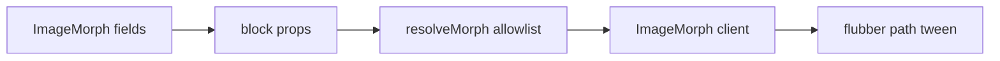

---

name: Image morphing block
overview: "Add an Image Morphing block that matches the ElementsKit widget: a shape that morphs between SVG paths, filled with an image, a solid color, or a gradient, with allowlisted timing and style controls."
todos:
- id: model
  content: Add morph settings, allowlists, default blob paths, and resolveMorph
  status: pending
- id: svg-extract
  content: Add a media action that returns sanitized path data from an uploaded SVG
  status: pending
- id: inspector
  content: Add the Image Morphing inspector field with content and style groups
  status: pending
- id: player
  content: Render the SVG morph with flubber, allowlisted easing, and reduced motion
  status: pending
- id: wire
  content: Register the block in the Puck config and the block registry
  status: pending
- id: verify
  content: Typecheck and verify effects, timing, custom SVGs, and the public page in the browser
  status: pending
  isProject: false

---

# Image morphing block

This is a new content block, matching the [ElementsKit Image Morphing widget](https://wpmet.com/doc/image-morphing/). It is available on every page and inside global blocks. It is not a style control on other blocks: those blocks do not have an image or a pair of shapes to morph.

The block keeps the shared `section` field, so spacing, background, and the existing entrance animation still apply around it.

## Data ([src/builder/morph.ts](src/builder/morph.ts))

`resolveMorph` is the only reader of stored JSON. Unknown keys are dropped with the same `pick`, `clamp`, `safeColor`, and `safeUrl` helpers as [src/builder/style.ts](src/builder/style.ts).

- **Effect:** `image`, `color`, or `gradient`.
- **Image:** one media URL. This library stores a single file, so WordPress image size and resolution are omitted.
- **Color:** fill, optional stroke (on/off plus a clamped stroke width).
- **Gradient:** two colors, two offsets, and line positions `x1`, `y1`, `x2`, `y2` (0–100).
- **Shape:** `default` uses four original closed blob paths in one viewBox (not ElementsKit’s artwork). `custom` uses 2–6 shapes. Each shape is a list of path `d` strings already sanitized at upload time.
- **Timing:** easing from a fixed anime-style list (Linear, EaseOutInQuad, EaseInCirc, and the other standard in/out/in-out curves), direction `normal` | `reverse` | `alternate`, loop on/off, duration, delay, and end delay in seconds, all clamped.
- **Style:** image opacity, zoom, horizontal and vertical position, and filters built only from clamped numbers (blur, brightness, contrast, saturate, grayscale). Shape width and height in pixels, clamped.

## Inspector

One custom field, [src/builder/controls/image-morph.tsx](src/builder/controls/image-morph.tsx), using `Choose`, `Slider`, `SelectInput`, `ColorInput`, and `MediaField`. It follows [src/builder/controls/section-inspector.tsx](src/builder/controls/section-inspector.tsx): content tab shows effect, shape, and timing; style tab shows image, color, gradient, and shape size; the layout tab shows nothing from this field. With no tab (the global-block sidebar) every group is visible.

Custom shapes use the media library, which already accepts `image/svg+xml`. Picking a file calls a new media action that loads that row only, rejects anything that is not an SVG, caps the body size, and returns path data. The stored value is the sanitized `d` strings, never the SVG markup. The field asks for at least two shapes and explains that a blob tool can be used to draw them first. Blobmaker is not embedded.

## Playback ([src/builder/blocks/image-morph.tsx](src/builder/blocks/image-morph.tsx))

A client component draws one SVG we own:

- Image fill uses `<image>` inside a `<clipPath>`.
- Color fill uses a `<path>` with optional stroke.
- Gradient fill uses a `<linearGradient>` whose stops and positions come from the resolved numbers.

`flubber` interpolates from one path to the next. Duration, delay, end delay (hold on the last shape), direction, and loop drive a `requestAnimationFrame` loop. Easing is a function from the allowlist, not a CSS string. `prefers-reduced-motion` shows the first shape and does not animate. The morph plays in the builder canvas because it is the block’s content. Invalid or single-shape data renders the first path with no tween. `useId` keeps clip and gradient ids unique.

## Wiring

- Register `ImageMorph` in [src/builder/config.tsx](src/builder/config.tsx) under Content, and in [src/builder/blocks/registry.ts](src/builder/blocks/registry.ts) so [src/builder/blocks/block-list.tsx](src/builder/blocks/block-list.tsx) can render it inside columns and global blocks.
- Leave [src/builder/schema.ts](src/builder/schema.ts) unchanged. Like the Image block, this one is media-bound and stays out of AI page generation.
- Add the `flubber` dependency.

## Check

Typecheck, then in the builder confirm the default blobs morph, each effect type, loop and direction, reduced motion, and a custom pair of SVGs. Confirm the same block on a public page.
