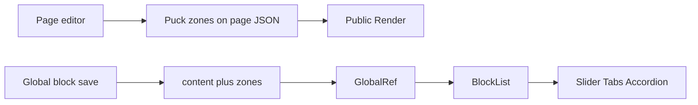

---

name: Interactive layout blocks
overview: Add Slider, Tabs, and Accordion as layout blocks whose panels are drop zones for any other block, and persist Puck zones so the same blocks keep their nested content when saved as global blocks.
todos:
- id: blocks
  content: Add Slider, Tabs, and Accordion slot blocks and register them in the Layout category
  status: completed
- id: zones
  content: Persist and rehydrate Puck zones for global blocks, including save-as-global and BlockList
  status: completed
- id: verify
  content: Verify nested drops in the page builder, public page, and global-block editor
  status: completed
  isProject: false

---

# Slider, Tabs, and Accordion blocks

Add three layout blocks to the page editor and the global-block editor. Each slide, tab, or accordion panel is a Puck slot, so any existing block can be dropped inside (Hero, Rich text, Image, Columns, and the rest). They share the same section Style and Layout inspector as the other blocks.

## Blocks

New client components in [src/builder/blocks/interactive.tsx](src/builder/blocks/interactive.tsx), registered from [src/builder/blocks/registry.ts](src/builder/blocks/registry.ts) and defined in [src/builder/config.tsx](src/builder/config.tsx). Put them in the existing Layout category next to Columns.

Each block uses `withSection` and an `items` array. Every item has a label plus a slot:

```ts
items: {
  type: 'array',
  arrayFields: {
    label: text('Label'),
    content: { type: 'slot', disallow: ['Slider', 'Tabs', 'Accordion'] },
  },
  getItemSummary: (item) => item.label || 'Panel',
  defaultItemProps: { label: 'Panel' },
}
```

Slots accept every other block, including Columns. Slider, Tabs, and Accordion cannot be nested inside each other, so drop zones stay one level deep. Default props ship with three empty panels so the canvas is usable immediately.

Behavior, using the same `s-*` site classes as FAQ and the pricing toggle (not the admin Tabs component):

- **Slider.** One panel at a time, previous/next buttons, dot indicators, optional loop and autoplay (3/5/7/10 seconds). Autoplay is off while `editing` is true. No new carousel dependency: CSS scroll-snap plus a small client component.
- **Tabs.** A tab list (underline or pills, start or center) and one visible panel. Keyboard and `role="tablist"` / `tab` / `tabpanel`.
- **Accordion.** Each item is a disclosure with the item label as the summary. A "open several at once" toggle chooses between one-open and many-open. Uses `button` + `aria-expanded` so the nested slot is not trapped inside native `details`.

While `editing` is true, every panel stays in the document and stacked, with its label above the drop zone, so Puck can accept drops into any panel. The interactive one-panel UI is what visitors and preview see.

Reuse the slot renderer already in [src/builder/blocks/content.tsx](src/builder/blocks/content.tsx): a function slot (Puck editor and public `<Render>`) is called as a component; an array slot (global blocks) is rendered with `BlockList`.



## Global blocks must keep nested zones

Puck stores slot children in `data.zones`, keyed `${blockId}:items[0].content`, not on the block props. Pages already save the full Puck `Data` in [builder-editor.tsx](src/app/(admin)/dashboard/(fullscreen)/pages/[id]/builder/_components/builder-editor.tsx). Global blocks do not: [global-block-editor.tsx](src/app/(admin)/dashboard/(fullscreen)/templates/globals/[id]/global-block-editor.tsx) and [save-global-dialog.tsx](src/app/(admin)/dashboard/(fullscreen)/pages/[id]/builder/_components/save-global-dialog.tsx) persist only the `content` array, and the dirty check ignores zones. A slider saved as a global block would lose every panel.

`global_blocks.content` is already jsonb, so no migration. Accept both shapes:

- Legacy: `BuilderItem[]` (what is stored today).
- New: `{ content: BuilderItem[]; zones?: Record<string, BuilderItem[]> }`.

Update the save schema in [templates.actions.ts](src/app/(admin)/dashboard/(shell)/templates/_modules/templates.actions.ts), the reader in `getGlobalBlockContent`, and the list helper that reads `content` as an array in [templates.service.ts](src/app/(admin)/dashboard/(shell)/templates/_modules/templates.service.ts). The global editor loads and saves both `content` and `zones`, and marks dirty when either changes. "Save section as global" copies the selected item plus every zone whose key starts with that item id or a nested child id.

[src/builder/blocks/block-list.tsx](src/builder/blocks/block-list.tsx) walks those zones and writes each zone's items onto the matching slot prop (`items[0].content`, `column1`, and so on) before rendering, including nested blocks. [GlobalRef](src/builder/blocks/content.tsx) passes the zones through.

## Out of scope

- AI generation of these blocks. Slots are not in [src/builder/schema.ts](src/builder/schema.ts).
- Replacing the text-only FAQ block.

## Verification

- In the page builder, insert each block, drop Rich text and an Image into different panels, switch slides and tabs, open and close accordion items, and confirm Style and Layout still apply.
- Reload the draft and the public page and confirm the nested blocks are still there.
- Save one of these blocks as a global block, edit it in the global-block editor, drop something into a second panel, insert it on a page with Global ref, and confirm both panels render.
- Open an existing global block that was saved as a plain array and confirm it still loads.
