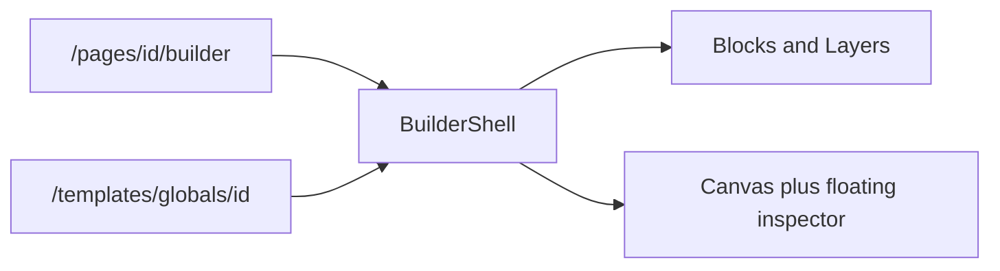

# Match the global editor to the page builder

The page builder at [`builder-editor.tsx`](src/app/(admin)/dashboard/(fullscreen)/pages/[id]/builder/_components/builder-editor.tsx) renders [`BuilderShell`](src/app/(admin)/dashboard/(fullscreen)/pages/[id]/builder/_components/builder-shell.tsx): top bar, Blocks/Layers/Page rail, canvas, and the floating inspector in [`selection-card.tsx`](src/app/(admin)/dashboard/(fullscreen)/pages/[id]/builder/_components/selection-card.tsx). Posts and post templates already use that shell.

The global editor in [`global-block-editor.tsx`](src/app/(admin)/dashboard/(fullscreen)/templates/globals/[id]/global-block-editor.tsx) still mounts Puck’s default three-column UI. It will use the same shell instead.

## Wire globals through the existing builder

Add `global` to `BuilderKind` in [`builder-context.tsx`](src/app/(admin)/dashboard/(fullscreen)/pages/[id]/builder/_components/builder-context.tsx), plus an optional `category` on the builder props.

In [`builder-editor.tsx`](src/app/(admin)/dashboard/(fullscreen)/pages/[id]/builder/_components/builder-editor.tsx), add a global adapter:

- Config is `builderConfig` with `GlobalRef` and the Global blocks category removed, same as today, so a global cannot nest another global.
- Root page fields (width, theme, padding, transition) are dropped. Those settings are not stored on a global block.
- Back link goes to Templates & Globals. Title is the block name.
- Save calls `saveGlobalBlock` with `{ content, zones }` and still requires at least one section. Empty content shows the existing error toast.
- Autosave stays off. A global block has no draft; saving updates every page that uses it. `useAutosave` with `enabled: false` still tracks dirty state for the leave warning.

[`templates/globals/[id]/page.tsx`](src/app/(admin)/dashboard/(fullscreen)/templates/globals/[id]/page.tsx) normalizes stored content into Puck data (`root`, `content`, `zones`) and renders `BuilderLoader` with `kind="global"`, the same way the post builder does. Delete [`global-block-editor.tsx`](src/app/(admin)/dashboard/(fullscreen)/templates/globals/[id]/global-block-editor.tsx) and [`global-block-loader.tsx`](src/app/(admin)/dashboard/(fullscreen)/templates/globals/[id]/global-block-loader.tsx).

## Header and rail for this kind

In [`builder-chrome.tsx`](src/app/(admin)/dashboard/(fullscreen)/pages/[id]/builder/_components/builder-chrome.tsx) and [`builder-shell.tsx`](src/app/(admin)/dashboard/(fullscreen)/pages/[id]/builder/_components/builder-shell.tsx), when `kind === 'global'`:

- Keep the top bar: label, name, device width, undo/redo, motion preview.
- One save button, labeled Save, disabled until there are changes. Hide status, autosave, preview, revisions, generate, publish, and save-as-template. Those belong to pages.
- Hide “Save as global block” on the selection action bar.
- Left rail is Blocks and Layers only. The Page tab is omitted because those fields are not saved.

Blocks, layers, canvas frame, and the floating Content/Style/Layout card stay the shared components.

## Check

Typecheck the touched files, then open both URLs and confirm the global editor shows the same top bar, block cards, layers tree, canvas, and floating inspector, and that Save writes the block.