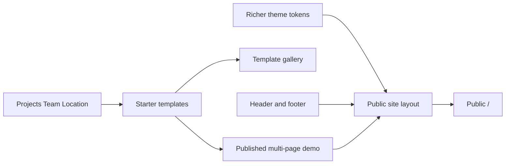

# Modern starter site

## Choices

Site kinds, all selected:

- SaaS product site (hero, features, pricing, FAQ, CTA)
- Agency or studio (services, selected work, testimonials, contact)
- Portfolio (projects, about, contact)
- Marketing site with a blog
- Company site (story, team, values, contact)
- Docs or changelog style pages
- Local business (services, hours, location, contact)
- Multi-page set: home, pricing, about, contact, and blog

Scope, all selected:

- Restyle the existing starter templates (gradients, split hero, motion)
- Set a modern site theme (font, colors, radius) and leave the admin UI as it is
- Expand the theme system (more fonts, more color roles, dark available for the public site)
- Add new blocks where the current ones cannot make the layout
- Seed published pages so the public site is not empty
- Seed header and footer menus and wire them to site settings
- Treat the homepage as the flagship; keep the other site kinds as templates
- Keep this step as the written plan until you ask to build it

How those fit together: one published demo is the multi-page marketing site. Agency, portfolio, company, docs, and local business are system templates in the gallery, ready to apply, and they do not each publish a second homepage. The home page is the flagship composition.

## What already exists

[src/db/seed/starter-content.ts](src/db/seed/starter-content.ts) has six system templates (SaaS landing, pricing, about, contact, blog index, article). They barely use section style. [src/db/seed/index.ts](src/db/seed/index.ts) updates those templates and never creates pages or menus, so [src/app/(site)/[[...slug]]/page.tsx](src/app/(site)/[[...slug]]/page.tsx) stays empty until a home page is published.

Theme tokens in [src/db/schemas/pages.schema.ts](src/db/schemas/pages.schema.ts) are primary, accent, four fonts, radius, and color mode. Blocks today are Hero, CTA, Features, Stats, Pricing, Testimonials, FAQ, RichText, Image, Gallery, ContactForm, BlogPosts, Columns, Slider, Tabs, Accordion, and GlobalRef.

## Theme

Extend `ThemeTokens` and the settings form in [src/app/(admin)/dashboard/(shell)/settings/_components/settings-form.tsx](src/app/(admin)/dashboard/(shell)/settings/_components/settings-form.tsx):

- Fonts: keep Inter, Plus Jakarta Sans, JetBrains Mono, and System, and add Instrument Sans and Newsreader.
- Color roles: background, foreground, and muted, in addition to primary and accent. [src/builder/theme.ts](src/builder/theme.ts) and [src/builder/site.css](src/builder/site.css) consume them. Blocks keep using the existing `s-*` classes.
- Color mode stays light, dark, or system. The seeded demo is light. Dark remains a setting, not a forced public theme.
- Seeded defaults, written only when tokens still equal `DEFAULT_THEME_TOKENS`: Plus Jakarta Sans, large radius, primary `#4F46E5`, accent `#0EA5E9`, and neutral background and foreground. A custom theme is left alone.
- Admin chrome stays out of this work.

## New blocks

Add these only for layouts the current blocks cannot carry. Register them in [src/builder/config.tsx](src/builder/config.tsx) and [src/builder/blocks/registry.ts](src/builder/blocks/registry.ts), each wrapped in the shared `Section`.

- **Projects.** Image, title, summary, link, and category. Used by agency selected work and portfolio projects. Gallery has images without that card content.
- **Team.** Photo, name, and role. Used by the company template.
- **Location.** Address, hours, and a map link. Used by the local business template.

Docs and changelog stay on Columns, RichText, and Accordion. SaaS sections stay on Hero, Features, Stats, Pricing, Testimonials, FAQ, and CTA.

## Templates

Restyle every starter in [src/db/seed/starter-content.ts](src/db/seed/starter-content.ts) with `SectionSettings` from [src/builder/style.ts](src/builder/style.ts): split or tall hero, one gradient, one dark band, staggered entrance, light hover on cards, page root `maxWidth: 'xl'`, `theme: 'site'`, `pageTransition: 'fade'`.

Keep the current six, and add templates for the kinds that are not in that set:

- Agency: services, Projects, testimonials, contact
- Portfolio: Projects, about copy, contact
- Company: story, values, Team, contact
- Docs: heading plus a two-column article and a short changelog list
- Local business: services, hours and Location, contact

Copy can stay short and specific to each kind. Images can stay on the existing Unsplash pattern.

## Publish the demo

Extend [src/db/seed/index.ts](src/db/seed/index.ts). `pages.createdBy` is required, so look up the earliest user. If none exists, log and skip pages and menus. Templates still update.

When a user exists, idempotently upsert by slug and publish only the multi-page demo:

- `/` home (`isHome`) from the SaaS landing template
- `/pricing`, `/about`, `/contact`
- `/blog` (`isBlogIndex`) from the blog listing template

Write both `draft` and `published` rows in `page_contents`, status `published`. Create a header menu (Home, Pricing, About, Blog, Contact) and a short footer menu, and set `headerMenuId` and `footerMenuId` when those fields are still empty.

Agency, portfolio, company, docs, and local templates are seeded as system templates only.

Re-running `pnpm db:seed` refreshes system templates and these pages by slug without duplicating them.

## Check

In the browser: `/`, `/pricing`, `/about`, `/contact`, `/blog`, and the header links. Confirm the hero, dark band, scroll motion, and a stacked mobile layout. Open the home page in the builder. In the template gallery, confirm the agency, portfolio, company, docs, and local templates are present and editable. Confirm the admin shell still uses its own theme.
