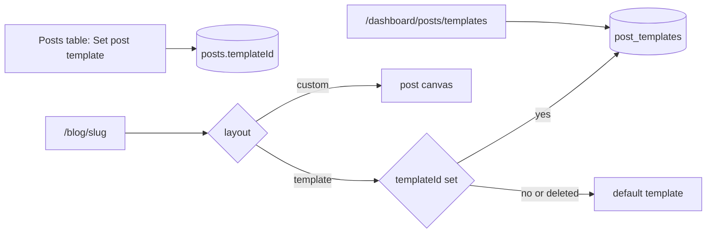

---

name: Multiple post templates
overview: Replace the single shared post template with a list of named post templates. One template is the default and applies to every post that hasn't picked another. Each post can pick a template from the posts table's three-dot menu ("Set post template"). Templates get their own listing page.
todos:
- id: tpl-schema
  content: Add post_templates table and posts.templateId; migrate the existing site_settings template into a Default row and drop the old columns
  status: completed
- id: tpl-service
  content: postTemplatesService (list, create, duplicate, rename, draft/publish, setDefault, delete, resolveForPost), postsService.setTemplate, and actions
  status: completed
- id: tpl-list
  content: Templates listing page with row actions and New template dialog; repoint posts page button and old route
  status: completed
- id: tpl-builder
  content: Per-template builder route and post-template adapter keyed by template id
  status: completed
- id: tpl-assign
  content: Set post template dialog in posts table row actions, layout column/filter, and template select in the post edit form
  status: completed
- id: tpl-render
  content: Resolve the post's template (assigned, then default, then built-in) in the public route, API, and switchLayout; verify end to end in the browser
  status: completed
  isProject: false

---

# Multiple single-post templates

Assumptions (the questions were skipped, so these are the recommended defaults):
- Per-post custom layouts stay as an extra option alongside named templates.
- "Set post template" works on one post at a time, from each row's three-dot menu.

## 1. Data model and migration

In [src/db/schemas/pages.schema.ts](src/db/schemas/pages.schema.ts):
- New `post_templates` table: `id`, `name`, `description`, `content` (live jsonb, nullable), `draftContent` (jsonb), `isDefault` (boolean), `createdBy`, timestamps. Add a partial unique index on `isDefault` where it is true, so only one row can be the default.
- Add `posts.templateId` as a nullable FK to `post_templates` with `on delete set null`. A null value means "use the default".
- Remove `singlePostTemplate` and `singlePostTemplateDraft` from `site_settings`.

Generate the migration, then hand-edit it so it:
1. Creates the table.
2. Inserts one "Default" row with `isDefault = true`, copying `content`/`draftContent` from the current `site_settings` columns.
3. Drops those columns.

Apply it through psql, as before.

## 2. Service and actions

In [posts.service.ts](src/app/(admin)/dashboard/(shell)/posts/_modules/posts.service.ts), replace `getTemplateRow`, `getTemplate`, `saveTemplateDraft` and `publishTemplate` with a `postTemplatesService` (new file `_modules/post-templates.service.ts`) that provides:
- `list()`: each template with name, default flag, published state, unpublished-changes flag and the number of posts using it. Posts with a null `templateId` count toward the default.
- `getById`, `create({name, description, fromId?})` (copies the source or default template, otherwise the built-in `DEFAULT_POST_TEMPLATE`), `rename`, `duplicate`.
- `saveDraft(id, content)` and `publish(id)`.
- `setDefault(id)`: in one transaction, clear the old default and set the new one.
- `delete(id)`: the default template can't be deleted. Posts using the deleted template fall back to the default through `set null`.
- `resolveForPost({templateId})`: returns the live content of the assigned template, otherwise the default's, otherwise the built-in default. The public route, the API and `switchLayout` all use it.

On the post side, add `postsService.setTemplate({id, templateId | null})`:
- Sets `layout = template` and `templateId`.
- If the post had a custom layout, writes a revision first, as `switchLayout` does today.
- When switching to custom, `switchLayout` now copies the post's assigned template.

In [posts.actions.ts](src/app/(admin)/dashboard/(shell)/posts/_modules/posts.actions.ts), add actions for each of these, guarded by `PAGES_PUBLISH` the same way the current template actions are. `setPostTemplate` uses the existing edit check.

## 3. Templates listing page

- Add `POSTS.TEMPLATES` (`/dashboard/posts/templates`) and `POSTS.TEMPLATE_BUILDER(id)` in [src/config/pages.ts](src/config/pages.ts). The old `/dashboard/posts/template` route redirects to the listing page.
- New page `(shell)/posts/templates/page.tsx` with a table showing name, a "Default" badge, status (Published, Draft or Unpublished changes), the number of posts using it, and last updated time.
- Each row's three-dot menu offers: Edit layout (opens the builder), Rename, Duplicate, Set as default, and Delete. Delete is hidden for the default template and confirms how many posts will move to the default.
- A "New template" button opens a dialog asking for a name and an optional "Start from" template.
- In [posts/page.tsx](src/app/(admin)/dashboard/(shell)/posts/page.tsx), rename the "Single-post template" button to "Post templates" and point it at the listing page.

## 4. Template builder per template

- Move `(fullscreen)/posts/template/page.tsx` to `(fullscreen)/posts/templates/[id]/builder/page.tsx`.
- In [builder-editor.tsx](src/app/(admin)/dashboard/(fullscreen)/pages/[id]/builder/_components/builder-editor.tsx), the `post-template` adapter takes the template id and calls `savePostTemplateDraft({id, content})` and `publishPostTemplate({id})`. It shows the template name as its label, and its back link goes to the templates listing.

## 5. "Set post template" in the posts table

In [posts-table.tsx](src/app/(admin)/dashboard/(shell)/posts/_components/posts-table.tsx):
- Add a "Set post template" item to `RowActions`. It opens a new `set-template-dialog.tsx` that lists every template as a selectable card, showing name, description, a "Default" badge and the post count.
- The dialog also offers "Use default template" (`templateId = null`) and, when the post has one, a note that its custom layout will be replaced. The current choice is preselected. Saving calls `setPostTemplate` and refreshes the table.
- The posts page passes the template list into `PostsTable`.
- The Layout column shows the template name, "Default" for unassigned posts, or "Custom layout". The layout filter gets one option per template, plus Default and Custom.
- `getPaginated` joins `post_templates` to return `templateName` and filters by `templateId`.

## 6. Post edit form

In [posts/form.tsx](src/app/(admin)/dashboard/(shell)/posts/form.tsx), the layout control becomes a select: Default template, each named template, and Custom layout. "Edit template" links to the selected template's builder.

## 7. Rendering

Replace `resolvePostTemplate(settings.singlePostTemplate)` with `postTemplatesService.resolveForPost(post)` in:
- [src/app/(site)/[[...slug]]/page.tsx](src/app/(site)/[[...slug]]/page.tsx)
- [src/app/api/v1/posts/[slug]/route.ts](src/app/api/v1/posts/[slug]/route.ts)

`blogService.loadPost` returns `templateId`. Cache live template content by id with the existing public-site cache tag.

## 8. Verify in the browser

1. Create a second template, edit it, and publish it.
2. Assign it to the sample post from the three-dot menu, and check the public post's layout.
3. Make it the default, and check an unassigned post.
4. Delete it, and confirm its posts fall back to the default.
5. Assign a template to a custom-layout post, and check the revision.
6. Regression checks: the page builder, the public `/blog` page, and the API.
