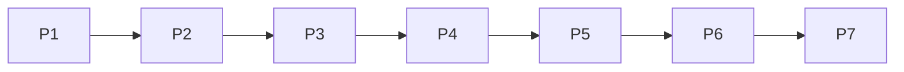

---

name: Numbered CMS refs
overview: Split the seven phase todos in the full CMS gap plan into small refs (P1-01 through P7-07). Name one ref to implement only that piece.
todos:
- id: P1-01
  content: Register Slider, Tabs, and Accordion as builderConfig component keys in src/builder/config.tsx
  status: pending
- id: P1-02
  content: Confirm Slider, Tabs, and Accordion render on the public site
  status: pending
- id: P1-03
  content: Show the contact-form options editor only for select and radio
  status: pending
- id: P1-04
  content: Nullable page_id plus post_id on page_views; record post views in the analytics service and beacon route
  status: pending
- id: P1-05
  content: Mount the view beacon on post routes in the public catch-all page
  status: pending
- id: P1-06
  content: Include posts on the analytics boards
  status: pending
- id: P1-07
  content: Public language switcher using translationGroupId and hreflang
  status: pending
- id: P1-08
  content: Wire UrlField on Hero, CTA, Pricing, and Image
  status: pending
- id: P1-09
  content: Wire IconPickerField on Features
  status: pending
- id: P1-10
  content: Turn off typescript.ignoreBuildErrors and fix the type errors
  status: pending
- id: P1-11
  content: Replace README.md with real Postgres, Google OAuth, storage, Gemini, and cron setup
  status: pending
- id: P2-01
  content: form_submissions table with site_id defaulting to default
  status: pending
- id: P2-02
  content: First-party contact-form submit route
  status: pending
- id: P2-03
  content: "Admin form inbox: list, read, archive"
  status: pending
- id: P2-04
  content: CSV export of form submissions
  status: pending
- id: P2-05
  content: Honeypot and optional Turnstile on form submit
  status: pending
- id: P2-06
  content: Email site owner via SMTP or Resend from env
  status: pending
- id: P2-07
  content: redirects table with site_id
  status: pending
- id: P2-08
  content: Middleware resolves redirects before the catch-all page
  status: pending
- id: P2-09
  content: Redirect CSV import
  status: pending
- id: P2-10
  content: Publishing a slug change offers to create a redirect
  status: pending
- id: P2-11
  content: Postgres full-text on published pages and posts
  status: pending
- id: P2-12
  content: Public /search page
  status: pending
- id: P2-13
  content: GET /api/v1/search
  status: pending
- id: P2-14
  content: Email and password login; keep Google
  status: pending
- id: P2-15
  content: Magic-link login
  status: pending
- id: P2-16
  content: Invite flow for new users
  status: pending
- id: P2-17
  content: Optional TOTP for Admins
  status: pending
- id: P2-18
  content: "Review queue for status=review: approve and request changes"
  status: pending
- id: P2-19
  content: Email the author on review actions
  status: pending
- id: P2-20
  content: OpenAPI spec from zod schemas in src/server/api/v1.ts
  status: pending
- id: P3-01
  content: "sites table: name, primary host, extra domains, locale list"
  status: pending
- id: P3-02
  content: "site_memberships: user, site, role"
  status: pending
- id: P3-03
  content: Add site_id to content tables and backfill default
  status: pending
- id: P3-04
  content: Resolve the public site from the request host
  status: pending
- id: P3-05
  content: Admin site switcher; permissions against the active site
  status: pending
- id: P3-06
  content: Per-site locale list; English unprefixed
  status: pending
- id: P3-07
  content: Translated menus
  status: pending
- id: P3-08
  content: Translated site name, description, and default SEO
  status: pending
- id: P4-01
  content: collections and collection_fields tables
  status: pending
- id: P4-02
  content: Validate collection entry JSON against the field list
  status: pending
- id: P4-03
  content: Generated admin list and edit screens for collections
  status: pending
- id: P4-04
  content: CollectionItem block and /{collection}/{slug} route
  status: pending
- id: P4-05
  content: "Scoped API keys: content:read, content:write, media:write"
  status: pending
- id: P4-06
  content: Draft-first write endpoints for pages, posts, entries, and media
  status: pending
- id: P4-07
  content: Postgres rate limit shared across instances
  status: pending
- id: P4-08
  content: Signed webhooks and a delivery log
  status: pending
- id: P5-01
  content: Video block
  status: pending
- id: P5-02
  content: Embed block
  status: pending
- id: P5-03
  content: Logo cloud block
  status: pending
- id: P5-04
  content: Team block
  status: pending
- id: P5-05
  content: Timeline block
  status: pending
- id: P5-06
  content: Map block
  status: pending
- id: P5-07
  content: Spacer block
  status: pending
- id: P5-08
  content: Button block
  status: pending
- id: P5-09
  content: Code block
  status: pending
- id: P5-10
  content: Newsletter block wired to the form inbox
  status: pending
- id: P5-11
  content: Image-morph block
  status: pending
- id: P5-12
  content: Load Puck components from src/builder/custom/
  status: pending
- id: P5-13
  content: Document the local plugin registration type
  status: pending
- id: P5-14
  content: Soft lock and presence on pages and posts
  status: pending
- id: P5-15
  content: One A/B variant per page with cookie split and beacon
  status: pending
- id: P5-16
  content: Analytics group by variant and manual pick winner
  status: pending
- id: P6-01
  content: Threaded post comments with pending, approved, and spam
  status: pending
- id: P6-02
  content: Public comment form for guests or signed-in users
  status: pending
- id: P6-03
  content: Comment moderation queue
  status: pending
- id: P6-04
  content: Comments post block
  status: pending
- id: P6-05
  content: Email the post author when a comment is approved
  status: pending
- id: P6-06
  content: products and orders tables
  status: pending
- id: P6-07
  content: Product grid block and Buy button
  status: pending
- id: P6-08
  content: Stripe Checkout for one product
  status: pending
- id: P6-09
  content: Stripe webhook marks the order paid; orders inbox
  status: pending
- id: P7-01
  content: Per-site baked export of published content, menus, theme, and media
  status: pending
- id: P7-02
  content: "Export report: forms and checkout need external URLs"
  status: pending
- id: P7-03
  content: "Playwright: sign in, edit, publish, view, submit a form, follow a redirect"
  status: pending
- id: P7-04
  content: Vitest for routes, redirects, collection validation, and the block registry
  status: pending
- id: P7-05
  content: docker-compose for app, Postgres, and optional MinIO
  status: pending
- id: P7-06
  content: Lighthouse CI on the home page and a blog post
  status: pending
- id: P7-07
  content: GitHub Actions for lint, typecheck, unit tests, and Playwright
  status: pending
  isProject: false

---

# Numbered refs for the CMS gap plan

Use these refs one at a time. Say **implement P1-03** (or any other ref). That ref is the whole task. Do not continue to the next ref unless you ask.

Source plan: [full_cms_gap_plan_8a7c0c53.plan.md](.cursor/plans/full_cms_gap_plan_8a7c0c53.plan.md). On accept, replace that file’s seven phase todos with the refs below and add this usage rule. Phase prose stays.

## Order

- New tables from **P2** onward include `site_id` defaulting to `default`.
- Do not start **P4** until **P3-03** (`site_id` backfill) is done.
- Do not start **P7-01** (baked export) until **P1-01** and **P1-02** (Slider, Tabs, Accordion) are done.
- **P5-10** needs the form inbox from **P2-01**.

## P1 — Finish what is started

- **P1-01** Register `Slider`, `Tabs`, and `Accordion` as keys of `builderConfig.components` in [src/builder/config.tsx](src/builder/config.tsx). They are imported and listed in the Layout category, but they are not component keys, so authors cannot insert them.
- **P1-02** Confirm those three blocks render on the public site.
- **P1-03** Show the contact-form options editor only for select and radio.
- **P1-04** Record post views: make `page_views.page_id` nullable and add `post_id` in [src/db/schemas/pages.schema.ts](src/db/schemas/pages.schema.ts). Update [src/server/services/analytics.service.ts](src/server/services/analytics.service.ts) and [src/app/api/analytics/view/route.ts](src/app/api/analytics/view/route.ts).
- **P1-05** Mount the view beacon on post routes in [src/app/(site)/[[...slug]]/page.tsx](src/app/(site)/[[...slug]]/page.tsx). Depends on P1-04.
- **P1-06** Include posts on the analytics boards.
- **P1-07** Public language switcher that follows `translationGroupId` and existing hreflang data.
- **P1-08** Wire `UrlField` on Hero, CTA, Pricing, and Image. Those links are still plain `text`. Controls already exist from the elementor catalog.
- **P1-09** Wire `IconPickerField` on Features. Items still use `select` plus `ICON_OPTIONS`.
- **P1-10** Turn off `typescript.ignoreBuildErrors` in [next.config.ts](next.config.ts) and fix the errors that surfaces.
- **P1-11** Replace the create-next-app [README.md](README.md) with setup for Postgres, Google OAuth, storage, Gemini, and cron.

## P2 — Day-one table stakes

- **P2-01** `form_submissions` table: site, form global id, payload JSON, status, spam flag. `site_id` defaults to `default`.
- **P2-02** First-party submit route. Contact forms in [src/builder/blocks/contact-form-client.tsx](src/builder/blocks/contact-form-client.tsx) post there instead of only an optional `actionUrl`.
- **P2-03** Admin inbox under Contact forms: list, read, archive.
- **P2-04** CSV export of submissions.
- **P2-05** Honeypot plus optional Turnstile secret.
- **P2-06** Email the site owner. SMTP or Resend, chosen by env.
- **P2-07** `redirects` table: from path, to path, 301 or 302, `site_id`.
- **P2-08** Middleware resolves redirects before the catch-all page.
- **P2-09** Redirect CSV import.
- **P2-10** Publishing a slug change offers to create a redirect.
- **P2-11** Postgres full-text on published page titles, text extracted from Puck JSON, and post bodies.
- **P2-12** Public `/search` page.
- **P2-13** `GET /api/v1/search`.
- **P2-14** Email and password login. Hashed secret on `users`. Keep Google in [src/auth.ts](src/auth.ts).
- **P2-15** Magic-link login.
- **P2-16** Invite flow. Stop relying only on “first user is Admin, everyone else is Viewer”.
- **P2-17** Optional TOTP for Admins.
- **P2-18** Review queue: dashboard list of `status = review`, approve, and request changes. Uses the existing status. No workflow engine.
- **P2-19** Email the author on approve and request changes.
- **P2-20** OpenAPI spec generated from the zod schemas in [src/server/api/v1.ts](src/server/api/v1.ts).

## P3 — Multi-site

- **P3-01** `sites` table: id, name, primary host, extra domains, locale list.
- **P3-02** `site_memberships`: user, site, role.
- **P3-03** Add `site_id` to pages, posts, media, menus, taxonomies, globals, templates, settings, submissions, redirects, analytics, and API keys. Backfill `default`.
- **P3-04** Resolve the public site from the request host in [src/server/services/public-site.service.ts](src/server/services/public-site.service.ts).
- **P3-05** Admin site switcher. Permissions checked against the active site.
- **P3-06** Per-site locale list replaces hardcoded `en|es|fr|de|ja`. English stays unprefixed per site.
- **P3-07** Translated menus.
- **P3-08** Translated site name, description, and default SEO. Media alt stays per asset. Pages and posts stay one document per language.

## P4 — Headless

Do not start until P3-03.

- **P4-01** `collections` and `collection_fields` (text, rich text, number, boolean, date, select, media, relation).
- **P4-02** Store entries as JSON validated by the field list.
- **P4-03** Admin list and edit screens generated from that schema.
- **P4-04** `CollectionItem` block plus a `/{collection}/{slug}` route, same idea as a Webflow CMS template page.
- **P4-05** Scoped API keys: `content:read`, `content:write`, `media:write`.
- **P4-06** Draft-first write endpoints for pages, posts, entries, and media. Publish still requires `pages.publish`.
- **P4-07** Move rate limiting from memory to Postgres so it works with more than one instance.
- **P4-08** Webhook subscriptions on publish, unpublish, form submit, and entry change. Signed payload and a delivery log.

Pages and posts stay first-class. Collections do not replace them.

## P5 — Builder

- **P5-01** Video block, using the existing section inspector.
- **P5-02** Embed block.
- **P5-03** Logo cloud block.
- **P5-04** Team block.
- **P5-05** Timeline block.
- **P5-06** Map block.
- **P5-07** Spacer block.
- **P5-08** Button block.
- **P5-09** Code block.
- **P5-10** Newsletter block wired to the form inbox (needs P2-01).
- **P5-11** Image-morph block from [image_morphing_block_544e3097.plan.md](.cursor/plans/image_morphing_block_544e3097.plan.md).
- **P5-12** Load extra Puck components from `src/builder/custom/` without editing [src/builder/config.tsx](src/builder/config.tsx).
- **P5-13** Document the local plugin registration type.
- **P5-14** Soft lock and presence on a page or post: who has it open, take-over after idle. No CRDT co-editing.
- **P5-15** One A/B variant per page. Cookie split. Beacon records the variant.
- **P5-16** Analytics boards group by variant. Manual “pick winner”. No stats engine.

## P6 — Comments and Stripe

- **P6-01** Threaded post comments: guest name and email, or a signed-in user. Statuses: pending, approved, spam.
- **P6-02** Public comment form on posts.
- **P6-03** Moderation queue.
- **P6-04** `Comments` post block.
- **P6-05** Email the post author when a comment is approved.
- **P6-06** `products` (site, title, slug, description, images, price, currency, status) and `orders`.
- **P6-07** Product grid block and a Buy button.
- **P6-08** Stripe Checkout session. One product per checkout. No multi-line cart, subscriptions, tax, or shipping.
- **P6-09** Stripe webhook marks the order paid. Orders inbox.

## P7 — Ship

- **P7-01** Per-site baked export from [export_baked_website_8e0e5f9a.plan.md](.cursor/plans/export_baked_website_8e0e5f9a.plan.md): published content, menus, theme, media, local blog filter, no dashboard. Depends on P1-01 and P1-02.
- **P7-02** Export report states that forms and checkout keep working only through external URLs.
- **P7-03** Playwright: sign in, edit a page, publish, view it, submit a form, follow a redirect.
- **P7-04** Vitest for public route resolution, redirect lookup, collection validation, and the block registry.
- **P7-05** `docker-compose`: app, Postgres, optional MinIO, one setup command.
- **P7-06** Lighthouse CI on the home page and a blog post. Target 90 or better on performance once images go through `next/image`.
- **P7-07** GitHub Actions: lint, typecheck, unit tests, and the Playwright path.

## Milestones

- Demoable product: P1 and P2.
- Agency product: through P3.
- Headless product: through P4.
- Webflow-class canvas: through P5.
- Full catch-up: P6 and P7.
