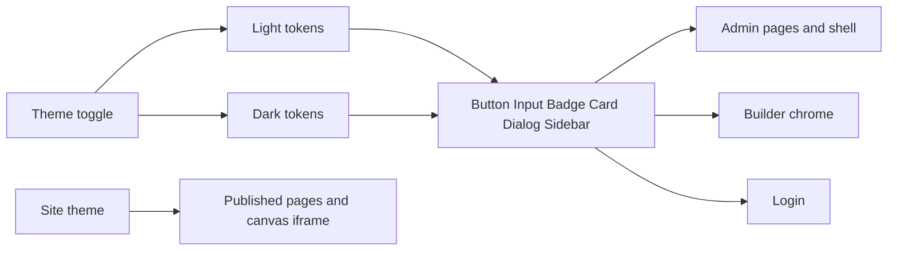

---

name: Obsidian Studio restyle
overview: Restyle the admin, page-builder chrome, and login to the Studio Crafted light spec and the Obsidian Studio dark spec, switched by the existing theme toggle. Published pages keep their own site theme.
todos:
- id: tokens
  content: Map both light and dark CSS variables, per-theme radius and shadows, and Inter plus Hanken Grotesk in globals.css and the root layout
  status: pending
- id: theme-toggle
  content: Keep the theme toggle, follow the active theme on admin, builder chrome, and auth, and stop locking the builder shell to light
  status: pending
- id: primitives
  content: Restyle button, input, badge, status badge, card, dialog, sheet, sidebar, and header with theme-aware tokens
  status: pending
- id: sweep
  content: Replace hardcoded steel and light/dark color pairs across admin pages, builder chrome, inspector controls, and login
  status: pending
- id: verify
  content: Verify login, dashboard, a list page, and builder chrome in both themes, and confirm the public site theme is unchanged
  status: pending
  isProject: false

---

# Studio light and Obsidian dark restyle

The product UI already flows through shadcn tokens in [`src/app/globals.css`](src/app/globals.css) and shared controls (`Button`, `Input`, `Badge`, `Card`, `Sidebar`). Most screens still paint with hardcoded `steel-*`, `dark-*`, and light/dark pairs, and the builder shell is locked to `data-theme="light"`. This restyle replaces those with two complete themes:

- Light, from [`design/light-screen.md`](design/light-screen.md) (Studio Crafted CMS)
- Dark, from [`design/dark-screen.md`](design/dark-screen.md) (Obsidian Studio)

The existing theme toggle stays. Admin, builder chrome, and login follow whichever theme is active. Published pages under [`src/app/(site)`](src/app/(site)) and the site theme in [`src/builder/theme.ts`](src/builder/theme.ts) / [`src/builder/site.css`](src/builder/site.css) stay as they are. The Puck iframe is the page preview; only the builder toolbars, drawers, and dialogs change.

Component prose in each file is the color source. YAML Material tokens are not used for fills when they disagree (dark YAML primary `#c0c1ff` would paint buttons pale lavender; the dark component spec uses `#6366F1`).

## What stays different per theme

Do not average the two specs into one radius or one status color. Shared components read CSS variables so the same class renders both looks.

- **Type.** Body and controls are Inter in both themes. Light headlines use Hanken Grotesk; dark headlines use Inter. Load both in [`src/app/layout.tsx`](src/app/layout.tsx) and set `--font-display` per theme. Headlines above 24px step down under 768px, matching the light spec.
- **Radius.** Light controls are 8px, cards 16px, sheets 24px. Dark controls are 4px, cards 8px, dialogs 12px. Expose `--radius-control`, `--radius-card`, and `--radius-overlay` and point buttons, inputs, cards, dialogs, and sheets at those variables.
- **Status.** Light published pills are indigo wash `#e0e7ff` with slate text; draft pills are `#f1f5f9`. Dark published pills are emerald `rgba(16,185,129,0.12)` / `#34D399` with a 6px dot; draft pills are amber `rgba(245,158,11,0.12)` / `#FBBF24`. Both are 22px pills. Emerald is not the dark secondary button.
- **Depth.** Light uses white panels, hairline `#e2e8f0`, and the three shadow levels in the light spec. Dark uses tonal steps and the low-profile tray and drag shadows, plus a glass header.

## Theme wiring

- Keep [`ThemeToggle`](src/components/atoms/theme-toggle.tsx) in [`src/components/organisms/header/header.tsx`](src/components/organisms/header/header.tsx). Do not force dark, and do not set `forcedTheme` on the root provider, so the public site is unchanged.
- Let [`next-themes`](src/components/providers/theme-provider.tsx) keep driving `.dark` / `data-theme`. Map `:root` and `[data-theme='light']` to the light spec, and `.dark` / `[data-theme='dark']` to the dark spec.
- Remove hardcoded `data-theme="light"` from the builder shell in [`builder-editor.tsx`](src/app/(admin)/dashboard/(fullscreen)/pages/[id]/builder/_components/builder-editor.tsx) and from builder dialogs (`ai-dialogs`, save-template, save-global) so chrome follows the toggle. Revision **content** preview still uses the page’s own theme.
- Toaster in [`src/components/ui/sonner.tsx`](src/components/ui/sonner.tsx) follows the active theme.

## Token map in globals.css

Light (`:root`, `[data-theme='light']`), from the light component section:

- `--background` `#f8fafc`, `--card` and `--sidebar` `#ffffff`, `--popover` `#ffffff`
- `--foreground` `#0f172a`, `--muted-foreground` `#475569`, disabled and timestamps `#94a3b8`
- `--primary` `#4338ca`, `--primary-foreground` `#ffffff`, hover `#3730a3`, `--ring` `#4338ca`
- `--border` `#e2e8f0`, stronger outline `#cbd5e1`, `--input` `#ffffff`
- `--secondary` stays the white surface button, not `#6366f1`. Use `#6366f1` only for hover indicators and secondary badges.
- Shadows: level 1 `0 1px 2px rgba(15,23,42,0.04)`; level 2 `0 4px 12px -2px rgba(15,23,42,0.08), 0 2px 4px -2px rgba(15,23,42,0.04)`; level 3 `0 16px 32px -8px rgba(15,23,42,0.12), 0 4px 8px -2px rgba(15,23,42,0.04)` with backdrop `rgba(15,23,42,0.2)`

Dark (`.dark`, `[data-theme='dark']`), from the dark component section:

- `--background` `#0B0F17`, `--card` and `--sidebar` `#111827`, `--popover` and surface secondary `#1E293B`, `--muted` / `--accent` `#334155`
- `--foreground` `#F9FAFB`, `--muted-foreground` `#94A3B8`
- `--primary` `#6366F1`, `--primary-foreground` `#FFFFFF`, hover `#4F46E5`, `--ring` `#6366F1`
- `--border` `rgba(255,255,255,0.08)`, `--input` `#0B0F17`
- Destructive button: `rgba(239,68,68,0.12)` fill, `#FCA5A5` text, `rgba(239,68,68,0.3)` border
- Tray shadow `0 8px 24px -4px rgba(0,0,0,0.6), 0 2px 6px -1px rgba(0,0,0,0.4)`; drag shadow `0 12px 32px -4px rgba(0,0,0,0.8)`

## Shared controls

Drive colors from the tokens above so variants do not hardcode one theme’s hex.

- [`src/components/ui/button.tsx`](src/components/ui/button.tsx): primary, surface/secondary, ghost, and destructive as specified per theme. Dark primary keeps the white/20 border, hover `#4F46E5`, and active scale `0.98`. Light primary uses the `#3730a3` border and the indigo micro-shadow. Radius is `--radius-control`.
- [`src/components/ui/input.tsx`](src/components/ui/input.tsx) and the atom form input: theme background and border, focus ring `2px` at 15% indigo in light and 20% indigo in dark. Placeholder `#475569` in dark. Checkboxes and radios are 16px; checked fill is `--primary`.
- [`src/components/ui/badge.tsx`](src/components/ui/badge.tsx) and [`src/components/atoms/status-badge.tsx`](src/components/atoms/status-badge.tsx): pill status colors from the theme split above. Version badges stay compact with tabular numbers; dark version badges use `#1E293B`.
- [`src/components/ui/card.tsx`](src/components/ui/card.tsx): `--radius-card`, hairline border. Light hover shifts the border to `#cbd5e1` and adds the level-1 shadow.
- Dialog, sheet, popover: `--radius-overlay` and the theme’s overlay shadow. Light modal backdrop is `rgba(15,23,42,0.2)`.
- [`src/components/ui/sidebar.tsx`](src/components/ui/sidebar.tsx): expanded 240px, collapsed 64px, ease `cubic-bezier(0.16, 1, 0.3, 1)`. Dark divider `rgba(255,255,255,0.06)` and 4px nav items. Light divider `#e2e8f0` and 8px nav items.
- Header: dark sticky bar is `backdrop-blur(12px)` over `rgba(17,24,39,0.85)`. Light sticky bar is white with a `#e2e8f0` hairline and the level-1 shadow.
- Breadcrumbs: slash separators. Light active crumb is bold slate. Dark inactive crumbs are `#94A3B8`, active crumb is `#F9FAFB` at weight 500.
- Block cards in the builder: dark base `#111827`, drag border `#6366F1`, indigo drop line. Light cards stay white with the light border and hover lift.

## Screen sweep

Replace `steel-*`, `dark-*`, and paired light/dark utilities (`border-steel-200 dark:border-dark-300`, `text-steel-500`, raw indigo links) with semantic classes (`bg-card`, `border-border`, `text-muted-foreground`, `text-primary`) across:

- Admin routes under [`src/app/(admin)`](src/app/(admin)), including dashboard, lists, settings, analytics, media, menus, users
- Builder chrome: [`builder-shell.tsx`](src/app/(admin)/dashboard/(fullscreen)/pages/[id]/builder/_components/builder-shell.tsx), [`builder-editor.tsx`](src/app/(admin)/dashboard/(fullscreen)/pages/[id]/builder/_components/builder-editor.tsx), selection card, layers, and builder dialogs
- Inspector controls in [`src/builder/controls`](src/builder/controls) and [`src/builder/fields`](src/builder/fields) that style the editor UI
- Shared atoms those screens use: tables, text editor chrome, media browser, react-select styles
- Login page and auth layout: canvas background, raised card, theme primary action

Tables use borderless row dividers, 40px default row height, and a hover tint of the canvas color, with no zebra striping.

Leave color swatches, chart series, and the revision content preview on the page’s own theme. Category tints in the block drawer use translucent indigo, violet, and emerald chips that stay readable in both themes, instead of `bg-violet-50` pastels.

## Check

In the browser, toggle light and dark on login, dashboard, one list (pages or posts), media, and the page builder (sidebar, canvas chrome, a dialog). Confirm the public homepage still uses the site theme, not either admin canvas.
