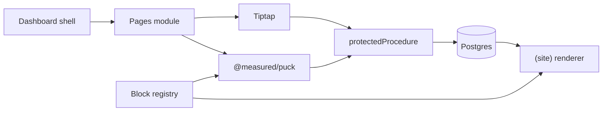

---

name: Port page-builder features
overview: Port the product features from the private PulseCMS prototype (KantaPaul/page-builder) into next-cms, using the existing Postgres, Tiptap, and @measured/puck stack instead of the prototype’s localStorage canvas.
todos:
- id: p0-persist
  content: Fix page content persistence, getById, indexes, edit route, and pages list
  status: completed
- id: p1-puck
  content: Add editorType and a real Puck registry matching the prototype block catalog
  status: completed
- id: p2-public
  content: Public renderer, draft preview tokens, and scheduled publish
  status: completed
- id: p3-revisions
  content: Draft vs published content, autosave, and revisions drawer
  status: completed
- id: p4-media
  content: Media library and MediaPicker for Puck and SEO
  status: completed
- id: p5-structure
  content: SEO tab, categories/tags, menus, site settings, sitemap/robots
  status: completed
- id: p6-templates
  content: Global blocks and starter templates
  status: completed
- id: p7-roles
  content: Enforce permission matrix, review workflow, and audit log
  status: completed
- id: p8-api
  content: Translation groups and versioned read API with hashed keys
  status: completed
- id: p9-ai
  content: Gemini page generation and block rewrite, validated against the registry
  status: completed
  isProject: false

---

# Port PulseCMS prototype features into next-cms

The prototype at [KantaPaul/page-builder](https://github.com/KantaPaul/page-builder) is a Vite demo (`cmsStorage` in localStorage, a hand-rolled canvas, Gemini). next-cms already has the real foundation: Next.js 16, Drizzle/Postgres, Google OAuth, Tiptap, and `@measured/puck` 0.20 (installed, unused). Port the product surface. Do not copy the demo’s storage layer, fake canvas, or custom rich-text editor.

## What the prototype has that this app does not

Already here, but broken or unused: pages CRUD schema ([src/db/schemas/pages.schema.ts](src/db/schemas/pages.schema.ts)), Tiptap editor, sidebar status/visibility/slug ([src/app/(admin)/dashboard/pages/_components/sidebar-editor.tsx](src/app/(admin)/dashboard/pages/_components/sidebar-editor.tsx)), `roles`/`permissions` tables ([src/db/schemas/auth.schema.ts](src/db/schemas/auth.schema.ts)), and a sidebar with only Pages ([src/menus/index.tsx](src/menus/index.tsx)).

`pagesServices.create` writes `content` onto `pages`, which has no `content` column, and never upserts `page_contents`. `getById` queries the wrong table. The form does not hydrate `defaultValues`.

Missing relative to the prototype’s `src/types/cms.ts` and admin screens:

- Hybrid editor: `editorType` of `builder | richtext`, full-screen canvas, undo/redo, viewport switch (desktop 1280 / tablet 768 / mobile 375), debounced 3s autosave.
- Block catalog from `src/builder/registry.ts`: Hero, Features, Stats, Pricing, Testimonials, FAQ, CTA, Columns, Rich text, Image, Contact form, Global block reference. Per-block responsive props (`hideOnMobile/Tablet/Desktop`, `paddingY`).
- Draft vs published content, publish/unpublish, duplicate, revisions drawer (manual, autosave, restore).
- Preview tokens with expiry, revoke, view count, and a public draft gate (`draftMode`).
- Media library (folders, alt, search) and a media picker used by image fields.
- SEO inspector: title/description counters, canonical, OG image, Twitter card, `noIndex`, structured-data type, keywords, live preview card.
- Categories and tags CRUD (categories are nested; tags have a color).
- Menus (header/footer/sidebar, nested items) and site settings (name, logo, favicon, default OG, theme tokens, robots).
- Roles matrix (`pages.create/edit/review/publish/delete`, `media.upload`, `settings.manage`, `api.manage`), review workflow, audit log. Tables exist; nothing enforces them.
- Headless read API: `/api/v1/pages`, page by slug, menus, settings, media, plus hashed API keys.
- AI: generate a page from a prompt, and rewrite/shorten block copy (prototype uses Gemini in `src/services/gemini.ts`).
- Starter templates and “save section as global symbol”.
- Public site: published pages only, home slug, header/footer from menus, theme CSS variables. Status enum here is `draft | published | archived`; the prototype also has `scheduled`. Visibility here is `public | private`; the prototype type also has `password` (no real gate in the demo UI, so skip password).

Skip the prototype’s Roadmap screen and the “simulate role” switcher. Keep the real logged-in user.

## How it maps onto this system

Store real Puck `Data` (`content`, `root.props`, `zones`), not the prototype’s `{ blocks: [] }` shape. Rich-text pages keep Tiptap JSON in the same `page_contents.content` column, distinguished by `pages.editorType`.

Follow existing patterns: `protectedProcedure`, `FormFactory` / `FieldFactory`, `DataTable` with `with-filters` and `with-pagination`, shadcn, and the admin layout. Add nav entries in [src/menus/index.tsx](src/menus/index.tsx) and routes under `src/app/(admin)/dashboard/`.

## Phases

### 0. Make pages actually persist

In [src/app/(admin)/dashboard/pages/_modules/pages.service.ts](src/app/(admin)/dashboard/pages/_modules/pages.service.ts), split `content` out of create/update and upsert `page_contents` in the same transaction. Fix `getById` to load the page with content, SEO, categories, and tags (add Drizzle relations). Unique index on `(slug, language)`. Composite keys and `on delete cascade` on `page_categories` and `page_tags`. Hydrate [form.tsx](src/app/(admin)/dashboard/pages/form.tsx) from `initialValues` and add `pages/[id]/edit`. List pages with the existing `DataTable`, including duplicate and soft delete.

### 1. Hybrid editor on real Puck

Add `editorType` enum (`richtext | builder`) and drop `isBuilderEnable`. Add `scheduled` to `PAGE_STATUS` in [src/db/schemas/shared.schema.ts](src/db/schemas/shared.schema.ts), plus `publishedAt` and `scheduledAt` on `pages`.

New `src/builder/`: `registry.ts` as a Puck `Config`, and one component per prototype block (Hero, Features, Stats, Pricing, Testimonials, FAQ, CTA, Columns with `DropZone`, Rich text via the existing Tiptap viewer, Image, Contact form, Global ref). Shared field group for responsive hide and padding. `root` props: `maxWidth`, `theme`, `paddingY`.

Full-screen route `dashboard/pages/[id]/builder`, client-only via `dynamic(..., { ssr: false })`. Save through a server action into `page_contents`. In the page form, Tiptap stays for `richtext`; `builder` shows “Open builder” plus a switch that converts editor type without deleting the other payload.

### 2. Public site, preview, schedule

`src/app/(site)/[[...slug]]/page.tsx`: `/` resolves `isHome`; other slugs resolve by slug and language. Render only `published` + `public`. Builder pages use Puck `<Render>`. Rich text uses the Tiptap viewer. `generateMetadata` from `seo_meta`. `revalidatePath` on publish.

Preview: create/regenerate/revoke rows in `preview_tokens` (add `status`, `viewCount`, `lastAccessedAt`). Public route accepts the token, calls `draftMode()`, and shows the draft banner from the prototype. A route handler publishes rows whose `scheduledAt` has passed.

### 3. Drafts, revisions, autosave

`page_contents.kind` = `draft | published`. `page_revisions` stores page id, editor type, kind (`manual | autosave | published`), title, author, and a jsonb snapshot. Autosave the draft every 3 seconds from Puck `onChange` and the Tiptap form. Publish copies draft to published and writes a revision. Revisions drawer: list, read-only preview, restore.

### 4. Media

`media` table (key, url, mime, size, width, height, alt, folder, createdBy). Local disk in dev, S3-compatible in prod via env. Admin grid with search, folders, and alt editing. `MediaPicker` dialog wired to a custom Puck `media` field and `seo_meta.ogImage`.

### 5. SEO, taxonomy, menus, settings

SEO tab bound to `seo_meta`, extended with `noIndex`, `ogType`, and `structuredDataType`. Character counters and a Google/OG preview card. Category tree and tag CRUD (tag `color`), then enable the commented multiselects in the sidebar. `menus` / `menu_items` (nested, dnd-kit). `site_settings` singleton: site name, logo, favicon, default OG, header/footer menu ids, theme tokens (primary, accent, font, radius, color mode) as CSS variables, robots text. `sitemap.ts` and `robots.ts` from published pages.

### 6. Globals and templates

`global_blocks` stores a Puck subtree. The Global ref block renders it, so one edit updates every page. “Save section as symbol” from the canvas. `page_templates` seeded from the prototype gallery (landing, product, company, blog, sales). New-page flow can start from a template.

### 7. Permissions, review, audit

Seed Admin, Editor, Author, Viewer using the prototype matrix (`pages.create`, `pages.edit`, `pages.review`, `pages.publish`, `pages.delete`, `media.upload`, `settings.manage`, `api.manage`) into the existing `permissions` table (`resource` + `action`). `requirePermission` on the procedure builder, and a `<Can>` wrapper for buttons. Authors submit for review; editors publish. Audit log table for create, update, publish, delete, restore, media upload, and settings changes. User role assignment page. No role simulator.

### 8. Languages and headless API

`translationGroupId` links translations. Editor action “Create translation” clones content. Public routes stay slug-based with `hreflang` from the group. Read-only `src/app/api/v1/` for pages, page by slug, menus, settings, and media. `api_keys` stores a hash only. Replace the prototype’s in-browser API playground with a small admin page that creates and revokes keys and shows the live routes.

### 9. AI, adapted

Server actions only, `GEMINI_API_KEY` in env, model name from env (the prototype’s `gemini-3.8-flash` string is not a real model id). “Generate page” sends the block field schema plus the prompt, parses JSON, and validates with zod against the registry before inserting Puck `Data`. Per-block rewrite/shorten/translate. Optional SEO title, description, and alt generation. Show the result before applying it.

## Out of scope for this port

Password-protected pages, page view counts, the roadmap screen, and copying any prototype component verbatim. Plugin loading and Docker packaging can wait until the features above exist.
