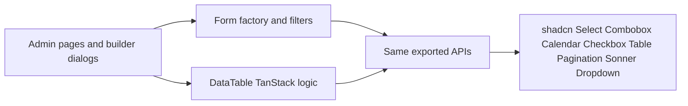

# Admin and builder chrome on shadcn/ui

The app already has a partial shadcn setup ([components.json](components.json): `new-york`, neutral, CSS variables) and primitives in [src/components/ui](src/components/ui). Admin screens still render through custom widgets: `react-select`, `react-datepicker`, `rc-pagination`, a steel-colored table, a custom checkbox, Headless UI for the account menu, and `react-hot-toast`.

Swap those widgets for official shadcn components. Keep the form factory field names and the TanStack data table. Do not restyle [src/builder](src/builder) inspector controls, Puck canvas, or [src/app/(site)](src/app/(site)).

## Add the missing primitives

Install with the existing CLI config so files land in `src/components/ui` and use `@/lib/utils/cn`:

- `select`, `command`, `calendar`, `checkbox`, `pagination`, `table`, `sonner`

`react-day-picker` is already a dependency. Leave `@tailwindcss/forms` on its current global strategy so builder inspector inputs and the public contact form do not change.

## Keep call sites stable

**Select.** [src/components/atoms/react-select/select.tsx](src/components/atoms/react-select/select.tsx) is searchable, clearable, single and multi, with select-all. Official `Select` cannot search or multi-select, so the replacement is a Combobox built from `Command`, `Popover`, and `Checkbox`. Keep the exports `ReactSelect`, `CreatableSelect`, `Option`, `handleSelected`, `handleOnChange`, `handleMultiSelect`, and `groupSelectedOptions`. [src/components/atoms/forms/factory/methods.tsx](src/components/atoms/forms/factory/methods.tsx) (`select`, `multiselect`, `creatableSelect`) and the filter toolbar then stay unchanged. Creatable adds a "Create …" command row instead of `react-select/async-creatable`. Drop the unused async select path.

**Date.** Rewrite [src/components/atoms/datepicker/datepicker.tsx](src/components/atoms/datepicker/datepicker.tsx) on `Popover` + `Calendar`. Preserve `selected`, `onChange`, `selectsRange`, `minDate`, `maxDate`, `isClearable`, `dateFormat`, and `inputProps`, which is what `date`, `dateRange`, and the filter date pickers use. If `showTimeSelect` is set, add a time input next to the calendar. The unused [range-picker.tsx](src/components/atoms/datepicker/range-picker.tsx) can point at the same calendar or be left unused.

**Table.** Restyle the markup in [src/components/atoms/table](src/components/atoms/table) (`TableRoot`, head, row, cell) with the shadcn `Table` classes: `border-border`, muted header, row hover, `bg-card`. Keep pinning, expansion, and column defs in [src/components/atoms/data-table/index.tsx](src/components/atoms/data-table/index.tsx). Replace steel borders and selected-row colors with semantic tokens.

**Pagination.** Rebuild [src/components/atoms/table/pagination.tsx](src/components/atoms/table/pagination.tsx) and [src/components/atoms/data-table/pagination.tsx](src/components/atoms/data-table/pagination.tsx) on `ui/pagination`. Page size keeps going through the select adapter. Query-param behavior stays in the data-table hook.

**Checkbox and switch.** Replace the steel checkbox in [src/components/atoms/forms/checkboxes/checkbox.tsx](src/components/atoms/forms/checkboxes/checkbox.tsx) with `ui/checkbox`, still accepting `children` as the label and `indeterminate`. Restyle [src/components/ui/switch.tsx](src/components/ui/switch.tsx) to the official track and thumb, and keep `onChange(boolean)`, `label`, and `error` so the factory `switch` field does not change.

**Toasts.** Add the Sonner `<Toaster />` in [src/app/layout.tsx](src/app/layout.tsx) and replace `react-hot-toast` imports. `toast.success` and `toast.error` match, including [src/lib/utils/error.ts](src/lib/utils/error.ts).

**Account menu.** Rebuild [src/components/molecules/auth-dropdown/auth-dropdown.tsx](src/components/molecules/auth-dropdown/auth-dropdown.tsx) with the existing `DropdownMenu`. That is the only `@headlessui/react` usage.

## Chrome tokens

Point admin chrome at the tokens already in [src/app/globals.css](src/app/globals.css):

- Header in [src/components/organisms/header/header.tsx](src/components/organisms/header/header.tsx): `bg-background`, `border-border` instead of `steel` / `dark-*`.
- Sidebar and dropdown menu: replace leftover `steel` / `dark-*` classes with `sidebar-*`, `popover`, and `accent`.
- Builder publish and review buttons in [builder-chrome.tsx](src/app/(admin)/dashboard/(fullscreen)/pages/[id]/builder/_components/builder-chrome.tsx): use the default `Button` variant instead of hardcoded indigo. Dialogs already use `ui/dialog`; they pick up Sonner and the select adapter automatically.

Apply `bg-background text-foreground` on the admin shell in [src/components/molecules/layouts/default.tsx](src/components/molecules/layouts/default.tsx), not on the public site layout.

The labeled input wrapper in [src/components/atoms/forms/input.tsx](src/components/atoms/forms/input.tsx) already uses `ui` `FormInput`. Drop its `max-w-sm` so form fields fill the admin layout.

## Remove libraries after the adapters compile

`react-select`, `react-datepicker`, `rc-pagination`, `@headlessui/react`, and `react-hot-toast`, once nothing imports them. Phone input and the TipTap editor stay; shadcn has no equivalent for those.

## Verify in the browser

Walk login, the pages table (search, select filter, page size, pagination, row menu), a settings or page form (text, switch, select, date), the account menu, and builder chrome (save-template dialog and publish button). Confirm a public page and the builder inspector controls look unchanged.
