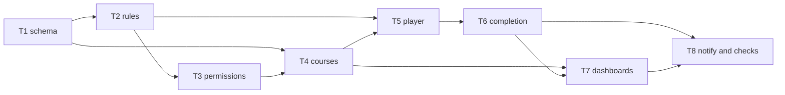

---

name: Training certificates
overview: "Training module in small refs (T1-01 through T8-08). Name one ref to implement only that piece. Courses, playback tracking, quizzes, PDF certificates, both dashboards, and in-app notifications."
todos:
- id: T1-01
  content: Journal the existing page_views SQL if it is still missing from the Drizzle journal
  status: pending
- id: T1-02
  content: Add training_courses, training_course_items, and training_enrollments
  status: pending
- id: T1-03
  content: Add training_video_progress and course_progress
  status: pending
- id: T1-04
  content: Add training_questions and training_attempts
  status: pending
- id: T1-05
  content: Add certificates with one issued row per user and course
  status: pending
- id: T1-06
  content: Add notifications and site_settings.training_settings
  status: pending
- id: T1-07
  content: Generate the Drizzle migration for the training tables only
  status: pending
- id: T2-01
  content: Parse a course item as media, YouTube, Vimeo, or direct MP4/WebM
  status: pending
- id: T2-02
  content: Merge watched ranges without counting seeks across a gap
  status: pending
- id: T2-03
  content: Accept a playback event with stale, duplicate, and wall-clock guards
  status: pending
- id: T2-04
  content: Course completion rules from progress, quiz, and approval
  status: pending
- id: T2-05
  content: Score a quiz on the server and enforce attempt limits
  status: pending
- id: T2-06
  content: Certificate number, verify token, and eligibility
  status: pending
- id: T2-07
  content: Notification dedupe keys
  status: pending
- id: T2-08
  content: node:test for T2-01 through T2-07 and a test script
  status: pending
- id: T3-01
  content: training.manage, training.learn, and the Learner role
  status: pending
- id: T3-02
  content: Send a Learner away from non-training dashboard routes
  status: pending
- id: T3-03
  content: trainingSettingsSchema and defaults
  status: pending
- id: T3-04
  content: Persist training settings in the site settings service and action
  status: pending
- id: T3-05
  content: Training section on the settings form
  status: pending
- id: T3-06
  content: Audit targets for course, enrollment, and certificate
  status: pending
- id: T4-01
  content: Training routes and sidebar items
  status: pending
- id: T4-02
  content: Course create, update, and publish service
  status: pending
- id: T4-03
  content: Course list
  status: pending
- id: T4-04
  content: Course editor for title, description, cover, dates, and enrollment
  status: pending
- id: T4-05
  content: Ordered course items from the media picker or a video URL
  status: pending
- id: T4-06
  content: Per-course completion requirement fields
  status: pending
- id: T4-07
  content: Assign and unassign individual users
  status: pending
- id: T4-08
  content: Quiz question editor
  status: pending
- id: T5-01
  content: HTML5 playback adapter for mp4 and webm
  status: pending
- id: T5-02
  content: YouTube IFrame API adapter
  status: pending
- id: T5-03
  content: Vimeo Player.js adapter
  status: pending
- id: T5-04
  content: Heartbeat on play, pause, ended, and page leave
  status: pending
- id: T5-05
  content: saveTrainingProgress server action
  status: pending
- id: T5-06
  content: Resume from last position when the setting is on
  status: pending
- id: T5-07
  content: Course player page for an enrolled learner
  status: pending
- id: T6-01
  content: Recalculate course_progress in a transaction
  status: pending
- id: T6-02
  content: Manual completion approval
  status: pending
- id: T6-03
  content: Quiz submit action
  status: pending
- id: T6-04
  content: Certificate PDF layout with pdf-lib and a QR code
  status: pending
- id: T6-05
  content: Store the PDF through storage()
  status: pending
- id: T6-06
  content: Auto-issue one certificate when eligibility passes
  status: pending
- id: T6-07
  content: Revoke a certificate
  status: pending
- id: T6-08
  content: Reissue a certificate
  status: pending
- id: T6-09
  content: Public verification page
  status: pending
- id: T6-10
  content: Learner certificate download
  status: pending
- id: T7-01
  content: Admin overview counts from SQL aggregates
  status: pending
- id: T7-02
  content: User progress table
  status: pending
- id: T7-03
  content: Course progress table
  status: pending
- id: T7-04
  content: CSV export of training progress
  status: pending
- id: T7-05
  content: Learner training home
  status: pending
- id: T7-06
  content: Learner course page with resume, quiz, and certificate status
  status: pending
- id: T8-01
  content: Idempotent notification insert
  status: pending
- id: T8-02
  content: Notify on assign, complete, issue, and revoke
  status: pending
- id: T8-03
  content: Cron reminders for due dates and expiring certificates
  status: pending
- id: T8-04
  content: Unread notification list in the dashboard shell
  status: pending
- id: T8-05
  content: Audit log on course, assignment, approval, issue, revoke, and reissue
  status: pending
- id: T8-06
  content: docs/training.md with provider limits
  status: pending
- id: T8-07
  content: Lint, tsc, and the test script
  status: pending
- id: T8-08
  content: Browser check of admin, learner, download, and verify
  status: pending
  isProject: false

---

# Training — small refs

Name one ref (for example **T2-03**) to implement only that piece. Do not start a later ref until the ones it depends on are done.

This CMS has users, media, `storage()`, settings, and an audit log. It has no courses, quizzes, PDF library, or mailer. There are no user groups, so assignment is per user. Notifications are in-app rows. Playback numbers are client estimates, not proof of attention.

If the video-library refs already added `parseVideoUrl` or `buildEmbed`, call those. Do not add a second copy. Training progress lives in `training_video_progress`, not the video library’s `video_progress`.

## T1 — Schema

- **T1-01** Journal [src/db/migrations/20261022070000_page_views.sql](src/db/migrations/20261022070000_page_views.sql) if it is still missing from `meta/_journal.json`. Do not change that SQL. Skip this if video-library **V1-01** already did it.
- **T1-02** Add [src/db/schemas/training.schema.ts](src/db/schemas/training.schema.ts) and export it from [src/db/schema.ts](src/db/schema.ts). Reuse `baseColumns` and user FKs.
  - `training_courses`: title, description, cover `media_id`, status `draft|published`, `starts_at`, `ends_at`, `enrollment_required`, completion JSON, certificate JSON.
  - `training_course_items`: course, order, required, threshold override, source `media|youtube|vimeo|direct`, nullable `media_id`, nullable external URL, title. Unique `(course_id, order)`.
  - `training_enrollments`: user, course, status, `assigned_by`, `due_at`. Unique `(user_id, course_id)`.
- **T1-03** `training_video_progress`: user, course item, course, last position, observed seconds, percent nullable, watched ranges, completion, first and last watched, `completed_at`, session count, last session id, last heartbeat, last client timestamp, `version`. Unique `(user_id, course_item_id)`. `course_progress`: user, course, percent, status `not_started|in_progress|completed`, `completed_at`, assessment status, approval actor and time. Unique `(user_id, course_id)`. Depends on T1-02.
- **T1-04** `training_questions`: course, order, prompt, options JSON, `correct_index`. `training_attempts`: user, course, score, passed, answers, `started_at`, `submitted_at`. Depends on T1-02.
- **T1-05** `certificates`: number, `verify_token` (32 random bytes, unique), user, course, `issued_at`, `expires_at`, storage key and url, status `issued|revoked|superseded`, revocation reason, actor, and time, `reissued_from_id`. Partial unique index: one `issued` row per `(user_id, course_id)`. Depends on T1-02.
- **T1-06** `notifications`: user, type, unique `dedupe_key`, title, body, href, `read_at`. `site_settings.training_settings` jsonb in [src/db/schemas/pages.schema.ts](src/db/schemas/pages.schema.ts), same pattern as `themeTokens`.
- **T1-07** Run `npm run db:generate`. The new SQL adds training tables and `training_settings` only. Depends on T1-01 through T1-06.

## T2 — Rules

No UI. New packages wait until **T6-04**.

- **T2-01** `parseCourseVideo` in [src/lib/training/parse-course-video.ts](src/lib/training/parse-course-video.ts). Accept a media id, or a YouTube, Vimeo, or direct https `.mp4` / `.webm` URL. Reject other hosts. Reuse `parseVideoUrl` when that file exists.
- **T2-02** `mergeRanges` in [src/lib/training/ranges.ts](src/lib/training/ranges.ts). Union played intervals. A seek does not fill the gap. Percent is covered time divided by duration, or null when duration is missing.
- **T2-03** `acceptPlayback` in [src/lib/training/playback.ts](src/lib/training/playback.ts). Ignore a stale `reportedAt` and a duplicate heartbeat. Credit at most the wall-clock since the last heartbeat, plus a small slack. Opening the page credits nothing. Session count increments only when the session id changes. Return the next `version`. Depends on T2-02.
- **T2-04** `courseCompletion` in [src/lib/training/completion.ts](src/lib/training/completion.ts). Incomplete until every enabled rule passes: per-item threshold (course default or override), all required items, minimum course percent, passed assessment, and manual approval. When percent is null, follow that course’s fallback: `assessment`, `manual`, or `block`.
- **T2-05** `scoreAttempt` in [src/lib/training/quiz.ts](src/lib/training/quiz.ts). Score from stored `correct_index`. Enforce attempt limit and retake delay. Do not return the correct index before submit. After submit, return score and pass/fail only.
- **T2-06** `nextCertificateNumber`, `createVerifyToken`, and `canIssue` in [src/lib/training/certificate.ts](src/lib/training/certificate.ts). Number format defaults to `CERT-{year}-{sequence}`. `canIssue` is false when an `issued` row already exists for that user and course.
- **T2-07** `notificationKey` in [src/lib/training/notification-key.ts](src/lib/training/notification-key.ts). Keys: `assigned:{enrollmentId}`, `complete:{userId}:{courseId}`, `cert:{certificateId}`, `due:{enrollmentId}:{date}`, `expire:{certificateId}:{date}`, `revoke:{certificateId}`.
- **T2-08** `node:test` via `tsx` for T2-01 through T2-07. Add a `test` script in [package.json](package.json) if **V2-05** has not added one. Cover duplicate and out-of-order events, wall-clock caps, completion thresholds, quiz pass/fail, duplicate issue, and dedupe keys.

## T3 — Permissions and settings

- **T3-01** Add `training.manage` and `training.learn` to [src/config/permissions.ts](src/config/permissions.ts). Add role `Learner`. `training.manage`: Admin only. `training.learn`: Admin, Editor, Author, Viewer, Learner. `ensureRolesSeeded` inserts the new rows. Learner gets no other permissions.
- **T3-02** In the dashboard shell, send role Learner to `/dashboard/my-training` when the path is outside training. Depends on T3-01 and T4-01 for the path constant; the redirect itself can land once T4-01 exists.
- **T3-03** `trainingSettingsSchema` and defaults in [src/lib/training/settings.ts](src/lib/training/settings.ts). Tracking on/off, resume, default completion percent, auto-issue, org name, logo, certificate title, signatory name and title, number prefix, validity days, show recipient name on the public page, reminder days, and which events notify.
- **T3-04** Read and write `trainingSettings` in the site settings service and [settings.actions.ts](src/app/(admin)/dashboard/(shell)/settings/_modules/settings.actions.ts). Validate with T2’s schema. Depends on T1-06 and T3-03.
- **T3-05** Training section on [settings-form.tsx](src/app/(admin)/dashboard/(shell)/settings/_components/settings-form.tsx). Include a control that grants `training.manage` to an existing role by writing permission rows. Depends on T3-04.
- **T3-06** Allow audit targets `training_course`, `training_enrollment`, and `certificate` in [src/server/services/audit.service.ts](src/server/services/audit.service.ts).

## T4 — Course admin

Depends on T1-07, T2-01, and T3-01 unless a ref says otherwise. Services under `src/server/services/training/`. Screens under `src/app/(admin)/dashboard/(shell)/training/`.

- **T4-01** Routes in [src/config/pages.ts](src/config/pages.ts) and sidebar items in [src/menus/index.tsx](src/menus/index.tsx). Training admin requires `training.manage`. My training requires `training.learn`.
- **T4-02** Course create, update, and publish. `permissionProcedure(training.manage)`. Audit each mutation. Depends on T3-06.
- **T4-03** Course list: title, status, item count, enrolled count. Depends on T4-01 and T4-02.
- **T4-04** Editor fields: title, description, cover from the media picker, draft or published, start and end, enrollment required. Depends on T4-02.
- **T4-05** Ordered items. Each item is a media video or a URL from T2-01, plus required flag and optional threshold override. Depends on T4-04.
- **T4-06** Completion fields on the course: video percent, require all mandatory items, minimum course percent, assessment on/off, passing score, attempt limit, retake delay, manual approval, fallback when duration is unavailable, certificate auto-issue and validity days. Depends on T4-04.
- **T4-07** Assign and unassign users. No groups. Set an optional due date. Depends on T4-02.
- **T4-08** Quiz editor: prompt, choices, correct choice, order. Store `correct_index` on the server only. Depends on T1-04 and T4-04.

## T5 — Player

Components under `src/components/training/`. Reuse `src/components/video/` players if those refs exist.

- **T5-01** HTML5 adapter for mp4 and webm. Events: `timeupdate`, `pause`, `ended`, `seeked`. Report played ranges, not page-open time.
- **T5-02** YouTube IFrame API adapter. If duration never arrives, report percent as unavailable.
- **T5-03** Vimeo Player.js adapter. Same unavailable rule as T5-02.
- **T5-04** Heartbeat about every 15 seconds, plus pause, ended, and `pagehide`. One client session id per page load. Depends on T5-01, T5-02, and T5-03.
- **T5-05** `saveTrainingProgress` for a signed-in user who may watch that item. Apply T2-03. Update with `WHERE version = ?`; on conflict, re-read and merge ranges. No-op when tracking is off. Depends on T1-03, T2-03, and T3-04.
- **T5-06** Resume seeks to `last_position` only when resume is on. Depends on T5-04 and T5-05.
- **T5-07** Player page for one course. Block playback outside the course window or when enrollment is required and the user is not assigned. Depends on T4-05 and T5-06.

## T6 — Completion and certificates

- **T6-01** After an accepted progress write, recalculate `course_progress` with T2-04 inside a transaction. Depends on T2-04 and T5-05.
- **T6-02** Admin action to approve completion. Records actor and time, then runs T6-01. Learner cannot call it. Depends on T6-01.
- **T6-03** Submit attempt: load questions without `correct_index`, score with T2-05, save the attempt, run T6-01. Depends on T2-05, T4-08, and T6-01.
- **T6-04** PDF layout with `pdf-lib` and `qrcode`. Include org name and logo (settings, else site name and logo), title, recipient name, course name, completion date, issue date, certificate number, verification URL, QR code, signatory, and expiry when set. Depends on T2-06.
- **T6-05** Write the PDF through [storage()](src/server/storage/index.ts) at `certificates/{id}.pdf`. Save key and url on the certificate row. Do not insert a media-library row. Depends on T6-04.
- **T6-06** When auto-issue is on and T2-06 says eligible, insert the certificate in the same transaction as T6-01. The partial unique index stops a second `issued` row. Depends on T1-05, T6-01, and T6-05.
- **T6-07** Revoke: status, reason, actor, timestamp. The row is otherwise unchanged. Depends on T6-06 and T3-06.
- **T6-08** Reissue: new row, `reissued_from_id`, previous row `superseded`. Depends on T6-07.
- **T6-09** Public page [src/app/verify/[token]/page.tsx](src/app/verify/[token]/page.tsx). Load by token only. Show status, number, course title, issue date, expiry, and recipient name only if the setting allows. No email, user id, or watch history. Unknown tokens get one not-found response. Depends on T1-05 and T3-03.
- **T6-10** Learner download of their own issued PDF. Other users get nothing unless they have `training.manage`. Depends on T6-05.

## T7 — Dashboards

Queries use `count` and `group by`. Do not load every progress row to total a card.

- **T7-01** `/dashboard/training` cards: courses, assigned users, started, completed, not started, certificates issued, expired, revoked. Depends on T4-01 and T1-07.
- **T7-02** User progress table: name, assigned courses, videos done and left, course percent, last activity, completion, assessment, certificate status. Search, filter, sort, pagination. Depends on T7-01.
- **T7-03** Course progress table: enrolled, not started, in progress, completed, overdue when `due_at` is set, certificates issued. Depends on T7-01.
- **T7-04** CSV export of the same rows as T7-02. `training.manage` only. Depends on T7-02.
- **T7-05** `/dashboard/my-training`: assigned and open courses, progress, completed history, certificates. A user sees only their own rows. Depends on T4-07 and T6-10.
- **T7-06** `/dashboard/my-training/[courseId]`: items, resume, quiz status, certificate download and revocation or expiry. Depends on T5-07, T6-03, and T7-05.

## T8 — Notifications and checks

- **T8-01** Insert helper using `onConflictDoNothing` on `dedupe_key` from T2-07. Depends on T1-06 and T2-07.
- **T8-02** Call T8-01 for assignment, course completion, certificate issue, and revocation when those settings are on. Depends on T4-07, T6-06, T6-07, and T8-01.
- **T8-03** Extend [src/app/api/cron/publish/route.ts](src/app/api/cron/publish/route.ts) to insert due-date and expiry reminders. Same bearer check. Dedupe keys stop repeats. Depends on T8-01.
- **T8-04** Unread list in the dashboard shell. Mark read on open. Depends on T8-01.
- **T8-05** Confirm audit entries for create, update, publish, assign, manual approval, issue, revoke, and reissue. No playback payloads in the audit log. Depends on T3-06, T4-02, T6-02, T6-06, T6-07, and T6-08.
- **T8-06** [docs/training.md](docs/training.md): what each role can do, and the provider limits below.
- **T8-07** `npm run lint`, `tsc --noEmit`, and `npm test`. Fix issues these refs introduced.
- **T8-08** Browser: create a course, assign a user, watch and resume, see both dashboards, download a certificate, open `/verify/[token]`, and confirm a revoked certificate shows revoked. Depends on T7-06, T6-09, and T6-10.

## Provider limits

- Browser events estimate playback. They do not prove attention.
- YouTube and Vimeo percent stays null when their player script returns no duration. The course fallback then applies.
- The same media file in two courses has two progress rows.
- Assignment is per user, not per group.
- Reminders are in-app and run only when the existing cron caller hits the publish route. They are not email.
