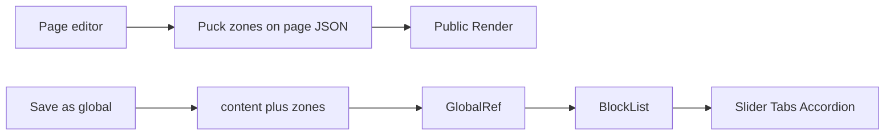

---

name: Verify layout blocks
overview: The Slider, Tabs, and Accordion blocks and global-block zone persistence from the patch are already in the working tree. This plan checks that implementation against the spec, fixes only what verification finds, and closes the remaining todos.
todos:
- id: verify-builder
  content: Verify Slider, Tabs, and Accordion drops, interaction, Style, and Layout in the page builder, preview, and public page
  status: completed
- id: verify-globals
  content: Verify save-as-global zone persistence, the global-block editor, Global ref, and legacy array content
  status: completed
- id: fix-gaps
  content: Fix only behavior that fails those checks, starting with zone-key rehydration if nested panels are empty
  status: completed
- id: close-plan
  content: Mark the blocks, zones, and verify todos completed in the existing interactive layout blocks plan
  status: completed
  isProject: false

---

# Finish interactive layout blocks

The code from [interactive_layout_blocks.patch](interactive_layout_blocks.patch) is already in the working tree. Do not re-apply the patch or rewrite the blocks. Confirm the behavior in the plan at [.cursor/plans/interactive_layout_blocks_d71d1ec4.plan.md](.cursor/plans/interactive_layout_blocks_d71d1ec4.plan.md), fix only gaps that verification finds, then mark those three todos completed.

## What is already in place

- [src/builder/blocks/interactive.tsx](src/builder/blocks/interactive.tsx) has Slider, Tabs, and Accordion. Editing stacks every panel with a label above the drop zone. Preview and the public page use the one-panel UI (scroll-snap slider, tablist, button plus `aria-expanded`).
- [src/builder/config.tsx](src/builder/config.tsx) registers them in the Layout category next to Columns. Each item is a slot that disallows `Slider`, `Tabs`, and `Accordion`. Defaults ship with three panels. `withSection` supplies Style and Layout. `renderBlock` passes `editing` from Puck.
- Global content accepts both a legacy `BuilderItem[]` and `{ content, zones }` in [templates.actions.ts](src/app/(admin)/dashboard/(shell)/templates/_modules/templates.actions.ts) and [templates.service.ts](src/app/(admin)/dashboard/(shell)/templates/_modules/templates.service.ts). [save-global-dialog.tsx](src/app/(admin)/dashboard/(fullscreen)/pages/[id]/builder/_components/save-global-dialog.tsx) copies the selected item plus zones owned by it or a nested child. [global-block-editor.tsx](src/app/(admin)/dashboard/(fullscreen)/templates/globals/[id]/global-block-editor.tsx) loads and saves both, and the dirty check includes zones.
- [block-list.tsx](src/builder/blocks/block-list.tsx) writes zone items onto slot props (`items[0].content`, and nested children) before render. [content.tsx](src/builder/blocks/content.tsx) `GlobalRef` passes `zones` through. Public pages call `resolveAllData` before `Render` in [src/app/(site)/[[...slug]]/page.tsx](src/app/(site)/[[...slug]]/page.tsx), so `GlobalRef.resolveData` fills `blocks` and `zones`.

## Verify, then fix only failures

Exercise these flows in the browser. Change code only when a step fails.

- Page builder: insert each block, drop Rich text and an Image into different panels, switch slides and tabs, open and close accordion items (one-open and several-open), and confirm Style and Layout still apply. In the canvas, every panel stays visible so drops work. On the public page and the preview route, only the interactive UI shows, and autoplay stays off while editing.
- Reload the draft and the published page. Nested blocks must still be in the saved Puck zones.
- Save one of these blocks as a global block, open it in the global-block editor, drop something into a second panel, insert it on a page with Global ref, and confirm both panels render.
- Open an existing global block stored as a plain array and confirm it still loads and the templates list still shows its section types.

If a global block’s nested panels are empty on the public page, the first place to check is zone-key shape. `rehydrateItem` expects keys like `${blockId}:items[0].content` and writes that path onto props in [block-list.tsx](src/builder/blocks/block-list.tsx). A different Puck key format is a bug in that helper, not a reason to change the block components.

## Close the existing plan

After the flows pass, set the `blocks`, `zones`, and `verify` todos in [.cursor/plans/interactive_layout_blocks_d71d1ec4.plan.md](.cursor/plans/interactive_layout_blocks_d71d1ec4.plan.md) to completed. Leave AI generation and the FAQ block out of scope.
