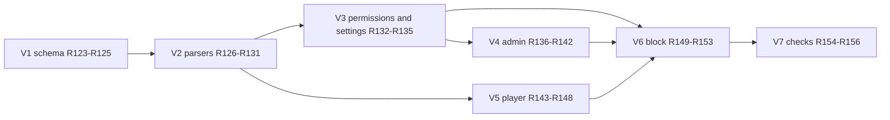

---

name: Video library refs R123–R156 (V1–V7)
overview: URL-only video library split into numbered refs (R123–R156, V1-01 through V7-03). Name one numbered ref to implement only that piece. YouTube, Vimeo, and direct MP4/WebM. No file uploads.
todos:
- id: R123
  content: "V1-01 Journal the existing page_views SQL"
  status: complete
- id: R124
  content: "V1-02 video_playlists, videos, video_progress, and site_settings.video_settings"
  status: complete
- id: R125
  content: "V1-03 Generate the Drizzle migration"
  status: in-progress
- id: R126
  content: "V2-01 parseVideoUrl for YouTube, Vimeo, and direct MP4/WebM"
  status: complete
- id: R127
  content: "V2-02 buildEmbed allowlisted iframe src"
  status: complete
- id: R128
  content: "V2-03 videoSettingsSchema and defaults"
  status: complete
- id: R129
  content: "V2-04 clampProgress completion rule"
  status: complete
- id: R130
  content: "V2-05 node:test for video parsers plus a test script"
  status: complete
- id: R131
  content: "V2-06 Official oEmbed client for YouTube and Vimeo"
  status: complete
- id: R132
  content: "V3-01 Video permission keys"
  status: complete
- id: R133
  content: "V3-02 Audit target video"
  status: complete
- id: R134
  content: "V3-03 Persist videoSettings"
  status: complete
- id: R135
  content: "V3-04 Video library section on the settings form"
  status: complete
- id: R136
  content: "V4-01 Dashboard video routes and sidebar item"
  status: complete
- id: R137
  content: "V4-02 Playlist service and actions"
  status: complete
- id: R138
  content: "V4-03 Playlist panel on the videos page"
  status: complete
- id: R139
  content: "V4-04 Video create and update service"
  status: complete
- id: R140
  content: "V4-05 Publish, unpublish, soft-delete, and reorder"
  status: complete
- id: R141
  content: "V4-06 Video list table"
  status: complete
- id: R142
  content: "V4-07 Create and edit form with invalid-URL message"
  status: complete
- id: R143
  content: "V5-01 Native player controls for direct MP4 and WebM"
  status: complete
- id: R144
  content: "V5-02 YouTube and Vimeo iframe player"
  status: complete
- id: R145
  content: "V5-03 Native-only seek restriction"
  status: complete
- id: R146
  content: "V5-04 Video list with search, playlist filter, and load more"
  status: complete
- id: R132
  content: "V3-01 Video permission keys"
  status: pending
- id: R133
  content: "V3-02 Audit target video"
  status: pending
- id: R134
  content: "V3-03 Persist videoSettings"
  status: pending
- id: R135
  content: "V3-04 Video library section on the settings form"
  status: pending
- id: R136
  content: "V4-01 Dashboard video routes and sidebar item"
  status: pending
- id: R137
  content: "V4-02 Playlist service and actions"
  status: pending
- id: R138
  content: "V4-03 Playlist panel on the videos page"
  status: pending
- id: R139
  content: "V4-04 Video create and update service"
  status: pending
- id: R140
  content: "V4-05 Publish, unpublish, soft-delete, and reorder"
  status: pending
- id: R141
  content: "V4-06 Video list table"
  status: pending
- id: R142
  content: "V4-07 Create and edit form with invalid-URL message"
  status: pending
- id: R143
  content: "V5-01 Native player controls for direct MP4 and WebM"
  status: pending
- id: R144
  content: "V5-02 YouTube and Vimeo iframe player"
  status: pending
- id: R145
  content: "V5-03 Native-only seek restriction"
  status: pending
- id: R146
  content: "V5-04 Video list with search, playlist filter, and load more"
  status: pending
- id: R147
  content: "V5-05 Sidebar and stacked library layouts"
  status: pending
- id: R148
  content: "V5-06 Admin preview dialog"
  status: pending
- id: R149
  content: "V6-01 Published-video query for the block"
  status: pending
- id: R150
  content: "V6-02 Register the VideoLibrary Puck block"
  status: pending
- id: R151
  content: "V6-03 saveVideoProgress for signed-in viewers"
  status: pending
- id: R152
  content: "V6-04 Resume start position"
  status: pending
- id: R153
  content: "V6-05 Wire progress into the widget"
  status: pending
- id: R154
  content: "V7-01 Permission matrix test for the four video keys"
  status: pending
- id: R155
  content: "V7-02 Lint and tsc on the video files"
  status: pending
- id: R156
  content: "V7-03 Browser check of the admin form and the public widget"
  status: pending
isProject: false

---

# Video library refs — R123–R156 (V1–V7)

Name one numbered ref (for example **R126**) to implement only that piece. Do not continue to the next ref unless you ask.

## Todo list

- [x] R123 — V1-01 Journal the existing page_views SQL
- [ ] R124 — V1-02 video_playlists, videos, video_progress, and site_settings.video_settings
- [ ] R125 — V1-03 Generate the Drizzle migration
- [ ] R126 — V2-01 parseVideoUrl for YouTube, Vimeo, and direct MP4/WebM
- [ ] R127 — V2-02 buildEmbed allowlisted iframe src
- [ ] R128 — V2-03 videoSettingsSchema and defaults
- [ ] R129 — V2-04 clampProgress completion rule
- [ ] R130 — V2-05 node:test for video parsers plus a test script
- [ ] R131 — V2-06 Official oEmbed client for YouTube and Vimeo
- [ ] R132 — V3-01 Video permission keys
- [ ] R133 — V3-02 Audit target video
- [ ] R134 — V3-03 Persist videoSettings
- [ ] R135 — V3-04 Video library section on the settings form
- [ ] R136 — V4-01 Dashboard video routes and sidebar item
- [ ] R137 — V4-02 Playlist service and actions
- [ ] R138 — V4-03 Playlist panel on the videos page
- [ ] R139 — V4-04 Video create and update service
- [ ] R140 — V4-05 Publish, unpublish, soft-delete, and reorder
- [ ] R141 — V4-06 Video list table
- [ ] R142 — V4-07 Create and edit form with invalid-URL message
- [ ] R143 — V5-01 Native player controls for direct MP4 and WebM
- [ ] R144 — V5-02 YouTube and Vimeo iframe player
- [ ] R145 — V5-03 Native-only seek restriction
- [ ] R146 — V5-04 Video list with search, playlist filter, and load more
- [ ] R147 — V5-05 Sidebar and stacked library layouts
- [ ] R148 — V5-06 Admin preview dialog
- [ ] R149 — V6-01 Published-video query for the block
- [ ] R150 — V6-02 Register the VideoLibrary Puck block
- [ ] R151 — V6-03 saveVideoProgress for signed-in viewers
- [ ] R152 — V6-04 Resume start position
- [ ] R153 — V6-05 Wire progress into the widget
- [ ] R154 — V7-01 Permission matrix test for the four video keys
- [ ] R155 — V7-02 Lint and tsc on the video files
- [ ] R156 — V7-03 Browser check of the admin form and the public widget

Videos are URL records only: YouTube, Vimeo, and direct HTTPS `.mp4` / `.webm`. No file uploads, no video hosting, and no media storage system. Spec: video library plan.

## Decisions

- Admin module under `src/app/(admin)/dashboard/(shell)/videos/`, same shape as pages and posts.
- Public UI is a Puck block `VideoLibrary`, same idea as `BlogPosts` in `src/builder/config.tsx`. Selecting a video swaps the player without a route change.
- Settings are a `video_settings` jsonb column on `site_settings`, same pattern as `theme_tokens`. No second settings table.
- Providers: YouTube, Vimeo, direct `.mp4` / `.webm`. HTTPS only. Embed `src` is built from a parsed id and a fixed host allowlist (`www.youtube-nocookie.com`, `player.vimeo.com`).
- Seek lock applies only to native `<video>`. YouTube and Vimeo keep their own controls. Progress for embeds depends on their player scripts.
- YouTube posters use `https://i.ytimg.com/vi/{id}/hqdefault.jpg`. oEmbed calls only `www.youtube.com/oembed` and `vimeo.com/api/oembed.json`. Direct files are never fetched on the server. YouTube duration stays a manual field.

## V1 — Schema (R123–R125)

- **R123** (V1-01) Journal the existing `page_views` SQL so later migrations do not recreate it.
- **R124** (V1-02) `video_playlists`, `videos`, `video_progress`, and `site_settings.video_settings`.
- **R125** (V1-03) Generate the Drizzle migration. It adds video tables and `video_settings` only.

## V2 — Parsers and rules (R126–R131)

Depends on nothing else in V1 except R123 before generating the migration.

- **R126** (V2-01) `parseVideoUrl` for YouTube, Vimeo, and direct MP4/WebM.
- **R127** (V2-02) `buildEmbed` allowlisted iframe src from a parsed id.
- **R128** (V2-03) `videoSettingsSchema` and defaults.
- **R129** (V2-04) `clampProgress` completion rule.
- **R130** (V2-05) `node:test` for parsers, embed hosts, settings, and progress clamp, plus a `test` script.
- **R131** (V2-06) Official oEmbed client for YouTube and Vimeo only. Depends on R126.

## V3 — Permissions and settings (R132–R135)

Depends on R123–R125 and R128 unless a ref says otherwise.

- **R132** (V3-01) `videos.create`, `videos.edit`, `videos.publish`, `videos.delete`.
- **R133** (V3-02) Audit target `video`.
- **R134** (V3-03) Persist `videoSettings` in the site settings service and action.
- **R135** (V3-04) Video library section on the settings form. Depends on R134.

## V4 — Admin (R136–R142)

Depends on R125, R126, R131, and R132 unless a ref says otherwise.

- **R136** (V4-01) Dashboard video routes and sidebar item.
- **R137** (V4-02) Playlist service and actions.
- **R138** (V4-03) Playlist panel on the videos page. Depends on R136 and R137.
- **R139** (V4-04) Video create and update with parser, provider flags, and oEmbed fill.
- **R140** (V4-05) Publish, unpublish, soft-delete, and reorder.
- **R141** (V4-06) Video list table. Depends on R139 and R140.
- **R142** (V4-07) Create and edit form with invalid-URL message. Depends on R138 and R139.

## V5 — Player (R143–R148)

Depends on R127 unless a ref says otherwise.

- **R143** (V5-01) Native player controls for direct MP4 and WebM.
- **R144** (V5-02) YouTube and Vimeo iframe player with unavailable fallback.
- **R145** (V5-03) Native-only seek restriction. Depends on R143.
- **R146** (V5-04) Video list with search, playlist filter, and load more.
- **R147** (V5-05) Sidebar and stacked library layouts. Depends on R143, R144, and R146.
- **R148** (V5-06) Admin preview dialog. Depends on R142 and R147.

## V6 — Public block (R149–R153)

Depends on R134 and R139 unless a ref says otherwise.

- **R149** (V6-01) Published-video query for the block, including catalog mode and viewer access.
- **R150** (V6-02) Register the `VideoLibrary` Puck block. Depends on R147 and R149.
- **R151** (V6-03) `saveVideoProgress` no-ops for anonymous visitors and clamps on the server. Depends on R124 and R129.
- **R152** (V6-04) Resume start position for native, YouTube, and Vimeo. Depends on R144 and R151.
- **R153** (V6-05) Wire progress into the widget when the setting is on. Depends on R150 and R152.

## V7 — Checks (R154–R156)

- **R154** (V7-01) Permission matrix test for the four video keys. Depends on R130 and R132.
- **R155** (V7-02) Lint and `tsc` on the touched files. Fix issues introduced by these refs.
- **R156** (V7-03) Browser check of the admin form and the public widget. Depends on R148 and R153.

## Provider limits (do not hide these in the UI)

- YouTube duration needs an API key. This plan does not add one.
- Seek lock, download blocking, and guaranteed completion apply only to direct `<video>` playback.
- Embed progress fails if the provider script is blocked or the owner disallows embedding.
- Disabling a provider rejects new URLs. Saved rows for that provider render the unavailable state.
