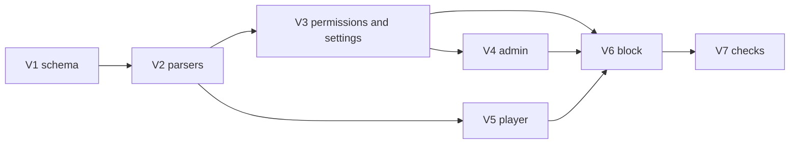

---

name: Video library widget
overview: URL-only video library split into small refs (V1-01 through V7-03). Name one ref to implement only that piece. YouTube, Vimeo, and direct MP4/WebM. No file uploads.
todos:
- id: V1-01
  content: Journal the existing page_views SQL so the video migration does not recreate it
  status: in_progress
- id: V1-02
  content: Add video_playlists, videos, video_progress, and site_settings.video_settings
  status: completed
- id: V1-03
  content: Generate the Drizzle migration and confirm it only adds video tables and video_settings
  status: in_progress
- id: V2-01
  content: parseVideoUrl for YouTube, Vimeo, and direct MP4/WebM
  status: completed
- id: V2-02
  content: buildEmbed allowlisted iframe src from a parsed id
  status: completed
- id: V2-03
  content: videoSettingsSchema and defaults
  status: completed
- id: V2-04
  content: clampProgress completion rule
  status: completed
- id: V2-05
  content: node:test for parsers, embed hosts, settings, and progress clamp, plus a test script
  status: completed
- id: V2-06
  content: Official oEmbed client for YouTube and Vimeo only
  status: completed
- id: V3-01
  content: videos.create, videos.edit, videos.publish, videos.delete in the permission matrix
  status: completed
- id: V3-02
  content: Audit target video
  status: completed
- id: V3-03
  content: Persist videoSettings in the site settings service and action
  status: completed
- id: V3-04
  content: Video library section on the settings form
  status: completed
- id: V4-01
  content: Dashboard video routes and sidebar item
  status: completed
- id: V4-02
  content: Playlist service and actions
  status: completed
- id: V4-03
  content: Playlist panel on the videos page
  status: completed
- id: V4-04
  content: Video create and update service with parser, provider flags, and oEmbed fill
  status: completed
- id: V4-05
  content: Publish, unpublish, soft-delete, and reorder actions
  status: completed
- id: V4-06
  content: Video list table
  status: completed
- id: V4-07
  content: Create and edit form with invalid-URL message
  status: completed
- id: V5-01
  content: Native player controls for direct MP4 and WebM
  status: completed
- id: V5-02
  content: YouTube and Vimeo iframe player with unavailable fallback
  status: completed
- id: V5-03
  content: Native-only seek restriction
  status: completed
- id: V5-04
  content: Video list with search, playlist filter, and load more
  status: completed
- id: V5-05
  content: Sidebar and stacked library layouts
  status: pending
- id: V5-06
  content: Admin preview dialog
  status: completed
- id: V6-01
  content: Published-video query for the block, including catalog mode and viewer access
  status: pending
- id: V6-02
  content: Register the VideoLibrary Puck block
  status: pending
- id: V6-03
  content: saveVideoProgress that no-ops for anonymous visitors and clamps on the server
  status: pending
- id: V6-04
  content: Resume start position for native, YouTube, and Vimeo
  status: pending
- id: V6-05
  content: Wire progress into the widget when the setting is on
  status: pending
- id: V7-01
  content: Permission matrix test for the four video keys
  status: pending
- id: V7-02
  content: Lint and tsc on the touched files
  status: pending
- id: V7-03
  content: Browser check of the admin form and the public widget
  status: pending
  isProject: false

---

# Video Library — small refs

Name one ref (for example **V2-01**) to implement only that piece. Do not start a later ref until the ones it depends on are done.

Videos are URL records only. Do not add file uploads, video hosting, or a media storage system. Do not add a YouTube Data API key. There is no learner enrollment table: `authenticated` means a CMS session, and `playlist-only` means the widget lists playlist videos only.

## Decisions

- Admin module under `src/app/(admin)/dashboard/(shell)/videos/`, same shape as pages and posts.
- Public UI is a Puck block `VideoLibrary`, same idea as `BlogPosts` in [src/builder/config.tsx](src/builder/config.tsx). Selecting a video swaps the player without a route change.
- Settings are a `video_settings` jsonb column on `site_settings`, same pattern as `theme_tokens`. No second settings table.
- Providers: YouTube, Vimeo, direct `.mp4` / `.webm`. HTTPS only. Embed `src` is built from a parsed id and a fixed host allowlist (`www.youtube-nocookie.com`, `player.vimeo.com`).
- Seek lock applies only to native `<video>`. YouTube and Vimeo keep their own controls. Progress for embeds depends on their player scripts.
- YouTube posters use `https://i.ytimg.com/vi/{id}/hqdefault.jpg`. oEmbed calls only `www.youtube.com/oembed` and `vimeo.com/api/oembed.json`. Direct files are never fetched on the server. YouTube duration stays a manual field.

## V1 — Schema

- **V1-01** Journal [src/db/migrations/20261022070000_page_views.sql](src/db/migrations/20261022070000_page_views.sql). It is in the Drizzle schema and not in `meta/_journal.json`. Do not change that SQL. Do this before generating the video migration so `page_views` is not created twice.
- **V1-02** Add [src/db/schemas/videos.schema.ts](src/db/schemas/videos.schema.ts) and export it from [src/db/schema.ts](src/db/schema.ts). Reuse `baseColumns` and user FKs.
  - `video_playlists`: name, description, slug, `created_by`, timestamps, `deleted_at`. Unique slug where `deleted_at` is null.
  - `videos`: title, description, `source_url`, provider (`youtube` | `vimeo` | `direct`), `provider_video_id`, `thumbnail_url`, `duration_seconds`, `playlist_id` (set null), `display_order`, status (`draft` | `published`), `created_by`, `updated_by`, timestamps, `deleted_at`. Indexes on `(playlist_id, display_order)` and `status`.
  - `video_progress`: unique `(user_id, video_id)`, `position_seconds`, `max_position_seconds`, `completed`, `last_watched_at`. Cascade on user and video.
  - `site_settings.video_settings` jsonb in [src/db/schemas/pages.schema.ts](src/db/schemas/pages.schema.ts), with a typed default.
- **V1-03** Run `npm run db:generate`. The new SQL should add the video tables and `video_settings` only. Depends on V1-01 and V1-02.

## V2 — Parsers and rules

No UI. No new npm packages.

- **V2-01** `parseVideoUrl` in [src/lib/video/parse-video-url.ts](src/lib/video/parse-video-url.ts). Accept YouTube `watch`, `youtu.be`, `/embed/`, `/shorts/`, and `youtube-nocookie`; Vimeo `vimeo.com/{id}` and `player.vimeo.com/video/{id}`; direct https paths ending in `.mp4` or `.webm`. Reject `http`, `javascript:`, `data:`, credentials in the URL, localhost, and private IPs. Optional direct-host allowlist; empty means any public https host. Return a clear error string for anything else.
- **V2-02** `buildEmbed` in [src/lib/video/embed.ts](src/lib/video/embed.ts). YouTube `https://www.youtube-nocookie.com/embed/{id}`. Vimeo `https://player.vimeo.com/video/{id}`. Direct playback URL is the normalized https URL. Never accept a raw iframe or HTML string.
- **V2-03** `videoSettingsSchema` and defaults in [src/lib/video/settings.ts](src/lib/video/settings.ts). Fields: enabled, title, description, layout (`sidebar` | `stacked`), default playlist id, thumbnails, descriptions, page size, provider toggles, direct host allowlist, progress, resume, muted autoplay, native playback speed, completion percent (default 90), native seek restriction, catalog mode (`all-published` | `playlist-only`), viewer access (`public` | `authenticated`), prefer captions.
- **V2-04** `clampProgress` in [src/lib/video/progress.ts](src/lib/video/progress.ts). Clamp position to `0..duration` when duration is known, otherwise to 24 hours. Set `completed` only when duration is known and position reaches the configured percent. Ignore a client completed flag.
- **V2-05** `node:test` via `tsx` for V2-01 through V2-04. Add a `test` script in [package.json](package.json). Depends on V2-01, V2-02, V2-03, and V2-04.
- **V2-06** oEmbed helper in [src/lib/video/oembed.ts](src/lib/video/oembed.ts). Fetch only the two official endpoints, `redirect: 'manual'`, short timeout. Fill title, thumbnail, and duration when the body includes them. YouTube oEmbed has no duration. Do not fetch direct video URLs. Depends on V2-01.

## V3 — Permissions and settings

- **V3-01** Add `videos.create`, `videos.edit`, `videos.publish`, and `videos.delete` to [src/config/permissions.ts](src/config/permissions.ts). Create and edit: Admin, Editor, Author. Publish and delete: Admin, Editor. Existing `ensureRolesSeeded` inserts new rows.
- **V3-02** Add audit target `video` in [src/server/services/audit.service.ts](src/server/services/audit.service.ts).
- **V3-03** Read and write `videoSettings` in [src/server/services/site-settings.service.ts](src/server/services/site-settings.service.ts) and [settings.actions.ts](src/app/(admin)/dashboard/(shell)/settings/_modules/settings.actions.ts). Validate with `videoSettingsSchema`. Depends on V1-02, V2-03, and V3-01 (`settings.manage` still gates the settings page).
- **V3-04** Video library section on [settings-form.tsx](src/app/(admin)/dashboard/(shell)/settings/_components/settings-form.tsx): general, providers, viewing. Copy states that seek lock and speed hiding apply to direct files only. Depends on V3-03.

## V4 — Admin

Depends on V1-03, V2-01, V2-06, and V3-01 unless a ref says otherwise.

- **V4-01** Routes in [src/config/pages.ts](src/config/pages.ts) and a sidebar item in [src/menus/index.tsx](src/menus/index.tsx), visible with `videos.create` or `videos.edit`.
- **V4-02** Playlist service and actions: list, create, update, soft-delete. `permissionProcedure` plus `assertPermission`. Audit each mutation.
- **V4-03** Playlist panel on `/dashboard/videos` (name, description, slug). Depends on V4-01 and V4-02.
- **V4-04** Video create and update service. Parse the URL, reject disabled providers, optionally fill from oEmbed, keep title, description, thumbnail, and duration editable. Audit. Depends on V3-03 so provider toggles are stored.
- **V4-05** Publish, unpublish, soft-delete, and reorder by `display_order`. Publish and delete use the matching permission. Edit covers reorder.
- **V4-06** Video table: title, provider, playlist, status, order controls. Depends on V4-04 and V4-05.
- **V4-07** Create and edit form: URL, title, description, thumbnail URL, duration, playlist, order, status. Show the parser error for invalid URLs. Depends on V4-03 and V4-04.

## V5 — Player and list

Components under `src/components/video/`. Depends on V2-02.

- **V5-01** Native player for direct MP4/WebM: play/pause, volume/mute, fullscreen, previous/next, playback speed when enabled. Muted autoplay only. Accessible labels and visible focus.
- **V5-02** YouTube and Vimeo iframe with `title` set to the video title and a fixed `allow` list. Unavailable or disabled provider shows a fallback message, not a broken iframe. Captions stay inside the provider player; YouTube may set `cc_load_policy=1` when prefer-captions is on.
- **V5-03** When native seek restriction is on, block seeking past `max_position_seconds`. Do not apply this to iframes. Depends on V5-01.
- **V5-04** Video list: thumbnail, title, optional description and duration, selected / completed / unavailable states, search, playlist filter, load more, responsive layout.
- **V5-05** `sidebar` layout (list beside the player, stacked below `lg`) and `stacked` layout. Depends on V5-01, V5-02, and V5-04.
- **V5-06** Admin preview dialog using the same player, including drafts. Depends on V4-07 and V5-05.

## V6 — Public block and progress

- **V6-01** Server query of published videos: widget disabled, `playlist-only`, `authenticated` (valid session, any role), default playlist, page size. Anonymous users get a sign-in message when access is authenticated. Depends on V3-03 and V4-04.
- **V6-02** Register `VideoLibrary` in [src/builder/config.tsx](src/builder/config.tsx) and [src/builder/blocks/registry.ts](src/builder/blocks/registry.ts), category `content`. Fields: title, description, layout, playlist override. `resolveData` uses V6-01. Disabled widget renders nothing on the public site and a short placeholder in the editor. Depends on V5-05 and V6-01.
- **V6-03** `saveVideoProgress` reads the session and returns without saving when nobody is signed in or progress is off. Do not use `protectedProcedure` (it redirects anonymous visitors). Clamp with V2-04. Depends on V1-02 and V2-04.
- **V6-04** Resume: native `currentTime`, YouTube `start`, Vimeo start hash. Load `youtube.com/iframe_api` and `player.vimeo.com/api/player.js` only when progress or resume needs them. Depends on V5-02 and V6-03.
- **V6-05** Widget reports position while playing and shows completed state from saved progress. Depends on V6-02 and V6-04.

## V7 — Checks

- **V7-01** Test that the four video permission keys exist and match the role matrix in V3-01. Depends on V2-05 and V3-01.
- **V7-02** `npm run lint` and `tsc --noEmit` on the touched files. Fix issues introduced by these refs.
- **V7-03** Browser: add a supported URL, see a validation error for a bad URL, publish, place the block, select a video without a full page change. Check desktop and a narrow viewport. Depends on V5-06 and V6-05.

## Provider limits (do not hide these in the UI)

- YouTube duration needs an API key. This plan does not add one.
- Seek lock, download blocking, and guaranteed completion apply only to direct `<video>` playback.
- Embed progress fails if the provider script is blocked or the owner disallows embedding.
- Disabling a provider rejects new URLs. Saved rows for that provider render the unavailable state.
